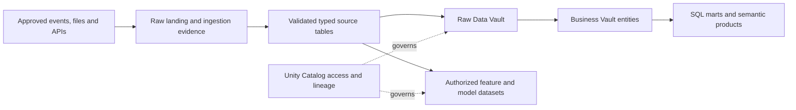

# Databricks Data Platform Blueprint

**Bring event engineering, SQL reporting, and data-science workflows onto a governed lakehouse with explicit cost and table ownership.**

This Databricks data platform blueprint covers a governed engineering and analytics lakehouse: source ingestion, Flow.BI modeling, FCT and TurboVault generation, datavault4dbt/dbt execution, DataHub catalog integration and user-authored Business Vault rules. Use its architecture, operating checks and cost model to plan a tested implementation.
Audience: data engineering, ML/AI teams, analytics engineers, platform security, operations, and FinOps. Updated: 5 November 2026.

## From source event to a governed Databricks data product

The databricks stack has four connected responsibilities:

- [Fivetran](https://fivetran.com/docs/getting-started) is the commercial managed ingestion service for supported source-to-destination replication. For databricks, it loads approved feeds into a controlled staging area; source connector coverage, historical depth, deletion semantics, and sync evidence are verified in the pilot. [Flow.BI](https://flow.bi/) analyzes source values and relationships to generate the logical Data Vault structure. The modeling input includes source event, Delta table, and catalog object; actual data is required, while available source metadata improves the result.
- For the databricks model, [FCT](https://www.scalefree.com/consulting/turbovault/flowbi-connector/) (Flow.BI Connector for TurboVault4dbt) connects the modeling service to the generator by retrieving and transforming Flow.BI output. [TurboVault](https://www.scalefree.com/consulting/turbovault/) translates Data Vault metadata into the dbt model layer. Review those generated artifacts before executing the databricks transformations; Studio is the online access option, requested through Scalefree.
- [datavault4dbt](https://github.com/ScalefreeCOM/datavault4dbt) supplies reusable loading logic for staging and the required Vault entity types. It contributes the technical history-loading foundation for source event, Delta table, and catalog object. [dbt](https://github.com/dbt-labs/dbt) compiles model SQL, resolves dependencies, runs transformations, and executes tests on the target. User-defined Business Vault models add event-derived relationships and business features within that workflow.
- [Databricks SQL and lakehouse tables](https://docs.databricks.com/aws/en/getting-started/architecture) is the reference target for this databricks architecture. Databricks supplies the engineering and SQL compute; governed lakehouse tables hold source history, Vault entities, and derived products. This separates the query/runtime role from the underlying object storage. Deploy Databricks in the approved Azure, AWS, or Google Cloud environment near the source data and operational skills. That cloud supplies the surrounding storage, network, identity, and customer profiling runtime. Size and operate these services against the databricks pilot rather than a generic platform benchmark.

[Scalefree](https://www.scalefree.com/) combines data-platform advisory, implementation delivery, automation tooling, and team training. For this blueprint, that support can include the databricks source-to-model design, implementation of event-derived relationships and business features, and training the team to maintain the resulting product.

[DataHub](https://docs.datahub.com/docs/ui-ingestion) is the metadata catalog for this databricks stack. It joins asset discovery, business definitions, ownership, and lineage so teams can trace source event and understand the derived rules for event-derived relationships and business features.

## Use the lakehouse where mixed workloads justify it

Choose Databricks when the platform must combine substantial event/file processing, engineering transformations, SQL consumption, and model-development workflows. The value proposition depends on reducing duplicate pipelines and operating effort across those workloads. A modest SQL reporting product may have a simpler alternative.

Deploy on Azure, AWS, or Google Cloud near the main data and cloud skills. Verify feature, networking, identity, compute, and regional availability for the chosen deployment rather than assuming complete parity. Use [Databricks architecture guidance](https://docs.databricks.com/aws/en/getting-started/architecture) as the platform reference.

## Map quality layers and Data Vault responsibilities

Medallion layers describe stages of data quality; Raw and Business Vault layers describe integration and business semantics. Document their mapping explicitly. Do not maintain two redundant copies merely to satisfy both naming schemes.

Assign a writer, schema contract, refresh method, and maintenance owner to each table. Where supported and appropriate, use Delta tables with a documented lifecycle. Validate how external readers, retention, and exports work before choosing an interoperability route.

Flow.BI profiles authorized actual data through its customer-cloud Docker component; available source metadata improves generation. Send output through FCT and TurboVault, review the generated dbt models, and run datavault4dbt/dbt against the tested Databricks target. User-authored Business Vault models remain separate from generated artifacts.

## Preserve event correctness across replay

Select a supported ingestion route for each source. Fivetran handles validated API/database/file paths; dedicated streaming acquisition may be needed for event transport and buffering. Preserve source event IDs, event time, receipt time, batch/offset evidence, schema version, and correction references.

A watermark or checkpoint is operating state that needs recovery. Define duplicate handling, late-arrival behavior, retention, and the authority to replay historical inputs. An apparently successful replay is not sufficient if it changes published historical totals unexpectedly.

Avoid uncontrolled simultaneous writes from notebooks, jobs, and SQL models. Separate exploratory notebooks from production pipelines. Version runtime dependencies, generated artifacts, tested SQL, and business logic together.

## Governance spans engineering and model use

Use [Unity Catalog](https://docs.databricks.com/aws/en/data-governance/unity-catalog/) to organize catalog/schema/object access and lineage. Define service principals, storage locations, approved data access, and distinct environments. Table permissions alone do not authorize reusing sensitive data for model training.

Track feature definitions, training cohorts, model artifacts, evaluation evidence, and serving permissions for AI products. If the project is only reporting, avoid adding a model-serving estate without a workload requirement.

## Cost test: completed work and freshness

Measure ingestion, scheduled jobs, SQL serving, interactive development, and model-related compute separately. Account for platform units, underlying infrastructure where billed separately, storage, network, maintenance, retries, and retained environments. Inspect usage with [Databricks usage dashboards](https://docs.databricks.com/aws/en/admin/account-settings/usage) and billing attribution.

Compare job/serverless/SQL execution options supported for the workload. Include cold starts, queueing, and idle time. A continuous freshness target can cost more than a periodic batch; justify it with the decision that benefits from faster data.

The pilot should include production-like event volume, one late-event case, a correction/replay, a Data Vault load, a Business Vault measure, and concurrent serving. Report cost per million accepted events and per published product refresh, together with latency and correctness.

## Operating acceptance and exit

Accept only after checkpoint recovery, table restoration, access isolation, version migration, and replay are demonstrated. Assign ownership for layout/compaction and retention maintenance where required by the selected configuration. Measure the cost of pipeline and runtime upgrades.

Maintain an export and catalog/table metadata recovery plan. Portability of files does not automatically reproduce permissions, scheduled jobs, model artifacts, or semantics. Train operators on the job system, catalog, event failure modes, query profiles, and billing data alongside the courses below.

## Managed ingestion for this platform

**Primary ingestion: Fivetran (commercial managed service).** Use a documented source/destination connection into staging for the selected platform. Verify the exact connector, historical/CDC behavior, delete capture, schema evolution, permissions, processing region, sync monitoring and recovery. Keep generated Vault models on separately owned target tables. Include the commercial plan, connector workload, destination loading and replay behavior in TCO; the [destination reference](https://fivetran.com/docs/destinations) and [pricing definitions](https://fivetran.com/docs/core-concepts/usage-based-pricing) govern the selected configuration.

## Metadata stewardship in the databricks stack

[DataHub](https://docs.datahub.com/docs/ui-ingestion) is the metadata catalog for this databricks stack. It joins asset discovery, business definitions, ownership, and lineage so teams can trace source event and understand the derived rules for event-derived relationships and business features.

For this product, register **source event, Delta table, catalog object, processing run, and product** as governed concepts linked to real assets. Describe **event-derived relationships and business features** with an owner, calculation/rule version, eligible population, cutoff, and known limitations. Publish only the metadata fields that the catalog users are authorized to see.

### Deployment and processing boundary

Use DataHub Core in a customer-managed environment as the reference open-source catalog, or choose DataHub Cloud under an explicit service agreement. Budget catalog infrastructure/search, upgrades, credentials, metadata collection, and stewardship; a managed catalog adds its subscription and provider dependencies. This catalog complements the database's native access controls and, where present, Unity Catalog or a table-format metastore.

### Connect execution evidence to meaning

Collect [dbt artifacts and target-warehouse metadata](https://docs.datahub.com/docs/generated/ingestion/sources/dbt) together so model nodes resolve to the actual tables/views. Select supported warehouse/BI sources and validate the specific Fabric or Cloudberry route where relevant. For Fivetran-led ingestion, assess the [DataHub Fivetran source](https://docs.datahub.com/docs/generated/ingestion/sources/fivetran) for connector metadata/lineage coverage. Use explicit API-emitted lineage for unrepresented steps rather than assuming the full source-to-report path is automatic.

dbt remains the execution/test layer; DataHub collects the supported metadata and quality results. Test which table/column lineage, test status, and deletion behavior are captured by the actual sources and artifact versions.

Catalog acceptance follows the databricks pilot: trace an approved source field through a generated model and Business Vault extension to a published metric, then test a schema change, a stale scan, and a permission revocation. Mask sample values and sensitive SQL/descriptions where required. Track scan coverage and unresolved lineage gaps explicitly.

## Training and knowledge transfer

Make capability development a delivery workstream with practical acceptance criteria.

| Track | Training resource | Participants | Proposed project outcome |
| --- | --- | --- | --- |
| DV — Data Vault | [Data Vault Training & Certification](https://www.scalefree.com/data-vault-2-1-trainings/data-vault-training-certification/) and [Modeling Class](https://www.scalefree.com/data-vault-2-1-trainings/data-vault-2-1-modeling-class/) | Architects, modelers, engineering leads; selected stewards for shared concepts. | Understand generated Raw Vault structures and design additional Business Vault entities with the correct keys, grain, and history. |
| DWA — Data Warehouse Automation | [Scalefree dbt training: DataVault4dbt and TurboVault automation blocks](https://www.scalefree.com/training/dbt-training/) | Modelers, engineers, and release owners. | Operate the Flow.BI–FCT–TurboVault workflow, review generated models before datavault4dbt/dbt execution, and regenerate without overwriting user-authored Business Vault entities. |
| dbt | [Scalefree dbt Training](https://www.scalefree.com/training/dbt-training/) | Data engineers, analytics engineers, and operators. | Build and test models, use packages/macros, debug failures, and promote releases through controlled environments. |
| Flow.BI foundations | [Flow.BI Introduction](https://flow.bi/trainings/flow-bi-introduction/) | Business analysts, domain stewards, architects, project leads, and engineers. | Understand the interface, data sources, deployment targets, and first model-generation run. |
| Flow.BI configuration and operations | [Flow.BI In-Depth](https://flow.bi/trainings/flow-bi-in-depth/) | Engineers, architects, and platform operators. | Configure classification, permissions, API access, and integration settings for the organization environment. |
| Understanding generated models | [Generated Data Vault Models](https://flow.bi/trainings/generated-data-vault-2-0-models/) | Data modelers, engineers, and architects. | Interpret generated structures and their downstream physical implementation; apply this knowledge to the review after TurboVault and to Business Vault extensions. |
| Flow.BI metadata presentation | [Presenting Flow.BI Metadata — training catalog](https://flow.bi/trainings/) | Modelers, analysts, and metadata/catalog owners. | Use Flow.BI dashboards to present internal metadata to authorized users. |
| Catalog stewardship | [DataHub documentation](https://docs.datahub.com/docs/ui-ingestion) | Data owners, stewards, catalog operators, and engineers. | Document source event, approve definitions, trace model lineage, and operate metadata scans and access. |

**Terminology:** DWA means Data Warehouse Automation. The DWA training track uses Scalefree's published automation learning blocks. DVA refers exclusively to the Data Vault Alliance.

The Data Vault certification training covers Data Vault 2.1. Align the curriculum with the selected tool versions and implementation patterns. Its dbt offering is customizable; agree the agenda and prerequisites before booking.
Flow.BI In-Depth requires Flow.BI Introduction and general data-architecture knowledge. Generated Data Vault Models requires Flow.BI Introduction and Data Vault modeling knowledge. Use the [Flow.BI training catalog](https://flow.bi/trainings/) to select classes or a bundle and confirm current delivery details.

Recommended sequence:

1. Run DV foundations and modeling to understand the generated Raw Vault and design Business Vault extensions.
2. Complete Flow.BI Introduction before connecting the pilot sources; follow with In-Depth for the configuration and operations team and Generated Data Vault Models for modelers and engineers.
3. Run dbt fundamentals before building the first transformation pipeline.
4. Run DWA practical sessions when the first Flow.BI output is available for direct processing through FCT and TurboVault. Include metadata presentation training for the team publishing model documentation.
5. Complete an organization-led lab using synthetic datasets for the selected industry workflow: Fivetran ingestion, Flow.BI generation, direct FCT transfer, TurboVault generation, generated-model review, datavault4dbt/dbt execution, user-added Business Vault entities, and industry-specific reconciliation.
6. Require at least two internal operators to deploy, troubleshoot, restore, and explain the pipeline without external assistance.

Budget training, preparation time, labs, and follow-up coaching separately from software and hosting. Use the [current training catalog](https://www.scalefree.com/training/) for available formats and scheduling.

## Scalefree implementation resources

The following articles complement the product documentation and training. Read the Flow.BI/FCT integration overview first, then TurboVault generation, datavault4dbt staging and loading, and finally Business Vault extensions and deployment practices.

| Tool or topic | Scalefree blog resource | Application to this blueprint |
| --- | --- | --- |
| Flow.BI, FCT, TurboVault, and datavault4dbt | [Flow.BI: Generating the Raw Data Vault Using AI and dbt](https://www.scalefree.com/blog/modeling/flow-bi-generating-the-raw-data-vault-using-ai-and-dbt/) | Explains the logical-to-physical automation chain and connector, and the addition of business logic in the Business Vault. Pair it with the [FCT access page](https://www.scalefree.com/consulting/turbovault/flowbi-connector/) for onboarding. |
| TurboVault | [Speed Up Your Data Vault 2.0 Implementation with TurboVault4dbt](https://www.scalefree.com/blog/tools/speed-up-your-data-vault-2-0-implementation-with-turbovault4dbt/) | Introduces metadata-driven dbt model generation. Use it to understand the generation stage before the review phase. |
| datavault4dbt overview | [Kick-Start Your Data Vault 2.0 Implementation with datavault4dbt](https://www.scalefree.com/blog/tools/kick-start-your-data-vault-2-0-implementation-with-datavault4dbt/) | Introduces loading templates and the package's role within dbt. Useful background before the hands-on training. |
| datavault4dbt staging | [Exploring datavault4dbt — Vol. 1: The Staging Layer](https://www.scalefree.com/blog/tools/exploring-datavault4dbt-a-practical-series-on-the-dbt-package-for-data-vault-2-0-vol-1-the-staging-layer/) | Covers staging configuration, hashing, derived columns, and prejoins. Apply these concepts when connecting the Fivetran landing datasets to generated transformations. |
| datavault4dbt Raw Vault | [Exploring datavault4dbt — Vol. 2: Standard Entities in the Raw Vault](https://www.scalefree.com/blog/datenwerkzeuge/exploring-datavault4dbt-a-practical-series-on-the-dbt-package-for-data-vault-2-0-vol-2-standard-entities-in-the-raw-vault/) | Walks through hubs, links, and satellites. Use it to interpret the models produced by TurboVault and their macro parameters. |
| Business Vault extensions | [Designing the Business Vault: Key Strategies for Effective Data Organization](https://www.scalefree.com/blog/data-vault/designing-the-business-vault-key-strategies-for-effective-data-organization/) | Explains reusable business logic and additional entities such as computed satellites, links, PITs, and bridges. Relevant to user-defined organization extensions after Raw Vault generation. |
| dbt delivery and testing | [CI/CD: Practical Insights into Automating Data Vault 2.0 with dbt](https://www.scalefree.com/blog/data-vault/ci-cd-practical-insights-into-automating-data-vault-2-0-with-dbt/) | Uses datavault4dbt and GitHub Actions to illustrate testing and delivery automation. Adapt execution and runner placement to the organization's cloud boundary. |
| PostgreSQL workload assessment | [Architectural Limitations of PostgreSQL for Enterprise Data Vault Workloads](https://www.scalefree.com/blog/data-vault/architectural-limitations-of-postgresql-for-enterprise-data-vault-workloads/) | Explains why a bounded PostgreSQL pilot is not a large-scale Data Vault recommendation. Compare the selected platform with Cloudberry MPP and its per-table row/column storage where an open relational warehouse is required. |
| Sovereignty, Iceberg, and Trino | [The Sovereign Data Platform: The Path to Data Ownership and Secure AI](https://www.scalefree.com/blog/architecture/the-sovereign-data-platform-the-path-to-data-ownership-and-secure-ai/) | Discusses controlled object storage, open table formats, and replaceable query engines, including Trino. Supports the portability and storage/compute separation principles. |

Examples in older articles may use earlier package versions, metadata layouts, or specific cloud databases. Use the pinned tool versions and current documentation for implementation details. For Fivetran ingestion and Trino/Iceberg configuration, use the primary documentation already linked in the platform and ingestion guidance in this document alongside these architectural resources. Browse the [Scalefree blog](https://www.scalefree.com/blog/) for further articles.

## Flow.BI implementation resources

Use the [Flow.BI blog](https://flow.bi/blog/) for ongoing product architecture and implementation material. Relevant starting points:

| Resource | Why it matters to this blueprint |
| --- | --- |
| [How Flow.BI Protects Sensitive Enterprise Data](https://flow.bi/blog/how-flow-bi-protects-sensitive-enterprise-data/) | Explains required data profiling, the local Docker image, storage access, and the local/backend processing boundary. |
| [Seeing Every Step: Data Lineage Inside Flow.BI](https://flow.bi/blog/seeing-every-step-data-lineage-inside-flow-bi/) | Describes source-to-model traceability and graph views. Use this model lineage alongside Fivetran load evidence and dbt execution lineage. |
| [Turning Salesforce and Pardot Tables Into a Semantic Model](https://flow.bi/blog/turning-salesforce-and-pardot-tables-into-a-semantic-model/) | Illustrates concept recognition and declared versus inferred relationships using CRM data. Use it as background on model generation; organization-specific additions in this blueprint are implemented through Business Vault entities. |
| [Generative AI for Data Vault](https://flow.bi/ai-driven-business/) | Explains the progression from data profiling to a logical Data Vault model and downstream physical-model automation. |
| [Flow.BI Media Library](https://flow.bi/media/) | Includes local-processing, bring-your-own-bucket, modeling, and dbt integration sessions for team onboarding. |

## Databricks Data Vault architecture questions

### How does Databricks fit the Data Vault automation stack?

Databricks supplies the selected database and analytical execution environment. Flow.BI models required source data; FCT transfers its output to TurboVault. Review generated models before datavault4dbt/dbt runs, then maintain business logic in additional Business Vault entities. Pin the database, connector, adapter and macro versions and verify their actual behavior.

### What should be tested before adopting Databricks?

Prove the platform-specific workload: **a governed engineering and analytics lakehouse**. Retain key/hash stability, history reconstruction, late-correction handling, access revocation and recovery evidence. Include DataHub metadata coverage, runtime and storage costs, staff effort and the exit route; benchmark the physical design with representative data and concurrent consumers.

## Related blueprints

- [Snowflake Data Vault architecture](../snowflake/snowflake-data-platform-blueprint.md)
- [Microsoft Fabric Data Vault architecture](../microsoft-fabric/microsoft-fabric-data-platform-blueprint.md)
- [Google BigQuery Data Vault architecture](../google-bigquery/google-bigquery-data-platform-blueprint.md)
- [Apache Cloudberry Data Vault architecture](../apache-cloudberry/apache-cloudberry-data-platform-blueprint.md)
- [All industry and technology blueprints](../../README.md)

## Next steps

Validate the [DataHub metadata integration](https://docs.datahub.com/docs/ui-ingestion) and include catalog deployment, licensing/operations, stewardship, and source-to-report lineage in the architecture discussion.

Use the [Fivetran getting-started and connector documentation](https://fivetran.com/docs/getting-started) to validate the proposed managed ingestion route before selecting a commercial plan.

Select the pilot described in this blueprint, name its business and technical owners, and bring representative source data, reporting definitions, workload volumes, and operating constraints to an architecture discussion.

| Step | Where to go | What to request or prepare |
| --- | --- | --- |
| Discuss the implementation | [Scalefree contact form](https://www.scalefree.com/about-scalefree/contact/) | Request a platform assessment, pilot workshop, implementation support, or tailored training. Include the blueprint title and the first data product. |
| Try automated modeling | [Flow.BI trial registration](https://flow.bi/sign-up-for-trial/) | Request a trial and local-processing Docker deployment instructions. Prepare authorized source data; available metadata improves the result. |
| Obtain the connector | [FCT access and download request](https://www.scalefree.com/consulting/turbovault/flowbi-connector/) | Request Flow.BI Connector for TurboVault4dbt access and verify the intended generator version. |
| Install the macro package | [datavault4dbt repository and releases](https://github.com/ScalefreeCOM/datavault4dbt) | Obtain the package, choose a supported target adapter, and pin a tested version. |
| Access the online generator | [Request TurboVault Studio signup through Scalefree](https://www.scalefree.com/about-scalefree/contact/) | Ask specifically for the new online TurboVault Studio and its Flow.BI/FCT integration route. |
| Obtain a downloadable generator | [TurboVault4dbt](https://github.com/ScalefreeCOM/turbovault4dbt) and [TurboVault Engine](https://github.com/ScalefreeCOM/turbovault-engine) | Select the edition that fits the integration and retain its version and configuration. |
| Receive implementation updates | [Scalefree newsletter registration](https://www.scalefree.com/) | Use the “Data Vault 2.GO / Build Better Data Platforms” newsletter form on the homepage. |

Complete the pilot's reconciliation, access, recovery, and cost checks before extending the source scope. Record the results and the decision to proceed in the project repository.

## License

Copyright © 2026 Scalefree International GmbH. The original text, tables, and diagrams in this blueprint are licensed under [CC BY-SA 4.0](https://creativecommons.org/licenses/by-sa/4.0/). Credit Scalefree, identify changes, and retain the applicable ShareAlike terms when distributing adaptations. See [LICENSE.md](../../LICENSE.md) for scope, attribution, and the governing legal code. Referenced software and third-party material retain their own licenses.
