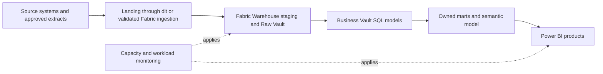

# Microsoft Fabric Data Platform Blueprint

**Connect ingestion, SQL modeling, and Power BI delivery through a managed analytics platform with accountable capacity.**

This Microsoft Fabric data platform blueprint covers integrated SQL-to-BI delivery: source ingestion, Flow.BI modeling, FCT and TurboVault generation, datavault4dbt/dbt execution, Dawiso catalog integration and user-authored Business Vault rules. Use its architecture, operating checks and cost model to plan a tested implementation.
Audience: Microsoft-oriented data teams, Power BI owners, SQL engineers, tenant administrators, and FinOps. Updated: 5 November 2026.

## The components behind Microsoft Fabric reporting

| Responsibility | Tools and contribution |
| --- | --- |
| Source intake and model discovery | [dlt](https://github.com/dlt-hub/dlt) (data load tool) is the ingestion library for supported API, database, and file feeds. In this microsoft fabric design, it brings approved source extracts, Warehouse tables, and Power BI products into controlled landing datasets with load evidence. [Flow.BI](https://flow.bi/) supplies the data-driven modeling stage that precedes physical model generation. The modeling input includes workspace, Warehouse model, and source batch; actual data is required, while available source metadata improves the result. |
| Connector and generation | For the microsoft fabric model, [FCT](https://www.scalefree.com/consulting/turbovault/flowbi-connector/) (Flow.BI Connector for TurboVault4dbt) handles the connector handoff from Flow.BI to the downstream model generator. [TurboVault](https://www.scalefree.com/consulting/turbovault/) generates the dbt models from that metadata. Review those generated artifacts before executing the microsoft fabric transformations; Studio is the online access option, requested through Scalefree. |
| Loading and business rules | [datavault4dbt](https://github.com/ScalefreeCOM/datavault4dbt) is the dbt macro package that implements standard Data Vault loading patterns. It contributes the technical history-loading foundation for workspace, Warehouse model, and source batch. [dbt](https://github.com/dbt-labs/dbt) provides the build-and-test workflow that executes the model dependencies on the database. User-defined Business Vault models add organization-specific SQL rules and semantic measures within that workflow. |
| Database and cloud | [Microsoft Fabric Warehouse](https://learn.microsoft.com/en-sg/fabric/fundamentals/decision-guide-lakehouse-warehouse) is the reference target for this microsoft fabric architecture. Microsoft Fabric is the managed analytics platform; its Warehouse is the SQL target for staging, Vault models, and marts in this design. Power BI supplies the reporting/semantic delivery path. Azure is the cloud ecosystem for the Fabric deployment and the customer-controlled source/profiling environment; tenant identity, networking, storage, capacity, and execution need explicit owners. Size and operate these services against the microsoft fabric pilot rather than a generic platform benchmark. |
| Delivery and capability | [Scalefree](https://www.scalefree.com/) provides data and AI consulting, Data Vault implementation, software integration, and training. For this blueprint, that support can include the microsoft fabric source-to-model design, implementation of organization-specific SQL rules and semantic measures, and training the team to maintain the resulting product. |

[Dawiso](https://www.dawiso.com/product/data-catalog) adds the business glossary, asset discovery, ownership, and lineage context for microsoft fabric. It connects the meaning of workspace and the rules for organization-specific SQL rules and semantic measures to the implemented datasets.

## Make the operating-model decision first

Fabric is a starting point when existing Microsoft identity, SQL skills, and Power BI delivery can support a more unified analytics operating model. The business case is fewer integration handoffs and faster governed reporting. Confirm the actual license and capacity requirements rather than assuming existing Microsoft 365 subscriptions cover the platform.

Select the appropriate Fabric item for each workload. The [Warehouse/Lakehouse decision guide](https://learn.microsoft.com/en-sg/fabric/fundamentals/decision-guide-lakehouse-warehouse) helps distinguish SQL warehouse work from file/Spark-oriented engineering. For this Data Vault pattern, start with a tested Warehouse target and make any Lakehouse path an explicit alternative.

## Keep the storage item and execution endpoint explicit

Define tenant, capacity, workspace, item, environment, and ownership boundaries. A workspace name is not a complete security design. Validate access through SQL, reports, exports, service principals, and underlying data paths.

Run dlt through a supported destination/staging path. If landing data begins in OneLake/Lakehouse, establish how it becomes available to the chosen Warehouse models. Do not assume every SQL endpoint provides identical write capabilities or works with the same adapter.

Use the documented [Microsoft dbt-fabric adapter](https://github.com/microsoft/dbt-fabric) for its supported Warehouse target and a compatible dbt/datavault4dbt version. Keep adapter, execution endpoint, and generated SQL version in the release record. A Lakehouse adapter route needs its own validation.

## Automate models and own the reporting semantics

Flow.BI requires actual source data and benefits from available metadata. Its local Docker profiler runs in the customer cloud with an approved outbound metadata/fingerprint connection. Flow.BI → FCT → TurboVault is followed by generated-model review, then datavault4dbt/dbt execution.

Users add Business Vault entities for organization-specific rules and produce marts with stable grains. The Power BI semantic model defines report measures and relationships; verify whether a calculation belongs there or in a reusable Business Vault/mart. Avoid implementing the same metric differently in multiple layers.

Separate schema/model deployment from data-refresh responsibilities. Choose one owner for each target, record dependencies, and test changes against both SQL consumers and reports.

## Capacity is part of the product design

A shared capacity can pool resources, but simultaneous engineering, transformation, and reporting loads can interfere. Use the [Fabric data-store guidance](https://learn.microsoft.com/en-us/fabric/get-started/decision-guide-data-store) and a current commercial quote to build the bill of materials.

Measure normal refresh, peak dashboard use, backfill, and development workloads together. Include capacity cost, storage, applicable user/BI licenses, orchestration, network, security/governance additions, and staffing. Treat cost allocations to domains as management accounting with a declared method.

The pilot must include the report's real concurrency and refresh schedule. Compare sustained capacity utilization and service quality with the alternative of isolating workloads or using a different serving platform. A low-utilization capacity can undermine the savings expected from consolidation.

## Delivery, recovery, and exit evidence

Start with one domain and one semantic product. Reconcile source totals, preserve late corrections, and test a business-rule revision. Show that regeneration keeps Business Vault customizations and that a report refresh cannot silently publish an incomplete load.

Test item/data restoration, credential replacement, capacity-related interruptions, deployment rollback, and export to an independent analytical environment. Capture what is portable as files/SQL and what needs conversion, including semantic models and platform orchestration.

Train the team on Warehouse versus Lakehouse behavior, capacity operations, workspace permissions, semantic modeling, and deployment practices alongside the Data Vault and Flow.BI courses below. Expand when measured delivery time and total operating cost justify it.

## Catalog ownership and lineage with Dawiso

[Dawiso](https://www.dawiso.com/product/data-catalog) adds the business glossary, asset discovery, ownership, and lineage context for microsoft fabric. It connects the meaning of workspace and the rules for organization-specific SQL rules and semantic measures to the implemented datasets.

For this product, register **workspace, Warehouse model, source batch, mart, and semantic product** as governed concepts linked to real assets. Describe **organization-specific SQL rules and semantic measures** with an owner, calculation/rule version, eligible population, cutoff, and known limitations. Publish only the metadata fields that the catalog users are authorized to see.

### Deployment and processing boundary

Use [Dawiso's deployment and integration options](https://www.dawiso.com/product/enterprise-deployment-built-for-flexibility-and-security) to select the supported catalog location and network path. Record the edition, contributor/viewer licensing, metadata scanning scope, and operating owner. For Cloudberry, validate the PostgreSQL/Greenplum-compatible scan or a governed metadata import rather than assuming a separately named native connector.

### Connect execution evidence to meaning

Discover the selected database/BI assets using the [supported connectors](https://www.dawiso.com/connectors) and validate dbt/generated-model metadata exchange for the chosen version. Define a controlled import/API mapping for gaps; do not assume a direct Flow.BI or FCT catalog connector. Keep the modeling service's generated metadata distinct from the catalog's approved business glossary.

dbt executes transformation tests; Dawiso records the associated definitions, owners, evidence links, and quality context. Select and validate the integration that publishes results; the catalog does not replace the test engine.

Catalog acceptance follows the microsoft fabric pilot: trace an approved source field through a generated model and Business Vault extension to a published metric, then test a schema change, a stale scan, and a permission revocation. Mask sample values and sensitive SQL/descriptions where required. Track scan coverage and unresolved lineage gaps explicitly.

## Training and knowledge transfer

Make capability development a delivery workstream with practical acceptance criteria.

| Track | Training resource | Participants | Proposed project outcome |
| --- | --- | --- | --- |
| DV — Data Vault | [Data Vault Training & Certification](https://www.scalefree.com/data-vault-2-1-trainings/data-vault-training-certification/) and [Modeling Class](https://www.scalefree.com/data-vault-2-1-trainings/data-vault-2-1-modeling-class/) | Architects, modelers, engineering leads; selected stewards for shared concepts. | Understand generated Raw Vault structures and design additional Business Vault entities with the correct keys, grain, and history. |
| DWA — Data Warehouse Automation | [Scalefree dbt training: DataVault4dbt and TurboVault automation blocks](https://www.scalefree.com/training/dbt-training/) | Modelers, engineers, and release owners. | Operate the Flow.BI–FCT–TurboVault workflow, review generated models before datavault4dbt/dbt execution, and regenerate without overwriting user-authored Business Vault entities. |
| dbt | [Scalefree dbt Training](https://www.scalefree.com/training/dbt-training/) | Data engineers, analytics engineers, and operators. | Build and test models, use packages/macros, debug failures, and promote releases through controlled environments. |
| Flow.BI foundations | [Flow.BI Introduction](https://flow.bi/trainings/flow-bi-introduction/) | Business analysts, domain stewards, architects, project leads, and engineers. | Understand the interface, data sources, deployment targets, and first model-generation run. |
| Flow.BI configuration and operations | [Flow.BI In-Depth](https://flow.bi/trainings/flow-bi-in-depth/) | Engineers, architects, and platform operators. | Configure classification, permissions, API access, and integration settings for the organization environment. |
| Understanding generated models | [Generated Data Vault Models](https://flow.bi/trainings/generated-data-vault-2-0-models/) | Data modelers, engineers, and architects. | Interpret generated structures and their downstream physical implementation; apply this knowledge to the review after TurboVault and to Business Vault extensions. |
| Flow.BI metadata presentation | [Presenting Flow.BI Metadata — training catalog](https://flow.bi/trainings/) | Modelers, analysts, and metadata/catalog owners. | Use Flow.BI dashboards to present internal metadata to authorized users. |
| Catalog stewardship | [Dawiso documentation](https://www.dawiso.com/product/data-catalog) | Data owners, stewards, catalog operators, and engineers. | Document workspace, approve definitions, trace model lineage, and operate metadata scans and access. |

**Terminology:** DWA means Data Warehouse Automation. The DWA training track uses Scalefree's published automation learning blocks. DVA refers exclusively to the Data Vault Alliance.

The Data Vault certification training covers Data Vault 2.1. Align the curriculum with the selected tool versions and implementation patterns. Its dbt offering is customizable; agree the agenda and prerequisites before booking.
Flow.BI In-Depth requires Flow.BI Introduction and general data-architecture knowledge. Generated Data Vault Models requires Flow.BI Introduction and Data Vault modeling knowledge. Use the [Flow.BI training catalog](https://flow.bi/trainings/) to select classes or a bundle and confirm current delivery details.

Recommended sequence:

1. Run DV foundations and modeling to understand the generated Raw Vault and design Business Vault extensions.
2. Complete Flow.BI Introduction before connecting the pilot sources; follow with In-Depth for the configuration and operations team and Generated Data Vault Models for modelers and engineers.
3. Run dbt fundamentals before building the first transformation pipeline.
4. Run DWA practical sessions when the first Flow.BI output is available for direct processing through FCT and TurboVault. Include metadata presentation training for the team publishing model documentation.
5. Complete an organization-led lab using synthetic datasets for the selected industry workflow: dlt ingestion, Flow.BI generation, direct FCT transfer, TurboVault generation, generated-model review, datavault4dbt/dbt execution, user-added Business Vault entities, and industry-specific reconciliation.
6. Require at least two internal operators to deploy, troubleshoot, restore, and explain the pipeline without external assistance.

Budget training, preparation time, labs, and follow-up coaching separately from software and hosting. Use the [current training catalog](https://www.scalefree.com/training/) for available formats and scheduling.

## Scalefree implementation resources

The following articles complement the product documentation and training. Read the Flow.BI/FCT integration overview first, then TurboVault generation, datavault4dbt staging and loading, and finally Business Vault extensions and deployment practices.

| Tool or topic | Scalefree blog resource | Application to this blueprint |
| --- | --- | --- |
| Flow.BI, FCT, TurboVault, and datavault4dbt | [Flow.BI: Generating the Raw Data Vault Using AI and dbt](https://www.scalefree.com/blog/modeling/flow-bi-generating-the-raw-data-vault-using-ai-and-dbt/) | Explains the logical-to-physical automation chain and connector, and the addition of business logic in the Business Vault. Pair it with the [FCT access page](https://www.scalefree.com/consulting/turbovault/flowbi-connector/) for onboarding. |
| TurboVault | [Speed Up Your Data Vault 2.0 Implementation with TurboVault4dbt](https://www.scalefree.com/blog/tools/speed-up-your-data-vault-2-0-implementation-with-turbovault4dbt/) | Introduces metadata-driven dbt model generation. Use it to understand the generation stage before the review phase. |
| datavault4dbt overview | [Kick-Start Your Data Vault 2.0 Implementation with datavault4dbt](https://www.scalefree.com/blog/tools/kick-start-your-data-vault-2-0-implementation-with-datavault4dbt/) | Introduces loading templates and the package's role within dbt. Useful background before the hands-on training. |
| datavault4dbt staging | [Exploring datavault4dbt — Vol. 1: The Staging Layer](https://www.scalefree.com/blog/tools/exploring-datavault4dbt-a-practical-series-on-the-dbt-package-for-data-vault-2-0-vol-1-the-staging-layer/) | Covers staging configuration, hashing, derived columns, and prejoins. Apply these concepts when connecting the dlt landing datasets to generated transformations. |
| datavault4dbt Raw Vault | [Exploring datavault4dbt — Vol. 2: Standard Entities in the Raw Vault](https://www.scalefree.com/blog/datenwerkzeuge/exploring-datavault4dbt-a-practical-series-on-the-dbt-package-for-data-vault-2-0-vol-2-standard-entities-in-the-raw-vault/) | Walks through hubs, links, and satellites. Use it to interpret the models produced by TurboVault and their macro parameters. |
| Business Vault extensions | [Designing the Business Vault: Key Strategies for Effective Data Organization](https://www.scalefree.com/blog/data-vault/designing-the-business-vault-key-strategies-for-effective-data-organization/) | Explains reusable business logic and additional entities such as computed satellites, links, PITs, and bridges. Relevant to user-defined organization extensions after Raw Vault generation. |
| dbt delivery and testing | [CI/CD: Practical Insights into Automating Data Vault 2.0 with dbt](https://www.scalefree.com/blog/data-vault/ci-cd-practical-insights-into-automating-data-vault-2-0-with-dbt/) | Uses datavault4dbt and GitHub Actions to illustrate testing and delivery automation. Adapt execution and runner placement to the organization's cloud boundary. |
| PostgreSQL workload assessment | [Architectural Limitations of PostgreSQL for Enterprise Data Vault Workloads](https://www.scalefree.com/blog/data-vault/architectural-limitations-of-postgresql-for-enterprise-data-vault-workloads/) | Explains why a bounded PostgreSQL pilot is not a large-scale Data Vault recommendation. Compare the selected platform with Cloudberry MPP and its per-table row/column storage where an open relational warehouse is required. |
| Sovereignty, Iceberg, and Trino | [The Sovereign Data Platform: The Path to Data Ownership and Secure AI](https://www.scalefree.com/blog/architecture/the-sovereign-data-platform-the-path-to-data-ownership-and-secure-ai/) | Discusses controlled object storage, open table formats, and replaceable query engines, including Trino. Supports the portability and storage/compute separation principles. |

Examples in older articles may use earlier package versions, metadata layouts, or specific cloud databases. Use the pinned tool versions and current documentation for implementation details. For dlt ingestion and Trino/Iceberg configuration, use the primary documentation already linked in the platform and ingestion guidance in this document alongside these architectural resources. Browse the [Scalefree blog](https://www.scalefree.com/blog/) for further articles.

## Flow.BI implementation resources

Use the [Flow.BI blog](https://flow.bi/blog/) for ongoing product architecture and implementation material. Relevant starting points:

| Resource | Why it matters to this blueprint |
| --- | --- |
| [How Flow.BI Protects Sensitive Enterprise Data](https://flow.bi/blog/how-flow-bi-protects-sensitive-enterprise-data/) | Explains required data profiling, the local Docker image, storage access, and the local/backend processing boundary. |
| [Seeing Every Step: Data Lineage Inside Flow.BI](https://flow.bi/blog/seeing-every-step-data-lineage-inside-flow-bi/) | Describes source-to-model traceability and graph views. Use this model lineage alongside dlt load evidence and dbt execution lineage. |
| [Turning Salesforce and Pardot Tables Into a Semantic Model](https://flow.bi/blog/turning-salesforce-and-pardot-tables-into-a-semantic-model/) | Illustrates concept recognition and declared versus inferred relationships using CRM data. Use it as background on model generation; organization-specific additions in this blueprint are implemented through Business Vault entities. |
| [Generative AI for Data Vault](https://flow.bi/ai-driven-business/) | Explains the progression from data profiling to a logical Data Vault model and downstream physical-model automation. |
| [Flow.BI Media Library](https://flow.bi/media/) | Includes local-processing, bring-your-own-bucket, modeling, and dbt integration sessions for team onboarding. |

## Microsoft Fabric Data Vault architecture questions

### How does Microsoft Fabric fit the Data Vault automation stack?

Microsoft Fabric supplies the selected database and analytical execution environment. Flow.BI models required source data; FCT transfers its output to TurboVault. Review generated models before datavault4dbt/dbt runs, then maintain business logic in additional Business Vault entities. Pin the database, connector, adapter and macro versions and verify their actual behavior.

### What should be tested before adopting Microsoft Fabric?

Prove the platform-specific workload: **integrated SQL-to-BI delivery**. Retain key/hash stability, history reconstruction, late-correction handling, access revocation and recovery evidence. Include Dawiso metadata coverage, runtime and storage costs, staff effort and the exit route; benchmark the physical design with representative data and concurrent consumers.

## Related blueprints

- [Snowflake Data Vault architecture](../snowflake/snowflake-data-platform-blueprint.md)
- [Databricks Data Vault architecture](../databricks/databricks-data-platform-blueprint.md)
- [Google BigQuery Data Vault architecture](../google-bigquery/google-bigquery-data-platform-blueprint.md)
- [Apache Cloudberry Data Vault architecture](../apache-cloudberry/apache-cloudberry-data-platform-blueprint.md)
- [All industry and technology blueprints](../../README.md)

## Next steps

Validate the [Dawiso metadata integration](https://www.dawiso.com/connectors) and include catalog deployment, licensing/operations, stewardship, and source-to-report lineage in the architecture discussion.

Select the pilot described in this blueprint, name its business and technical owners, and bring representative source data, reporting definitions, workload volumes, and operating constraints to an architecture discussion.

| Step | Where to go | What to request or prepare |
| --- | --- | --- |
| Discuss the implementation | [Scalefree contact form](https://www.scalefree.com/about-scalefree/contact/) | Request a platform assessment, pilot workshop, implementation support, or tailored training. Include the blueprint title and the first data product. |
| Try automated modeling | [Flow.BI trial registration](https://flow.bi/sign-up-for-trial/) | Request a trial and local-processing Docker deployment instructions. Prepare authorized source data; available metadata improves the result. |
| Obtain the connector | [FCT access and download request](https://www.scalefree.com/consulting/turbovault/flowbi-connector/) | Request Flow.BI Connector for TurboVault4dbt access and verify the intended generator version. |
| Install the macro package | [datavault4dbt repository and releases](https://github.com/ScalefreeCOM/datavault4dbt) | Obtain the package, choose a supported target adapter, and pin a tested version. |
| Access the online generator | [Request TurboVault Studio signup through Scalefree](https://www.scalefree.com/about-scalefree/contact/) | Ask specifically for the new online TurboVault Studio and its Flow.BI/FCT integration route. |
| Obtain a downloadable generator | [TurboVault4dbt](https://github.com/ScalefreeCOM/turbovault4dbt) and [TurboVault Engine](https://github.com/ScalefreeCOM/turbovault-engine) | Select the edition that fits the integration and retain its version and configuration. |
| Receive implementation updates | [Scalefree newsletter registration](https://www.scalefree.com/) | Use the “Data Vault 2.GO / Build Better Data Platforms” newsletter form on the homepage. |

Complete the pilot's reconciliation, access, recovery, and cost checks before extending the source scope. Record the results and the decision to proceed in the project repository.

## License

Copyright © 2026 Scalefree International GmbH. The original text, tables, and diagrams in this blueprint are licensed under [CC BY-SA 4.0](https://creativecommons.org/licenses/by-sa/4.0/). Credit Scalefree, identify changes, and retain the applicable ShareAlike terms when distributing adaptations. See [LICENSE.md](../../LICENSE.md) for scope, attribution, and the governing legal code. Referenced software and third-party material retain their own licenses.
