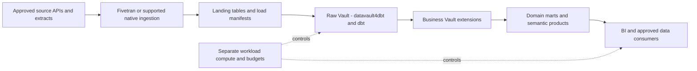

# Snowflake Data Platform Blueprint

**Build an automated SQL data platform with workload isolation, reproducible history, and accountable consumption.**

This Snowflake data platform blueprint covers accountable SQL data warehousing: source ingestion, Flow.BI modeling, FCT and TurboVault generation, datavault4dbt/dbt execution, DataHub catalog integration and user-authored Business Vault rules. Use its architecture, operating checks and cost model to plan a tested implementation.
Audience: data architects, analytics engineers, platform operators, governance owners, and FinOps. Updated: 5 November 2026.

## Snowflake data platform: tools and responsibilities

The snowflake stack has four connected responsibilities:

- [Fivetran](https://fivetran.com/docs/getting-started) is the commercial managed ingestion service for supported source-to-destination replication. For snowflake, it loads approved feeds into a controlled staging area; source connector coverage, historical depth, deletion semantics, and sync evidence are verified in the pilot. [Flow.BI](https://flow.bi/) turns patterns in the supplied data into a logical integration model. The modeling input includes database, schema, and source batch; actual data is required, while available source metadata improves the result.
- For the snowflake model, [FCT](https://www.scalefree.com/consulting/turbovault/flowbi-connector/) (Flow.BI Connector for TurboVault4dbt) provides the model-transfer step between Flow.BI and TurboVault. [TurboVault](https://www.scalefree.com/consulting/turbovault/) produces the generated model files that the engineering team reviews. Review those generated artifacts before executing the snowflake transformations; Studio is the online access option, requested through Scalefree.
- [datavault4dbt](https://github.com/ScalefreeCOM/datavault4dbt) implements the Data Vault transformation patterns referenced by the generated project. It contributes the technical history-loading foundation for database, schema, and source batch. [dbt](https://github.com/dbt-labs/dbt) turns the versioned models and macros into an executable, testable database build. User-defined Business Vault models add reusable business rules and domain marts within that workflow.
- [Snowflake](https://docs.snowflake.com/en/user-guide/cost-understanding-overall) is the reference target for this snowflake architecture. Snowflake is the managed SQL warehouse for storing integrated history and executing transformation/reporting workloads. Workload sizing and compute attribution remain architectural decisions. Choose Azure or AWS for the deployment described here according to data location and integration needs; the chosen cloud also supplies customer-side landing, profiling, and surrounding services. Size and operate these services against the snowflake pilot rather than a generic platform benchmark.

[Scalefree](https://www.scalefree.com/) is a data and AI consultancy providing strategy, platform implementation, Data Vault expertise, and training. For this blueprint, that support can include the snowflake source-to-model design, implementation of reusable business rules and domain marts, and training the team to maintain the resulting product.

[DataHub](https://docs.datahub.com/docs/ui-ingestion) is the metadata catalog for this snowflake stack. It joins asset discovery, business definitions, ownership, and lineage so teams can trace database and understand the derived rules for reusable business rules and domain marts.

## Choose Snowflake for the actual work

Snowflake is a starting point for SQL-centric integration, governed reporting, and independently operated consumer workloads. This blueprint uses Snowflake on Azure or AWS; select the provider and region near the principal sources and consumers, subject to contract and processing requirements. Supporting multiple clouds does not make accounts, data, or charges automatically interchangeable.

The adoption case is faster delivery with managed infrastructure and explicit workload management. Validate that benefit against contract pricing, engineering effort, operating skills, and migration costs. A document-heavy or custom model-training workload may warrant a complementary engine rather than moving every task into the warehouse.

## Separate ingestion, transformation, and consumption

Use databases/schemas and roles to distinguish environments and domains. Separate ingestion, scheduled transformations, development, and serving workloads where the isolation benefits justify the allocation. Give each workload an owner, query tags or equivalent attribution, a schedule, and a budget. Keep source extraction credentials separate from warehouse execution privileges.

Flow.BI requires actual source data; mostly optional source metadata improves results. Run its local Docker profiler in the customer cloud and approve the derived metadata/fingerprint connection. Its model passes directly through FCT to TurboVault, then generated-model review, then datavault4dbt/dbt execution. Users add Business Vault entities without editing the generated Raw Vault as their primary customization path.

## Decide table ownership and refresh ownership

Use native Snowflake tables for the initial validated Vault unless a workload justifies a different layout. Where open table storage is needed, evaluate [Snowflake Iceberg tables](https://docs.snowflake.com/en/user-guide/tables-iceberg), catalog ownership, supported operations, retention, and external-engine behavior for the selected mode. An Iceberg label does not settle who can write, maintain, or restore a table.

For each derived object, choose one refresh owner. Scheduled dbt runs, streams/tasks, and dynamic-table designs should not concurrently manage the same target without an explicit design. If evaluating [dynamic tables](https://docs.snowflake.com/en/user-guide/dynamic-tables-about), prove the selected SQL, refresh mode, dependencies, and cost against the workload. Keep the Data Vault package's supported incremental behavior as a separate compatibility test.

## Benchmark a complete reporting cycle

Test a representative full load, normal incremental run, late correction, replay, historical report, and concurrent dashboard burst. Use cold and warm runs and identify cache effects. Measure elapsed time, queueing, scanned work, compute consumption, storage growth, operator effort, and reconciliation quality.

A useful pilot is one source domain, one Raw Vault, user-added Business Vault rules, and one owned mart. Demonstrate that analytical demand cannot exhaust the scheduled load's agreed service window, then compare the cost of that isolation with a shared workload arrangement.

## Cost and operating decisions

[Snowflake cost guidance](https://docs.snowflake.com/en/user-guide/cost-understanding-overall) identifies compute, storage, and transfer as core cost categories. Build the business case from measured consumption and the organization's contracted rates. Include serverless features, orchestration, retained copies, recovery/replication, test environments, BI, and support where applicable.

Auto-suspend, appropriate sizing, controlled refresh frequency, and workload attribution are proposed controls, not guaranteed savings. Compare right-sized runtime with a smaller warehouse that takes much longer; the lowest hourly resource rate may not yield the lowest completed-work cost.

Retain evidence of source batches, generated-model versions, business rules, quality results, and report releases. Test role restrictions through direct SQL and extracts. Define recovery for credentials, orchestration state, and external storage as well as database objects.

## Migration and acceptance

Inventory source-specific SQL, stored procedures, load semantics, identity rules, and historical retention before translating models. Run the new and existing reporting products in parallel, reconcile discrepancies, and cut over by product. Retain a restore/export path and estimate the cost of using it.

Accept the platform when the pilot's totals reconcile, repeat runs are safe, corrections are preserved, privileges behave as designed, recovery works, and the measured operating cost meets the approved business case. Platform training should include query profiling, workload sizing, access administration, and cost attribution alongside the Data Vault/tool training below.

## Managed ingestion for this platform

**Primary ingestion: Fivetran (commercial managed service).** Use a documented source/destination connection into staging for the selected platform. Verify the exact connector, historical/CDC behavior, delete capture, schema evolution, permissions, processing region, sync monitoring and recovery. Keep generated Vault models on separately owned target tables. Include the commercial plan, connector workload, destination loading and replay behavior in TCO; the [destination reference](https://fivetran.com/docs/destinations) and [pricing definitions](https://fivetran.com/docs/core-concepts/usage-based-pricing) govern the selected configuration.

## From database to a documented data product

[DataHub](https://docs.datahub.com/docs/ui-ingestion) is the metadata catalog for this snowflake stack. It joins asset discovery, business definitions, ownership, and lineage so teams can trace database and understand the derived rules for reusable business rules and domain marts.

Use DataHub Core in a customer-managed environment as the reference open-source catalog, or choose DataHub Cloud under an explicit service agreement. Budget catalog infrastructure/search, upgrades, credentials, metadata collection, and stewardship; a managed catalog adds its subscription and provider dependencies. This catalog complements the database's native access controls and, where present, Unity Catalog or a table-format metastore.

| Catalog responsibility | Implementation in this blueprint |
| --- | --- |
| Business meaning | For this product, register **database, schema, source batch, warehouse workload, and data product** as governed concepts linked to real assets. Describe **reusable business rules and domain marts** with an owner, calculation/rule version, eligible population, cutoff, and known limitations. Publish only the metadata fields that the catalog users are authorized to see. |
| Metadata ingestion | Collect [dbt artifacts and target-warehouse metadata](https://docs.datahub.com/docs/generated/ingestion/sources/dbt) together so model nodes resolve to the actual tables/views. Select supported warehouse/BI sources and validate the specific Fabric or Cloudberry route where relevant. For Fivetran-led ingestion, assess the [DataHub Fivetran source](https://docs.datahub.com/docs/generated/ingestion/sources/fivetran) for connector metadata/lineage coverage. Use explicit API-emitted lineage for unrepresented steps rather than assuming the full source-to-report path is automatic. |
| Quality and lineage evidence | dbt remains the execution/test layer; DataHub collects the supported metadata and quality results. Test which table/column lineage, test status, and deletion behavior are captured by the actual sources and artifact versions. |
| Release evidence | Catalog acceptance follows the snowflake pilot: trace an approved source field through a generated model and Business Vault extension to a published metric, then test a schema change, a stale scan, and a permission revocation. Mask sample values and sensitive SQL/descriptions where required. Track scan coverage and unresolved lineage gaps explicitly. |

## Training and knowledge transfer

Make capability development a delivery workstream with practical acceptance criteria.

| Track | Training resource | Participants | Proposed project outcome |
| --- | --- | --- | --- |
| DV — Data Vault | [Data Vault Training & Certification](https://www.scalefree.com/data-vault-2-1-trainings/data-vault-training-certification/) and [Modeling Class](https://www.scalefree.com/data-vault-2-1-trainings/data-vault-2-1-modeling-class/) | Architects, modelers, engineering leads; selected stewards for shared concepts. | Understand generated Raw Vault structures and design additional Business Vault entities with the correct keys, grain, and history. |
| DWA — Data Warehouse Automation | [Scalefree dbt training: DataVault4dbt and TurboVault automation blocks](https://www.scalefree.com/training/dbt-training/) | Modelers, engineers, and release owners. | Operate the Flow.BI–FCT–TurboVault workflow, review generated models before datavault4dbt/dbt execution, and regenerate without overwriting user-authored Business Vault entities. |
| dbt | [Scalefree dbt Training](https://www.scalefree.com/training/dbt-training/) | Data engineers, analytics engineers, and operators. | Build and test models, use packages/macros, debug failures, and promote releases through controlled environments. |
| Flow.BI foundations | [Flow.BI Introduction](https://flow.bi/trainings/flow-bi-introduction/) | Business analysts, domain stewards, architects, project leads, and engineers. | Understand the interface, data sources, deployment targets, and first model-generation run. |
| Flow.BI configuration and operations | [Flow.BI In-Depth](https://flow.bi/trainings/flow-bi-in-depth/) | Engineers, architects, and platform operators. | Configure classification, permissions, API access, and integration settings for the organization environment. |
| Understanding generated models | [Generated Data Vault Models](https://flow.bi/trainings/generated-data-vault-2-0-models/) | Data modelers, engineers, and architects. | Interpret generated structures and their downstream physical implementation; apply this knowledge to the review after TurboVault and to Business Vault extensions. |
| Flow.BI metadata presentation | [Presenting Flow.BI Metadata — training catalog](https://flow.bi/trainings/) | Modelers, analysts, and metadata/catalog owners. | Use Flow.BI dashboards to present internal metadata to authorized users. |
| Catalog stewardship | [DataHub documentation](https://docs.datahub.com/docs/ui-ingestion) | Data owners, stewards, catalog operators, and engineers. | Document database, approve definitions, trace model lineage, and operate metadata scans and access. |

**Terminology:** DWA means Data Warehouse Automation. The DWA training track uses Scalefree's published automation learning blocks. DVA refers exclusively to the Data Vault Alliance.

The Data Vault certification training covers Data Vault 2.1. Align the curriculum with the selected tool versions and implementation patterns. Its dbt offering is customizable; agree the agenda and prerequisites before booking.
Flow.BI In-Depth requires Flow.BI Introduction and general data-architecture knowledge. Generated Data Vault Models requires Flow.BI Introduction and Data Vault modeling knowledge. Use the [Flow.BI training catalog](https://flow.bi/trainings/) to select classes or a bundle and confirm current delivery details.

Recommended sequence:

1. Run DV foundations and modeling to understand the generated Raw Vault and design Business Vault extensions.
2. Complete Flow.BI Introduction before connecting the pilot sources; follow with In-Depth for the configuration and operations team and Generated Data Vault Models for modelers and engineers.
3. Run dbt fundamentals before building the first transformation pipeline.
4. Run DWA practical sessions when the first Flow.BI output is available for direct processing through FCT and TurboVault. Include metadata presentation training for the team publishing model documentation.
5. Complete an organization-led lab using synthetic datasets for the selected industry workflow: Fivetran ingestion, Flow.BI generation, direct FCT transfer, TurboVault generation, generated-model review, datavault4dbt/dbt execution, user-added Business Vault entities, and industry-specific reconciliation.
6. Require at least two internal operators to deploy, troubleshoot, restore, and explain the pipeline without external assistance.

Budget training, preparation time, labs, and follow-up coaching separately from software and hosting. Use the [current training catalog](https://www.scalefree.com/training/) for available formats and scheduling.

## Scalefree implementation resources

The following articles complement the product documentation and training. Read the Flow.BI/FCT integration overview first, then TurboVault generation, datavault4dbt staging and loading, and finally Business Vault extensions and deployment practices.

| Tool or topic | Scalefree blog resource | Application to this blueprint |
| --- | --- | --- |
| Flow.BI, FCT, TurboVault, and datavault4dbt | [Flow.BI: Generating the Raw Data Vault Using AI and dbt](https://www.scalefree.com/blog/modeling/flow-bi-generating-the-raw-data-vault-using-ai-and-dbt/) | Explains the logical-to-physical automation chain and connector, and the addition of business logic in the Business Vault. Pair it with the [FCT access page](https://www.scalefree.com/consulting/turbovault/flowbi-connector/) for onboarding. |
| TurboVault | [Speed Up Your Data Vault 2.0 Implementation with TurboVault4dbt](https://www.scalefree.com/blog/tools/speed-up-your-data-vault-2-0-implementation-with-turbovault4dbt/) | Introduces metadata-driven dbt model generation. Use it to understand the generation stage before the review phase. |
| datavault4dbt overview | [Kick-Start Your Data Vault 2.0 Implementation with datavault4dbt](https://www.scalefree.com/blog/tools/kick-start-your-data-vault-2-0-implementation-with-datavault4dbt/) | Introduces loading templates and the package's role within dbt. Useful background before the hands-on training. |
| datavault4dbt staging | [Exploring datavault4dbt — Vol. 1: The Staging Layer](https://www.scalefree.com/blog/tools/exploring-datavault4dbt-a-practical-series-on-the-dbt-package-for-data-vault-2-0-vol-1-the-staging-layer/) | Covers staging configuration, hashing, derived columns, and prejoins. Apply these concepts when connecting the Fivetran landing datasets to generated transformations. |
| datavault4dbt Raw Vault | [Exploring datavault4dbt — Vol. 2: Standard Entities in the Raw Vault](https://www.scalefree.com/blog/datenwerkzeuge/exploring-datavault4dbt-a-practical-series-on-the-dbt-package-for-data-vault-2-0-vol-2-standard-entities-in-the-raw-vault/) | Walks through hubs, links, and satellites. Use it to interpret the models produced by TurboVault and their macro parameters. |
| Business Vault extensions | [Designing the Business Vault: Key Strategies for Effective Data Organization](https://www.scalefree.com/blog/data-vault/designing-the-business-vault-key-strategies-for-effective-data-organization/) | Explains reusable business logic and additional entities such as computed satellites, links, PITs, and bridges. Relevant to user-defined organization extensions after Raw Vault generation. |
| dbt delivery and testing | [CI/CD: Practical Insights into Automating Data Vault 2.0 with dbt](https://www.scalefree.com/blog/data-vault/ci-cd-practical-insights-into-automating-data-vault-2-0-with-dbt/) | Uses datavault4dbt and GitHub Actions to illustrate testing and delivery automation. Adapt execution and runner placement to the organization's cloud boundary. |
| PostgreSQL workload assessment | [Architectural Limitations of PostgreSQL for Enterprise Data Vault Workloads](https://www.scalefree.com/blog/data-vault/architectural-limitations-of-postgresql-for-enterprise-data-vault-workloads/) | Explains why a bounded PostgreSQL pilot is not a large-scale Data Vault recommendation. Compare the selected platform with Cloudberry MPP and its per-table row/column storage where an open relational warehouse is required. |
| Sovereignty, Iceberg, and Trino | [The Sovereign Data Platform: The Path to Data Ownership and Secure AI](https://www.scalefree.com/blog/architecture/the-sovereign-data-platform-the-path-to-data-ownership-and-secure-ai/) | Discusses controlled object storage, open table formats, and replaceable query engines, including Trino. Supports the portability and storage/compute separation principles. |

Examples in older articles may use earlier package versions, metadata layouts, or specific cloud databases. Use the pinned tool versions and current documentation for implementation details. For Fivetran ingestion and Trino/Iceberg configuration, use the primary documentation already linked in the platform and ingestion guidance in this document alongside these architectural resources. Browse the [Scalefree blog](https://www.scalefree.com/blog/) for further articles.

## Flow.BI implementation resources

Use the [Flow.BI blog](https://flow.bi/blog/) for ongoing product architecture and implementation material. Relevant starting points:

| Resource | Why it matters to this blueprint |
| --- | --- |
| [How Flow.BI Protects Sensitive Enterprise Data](https://flow.bi/blog/how-flow-bi-protects-sensitive-enterprise-data/) | Explains required data profiling, the local Docker image, storage access, and the local/backend processing boundary. |
| [Seeing Every Step: Data Lineage Inside Flow.BI](https://flow.bi/blog/seeing-every-step-data-lineage-inside-flow-bi/) | Describes source-to-model traceability and graph views. Use this model lineage alongside Fivetran load evidence and dbt execution lineage. |
| [Turning Salesforce and Pardot Tables Into a Semantic Model](https://flow.bi/blog/turning-salesforce-and-pardot-tables-into-a-semantic-model/) | Illustrates concept recognition and declared versus inferred relationships using CRM data. Use it as background on model generation; organization-specific additions in this blueprint are implemented through Business Vault entities. |
| [Generative AI for Data Vault](https://flow.bi/ai-driven-business/) | Explains the progression from data profiling to a logical Data Vault model and downstream physical-model automation. |
| [Flow.BI Media Library](https://flow.bi/media/) | Includes local-processing, bring-your-own-bucket, modeling, and dbt integration sessions for team onboarding. |

## Snowflake Data Vault architecture questions

### How does Snowflake fit the Data Vault automation stack?

Snowflake supplies the selected database and analytical execution environment. Flow.BI models required source data; FCT transfers its output to TurboVault. Review generated models before datavault4dbt/dbt runs, then maintain business logic in additional Business Vault entities. Pin the database, connector, adapter and macro versions and verify their actual behavior.

### What should be tested before adopting Snowflake?

Prove the platform-specific workload: **accountable SQL data warehousing**. Retain key/hash stability, history reconstruction, late-correction handling, access revocation and recovery evidence. Include DataHub metadata coverage, runtime and storage costs, staff effort and the exit route; benchmark the physical design with representative data and concurrent consumers.

## Related blueprints

- [Databricks Data Vault architecture](../databricks/databricks-data-platform-blueprint.md)
- [Microsoft Fabric Data Vault architecture](../microsoft-fabric/microsoft-fabric-data-platform-blueprint.md)
- [Google BigQuery Data Vault architecture](../google-bigquery/google-bigquery-data-platform-blueprint.md)
- [Apache Cloudberry Data Vault architecture](../apache-cloudberry/apache-cloudberry-data-platform-blueprint.md)
- [All industry and technology blueprints](../../README.md)

## Next steps

Validate the [DataHub metadata integration](https://docs.datahub.com/docs/ui-ingestion) and include catalog deployment, licensing/operations, stewardship, and source-to-report lineage in the architecture discussion.

Use the [Fivetran getting-started and connector documentation](https://fivetran.com/docs/getting-started) to validate the proposed managed ingestion route before selecting a commercial plan.

Select the pilot described in this blueprint, name its business and technical owners, and bring representative source data, reporting definitions, workload volumes, and operating constraints to an architecture discussion.

| Step | Where to go | What to request or prepare |
| --- | --- | --- |
| Discuss the implementation | [Scalefree contact form](https://www.scalefree.com/about-scalefree/contact/) | Request a platform assessment, pilot workshop, implementation support, or tailored training. Include the blueprint title and the first data product. |
| Try automated modeling | [Flow.BI trial registration](https://flow.bi/sign-up-for-trial/) | Request a trial and local-processing Docker deployment instructions. Prepare authorized source data; available metadata improves the result. |
| Obtain the connector | [FCT access and download request](https://www.scalefree.com/consulting/turbovault/flowbi-connector/) | Request Flow.BI Connector for TurboVault4dbt access and verify the intended generator version. |
| Install the macro package | [datavault4dbt repository and releases](https://github.com/ScalefreeCOM/datavault4dbt) | Obtain the package, choose a supported target adapter, and pin a tested version. |
| Access the online generator | [Request TurboVault Studio signup through Scalefree](https://www.scalefree.com/about-scalefree/contact/) | Ask specifically for the new online TurboVault Studio and its Flow.BI/FCT integration route. |
| Obtain a downloadable generator | [TurboVault4dbt](https://github.com/ScalefreeCOM/turbovault4dbt) and [TurboVault Engine](https://github.com/ScalefreeCOM/turbovault-engine) | Select the edition that fits the integration and retain its version and configuration. |
| Receive implementation updates | [Scalefree newsletter registration](https://www.scalefree.com/) | Use the “Data Vault 2.GO / Build Better Data Platforms” newsletter form on the homepage. |

Complete the pilot's reconciliation, access, recovery, and cost checks before extending the source scope. Record the results and the decision to proceed in the project repository.

## License

Copyright © 2026 Scalefree International GmbH. The original text, tables, and diagrams in this blueprint are licensed under [CC BY-SA 4.0](https://creativecommons.org/licenses/by-sa/4.0/). Credit Scalefree, identify changes, and retain the applicable ShareAlike terms when distributing adaptations. See [LICENSE.md](../../LICENSE.md) for scope, attribution, and the governing legal code. Referenced software and third-party material retain their own licenses.
