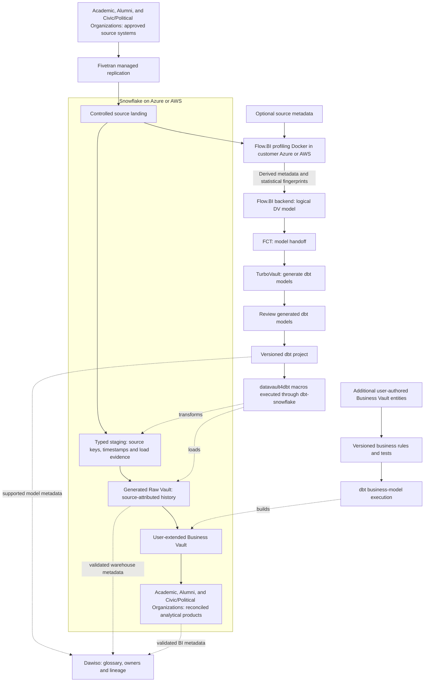

# Cloud Academic, Alumni, and Civic/Political Organizations Snowflake Data Platform Blueprint

**Connect membership, chapters, exchange-program relationships, events, volunteering, and association governance.**

This academic, alumni, and civic/political organizations data platform blueprint implements Data Vault on Snowflake using Fivetran, Flow.BI, dbt and Dawiso. Follow the source workflow for membership continuity and association reporting, then validate history, business rules, deployment and cost against the worked example.
Audience: association boards, membership officers, chapter volunteers, event organizers, treasurers, program coordinators, and privacy stewards. Updated: 5 November 2026.

[Industry platform selection guide](../cloud-academic-alumni-and-civic-political-organizations-platform-selection-guide.md) · [Sovereign edition](../../sovereign/sovereign-academic-alumni-and-civic-political-organizations-data-platform-blueprint.md) · [All blueprints](../../../../README.md)

## Snowflake stack for academic, alumni, and civic/political organizations

[Snowflake](https://docs.snowflake.com/en/user-guide/cost-understanding-overall) is the database/compute target for academic, alumni, and civic/political organizations: Snowflake is the managed SQL warehouse for storing integrated history and executing transformation/reporting workloads. Workload sizing and compute attribution remain architectural decisions. Choose Azure or AWS for the deployment described here according to data location and integration needs; the chosen cloud also supplies customer-side landing, profiling, and surrounding services.

[Fivetran](https://fivetran.com/docs/getting-started) provides commercial managed replication for supported academic, alumni, and civic/political organizations sources. Land membership, dues, chapter, event, and communication-preference records in a destination-owned replica, retain sync/deletion evidence, and keep dbt-owned Vault tables separate. [Flow.BI](https://flow.bi/) supplies the data-driven modeling stage that precedes physical model generation for member, chapter affiliation, and event registration. Actual data is required; mostly optional source metadata improves modeling. Its customer-cloud Docker component profiles locally and sends derived metadata and statistical fingerprints to the backend.

[FCT](https://www.scalefree.com/consulting/turbovault/flowbi-connector/) (Flow.BI Connector for TurboVault4dbt) handles the connector handoff from Flow.BI to the downstream model generator. [TurboVault](https://www.scalefree.com/consulting/turbovault/) generates the dbt models from that metadata. Its generated models are reviewed before execution; request online TurboVault Studio access through Scalefree. [datavault4dbt](https://github.com/ScalefreeCOM/datavault4dbt) is the dbt macro package that implements standard Data Vault loading patterns, while [dbt](https://github.com/dbt-labs/dbt) provides the build-and-test workflow that executes the model dependencies on the database. Additional user-authored Business Vault entities implement **renewal cohorts and effective volunteer permissions** outside the regenerated paths.

[Dawiso](https://www.dawiso.com/product/data-catalog) is the commercial catalog for member, chapter affiliation, and event registration, connecting business definitions, owners, discovered assets, and lineage evidence. Its deployment and metadata processing need a separate operating agreement.

[Scalefree](https://www.scalefree.com/) provides data and AI consulting, Data Vault implementation, software integration, and training. The engagement connects Snowflake implementation to the academic, alumni, and civic/political organizations workflow, governed business rules, and team enablement.

## Snowflake data and model flow

Source values for member, chapter affiliation, and event registration are required for profiling. The local Docker component keeps raw source records in the customer environment during profiling and needs approved outbound backend connectivity for derived metadata and fingerprints. Flow.BI output goes directly through FCT and TurboVault; the review occurs after generation and before macro execution. Catalog edges represent configured integrations with tested coverage, including explicit lineage where automatic discovery is incomplete.

## Build continuity across volunteer handovers

Academic, alumni, and civic associations often operate through membership tools, event registrations, chapter mailing lists, accounting, and volunteer spreadsheets. A board change should not erase institutional memory, and a chapter volunteer should not receive unrestricted member data.

Fulbright Alumni e.V. is an example of a volunteer-led alumni association with [regional chapters](https://fulbright-alumni.de/regional-chapters/) and [member involvement](https://fulbright-alumni.de/contact/). This blueprint proposes a general operating model; it does not describe the association's internal systems or characterize it as a political party.

Start with membership continuity and chapter-event participation for one association year. Integrate membership status, dues, event registration/attendance, chapter roles, and communication preferences. The nonprofit blueprint separately addresses restricted grants and beneficiary delivery.

| Workflow | Evidence | Product |
| --- | --- | --- |
| Join or renew | Application, membership class, status-effective dates | Reliable member population and renewal cohort. |
| Connect locally | Chapter affiliation, volunteer role, list preference | Authorized chapter communications and handover. |
| Participate | Event registration, cancellation, attendance | Distinct participation and service reach. |
| Mentor or volunteer | Opt-in, role, assignment and completion | Approved program participation with restricted matching details. |
| Govern and account | Board term, authorization, dues and payment allocation | Governance continuity and reconciled membership finances. |

## Membership is not a mailing-list subscription

Model person, membership, membership class, chapter, affiliation interval, association year, event, registration, attendance, volunteer assignment, board role, dues assessment, payment allocation, and communication preference. Keep exchange-program cohort/award metadata separate from association membership and verify source/use rights.

A person can be a visitor, former member, current member, donor, and volunteer at different times. Joining an event does not automatically authorize newsletters or permanent chapter sharing. Maintain preference purpose, source, timestamp, and withdrawal history.

Users add Business Vault entities for renewal cohorts, effective role access, chapter attribution, participation aggregates, and dues status. Flow.BI output goes through FCT and TurboVault; generated models are reviewed before datavault4dbt/dbt execution. Keep extensions separate from regenerated Raw Vault models.

## Worked example: retention needs a defined cohort

Suppose 200 members were eligible to renew at the year boundary and 160 renew within the agreed window. Cohort renewal is 80%. Twenty new members joining during that window increase membership but do not raise the cohort renewal rate to 90%.

For events, 90 registration rows may represent 70 distinct people and 60 actual attendees. Report registrations, people, and attendance separately. Define household/group registrations, guests, no-shows, and duplicate addresses before deduplicating.

Facts should preserve **person × membership-status interval**, **person × event × participation state**, and **dues assessment × payment allocation**. Keep historical denominators and board-approved policy versions so a new treasurer can reproduce the prior annual report.

## Protect affiliation and operational continuity

Membership, political opinions, advocacy activity, and sensitive affiliations can require heightened protection depending on the organization and law. Do not infer political beliefs from event attendance or academic association membership. For political organizations, define explicit sensitive-data purposes and authorization with qualified governance owners.

Under [GDPR](https://eur-lex.europa.eu/eli/reg/2016/679/oj/eng), assess applicable personal/special-category processing conditions and national association law. Chapter volunteers receive scoped access with an expiry; event hosts receive only approved fields. Public directories and sponsor lists require their own publication basis.

Choose a small operational footprint first. Customer-controlled cloud execution can support the design, but a full distributed lakehouse may be disproportionate for a modest volunteer association. Preserve exportability and simple handover instructions. Confirm the right to profile source records and approve Flow.BI's outbound metadata/fingerprint payload.

## Pilot for a real board handover

Membership officers own status, the treasurer owns dues, chapter coordinators own affiliations, and privacy stewards own sharing and publication rules. Train at least two volunteers to explain identity corrections, withdrawn communications, role expiry, and annual-report cohorts.

Acceptance requires reconciling dues to accounting, reproducing the renewal cohort, separating event registration from attendance, and removing a former chapter officer's access. Simulate a board handover and restore an export in a fresh environment. Document source gaps rather than filling in sensitive personal attributes.

Extend to mentoring, scholarship-related activity, and cross-association cooperation through separately agreed permissions. Full tools, cloud choices, training, and implementation resources follow.

## Engineering decisions for the academic, alumni, and civic/political organizations Snowflake product

This is the **Snowflake implementation** of the academic, alumni, and civic/political organizations workflow. Its purpose is **membership continuity and association reporting**. Validate the selected target against the worked example and operational failure cases in this document. The platform comparison is available separately; this article carries the complete implementation, training, resources, and Next steps for this stack.

[Snowflake](https://docs.snowflake.com/en/user-guide/cost-understanding-overall) provides the managed SQL warehouse for academic, alumni, and civic/political organizations. Land approved source deliveries, build staging and the Raw Vault with the tested Snowflake adapter, and implement renewal cohorts and effective volunteer permissions as owned Business Vault models. Align the Azure or AWS account/region with the source estate, consumers, and operating skills.

Use distinct load, transformation, and reporting compute where the academic, alumni, and civic/political organizations service windows need isolation. The evaluation must reconstruct historical member evidence and run concurrent consumers while applying a correction. Price compute, storage/retained copies, managed/serverless features used, transfer, and recovery; an AWS-to-Azure change is a migration decision with its own cost.

### Physical model and workload boundaries

Use separate landing, staging, Raw Vault, Business Vault, and serving schemas with explicit writer roles. A Fivetran-managed replica is an ingestion boundary; generated dbt models own the Vault. For member, chapter affiliation, and event registration, preserve the source key namespace and business-effective timestamp alongside the load timestamp. Size transformation and reporting virtual warehouses independently where contention or charge attribution justifies it. Avoid adding clustering to every table: inspect the actual history lookup, join and correction profiles first.

### Historical rebuilds and release validation

Run the academic, alumni, and civic/political organizations worked example through the pinned dbt-snowflake adapter and datavault4dbt package. Prove stable key/hash inputs, decimal/currency precision, timestamp interpretation, duplicate handling and satellite change detection. A late correction must update the appropriate historical interpretation without silently rewriting the previously published report. Exercise isolated development/release datasets and a restoration route; retention or cloning features have configured scope and cost and do not replace the recovery test.

### SQL serving, sharing and cost attribution

Publish renewal cohorts and effective volunteer permissions through owned Business Vault models and approved serving contracts. Apply access policy to SQL, BI, extracts and any sharing route, and verify revoked access from the consumer identity. Measure loading, transformations and the close/reporting burst separately. Record query/warehouse evidence for each accepted batch; include idle compute, retries, retained data and edition-dependent features in the cost model. A feature such as additional acceleration or sharing requires a measured academic, alumni, and civic/political organizations benefit and an approved release configuration.

### Ingestion contract

**Primary ingestion: Fivetran (commercial managed service).** Verify supported academic, alumni, and civic/political organizations sources and the documented Snowflake destination, historical load/CDC scope, deleted-record behavior, schema changes, sync recovery and processing location. Keep its destination replica separate from dbt-owned models. Price the actual connector usage and destination load compute, including the plan-specific treatment of re-syncs; source-specific APIs or industrial/clinical gateways may still be needed. Use the [destination documentation](https://fivetran.com/docs/destinations) and [pricing definitions](https://fivetran.com/docs/core-concepts/usage-based-pricing).

### Platform acceptance and operating evidence

The release record contains Snowflake query history, dbt artifacts, reconciliation results, and warehouse usage. Join it to source delivery IDs, generator/package/adapter versions, model approval, calculation rule versions and publication cutoffs. Execute a duplicate, a late correction, partial-load recovery, regeneration without losing user-authored Business Vault entities, permission revocation and clean-environment restore using this industry's actual grain.

Reproduce a renewal cohort, distinguish event registration from attendance, and simulate a treasurer/chapter-volunteer handover. Use identical source scope, correction cases, service targets, and business definitions when comparing platforms.

Report cost per **annual membership report and authorized chapter-product refresh**, plus end-to-end freshness, concurrent-consumer response, reconciliation exceptions, and operator hours. Specifically measure long idle periods, volunteer support/handover effort, unnecessary copies, and accidental whole-history queries.

### Implementation documentation

Use the [Snowflake platform documentation](https://docs.snowflake.com/en/user-guide/cost-understanding-overall), [dbt-snowflake setup](https://docs.getdbt.com/docs/local/connect-data-platform/snowflake-setup), and [datavault4dbt supported platforms and documentation](https://www.datavault4dbt.com/) to pin the implementation. Feature availability and adapter/materialization behavior are part of the pilot acceptance record. Select each additional feature against a concrete academic, alumni, and civic/political organizations use case and incremental operating cost.

## Operate and govern by data product

Assign each product a business owner, technical operator, purpose, grain, definitions, refresh target, classification, retention, and quality thresholds. Preserve source batch/offset IDs, code/package versions, calculation rules, cutoff, and exception status with published outputs. Keep operational-system decisions and regulated calculation engines within their validated authority boundaries.

Use institutional identity, scoped service principals, separate development/production, secret management, auditable privileged access, and approved network routes. Enforce restrictions through SQL, BI, export, and underlying storage. Test actual negative access and revocation behavior. A managed service or compliant provider does not establish application-level compliance.

Choose orchestration and alerts around the product's dependencies. A late source or unresolved material reconciliation break should affect publication status. Define retries and recovery of ingestion state, metadata/catalogs, data, credentials, and deployment artifacts. Demonstrate rollback and a clean-environment restore.

## Compare lifecycle cost and delivery value

The managed-cloud case is **shorter delivery time, reduced infrastructure administration, elastic execution, and useful platform integration**. The decision is an operating-model tradeoff. Keep privacy, contractual requirements, data-location constraints, and an exit plan even when sovereignty is not the main objective.

Use a three-year model with an explicit growth scenario:

`TCO = migration and implementation + platform/compute + storage and retained copies + ingestion/orchestration + network/egress + BI/security licenses + support + operating staff + recovery/testing + exit allowance`

Account for negotiated rates and existing commitments as incremental costs, without treating sunk licenses or staff effort as free. Measure normal, peak, backfill, and quiet-period workloads. Record costs per completed data-product refresh and per meaningful business unit, together with correctness and service quality. Compare low/base/high demand and sensitivity to refresh frequency, retention, concurrency, and source growth. Do not publish a cost-saving percentage without the corresponding workload and pricing assumptions.

For feature decisions, record the use case, production availability in the selected region/edition, integration limits, expected outcome, incremental cost, operating owner, and rollback. Prefer an ordinary SQL or scheduled pipeline when it meets the product goal more economically. New AI, streaming, or sharing capabilities should earn their place through a measured pilot.

## Delivery gates

1. Agree the product's grain, calculation, scope, cutoff, access, and reconciliation targets with its business owner.
2. Benchmark the recommended platform against the strongest alternative using the same sources and workload, including cold/warm runs and concurrent consumers.
3. Build the ingestion/model-generation path; review after TurboVault; run tested macros and add Business Vault rules.
4. Prove the industry's worked example and failure cases, historical reconstruction, permissions, restart, restore, and regeneration behavior.
5. Compare measured run cost and staff effort with the business case. Document limitations and choose the platform before committing to broad migration.

## Catalog ownership and lineage with Dawiso

[Dawiso](https://www.dawiso.com/product/data-catalog) adds the business glossary, asset discovery, ownership, and lineage context for academic, alumni, and civic/political organizations. It connects the meaning of member and the rules for renewal cohorts and effective volunteer permissions to the implemented datasets.

1. **Establish the catalog boundary.** Use [Dawiso's deployment and integration options](https://www.dawiso.com/product/enterprise-deployment-built-for-flexibility-and-security) to select the supported catalog location and network path. Record the edition, contributor/viewer licensing, metadata scanning scope, and operating owner. Validate discovery of Snowflake assets and dbt lineage using the supported connectors or an explicit metadata mapping.

2. **Document the business product.** For this product, register **member, chapter affiliation, event registration, attendance, and dues** as governed concepts linked to real assets. Describe **renewal cohorts and effective volunteer permissions** with an owner, calculation/rule version, eligible population, cutoff, and known limitations. Publish only the metadata fields that the catalog users are authorized to see.

3. **Collect and verify lineage.** Discover the selected database/BI assets using the [supported connectors](https://www.dawiso.com/connectors) and validate dbt/generated-model metadata exchange for the chosen version. Define a controlled import/API mapping for gaps; do not assume a direct Flow.BI or FCT catalog connector. Keep the modeling service's generated metadata distinct from the catalog's approved business glossary. dbt executes transformation tests; Dawiso records the associated definitions, owners, evidence links, and quality context. Select and validate the integration that publishes results; the catalog does not replace the test engine.

4. **Exercise the pilot controls.** Catalog acceptance follows the academic, alumni, and civic/political organizations pilot: trace an approved source field through a generated model and Business Vault extension to a published metric, then test a schema change, a stale scan, and a permission revocation. Mask sample values and sensitive SQL/descriptions where required. Track scan coverage and unresolved lineage gaps explicitly.

## Training and knowledge transfer

Make capability development a delivery workstream with practical acceptance criteria.

| Track | Training resource | Participants | Proposed project outcome |
| --- | --- | --- | --- |
| DV — Data Vault | [Data Vault Training & Certification](https://www.scalefree.com/data-vault-2-1-trainings/data-vault-training-certification/) and [Modeling Class](https://www.scalefree.com/data-vault-2-1-trainings/data-vault-2-1-modeling-class/) | Architects, modelers, engineering leads; selected stewards for shared concepts. | Understand generated Raw Vault structures and design additional Business Vault entities with the correct keys, grain, and history. |
| DWA — Data Warehouse Automation | [Scalefree dbt training: DataVault4dbt and TurboVault automation blocks](https://www.scalefree.com/training/dbt-training/) | Modelers, engineers, and release owners. | Operate the Flow.BI–FCT–TurboVault workflow, review generated models before datavault4dbt/dbt execution, and regenerate without overwriting user-authored Business Vault entities. |
| dbt | [Scalefree dbt Training](https://www.scalefree.com/training/dbt-training/) | Data engineers, analytics engineers, and operators. | Build and test models, use packages/macros, debug failures, and promote releases through controlled environments. |
| Flow.BI foundations | [Flow.BI Introduction](https://flow.bi/trainings/flow-bi-introduction/) | Business analysts, domain stewards, architects, project leads, and engineers. | Understand the interface, data sources, deployment targets, and first model-generation run. |
| Flow.BI configuration and operations | [Flow.BI In-Depth](https://flow.bi/trainings/flow-bi-in-depth/) | Engineers, architects, and platform operators. | Configure classification, permissions, API access, and integration settings for the organization environment. |
| Understanding generated models | [Generated Data Vault Models](https://flow.bi/trainings/generated-data-vault-2-0-models/) | Data modelers, engineers, and architects. | Interpret generated structures and their downstream physical implementation; apply this knowledge to the review after TurboVault and to Business Vault extensions. |
| Flow.BI metadata presentation | [Presenting Flow.BI Metadata — training catalog](https://flow.bi/trainings/) | Modelers, analysts, and metadata/catalog owners. | Use Flow.BI dashboards to present internal metadata to authorized users. |
| Catalog stewardship | [Dawiso documentation](https://www.dawiso.com/product/data-catalog) | Data owners, stewards, catalog operators, and engineers. | Document member, approve definitions, trace model lineage, and operate metadata scans and access. |

**Terminology:** DWA means Data Warehouse Automation. The DWA training track uses Scalefree's published automation learning blocks. DVA refers exclusively to the Data Vault Alliance.

The Data Vault certification training covers Data Vault 2.1. Align the curriculum with the selected tool versions and implementation patterns. Its dbt offering is customizable; agree the agenda and prerequisites before booking.
Flow.BI In-Depth requires Flow.BI Introduction and general data-architecture knowledge. Generated Data Vault Models requires Flow.BI Introduction and Data Vault modeling knowledge. Use the [Flow.BI training catalog](https://flow.bi/trainings/) to select classes or a bundle and confirm current delivery details.

Recommended sequence:

1. Run DV foundations and modeling to understand the generated Raw Vault and design Business Vault extensions.
2. Complete Flow.BI Introduction before connecting the pilot sources; follow with In-Depth for the configuration and operations team and Generated Data Vault Models for modelers and engineers.
3. Run dbt fundamentals before building the first transformation pipeline.
4. Run DWA practical sessions when the first Flow.BI output is available for direct processing through FCT and TurboVault. Include metadata presentation training for the team publishing model documentation.
5. Complete an organization-led lab using synthetic datasets for the selected industry workflow: Fivetran ingestion, Flow.BI generation, direct FCT transfer, TurboVault generation, generated-model review, datavault4dbt/dbt execution, user-added Business Vault entities, and industry-specific reconciliation.
6. Require at least two internal operators to deploy, troubleshoot, restore, and explain the pipeline without external assistance.

Budget training, preparation time, labs, and follow-up coaching separately from software and hosting. Use the [current training catalog](https://www.scalefree.com/training/) for available formats and scheduling.

## Scalefree implementation resources

The following articles complement the product documentation and training. Read the Flow.BI/FCT integration overview first, then TurboVault generation, datavault4dbt staging and loading, and finally Business Vault extensions and deployment practices.

| Tool or topic | Scalefree blog resource | Application to this blueprint |
| --- | --- | --- |
| Flow.BI, FCT, TurboVault, and datavault4dbt | [Flow.BI: Generating the Raw Data Vault Using AI and dbt](https://www.scalefree.com/blog/modeling/flow-bi-generating-the-raw-data-vault-using-ai-and-dbt/) | Explains the logical-to-physical automation chain and connector, and the addition of business logic in the Business Vault. Pair it with the [FCT access page](https://www.scalefree.com/consulting/turbovault/flowbi-connector/) for onboarding. |
| TurboVault | [Speed Up Your Data Vault 2.0 Implementation with TurboVault4dbt](https://www.scalefree.com/blog/tools/speed-up-your-data-vault-2-0-implementation-with-turbovault4dbt/) | Introduces metadata-driven dbt model generation. Use it to understand the generation stage before the review phase. |
| datavault4dbt overview | [Kick-Start Your Data Vault 2.0 Implementation with datavault4dbt](https://www.scalefree.com/blog/tools/kick-start-your-data-vault-2-0-implementation-with-datavault4dbt/) | Introduces loading templates and the package's role within dbt. Useful background before the hands-on training. |
| datavault4dbt staging | [Exploring datavault4dbt — Vol. 1: The Staging Layer](https://www.scalefree.com/blog/tools/exploring-datavault4dbt-a-practical-series-on-the-dbt-package-for-data-vault-2-0-vol-1-the-staging-layer/) | Covers staging configuration, hashing, derived columns, and prejoins. Apply these concepts when connecting the Fivetran landing datasets to generated transformations. |
| datavault4dbt Raw Vault | [Exploring datavault4dbt — Vol. 2: Standard Entities in the Raw Vault](https://www.scalefree.com/blog/datenwerkzeuge/exploring-datavault4dbt-a-practical-series-on-the-dbt-package-for-data-vault-2-0-vol-2-standard-entities-in-the-raw-vault/) | Walks through hubs, links, and satellites. Use it to interpret the models produced by TurboVault and their macro parameters. |
| Business Vault extensions | [Designing the Business Vault: Key Strategies for Effective Data Organization](https://www.scalefree.com/blog/data-vault/designing-the-business-vault-key-strategies-for-effective-data-organization/) | Explains reusable business logic and additional entities such as computed satellites, links, PITs, and bridges. Relevant to user-defined organization extensions after Raw Vault generation. |
| dbt delivery and testing | [CI/CD: Practical Insights into Automating Data Vault 2.0 with dbt](https://www.scalefree.com/blog/data-vault/ci-cd-practical-insights-into-automating-data-vault-2-0-with-dbt/) | Uses datavault4dbt and GitHub Actions to illustrate testing and delivery automation. Adapt execution and runner placement to the organization's cloud boundary. |

Examples in older articles may use earlier package versions, metadata layouts, or specific cloud databases. Use the pinned tool versions and current documentation for implementation details. For ingestion and target-platform configuration, use the primary documentation already linked in the platform and ingestion guidance in this document alongside these architectural resources. Browse the [Scalefree blog](https://www.scalefree.com/blog/) for further articles.

## Flow.BI implementation resources

Use the [Flow.BI blog](https://flow.bi/blog/) for ongoing product architecture and implementation material. Relevant starting points:

| Resource | Why it matters to this blueprint |
| --- | --- |
| [How Flow.BI Protects Sensitive Enterprise Data](https://flow.bi/blog/how-flow-bi-protects-sensitive-enterprise-data/) | Explains required data profiling, the local Docker image, storage access, and the local/backend processing boundary. |
| [Seeing Every Step: Data Lineage Inside Flow.BI](https://flow.bi/blog/seeing-every-step-data-lineage-inside-flow-bi/) | Describes source-to-model traceability and graph views. Use this model lineage alongside Fivetran load evidence and dbt execution lineage. |
| [Turning Salesforce and Pardot Tables Into a Semantic Model](https://flow.bi/blog/turning-salesforce-and-pardot-tables-into-a-semantic-model/) | Illustrates concept recognition and declared versus inferred relationships using CRM data. Use it as background on model generation; organization-specific additions in this blueprint are implemented through Business Vault entities. |
| [Generative AI for Data Vault](https://flow.bi/ai-driven-business/) | Explains the progression from data profiling to a logical Data Vault model and downstream physical-model automation. |
| [Flow.BI Media Library](https://flow.bi/media/) | Includes local-processing, bring-your-own-bucket, modeling, and dbt integration sessions for team onboarding. |

## Questions about academic, alumni, and civic/political organizations analytics on Snowflake

### How should Snowflake preserve academic, alumni, and civic/political organizations history?

Separate source landing, dbt transformations and reporting workloads. For member, chapter affiliation, and event registration, preserve source keys and effective/load times before building renewal cohorts and effective volunteer permissions. Test historical corrections under concurrent SQL demand and attribute virtual-warehouse usage to the accepted product.

### What should the academic, alumni, and civic/political organizations Snowflake pilot prove?

Use the worked example and difficult cases to validate **membership continuity and association reporting**. Retain source-to-output reconciliation, duplicate and late-record results, access-denial evidence, restore behavior and the measured cost per accepted product. Confirm that regeneration preserves user-authored Business Vault rules and that Dawiso lineage covers the actual route.

## Related blueprints

- [Sovereign academic, alumni, and civic/political organizations data platform](../../sovereign/sovereign-academic-alumni-and-civic-political-organizations-data-platform-blueprint.md)
- [Academic, Alumni, and Civic/Political Organizations cloud platform selection](../cloud-academic-alumni-and-civic-political-organizations-platform-selection-guide.md)
- [Academic, Alumni, and Civic/Political Organizations on Databricks](../databricks/cloud-academic-alumni-and-civic-political-organizations-databricks-data-platform-blueprint.md)
- [Academic, Alumni, and Civic/Political Organizations on Microsoft Fabric](../microsoft-fabric/cloud-academic-alumni-and-civic-political-organizations-microsoft-fabric-data-platform-blueprint.md)
- [Academic, Alumni, and Civic/Political Organizations on Google BigQuery](../google-bigquery/cloud-academic-alumni-and-civic-political-organizations-google-bigquery-data-platform-blueprint.md)
- [Snowflake technology architecture](../../../../cloud/snowflake/snowflake-data-platform-blueprint.md)
- [All industry and technology blueprints](../../../../README.md)

## Next steps

Bring the academic, alumni, and civic/political organizations worked example, source inventory, Snowflake deployment assumptions and measured cost targets to the first implementation session. Request a pilot covering ingestion, model generation, the review after TurboVault, dbt execution, Dawiso lineage and one user-authored Business Vault extension.

Include Dawiso metadata discovery, glossary ownership, lineage coverage, and catalog operating cost in the pilot scope.

Use the [Fivetran getting-started and connector documentation](https://fivetran.com/docs/getting-started) to validate the proposed managed ingestion route before selecting a commercial plan.

Select the pilot described in this blueprint, name its business and technical owners, and bring representative source data, reporting definitions, workload volumes, and operating constraints to an architecture discussion.

| Step | Where to go | What to request or prepare |
| --- | --- | --- |
| Discuss the implementation | [Scalefree contact form](https://www.scalefree.com/about-scalefree/contact/) | Request a platform assessment, pilot workshop, implementation support, or tailored training. Include the blueprint title and the first data product. |
| Try automated modeling | [Flow.BI trial registration](https://flow.bi/sign-up-for-trial/) | Request a trial and local-processing Docker deployment instructions. Prepare authorized source data; available metadata improves the result. |
| Obtain the connector | [FCT access and download request](https://www.scalefree.com/consulting/turbovault/flowbi-connector/) | Request Flow.BI Connector for TurboVault4dbt access and verify the intended generator version. |
| Install the macro package | [datavault4dbt repository and releases](https://github.com/ScalefreeCOM/datavault4dbt) | Obtain the package, choose a supported target adapter, and pin a tested version. |
| Access the online generator | [Request TurboVault Studio signup through Scalefree](https://www.scalefree.com/about-scalefree/contact/) | Ask specifically for the new online TurboVault Studio and its Flow.BI/FCT integration route. |
| Obtain a downloadable generator | [TurboVault4dbt](https://github.com/ScalefreeCOM/turbovault4dbt) and [TurboVault Engine](https://github.com/ScalefreeCOM/turbovault-engine) | Select the edition that fits the integration and retain its version and configuration. |
| Receive implementation updates | [Scalefree newsletter registration](https://www.scalefree.com/) | Use the “Data Vault 2.GO / Build Better Data Platforms” newsletter form on the homepage. |

Complete the pilot's reconciliation, access, recovery, and cost checks before extending the source scope. Record the results and the decision to proceed in the project repository.

## License

Copyright © 2026 Scalefree International GmbH. The original text, tables, and diagrams in this blueprint are licensed under [CC BY-SA 4.0](https://creativecommons.org/licenses/by-sa/4.0/). Credit Scalefree, identify changes, and retain the applicable ShareAlike terms when distributing adaptations. See [LICENSE.md](../../../../LICENSE.md) for scope, attribution, and the governing legal code. Referenced software and third-party material retain their own licenses.
