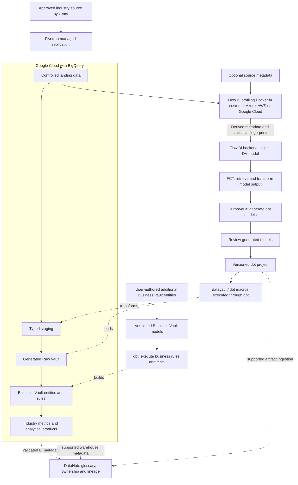

# Cloud Agriculture Platform Selection Guide

**Connect fields, seasons, operations, inputs, harvests, and supply-chain lots while preserving producer control and measurement context.**

Compare Snowflake, Databricks, Microsoft Fabric and Google BigQuery for a agriculture data platform supporting input-to-harvest and delivery traceability. This selection guide evaluates workload fit, integration, governance and total cost; four linked implementation blueprints carry the platform-specific architecture and delivery plan.
Audience: producers, cooperatives, agronomists, farm operations, sustainability teams, commodity finance, and data stewards. Updated: 5 November 2026.

## Standalone platform blueprints

- [Snowflake implementation](snowflake/cloud-agriculture-snowflake-data-platform-blueprint.md)
- [Databricks implementation](databricks/cloud-agriculture-databricks-data-platform-blueprint.md)
- [Microsoft Fabric implementation](microsoft-fabric/cloud-agriculture-microsoft-fabric-data-platform-blueprint.md)
- [Google BigQuery implementation](google-bigquery/cloud-agriculture-google-bigquery-data-platform-blueprint.md)

## How the Agriculture Data Vault stack fits together

[Scalefree](https://www.scalefree.com/) supports platform design and delivery with Data Vault expertise, software tooling, and practical training. For this blueprint, that support can include the agriculture source-to-model design, implementation of moisture normalization and field/parcel histories, and training the team to maintain the resulting product.

[Fivetran](https://fivetran.com/docs/getting-started) is the commercial managed ingestion service for supported source-to-destination replication. For agriculture, it loads approved feeds into a controlled staging area; source connector coverage, historical depth, deletion semantics, and sync evidence are verified in the pilot. [Flow.BI](https://flow.bi/) uses data profiling and AI-assisted modeling to define an integrated Data Vault. The modeling input includes field-season, operation, and harvest; actual data is required, while available source metadata improves the result.

For the agriculture model, [FCT](https://www.scalefree.com/consulting/turbovault/flowbi-connector/) (Flow.BI Connector for TurboVault4dbt) is the connector that maps Flow.BI output into metadata TurboVault can consume. [TurboVault](https://www.scalefree.com/consulting/turbovault/) builds the metadata-driven dbt project artifacts for the target implementation. Review those generated artifacts before executing the agriculture transformations; Studio is the online access option, requested through Scalefree. [datavault4dbt](https://github.com/ScalefreeCOM/datavault4dbt) provides standardized macro definitions for the Vault structures and load behavior. It contributes the technical history-loading foundation for field-season, operation, and harvest.

[dbt](https://github.com/dbt-labs/dbt) executes model SQL through the selected adapter and records the transformation/test run. User-defined Business Vault models add moisture normalization and field/parcel histories within that workflow. [Google BigQuery](https://cloud.google.com/bigquery/pricing) is the reference target for this agriculture architecture. BigQuery is the managed analytical warehouse and SQL execution engine for the typed source data, Vault, and reporting products. Google Cloud provides the project/IAM, storage, network, and execution environment around BigQuery. The customer-managed Flow.BI Docker component runs within that environment. Size and operate these services against the agriculture pilot rather than a generic platform benchmark.

[DataHub](https://docs.datahub.com/docs/ui-ingestion) is the metadata catalog for this agriculture stack. It joins asset discovery, business definitions, ownership, and lineage so teams can trace field-season and understand the derived rules for moisture normalization and field/parcel histories.

## Cloud data and model flow

Actual landing data is required for Flow.BI profiling; source metadata enriches the result. Raw source records remain in the customer environment during local profiling; the documented backend exchange needs approved outbound connectivity. Flow.BI output goes directly to FCT and TurboVault. Review follows generation and precedes datavault4dbt/dbt execution. Additional Business Vault entities carry user-maintained business logic. The DataHub edges represent integrations to configure and test, including explicit lineage for unsupported steps; catalog registration does not grant data access. Platform alternatives below use the same logical flow with their tested ingestion and dbt adapters.

## Platform recommendation and decision assumptions

**Recommended starting point: Google Cloud with BigQuery.** This recommendation assumes an agriculture/cooperative analytics team needing seasonal SQL and geospatial products, with approved Google Cloud use. It is an architectural judgment to validate, not a claim that an industry has one universally best platform.

Field-season joins, geographic context, and intermittent harvest analysis can be evaluated through managed SQL and spatial analytics.

Retain imagery and source files in object storage, reference approved derived observations, and load typed field-season/harvest facts into BigQuery.

**Strongest alternatives:** Databricks for large image/raster and custom model pipelines; Snowflake for predominantly commercial/contract SQL; Fabric for Microsoft BI-led cooperatives.

### Google Cloud with BigQuery

[BigQuery](https://cloud.google.com/bigquery/pricing) is the managed warehouse and SQL engine for a Google Cloud implementation. Use governed projects/datasets, supported ingestion, a tested BigQuery adapter, and explicit partition/cluster choices for field-season, operation, harvest, storage lot, and delivery. Customer-controlled Google Cloud services also host source landing and the Flow.BI profiling component.

Benchmark input-to-harvest and delivery traceability with representative data and historical corrections. Compare on-demand analysis with capacity-based execution under the same refresh and concurrency targets. Measure scanned data/capacity, storage, load/streaming features actually used, transfer, BI, and operator time. Predicate pruning and repeat-query behavior must be demonstrated with this industry's facts.

### Snowflake on Azure or AWS

[Snowflake](https://docs.snowflake.com/en/user-guide/cost-understanding-overall) provides the managed SQL warehouse for agriculture. Land approved source deliveries, build staging and the Raw Vault with the tested Snowflake adapter, and implement moisture normalization and field/parcel histories as owned Business Vault models. Align the Azure or AWS account/region with the source estate, consumers, and operating skills.

Use distinct load, transformation, and reporting compute where the agriculture service windows need isolation. The evaluation must reconstruct historical field-season evidence and run concurrent consumers while applying a correction. Price compute, storage/retained copies, managed/serverless features used, transfer, and recovery; an AWS-to-Azure change is a migration decision with its own cost.

### Microsoft Fabric on Azure

[Microsoft Fabric](https://learn.microsoft.com/en-sg/fabric/fundamentals/decision-guide-lakehouse-warehouse) combines managed analytical services and Power BI delivery. For agriculture, use Warehouse as the tested SQL/dbt target when that is the selected route, and keep Lakehouse/file/Spark processing an explicit option with separate adapter/write tests. Azure supplies the surrounding customer identity, source-access and profiling environment.

Define moisture normalization and field/parcel histories once in the agreed transformation/semantic layer and test the handoff to reports. Measure capacity contention during a real agriculture refresh and consumer burst. Include capacity, storage, applicable BI/user licensing, ingestion, and administration. A Fivetran-fed alternative needs a validated intermediate landing/load design; the destination documentation does not establish direct Fabric Warehouse support.

### Databricks on Azure, AWS, or Google Cloud

[Databricks](https://docs.databricks.com/aws/en/getting-started/architecture) contributes engineering and SQL execution over governed lakehouse tables. Use the approved incumbent cloud for storage, network and identity, then retain raw deliveries, typed source tables, the Raw Vault, and moisture normalization and field/parcel histories with an owned writer/refresh contract. Unity Catalog governs the platform assets; DataHub provides the cross-stack business discovery and lineage layer in this cloud edition.

Evaluate ingestion/replay and SQL serving for agriculture together. Preserve the fact grain and corrections while comparing job/SQL/serverless choices supported by the chosen cloud and edition. Include platform usage, underlying infrastructure where separately billed, table maintenance, storage, network, retries, and retained environments. A streaming or AI feature needs a measurable product use case.

### Ingestion contract for the platform comparison

**Primary ingestion: Fivetran (commercial managed service).** Replicate supported, authorized agriculture sources into destination staging; keep the staged replica separate from the Raw Vault owned by dbt models. Confirm source coverage, history/CDC depth, deletion capture, schema/type changes, credentials, sync/recovery behavior, and the selected processing location. Estimate connector/sync subscription charges from the actual plan and workload; include destination-load compute and re-sync behavior in the business case. See [Fivetran destinations](https://fivetran.com/docs/destinations) and [pricing definitions](https://fivetran.com/docs/core-concepts/usage-based-pricing).

Use a documented Fivetran destination for the chosen Snowflake, BigQuery, or Databricks configuration. For the Fabric alternative, design and test a supported landing/load route into the chosen Warehouse/Lakehouse target; direct Fivetran-to-Fabric Warehouse loading is not assumed.

### Industry benchmark and cost boundary

Recompute moisture-adjusted yield after a boundary correction and trace a blended delivery to harvest sources. Use identical source scope, correction cases, service targets, and business definitions when comparing platforms.

Report cost per **field-season product, reconciled harvest batch, and spatial analysis run**, plus end-to-end freshness, concurrent-consumer response, reconciliation exceptions, and operator hours. Specifically measure imagery processing outside SQL, spatial scan sizes, seasonal peaks, partner data licensing, and retained geometry versions.

Evaluate BigQuery geography functions on the real geometry/coordinate model; route large raster processing to a validated engine rather than assuming SQL is sufficient.

## Anchor the platform in a crop season

Farm data changes meaning with field boundaries, planted area, variety, season, moisture, and measurement method. Comparing yield across farms without those definitions can produce precise-looking but misleading results.

Start with input-to-harvest traceability for one crop and region. Integrate farm-management records, field geometries, planting/operation logs, harvest weights, and storage-lot movements. Satellite imagery, weather, and equipment telemetry are linked evidence; they need acquisition and licensing arrangements before analytical reuse.

| Workflow | Evidence to retain | Product |
| --- | --- | --- |
| Establish the season | Field-boundary version, tenure/use rights, crop and variety | Season-specific cultivated-area denominator. |
| Plant and treat | Operation, date, material batch, dose, equipment | Input history and traceable application quantities. |
| Observe and intervene | Weather/soil observation, method, unit, location | Agronomic context with measurement quality. |
| Harvest | Harvest event, field source, gross/tare weight, moisture | Comparable production quantities. |
| Store and deliver | Lot merge/split, drying, transfer, sale | Field-to-delivery traceability with quantity reconciliation. |

## Data model: land, production, and ownership differ

Separate holding, operator, parcel, field geometry version, season, crop, planting, operation, input batch, observation, harvest event, storage lot, and delivery. A cadastral parcel is not necessarily the cultivated field. A cooperative may aggregate data from producers without acquiring unrestricted rights to use it.

The Raw Vault retains original observations and operations. Users add Business Vault entities for season boundaries, field/parcel crosswalks, unit conversions, moisture-adjusted weight, and approved sustainability calculations. Flow.BI output passes to FCT and TurboVault, then generated-model review, then datavault4dbt/dbt execution.

Use [FAO AGROVOC](https://www.fao.org/agrovoc/) as a vocabulary reference where appropriate; version local mappings and retain original terms. It does not replace crop-specific operational rules or prove regulatory compliance.

## Worked example: comparable harvest weight

An illustrative harvest weighs 100 tonnes at 20% moisture. Its dry-matter mass is 80 tonnes. At a reference moisture of 14%, equivalent weight is 80/0.86, approximately 93.02 tonnes, assuming moisture is on the same wet-basis definition and ignoring other losses.

On 10 harvested hectares, this is approximately 9.30 tonnes per harvested hectare. A planted-area denominator could differ. Store actual weight and moisture, measurement method, harvested area, reference basis, and calculation version. The worked formula is a modeling example; agronomy and commercial owners approve the applicable method and deductions.

Use **harvest event × field-season × measured quantity/unit** as a source fact, with explicit allocations when one vehicle combines multiple fields. Storage drying losses and blending require separate transformation records rather than unexplained inventory adjustments.

## Producer trust and sensitive geography

Field coordinates, crop plans, input purchases, pricing, and productivity can disclose commercial strategy. Define producer-level isolation, cooperative roles, permitted comparisons, and aggregation thresholds. Protect workers' identities and precise tracks. Public sustainability claims require approved boundaries, input evidence, methodology, and uncertainty statements.

Preserve geospatial coordinate reference systems, boundary validity, observation time, device quality, and remote-sensing processing version. Large imagery belongs in controlled object storage; model references and derived products with their provenance. Use approved data gateways for machinery telemetry instead of giving analytics control access to equipment.

## Pilot led by producers and agronomists

Agronomists approve crop/measurement meaning; producers approve sharing; operations owns field and activity completeness; finance reconciles delivered quantities and settlement. Train analysts with a changed field boundary, a harvest spanning two fields, and a blended storage lot.

Acceptance requires tracing a delivery back to source harvests, reconciling delivered and stored quantities with explicit drying/handling adjustments, reproducing reference-moisture yield, and detecting missing or incompatible units. Test producer access isolation and a withdrawn sharing permission. Weather or sensor gaps must be visible rather than interpolated without a declared rule.

Expand into crop planning, resource efficiency, and risk analytics only after the season and quantity model is reliable. The remainder of this document provides the complete tools, cloud choices, training, and resources.

## Operate and govern by data product

Assign each product a business owner, technical operator, purpose, grain, definitions, refresh target, classification, retention, and quality thresholds. Preserve source batch/offset IDs, code/package versions, calculation rules, cutoff, and exception status with published outputs. Keep operational-system decisions and regulated calculation engines within their validated authority boundaries.

Use institutional identity, scoped service principals, separate development/production, secret management, auditable privileged access, and approved network routes. Enforce restrictions through SQL, BI, export, and underlying storage. Test actual negative access and revocation behavior. A managed service or compliant provider does not establish application-level compliance.

Choose orchestration and alerts around the product's dependencies. A late source or unresolved material reconciliation break should affect publication status. Define retries and recovery of ingestion state, metadata/catalogs, data, credentials, and deployment artifacts. Demonstrate rollback and a clean-environment restore.

## Compare lifecycle cost and delivery value

The managed-cloud case is **shorter delivery time, reduced infrastructure administration, elastic execution, and useful platform integration**. The decision is an operating-model tradeoff. Keep privacy, contractual requirements, data-location constraints, and an exit plan even when sovereignty is not the main objective.

Use a three-year model with an explicit growth scenario:

`TCO = migration and implementation + platform/compute + storage and retained copies + ingestion/orchestration + network/egress + BI/security licenses + support + operating staff + recovery/testing + exit allowance`

Account for negotiated rates and existing commitments as incremental costs, without treating sunk licenses or staff effort as free. Measure normal, peak, backfill, and quiet-period workloads. Record costs per completed data-product refresh and per meaningful business unit, together with correctness and service quality. Compare low/base/high demand and sensitivity to refresh frequency, retention, concurrency, and source growth. Do not publish a cost-saving percentage without the corresponding workload and pricing assumptions.

For feature decisions, record the use case, production availability in the selected region/edition, integration limits, expected outcome, incremental cost, operating owner, and rollback. Prefer an ordinary SQL or scheduled pipeline when it meets the product goal more economically. New AI, streaming, or sharing capabilities should earn their place through a measured pilot.

## Delivery gates

1. Agree the product's grain, calculation, scope, cutoff, access, and reconciliation targets with its business owner.
2. Benchmark the recommended platform against the strongest alternative using the same sources and workload, including cold/warm runs and concurrent consumers.
3. Build the ingestion/model-generation path; review after TurboVault; run tested macros and add Business Vault rules.
4. Prove the industry's worked example and failure cases, historical reconstruction, permissions, restart, restore, and regeneration behavior.
5. Compare measured run cost and staff effort with the business case. Document limitations and choose the platform before committing to broad migration.

## Catalog ownership and lineage with DataHub

[DataHub](https://docs.datahub.com/docs/ui-ingestion) is the metadata catalog for this agriculture stack. It joins asset discovery, business definitions, ownership, and lineage so teams can trace field-season and understand the derived rules for moisture normalization and field/parcel histories.

1. **Establish the catalog boundary.** Use DataHub Core in a customer-managed environment as the reference open-source catalog, or choose DataHub Cloud under an explicit service agreement. Budget catalog infrastructure/search, upgrades, credentials, metadata collection, and stewardship; a managed catalog adds its subscription and provider dependencies. This catalog complements the database's native access controls and, where present, Unity Catalog or a table-format metastore.

2. **Document the business product.** For this product, register **field-season, operation, harvest, storage lot, and delivery** as governed concepts linked to real assets. Describe **moisture normalization and field/parcel histories** with an owner, calculation/rule version, eligible population, cutoff, and known limitations. Publish only the metadata fields that the catalog users are authorized to see.

3. **Collect and verify lineage.** Collect [dbt artifacts and target-warehouse metadata](https://docs.datahub.com/docs/generated/ingestion/sources/dbt) together so model nodes resolve to the actual tables/views. Select supported warehouse/BI sources and validate the specific Fabric or Cloudberry route where relevant. For Fivetran-led ingestion, assess the [DataHub Fivetran source](https://docs.datahub.com/docs/generated/ingestion/sources/fivetran) for connector metadata/lineage coverage. Use explicit API-emitted lineage for unrepresented steps rather than assuming the full source-to-report path is automatic. dbt remains the execution/test layer; DataHub collects the supported metadata and quality results. Test which table/column lineage, test status, and deletion behavior are captured by the actual sources and artifact versions.

4. **Exercise the pilot controls.** Catalog acceptance follows the agriculture pilot: trace an approved source field through a generated model and Business Vault extension to a published metric, then test a schema change, a stale scan, and a permission revocation. Mask sample values and sensitive SQL/descriptions where required. Track scan coverage and unresolved lineage gaps explicitly.

## Training and knowledge transfer

Make capability development a delivery workstream with practical acceptance criteria.

| Track | Training resource | Participants | Proposed project outcome |
| --- | --- | --- | --- |
| DV — Data Vault | [Data Vault Training & Certification](https://www.scalefree.com/data-vault-2-1-trainings/data-vault-training-certification/) and [Modeling Class](https://www.scalefree.com/data-vault-2-1-trainings/data-vault-2-1-modeling-class/) | Architects, modelers, engineering leads; selected stewards for shared concepts. | Understand generated Raw Vault structures and design additional Business Vault entities with the correct keys, grain, and history. |
| DWA — Data Warehouse Automation | [Scalefree dbt training: DataVault4dbt and TurboVault automation blocks](https://www.scalefree.com/training/dbt-training/) | Modelers, engineers, and release owners. | Operate the Flow.BI–FCT–TurboVault workflow, review generated models before datavault4dbt/dbt execution, and regenerate without overwriting user-authored Business Vault entities. |
| dbt | [Scalefree dbt Training](https://www.scalefree.com/training/dbt-training/) | Data engineers, analytics engineers, and operators. | Build and test models, use packages/macros, debug failures, and promote releases through controlled environments. |
| Flow.BI foundations | [Flow.BI Introduction](https://flow.bi/trainings/flow-bi-introduction/) | Business analysts, domain stewards, architects, project leads, and engineers. | Understand the interface, data sources, deployment targets, and first model-generation run. |
| Flow.BI configuration and operations | [Flow.BI In-Depth](https://flow.bi/trainings/flow-bi-in-depth/) | Engineers, architects, and platform operators. | Configure classification, permissions, API access, and integration settings for the organization environment. |
| Understanding generated models | [Generated Data Vault Models](https://flow.bi/trainings/generated-data-vault-2-0-models/) | Data modelers, engineers, and architects. | Interpret generated structures and their downstream physical implementation; apply this knowledge to the review after TurboVault and to Business Vault extensions. |
| Flow.BI metadata presentation | [Presenting Flow.BI Metadata — training catalog](https://flow.bi/trainings/) | Modelers, analysts, and metadata/catalog owners. | Use Flow.BI dashboards to present internal metadata to authorized users. |
| Catalog stewardship | [DataHub documentation](https://docs.datahub.com/docs/ui-ingestion) | Data owners, stewards, catalog operators, and engineers. | Document field-season, approve definitions, trace model lineage, and operate metadata scans and access. |

**Terminology:** DWA means Data Warehouse Automation. The DWA training track uses Scalefree's published automation learning blocks. DVA refers exclusively to the Data Vault Alliance.

The Data Vault certification training covers Data Vault 2.1. Align the curriculum with the selected tool versions and implementation patterns. Its dbt offering is customizable; agree the agenda and prerequisites before booking.
Flow.BI In-Depth requires Flow.BI Introduction and general data-architecture knowledge. Generated Data Vault Models requires Flow.BI Introduction and Data Vault modeling knowledge. Use the [Flow.BI training catalog](https://flow.bi/trainings/) to select classes or a bundle and confirm current delivery details.

Recommended sequence:

1. Run DV foundations and modeling to understand the generated Raw Vault and design Business Vault extensions.
2. Complete Flow.BI Introduction before connecting the pilot sources; follow with In-Depth for the configuration and operations team and Generated Data Vault Models for modelers and engineers.
3. Run dbt fundamentals before building the first transformation pipeline.
4. Run DWA practical sessions when the first Flow.BI output is available for direct processing through FCT and TurboVault. Include metadata presentation training for the team publishing model documentation.
5. Complete an organization-led lab using synthetic datasets for the selected industry workflow: Fivetran ingestion, Flow.BI generation, direct FCT transfer, TurboVault generation, generated-model review, datavault4dbt/dbt execution, user-added Business Vault entities, and industry-specific reconciliation.
6. Require at least two internal operators to deploy, troubleshoot, restore, and explain the pipeline without external assistance.

Budget training, preparation time, labs, and follow-up coaching separately from software and hosting. Use the [current training catalog](https://www.scalefree.com/training/) for available formats and scheduling.

## Scalefree implementation resources

The following articles complement the product documentation and training. Read the Flow.BI/FCT integration overview first, then TurboVault generation, datavault4dbt staging and loading, and finally Business Vault extensions and deployment practices.

| Tool or topic | Scalefree blog resource | Application to this blueprint |
| --- | --- | --- |
| Flow.BI, FCT, TurboVault, and datavault4dbt | [Flow.BI: Generating the Raw Data Vault Using AI and dbt](https://www.scalefree.com/blog/modeling/flow-bi-generating-the-raw-data-vault-using-ai-and-dbt/) | Explains the logical-to-physical automation chain and connector, and the addition of business logic in the Business Vault. Pair it with the [FCT access page](https://www.scalefree.com/consulting/turbovault/flowbi-connector/) for onboarding. |
| TurboVault | [Speed Up Your Data Vault 2.0 Implementation with TurboVault4dbt](https://www.scalefree.com/blog/tools/speed-up-your-data-vault-2-0-implementation-with-turbovault4dbt/) | Introduces metadata-driven dbt model generation. Use it to understand the generation stage before the review phase. |
| datavault4dbt overview | [Kick-Start Your Data Vault 2.0 Implementation with datavault4dbt](https://www.scalefree.com/blog/tools/kick-start-your-data-vault-2-0-implementation-with-datavault4dbt/) | Introduces loading templates and the package's role within dbt. Useful background before the hands-on training. |
| datavault4dbt staging | [Exploring datavault4dbt — Vol. 1: The Staging Layer](https://www.scalefree.com/blog/tools/exploring-datavault4dbt-a-practical-series-on-the-dbt-package-for-data-vault-2-0-vol-1-the-staging-layer/) | Covers staging configuration, hashing, derived columns, and prejoins. Apply these concepts when connecting the Fivetran landing datasets to generated transformations. |
| datavault4dbt Raw Vault | [Exploring datavault4dbt — Vol. 2: Standard Entities in the Raw Vault](https://www.scalefree.com/blog/datenwerkzeuge/exploring-datavault4dbt-a-practical-series-on-the-dbt-package-for-data-vault-2-0-vol-2-standard-entities-in-the-raw-vault/) | Walks through hubs, links, and satellites. Use it to interpret the models produced by TurboVault and their macro parameters. |
| Business Vault extensions | [Designing the Business Vault: Key Strategies for Effective Data Organization](https://www.scalefree.com/blog/data-vault/designing-the-business-vault-key-strategies-for-effective-data-organization/) | Explains reusable business logic and additional entities such as computed satellites, links, PITs, and bridges. Relevant to user-defined organization extensions after Raw Vault generation. |
| dbt delivery and testing | [CI/CD: Practical Insights into Automating Data Vault 2.0 with dbt](https://www.scalefree.com/blog/data-vault/ci-cd-practical-insights-into-automating-data-vault-2-0-with-dbt/) | Uses datavault4dbt and GitHub Actions to illustrate testing and delivery automation. Adapt execution and runner placement to the organization's cloud boundary. |
| PostgreSQL workload assessment | [Architectural Limitations of PostgreSQL for Enterprise Data Vault Workloads](https://www.scalefree.com/blog/data-vault/architectural-limitations-of-postgresql-for-enterprise-data-vault-workloads/) | Explains why a bounded PostgreSQL pilot is not a large-scale Data Vault recommendation. Compare the selected platform with Cloudberry MPP and its per-table row/column storage where an open relational warehouse is required. |
| Sovereignty, Iceberg, and Trino | [The Sovereign Data Platform: The Path to Data Ownership and Secure AI](https://www.scalefree.com/blog/architecture/the-sovereign-data-platform-the-path-to-data-ownership-and-secure-ai/) | Discusses controlled object storage, open table formats, and replaceable query engines, including Trino. Supports the portability and storage/compute separation principles. |

Examples in older articles may use earlier package versions, metadata layouts, or specific cloud databases. Use the pinned tool versions and current documentation for implementation details. For Fivetran ingestion and Trino/Iceberg configuration, use the primary documentation already linked in the platform and ingestion guidance in this document alongside these architectural resources. Browse the [Scalefree blog](https://www.scalefree.com/blog/) for further articles.

## Flow.BI implementation resources

Use the [Flow.BI blog](https://flow.bi/blog/) for ongoing product architecture and implementation material. Relevant starting points:

| Resource | Why it matters to this blueprint |
| --- | --- |
| [How Flow.BI Protects Sensitive Enterprise Data](https://flow.bi/blog/how-flow-bi-protects-sensitive-enterprise-data/) | Explains required data profiling, the local Docker image, storage access, and the local/backend processing boundary. |
| [Seeing Every Step: Data Lineage Inside Flow.BI](https://flow.bi/blog/seeing-every-step-data-lineage-inside-flow-bi/) | Describes source-to-model traceability and graph views. Use this model lineage alongside Fivetran load evidence and dbt execution lineage. |
| [Turning Salesforce and Pardot Tables Into a Semantic Model](https://flow.bi/blog/turning-salesforce-and-pardot-tables-into-a-semantic-model/) | Illustrates concept recognition and declared versus inferred relationships using CRM data. Use it as background on model generation; organization-specific additions in this blueprint are implemented through Business Vault entities. |
| [Generative AI for Data Vault](https://flow.bi/ai-driven-business/) | Explains the progression from data profiling to a logical Data Vault model and downstream physical-model automation. |
| [Flow.BI Media Library](https://flow.bi/media/) | Includes local-processing, bring-your-own-bucket, modeling, and dbt integration sessions for team onboarding. |

## Choosing a cloud data platform for agriculture

### Which cloud data warehouse fits agriculture?

Begin with the workload for **input-to-harvest and delivery traceability** and the actual source estate. Compare SQL/reporting demand, event engineering, semantic delivery, historical corrections and the incumbent cloud. The recommendation in this guide is conditional; test the strongest alternative before selecting the platform.

### How should agriculture teams compare platform costs?

Run the same field-season, operation, and harvest scope, reconciliation cases, refresh target and concurrent consumers on the candidates. Include migration, ingestion, compute, storage, transfer, BI, catalog operations, staffing, recovery and exit. A lower consumption bill is not a saving if correctness, service quality or required operating work changes.

## Related blueprints

- [Sovereign agriculture data platform](../sovereign/sovereign-agriculture-data-platform-blueprint.md)
- [Agriculture on Snowflake](snowflake/cloud-agriculture-snowflake-data-platform-blueprint.md)
- [Agriculture on Databricks](databricks/cloud-agriculture-databricks-data-platform-blueprint.md)
- [Agriculture on Microsoft Fabric](microsoft-fabric/cloud-agriculture-microsoft-fabric-data-platform-blueprint.md)
- [Agriculture on Google BigQuery](google-bigquery/cloud-agriculture-google-bigquery-data-platform-blueprint.md)
- [All industry and technology blueprints](../../../README.md)

## Next steps

Validate the [DataHub metadata integration](https://docs.datahub.com/docs/ui-ingestion) and include catalog deployment, licensing/operations, stewardship, and source-to-report lineage in the architecture discussion.

Use the [Fivetran getting-started and connector documentation](https://fivetran.com/docs/getting-started) to validate the proposed managed ingestion route before selecting a commercial plan.

Select the pilot described in this blueprint, name its business and technical owners, and bring representative source data, reporting definitions, workload volumes, and operating constraints to an architecture discussion.

| Step | Where to go | What to request or prepare |
| --- | --- | --- |
| Discuss the implementation | [Scalefree contact form](https://www.scalefree.com/about-scalefree/contact/) | Request a platform assessment, pilot workshop, implementation support, or tailored training. Include the blueprint title and the first data product. |
| Try automated modeling | [Flow.BI trial registration](https://flow.bi/sign-up-for-trial/) | Request a trial and local-processing Docker deployment instructions. Prepare authorized source data; available metadata improves the result. |
| Obtain the connector | [FCT access and download request](https://www.scalefree.com/consulting/turbovault/flowbi-connector/) | Request Flow.BI Connector for TurboVault4dbt access and verify the intended generator version. |
| Install the macro package | [datavault4dbt repository and releases](https://github.com/ScalefreeCOM/datavault4dbt) | Obtain the package, choose a supported target adapter, and pin a tested version. |
| Access the online generator | [Request TurboVault Studio signup through Scalefree](https://www.scalefree.com/about-scalefree/contact/) | Ask specifically for the new online TurboVault Studio and its Flow.BI/FCT integration route. |
| Obtain a downloadable generator | [TurboVault4dbt](https://github.com/ScalefreeCOM/turbovault4dbt) and [TurboVault Engine](https://github.com/ScalefreeCOM/turbovault-engine) | Select the edition that fits the integration and retain its version and configuration. |
| Receive implementation updates | [Scalefree newsletter registration](https://www.scalefree.com/) | Use the “Data Vault 2.GO / Build Better Data Platforms” newsletter form on the homepage. |

Complete the pilot's reconciliation, access, recovery, and cost checks before extending the source scope. Record the results and the decision to proceed in the project repository.

## License

Copyright © 2026 Scalefree International GmbH. The original text, tables, and diagrams in this blueprint are licensed under [CC BY-SA 4.0](https://creativecommons.org/licenses/by-sa/4.0/). Credit Scalefree, identify changes, and retain the applicable ShareAlike terms when distributing adaptations. See [LICENSE.md](../../../LICENSE.md) for scope, attribution, and the governing legal code. Referenced software and third-party material retain their own licenses.
