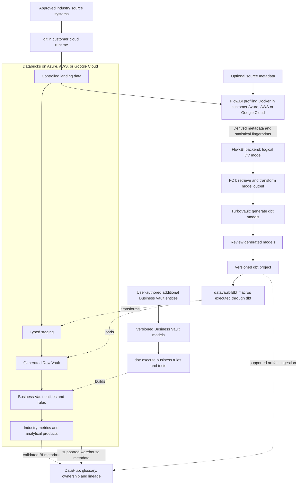

# Cloud Fisheries and Aquaculture Platform Selection Guide

**Connect stock/cohort origin, husbandry or catch events, biomass estimates, harvest, processing, and deliveries.**

Compare Snowflake, Databricks, Microsoft Fabric and Google BigQuery for a fisheries and aquaculture data platform supporting Connect stock/cohort origin, husbandry or catch events, biomass estimates, harvest, processing, and deliveries. This selection guide evaluates workload fit, integration, governance and total cost; four linked implementation blueprints carry the platform-specific architecture and delivery plan.
Audience: sector operations, domain specialists, finance/commercial teams, security, governance, and data engineering. Updated: 5 November 2026.

## Standalone platform blueprints

- [Snowflake implementation](snowflake/cloud-fisheries-and-aquaculture-snowflake-data-platform-blueprint.md)
- [Databricks implementation](databricks/cloud-fisheries-and-aquaculture-databricks-data-platform-blueprint.md)
- [Microsoft Fabric implementation](microsoft-fabric/cloud-fisheries-and-aquaculture-microsoft-fabric-data-platform-blueprint.md)
- [Google BigQuery implementation](google-bigquery/cloud-fisheries-and-aquaculture-google-bigquery-data-platform-blueprint.md)

## Technology roles in Fisheries and Aquaculture analytics

| Responsibility | Tools and contribution |
| --- | --- |
| Source intake and model discovery | [dlt](https://github.com/dlt-hub/dlt) (data load tool) is the ingestion library for supported API, database, and file feeds. In this fisheries and aquaculture design, it brings farm/vessel operations, feeding/catch records, and biomass estimates into controlled landing datasets with load evidence. [Flow.BI](https://flow.bi/) derives hubs, links, satellites, and their relationships from the data it profiles. The modeling input includes site/cage or vessel, stock cohort, and catch event; actual data is required, while available source metadata improves the result. |
| Connector and generation | For the fisheries and aquaculture model, [FCT](https://www.scalefree.com/consulting/turbovault/flowbi-connector/) (Flow.BI Connector for TurboVault4dbt) passes the generated logical model from Flow.BI into the TurboVault metadata workflow. [TurboVault](https://www.scalefree.com/consulting/turbovault/) generates model artifacts so the implementation follows the supplied metadata. Review those generated artifacts before executing the fisheries and aquaculture transformations; Studio is the online access option, requested through Scalefree. |
| Loading and business rules | [datavault4dbt](https://github.com/ScalefreeCOM/datavault4dbt) supplies the reusable staging, hub, link, and satellite macros invoked by the models. It contributes the technical history-loading foundation for site/cage or vessel, stock cohort, and catch event. [dbt](https://github.com/dbt-labs/dbt) runs the versioned SQL transformation project and its quality tests against the selected engine. User-defined Business Vault models add cohort transfer histories and biomass estimation versions within that workflow. |
| Database and cloud | [Databricks SQL and lakehouse tables](https://docs.databricks.com/aws/en/getting-started/architecture) is the reference target for this fisheries and aquaculture architecture. Databricks supplies the engineering and SQL compute; governed lakehouse tables hold source history, Vault entities, and derived products. This separates the query/runtime role from the underlying object storage. Deploy Databricks in the approved Azure, AWS, or Google Cloud environment near the source data and operational skills. That cloud supplies the surrounding storage, network, identity, and customer profiling runtime. Size and operate these services against the fisheries and aquaculture pilot rather than a generic platform benchmark. |
| Delivery and capability | [Scalefree](https://www.scalefree.com/) supports the data-platform lifecycle through architecture, engineering, governance, and skills development. For this blueprint, that support can include the fisheries and aquaculture source-to-model design, implementation of cohort transfer histories and biomass estimation versions, and training the team to maintain the resulting product. |

[DataHub](https://docs.datahub.com/docs/ui-ingestion) is the metadata catalog for this fisheries and aquaculture stack. It joins asset discovery, business definitions, ownership, and lineage so teams can trace site/cage or vessel and understand the derived rules for cohort transfer histories, biomass estimation versions, feed conversion, and origin-to-product mappings.

## Cloud data and model flow

Actual landing data is required for Flow.BI profiling; source metadata enriches the result. Raw source records remain in the customer environment during local profiling; the documented backend exchange needs approved outbound connectivity. Flow.BI output goes directly to FCT and TurboVault. Review follows generation and precedes datavault4dbt/dbt execution. Additional Business Vault entities carry user-maintained business logic. The DataHub edges represent integrations to configure and test, including explicit lineage for unsupported steps; catalog registration does not grant data access. Platform alternatives below use the same logical flow with their tested ingestion and dbt adapters.

## Fisheries and Aquaculture: operational workflow and source evidence

The first data product addresses this decision: **connect stock/cohort origin, husbandry or catch events, biomass estimates, harvest, processing, and deliveries.** Start with one bounded business unit, contract/product family, site, or reporting period and name the owner of the resulting decision. The pilot draws from farm/vessel operations, feeding/catch records, biomass estimates, treatment logs, processing/weighbridge, and sales.

| Workflow stage | Evidence and interpretation to retain |
| --- | --- |
| Establish origin | retain vessel/catch or hatchery/cohort identity |
| Grow or catch | record feed, conditions and authorized treatment |
| Harvest and process | preserve weights and lot splits |
| Deliver | bind product to origin and quality evidence |

Preserve the planned or promised position as well as actual execution. Maintain source-event time, business-effective time, arrival/load time, correction references, and the cutoff used for reporting. A late or missing delivery remains a visible data-quality state; it should not silently become zero activity.

## Data Vault entities and fact grain for fisheries and aquaculture

The business vocabulary includes **site/cage or vessel, stock cohort, catch event, biomass estimate, feed lot, treatment, harvest lot, process batch, and delivery**. The proposed fact grain is **cohort/site × observation/operation event, with harvested lot transformations separately measured**. Keep identifiers namespaced by the issuing system and organization. Distinguish source facts from estimates, allocations, approved business rules, and publication snapshots.

Flow.BI profiles required actual data; mostly optional source metadata improves results. Its output passes directly through **FCT → TurboVault → generated-model review → datavault4dbt/dbt execution**. The generated Raw Vault preserves source-attributed history. Users add Business Vault entities for **cohort transfer histories, biomass estimation versions, feed conversion, and origin-to-product mappings**. These user-authored extensions remain outside regenerated model paths.

Use the vocabulary to validate source semantics and define user-authored extensions. Review the generated implementation after TurboVault. Record the relevant package, adapter, generator, source-schema, rule, and runtime versions together.

## Worked fisheries and aquaculture example: calculation and reporting scope

A defined cohort gains 100 tonnes of biomass and consumes 120 tonnes of feed: illustrative feed conversion is 1.2 tonnes feed per tonne biomass gain. Harvested weight alone is not biomass gain; opening/closing estimates, mortality and transfers need an approved method.

Keep the calculation's numerator, denominator, unit/currency, eligible population, business calendar, cutoff, exclusions, and rule version with the published product. Original evidence and corrected knowledge should support both reconstruction of the earlier report and a separately identified restatement.

## Corrections, exceptions, and access in fisheries and aquaculture

Exercise **stock transfers, mortality corrections, mixed catches, feed unit errors, and revised harvest weights**. Build explicit associations for revisions and reversals so an event replay does not become a second business event. Measure reconciliation breaks at the fact grain before joining to descriptive or many-to-many relationships.

Protect **precise farm/vessel locations, animal-health information, treatment records, commercial quotas, and staff identities**. Establish purpose-specific permissions across direct SQL, BI, exports, and storage. Test revoked access and partner/client boundaries using the same routes consumers use. Retain source documents or large artifacts in an appropriate controlled repository and integrate authorized references and provenance.

[GS1 EPCIS standards](https://ref.gs1.org/standards/epcis/) is a relevant reference for the design. Use the event and identity concepts as a cross-partner mapping reference where appropriate. Preserve actual partner schemas, versions, quantities, and custody evidence.

### Managed-cloud value and operating fit

Choose managed execution for measured delivery and operating benefits: faster product delivery, appropriate workload elasticity, reduced infrastructure administration, and useful integration. Retain the domain's confidentiality, safety, contractual, and records requirements. Platform features do not replace accountable business definitions or source reconciliation.

## Pilot ownership, acceptance, and rollout

Ownership is explicit: **farm/fleet operations owns events; veterinary/quality teams own health evidence; commercial teams own delivered quantities**. Engineers own connector behavior, pipeline state, generated-model releases and recovery. Governance owners approve processing purpose, field scope, external disclosure, and retention. The report/data-product owner decides how unresolved exceptions affect publication.

For acceptance, **trace a delivery to source lots, reconcile cohort movements, and reproduce a revised biomass calculation**. Also demonstrate restart after a partial load, reproducible historical output, negative access tests, clean-environment recovery, and regeneration without losing Business Vault entities. Document thresholds and tolerances before assessing results rather than selecting them after a discrepancy appears.

Train business analysts on the worked example and denominator/grain choices. Train modelers using the sector's difficult cases, and require at least two internal operators to explain ingestion, review, execution, corrections, and restore. Extend one source or domain at a time after the pilot evidence and operating cost are accepted.

## Cloud platform recommendation and economic case

**Recommended starting point: Databricks on Azure, AWS, or Google Cloud.** This recommendation assumes a capable engineering team and substantial file/event processing in the incumbent approved cloud. The workload rationale is **environmental/operational time series and processing genealogy alongside structured commercial reporting**. Choose the specific cloud/region close to approved sources and operator skills; industry alone does not determine a universally best platform.

**Strong alternatives:** Snowflake for predominantly structured SQL/financial reporting; Fabric for Microsoft BI-led delivery; BigQuery for managed scan-oriented SQL without extensive custom engineering. Use the same source scope, historical correction cases, concurrency, freshness and recovery targets when comparing them.

### Databricks on Azure, AWS, or Google Cloud for fisheries and aquaculture

[Databricks](https://docs.databricks.com/aws/en/getting-started/architecture) contributes engineering and SQL execution over governed lakehouse tables. Use the approved incumbent cloud for storage, network and identity, then retain raw deliveries, typed source tables, the Raw Vault, and cohort transfer histories, biomass estimation versions, feed conversion, and origin-to-product mappings with an owned writer/refresh contract. Unity Catalog governs the platform assets; DataHub provides the cross-stack business discovery and lineage layer in this cloud edition.

Evaluate ingestion/replay and SQL serving for fisheries and aquaculture together. Preserve the fact grain and corrections while comparing job/SQL/serverless choices supported by the chosen cloud and edition. Include platform usage, underlying infrastructure where separately billed, table maintenance, storage, network, retries, and retained environments. A streaming or AI feature needs a measurable product use case.

### Snowflake on Azure or AWS for fisheries and aquaculture

[Snowflake](https://docs.snowflake.com/en/user-guide/cost-understanding-overall) provides the managed SQL warehouse for fisheries and aquaculture. Land approved source deliveries, build staging and the Raw Vault with the tested Snowflake adapter, and implement cohort transfer histories, biomass estimation versions, feed conversion, and origin-to-product mappings as owned Business Vault models. Align the Azure or AWS account/region with the source estate, consumers, and operating skills.

Use distinct load, transformation, and reporting compute where the fisheries and aquaculture service windows need isolation. The evaluation must reconstruct historical site/cage or vessel evidence and run concurrent consumers while applying a correction. Price compute, storage/retained copies, managed/serverless features used, transfer, and recovery; an AWS-to-Azure change is a migration decision with its own cost.

### Microsoft Fabric on Azure for fisheries and aquaculture

[Microsoft Fabric](https://learn.microsoft.com/en-sg/fabric/fundamentals/decision-guide-lakehouse-warehouse) combines managed analytical services and Power BI delivery. For fisheries and aquaculture, use Warehouse as the tested SQL/dbt target when that is the selected route, and keep Lakehouse/file/Spark processing an explicit option with separate adapter/write tests. Azure supplies the surrounding customer identity, source-access and profiling environment.

Define cohort transfer histories, biomass estimation versions, feed conversion, and origin-to-product mappings once in the agreed transformation/semantic layer and test the handoff to reports. Measure capacity contention during a real fisheries and aquaculture refresh and consumer burst. Include capacity, storage, applicable BI/user licensing, ingestion, and administration. Validate the dlt-to-landing and landing-to-Warehouse path before treating source ingestion as production-ready.

### Google Cloud with BigQuery for fisheries and aquaculture

[BigQuery](https://cloud.google.com/bigquery/pricing) is the managed warehouse and SQL engine for a Google Cloud implementation. Use governed projects/datasets, supported ingestion, a tested BigQuery adapter, and explicit partition/cluster choices for site/cage or vessel, stock cohort, catch event, biomass estimate, feed lot, treatment, harvest lot, process batch, and delivery. Customer-controlled Google Cloud services also host source landing and the Flow.BI profiling component.

Benchmark connect stock/cohort origin, husbandry or catch events, biomass estimates, harvest, processing, and deliveries with representative data and historical corrections. Compare on-demand analysis with capacity-based execution under the same refresh and concurrency targets. Measure scanned data/capacity, storage, load/streaming features actually used, transfer, BI, and operator time. Predicate pruning and repeat-query behavior must be demonstrated with this industry's facts.

### Ingestion contract for the platform comparison

**Primary ingestion: dlt (open-source library).** The fisheries and aquaculture team owns source code/configuration, compatible drivers/destinations, extraction state, packaging, schedules and recovery. Preserve source event/version evidence and prove deletes, late records and schema changes. Include engineering, execution and maintenance in TCO. Fivetran is a managed commercial alternative when documented connectors and a complete cost comparison support it.

Use dlt only through a supported source/destination or a validated landing-to-target load path. Verify Fabric Warehouse versus Lakehouse endpoints separately; matching a SQL protocol or writing files does not establish complete target compatibility.

### Sector-specific cost and feature test

Measure **sensor retention, remote connectivity/replay, biomass recalculation, and spatial/model processing**. Attribute normal refreshes, backfills, peak consumer demand, retries, retained history and staff effort separately. Report both cost per accepted source batch/data-product refresh and the meaningful business unit established in the worked example. A lower cost is useful only if correctness and the declared service target are maintained.

Use the difficult cases and acceptance exercise above as the platform benchmark. Compare cold and warm runs, record cache effects, and include the cost of a historical reconstruction. New streaming, AI, sharing, or semantic features enter the design only through a named use case, a supported regional/edition configuration, a measured benefit, and an incremental operating cost.

## Operate and govern by data product

Assign each product a business owner, technical operator, purpose, grain, definitions, refresh target, classification, retention, and quality thresholds. Preserve source batch/offset IDs, code/package versions, calculation rules, cutoff, and exception status with published outputs. Keep operational-system decisions and regulated calculation engines within their validated authority boundaries.

Use institutional identity, scoped service principals, separate development/production, secret management, auditable privileged access, and approved network routes. Enforce restrictions through SQL, BI, export, and underlying storage. Test actual negative access and revocation behavior. A managed service or compliant provider does not establish application-level compliance.

Choose orchestration and alerts around the product's dependencies. A late source or unresolved material reconciliation break should affect publication status. Define retries and recovery of ingestion state, metadata/catalogs, data, credentials, and deployment artifacts. Demonstrate rollback and a clean-environment restore.

## Compare lifecycle cost and delivery value

The managed-cloud case is **shorter delivery time, reduced infrastructure administration, elastic execution, and useful platform integration**. The decision is an operating-model tradeoff. Keep privacy, contractual requirements, data-location constraints, and an exit plan even when sovereignty is not the main objective.

Use a three-year model with an explicit growth scenario:

`TCO = migration and implementation + platform/compute + storage and retained copies + ingestion/orchestration + network/egress + BI/security licenses + support + operating staff + recovery/testing + exit allowance`

Account for negotiated rates and existing commitments as incremental costs, without treating sunk licenses or staff effort as free. Measure normal, peak, backfill, and quiet-period workloads. Record costs per completed data-product refresh and per meaningful business unit, together with correctness and service quality. Compare low/base/high demand and sensitivity to refresh frequency, retention, concurrency, and source growth. Do not publish a cost-saving percentage without the corresponding workload and pricing assumptions.

For feature decisions, record the use case, production availability in the selected region/edition, integration limits, expected outcome, incremental cost, operating owner, and rollback. Prefer an ordinary SQL or scheduled pipeline when it meets the product goal more economically. New AI, streaming, or sharing capabilities should earn their place through a measured pilot.

## Delivery gates

1. Agree the product's grain, calculation, scope, cutoff, access, and reconciliation targets with its business owner.
2. Benchmark the recommended platform against the strongest alternative using the same sources and workload, including cold/warm runs and concurrent consumers.
3. Build the ingestion/model-generation path; review after TurboVault; run tested macros and add Business Vault rules.
4. Prove the industry's worked example and failure cases, historical reconstruction, permissions, restart, restore, and regeneration behavior.
5. Compare measured run cost and staff effort with the business case. Document limitations and choose the platform before committing to broad migration.

## DataHub governance for fisheries and aquaculture

[DataHub](https://docs.datahub.com/docs/ui-ingestion) is the metadata catalog for this fisheries and aquaculture stack. It joins asset discovery, business definitions, ownership, and lineage so teams can trace site/cage or vessel and understand the derived rules for cohort transfer histories, biomass estimation versions, feed conversion, and origin-to-product mappings.

For this product, register **site/cage or vessel, stock cohort, catch event, biomass estimate, feed lot, treatment, harvest lot, process batch, and delivery** as governed concepts linked to real assets. Describe **cohort transfer histories, biomass estimation versions, feed conversion, and origin-to-product mappings** with an owner, calculation/rule version, eligible population, cutoff, and known limitations. Publish only the metadata fields that the catalog users are authorized to see.

### Deployment and processing boundary

Use DataHub Core in a customer-managed environment as the reference open-source catalog, or choose DataHub Cloud under an explicit service agreement. Budget catalog infrastructure/search, upgrades, credentials, metadata collection, and stewardship; a managed catalog adds its subscription and provider dependencies. This catalog complements the database's native access controls and, where present, Unity Catalog or a table-format metastore.

### Connect execution evidence to meaning

Collect [dbt artifacts and target-warehouse metadata](https://docs.datahub.com/docs/generated/ingestion/sources/dbt) together so model nodes resolve to the actual tables/views. Select supported warehouse/BI sources and validate the specific Fabric or Cloudberry route where relevant. For Fivetran-led ingestion, assess the [DataHub Fivetran source](https://docs.datahub.com/docs/generated/ingestion/sources/fivetran) for connector metadata/lineage coverage. Use explicit API-emitted lineage for unrepresented steps rather than assuming the full source-to-report path is automatic.

dbt remains the execution/test layer; DataHub collects the supported metadata and quality results. Test which table/column lineage, test status, and deletion behavior are captured by the actual sources and artifact versions.

Catalog acceptance follows the fisheries and aquaculture pilot: trace an approved source field through a generated model and Business Vault extension to a published metric, then test a schema change, a stale scan, and a permission revocation. Mask sample values and sensitive SQL/descriptions where required. Track scan coverage and unresolved lineage gaps explicitly.

## Training and knowledge transfer

Make capability development a delivery workstream with practical acceptance criteria.

| Track | Training resource | Participants | Proposed project outcome |
| --- | --- | --- | --- |
| DV — Data Vault | [Data Vault Training & Certification](https://www.scalefree.com/data-vault-2-1-trainings/data-vault-training-certification/) and [Modeling Class](https://www.scalefree.com/data-vault-2-1-trainings/data-vault-2-1-modeling-class/) | Architects, modelers, engineering leads; selected stewards for shared concepts. | Understand generated Raw Vault structures and design additional Business Vault entities with the correct keys, grain, and history. |
| DWA — Data Warehouse Automation | [Scalefree dbt training: DataVault4dbt and TurboVault automation blocks](https://www.scalefree.com/training/dbt-training/) | Modelers, engineers, and release owners. | Operate the Flow.BI–FCT–TurboVault workflow, review generated models before datavault4dbt/dbt execution, and regenerate without overwriting user-authored Business Vault entities. |
| dbt | [Scalefree dbt Training](https://www.scalefree.com/training/dbt-training/) | Data engineers, analytics engineers, and operators. | Build and test models, use packages/macros, debug failures, and promote releases through controlled environments. |
| Flow.BI foundations | [Flow.BI Introduction](https://flow.bi/trainings/flow-bi-introduction/) | Business analysts, domain stewards, architects, project leads, and engineers. | Understand the interface, data sources, deployment targets, and first model-generation run. |
| Flow.BI configuration and operations | [Flow.BI In-Depth](https://flow.bi/trainings/flow-bi-in-depth/) | Engineers, architects, and platform operators. | Configure classification, permissions, API access, and integration settings for the organization environment. |
| Understanding generated models | [Generated Data Vault Models](https://flow.bi/trainings/generated-data-vault-2-0-models/) | Data modelers, engineers, and architects. | Interpret generated structures and their downstream physical implementation; apply this knowledge to the review after TurboVault and to Business Vault extensions. |
| Flow.BI metadata presentation | [Presenting Flow.BI Metadata — training catalog](https://flow.bi/trainings/) | Modelers, analysts, and metadata/catalog owners. | Use Flow.BI dashboards to present internal metadata to authorized users. |
| Catalog stewardship | [DataHub documentation](https://docs.datahub.com/docs/ui-ingestion) | Data owners, stewards, catalog operators, and engineers. | Document site/cage or vessel, approve definitions, trace model lineage, and operate metadata scans and access. |

**Terminology:** DWA means Data Warehouse Automation. The DWA training track uses Scalefree's published automation learning blocks. DVA refers exclusively to the Data Vault Alliance.

The Data Vault certification training covers Data Vault 2.1. Align the curriculum with the selected tool versions and implementation patterns. Its dbt offering is customizable; agree the agenda and prerequisites before booking.
Flow.BI In-Depth requires Flow.BI Introduction and general data-architecture knowledge. Generated Data Vault Models requires Flow.BI Introduction and Data Vault modeling knowledge. Use the [Flow.BI training catalog](https://flow.bi/trainings/) to select classes or a bundle and confirm current delivery details.

Recommended sequence:

1. Run DV foundations and modeling to understand the generated Raw Vault and design Business Vault extensions.
2. Complete Flow.BI Introduction before connecting the pilot sources; follow with In-Depth for the configuration and operations team and Generated Data Vault Models for modelers and engineers.
3. Run dbt fundamentals before building the first transformation pipeline.
4. Run DWA practical sessions when the first Flow.BI output is available for direct processing through FCT and TurboVault. Include metadata presentation training for the team publishing model documentation.
5. Complete an organization-led lab using synthetic datasets for the selected industry workflow: dlt ingestion, Flow.BI generation, direct FCT transfer, TurboVault generation, generated-model review, datavault4dbt/dbt execution, user-added Business Vault entities, and industry-specific reconciliation.
6. Require at least two internal operators to deploy, troubleshoot, restore, and explain the pipeline without external assistance.

Budget training, preparation time, labs, and follow-up coaching separately from software and hosting. Use the [current training catalog](https://www.scalefree.com/training/) for available formats and scheduling.

## Scalefree implementation resources

The following articles complement the product documentation and training. Read the Flow.BI/FCT integration overview first, then TurboVault generation, datavault4dbt staging and loading, and finally Business Vault extensions and deployment practices.

| Tool or topic | Scalefree blog resource | Application to this blueprint |
| --- | --- | --- |
| Flow.BI, FCT, TurboVault, and datavault4dbt | [Flow.BI: Generating the Raw Data Vault Using AI and dbt](https://www.scalefree.com/blog/modeling/flow-bi-generating-the-raw-data-vault-using-ai-and-dbt/) | Explains the logical-to-physical automation chain and connector, and the addition of business logic in the Business Vault. Pair it with the [FCT access page](https://www.scalefree.com/consulting/turbovault/flowbi-connector/) for onboarding. |
| TurboVault | [Speed Up Your Data Vault 2.0 Implementation with TurboVault4dbt](https://www.scalefree.com/blog/tools/speed-up-your-data-vault-2-0-implementation-with-turbovault4dbt/) | Introduces metadata-driven dbt model generation. Use it to understand the generation stage before the review phase. |
| datavault4dbt overview | [Kick-Start Your Data Vault 2.0 Implementation with datavault4dbt](https://www.scalefree.com/blog/tools/kick-start-your-data-vault-2-0-implementation-with-datavault4dbt/) | Introduces loading templates and the package's role within dbt. Useful background before the hands-on training. |
| datavault4dbt staging | [Exploring datavault4dbt — Vol. 1: The Staging Layer](https://www.scalefree.com/blog/tools/exploring-datavault4dbt-a-practical-series-on-the-dbt-package-for-data-vault-2-0-vol-1-the-staging-layer/) | Covers staging configuration, hashing, derived columns, and prejoins. Apply these concepts when connecting the dlt landing datasets to generated transformations. |
| datavault4dbt Raw Vault | [Exploring datavault4dbt — Vol. 2: Standard Entities in the Raw Vault](https://www.scalefree.com/blog/datenwerkzeuge/exploring-datavault4dbt-a-practical-series-on-the-dbt-package-for-data-vault-2-0-vol-2-standard-entities-in-the-raw-vault/) | Walks through hubs, links, and satellites. Use it to interpret the models produced by TurboVault and their macro parameters. |
| Business Vault extensions | [Designing the Business Vault: Key Strategies for Effective Data Organization](https://www.scalefree.com/blog/data-vault/designing-the-business-vault-key-strategies-for-effective-data-organization/) | Explains reusable business logic and additional entities such as computed satellites, links, PITs, and bridges. Relevant to user-defined organization extensions after Raw Vault generation. |
| dbt delivery and testing | [CI/CD: Practical Insights into Automating Data Vault 2.0 with dbt](https://www.scalefree.com/blog/data-vault/ci-cd-practical-insights-into-automating-data-vault-2-0-with-dbt/) | Uses datavault4dbt and GitHub Actions to illustrate testing and delivery automation. Adapt execution and runner placement to the organization's cloud boundary. |
| PostgreSQL workload assessment | [Architectural Limitations of PostgreSQL for Enterprise Data Vault Workloads](https://www.scalefree.com/blog/data-vault/architectural-limitations-of-postgresql-for-enterprise-data-vault-workloads/) | Explains why a bounded PostgreSQL pilot is not a large-scale Data Vault recommendation. Compare the selected platform with Cloudberry MPP and its per-table row/column storage where an open relational warehouse is required. |
| Sovereignty, Iceberg, and Trino | [The Sovereign Data Platform: The Path to Data Ownership and Secure AI](https://www.scalefree.com/blog/architecture/the-sovereign-data-platform-the-path-to-data-ownership-and-secure-ai/) | Discusses controlled object storage, open table formats, and replaceable query engines, including Trino. Supports the portability and storage/compute separation principles. |

Examples in older articles may use earlier package versions, metadata layouts, or specific cloud databases. Use the pinned tool versions and current documentation for implementation details. For dlt ingestion and Trino/Iceberg configuration, use the primary documentation already linked in the platform and ingestion guidance in this document alongside these architectural resources. Browse the [Scalefree blog](https://www.scalefree.com/blog/) for further articles.

## Flow.BI implementation resources

Use the [Flow.BI blog](https://flow.bi/blog/) for ongoing product architecture and implementation material. Relevant starting points:

| Resource | Why it matters to this blueprint |
| --- | --- |
| [How Flow.BI Protects Sensitive Enterprise Data](https://flow.bi/blog/how-flow-bi-protects-sensitive-enterprise-data/) | Explains required data profiling, the local Docker image, storage access, and the local/backend processing boundary. |
| [Seeing Every Step: Data Lineage Inside Flow.BI](https://flow.bi/blog/seeing-every-step-data-lineage-inside-flow-bi/) | Describes source-to-model traceability and graph views. Use this model lineage alongside dlt load evidence and dbt execution lineage. |
| [Turning Salesforce and Pardot Tables Into a Semantic Model](https://flow.bi/blog/turning-salesforce-and-pardot-tables-into-a-semantic-model/) | Illustrates concept recognition and declared versus inferred relationships using CRM data. Use it as background on model generation; organization-specific additions in this blueprint are implemented through Business Vault entities. |
| [Generative AI for Data Vault](https://flow.bi/ai-driven-business/) | Explains the progression from data profiling to a logical Data Vault model and downstream physical-model automation. |
| [Flow.BI Media Library](https://flow.bi/media/) | Includes local-processing, bring-your-own-bucket, modeling, and dbt integration sessions for team onboarding. |

## Choosing a cloud data platform for fisheries and aquaculture

### Which cloud data warehouse fits fisheries and aquaculture?

Begin with the workload for **Connect stock/cohort origin, husbandry or catch events, biomass estimates, harvest, processing, and deliveries** and the actual source estate. Compare SQL/reporting demand, event engineering, semantic delivery, historical corrections and the incumbent cloud. The recommendation in this guide is conditional; test the strongest alternative before selecting the platform.

### How should fisheries and aquaculture teams compare platform costs?

Run the same site/cage or vessel, stock cohort, and catch event scope, reconciliation cases, refresh target and concurrent consumers on the candidates. Include migration, ingestion, compute, storage, transfer, BI, catalog operations, staffing, recovery and exit. A lower consumption bill is not a saving if correctness, service quality or required operating work changes.

## Related blueprints

- [Sovereign fisheries and aquaculture data platform](../sovereign/sovereign-fisheries-and-aquaculture-data-platform-blueprint.md)
- [Fisheries and Aquaculture on Snowflake](snowflake/cloud-fisheries-and-aquaculture-snowflake-data-platform-blueprint.md)
- [Fisheries and Aquaculture on Databricks](databricks/cloud-fisheries-and-aquaculture-databricks-data-platform-blueprint.md)
- [Fisheries and Aquaculture on Microsoft Fabric](microsoft-fabric/cloud-fisheries-and-aquaculture-microsoft-fabric-data-platform-blueprint.md)
- [Fisheries and Aquaculture on Google BigQuery](google-bigquery/cloud-fisheries-and-aquaculture-google-bigquery-data-platform-blueprint.md)
- [All industry and technology blueprints](../../../README.md)

## Next steps

Validate the [DataHub metadata integration](https://docs.datahub.com/docs/ui-ingestion) and include catalog deployment, licensing/operations, stewardship, and source-to-report lineage in the architecture discussion.

Select the pilot described in this blueprint, name its business and technical owners, and bring representative source data, reporting definitions, workload volumes, and operating constraints to an architecture discussion.

| Step | Where to go | What to request or prepare |
| --- | --- | --- |
| Discuss the implementation | [Scalefree contact form](https://www.scalefree.com/about-scalefree/contact/) | Request a platform assessment, pilot workshop, implementation support, or tailored training. Include the blueprint title and the first data product. |
| Try automated modeling | [Flow.BI trial registration](https://flow.bi/sign-up-for-trial/) | Request a trial and local-processing Docker deployment instructions. Prepare authorized source data; available metadata improves the result. |
| Obtain the connector | [FCT access and download request](https://www.scalefree.com/consulting/turbovault/flowbi-connector/) | Request Flow.BI Connector for TurboVault4dbt access and verify the intended generator version. |
| Install the macro package | [datavault4dbt repository and releases](https://github.com/ScalefreeCOM/datavault4dbt) | Obtain the package, choose a supported target adapter, and pin a tested version. |
| Access the online generator | [Request TurboVault Studio signup through Scalefree](https://www.scalefree.com/about-scalefree/contact/) | Ask specifically for the new online TurboVault Studio and its Flow.BI/FCT integration route. |
| Obtain a downloadable generator | [TurboVault4dbt](https://github.com/ScalefreeCOM/turbovault4dbt) and [TurboVault Engine](https://github.com/ScalefreeCOM/turbovault-engine) | Select the edition that fits the integration and retain its version and configuration. |
| Receive implementation updates | [Scalefree newsletter registration](https://www.scalefree.com/) | Use the “Data Vault 2.GO / Build Better Data Platforms” newsletter form on the homepage. |

Complete the pilot's reconciliation, access, recovery, and cost checks before extending the source scope. Record the results and the decision to proceed in the project repository.

## License

Copyright © 2026 Scalefree International GmbH. The original text, tables, and diagrams in this blueprint are licensed under [CC BY-SA 4.0](https://creativecommons.org/licenses/by-sa/4.0/). Credit Scalefree, identify changes, and retain the applicable ShareAlike terms when distributing adaptations. See [LICENSE.md](../../../LICENSE.md) for scope, attribution, and the governing legal code. Referenced software and third-party material retain their own licenses.
