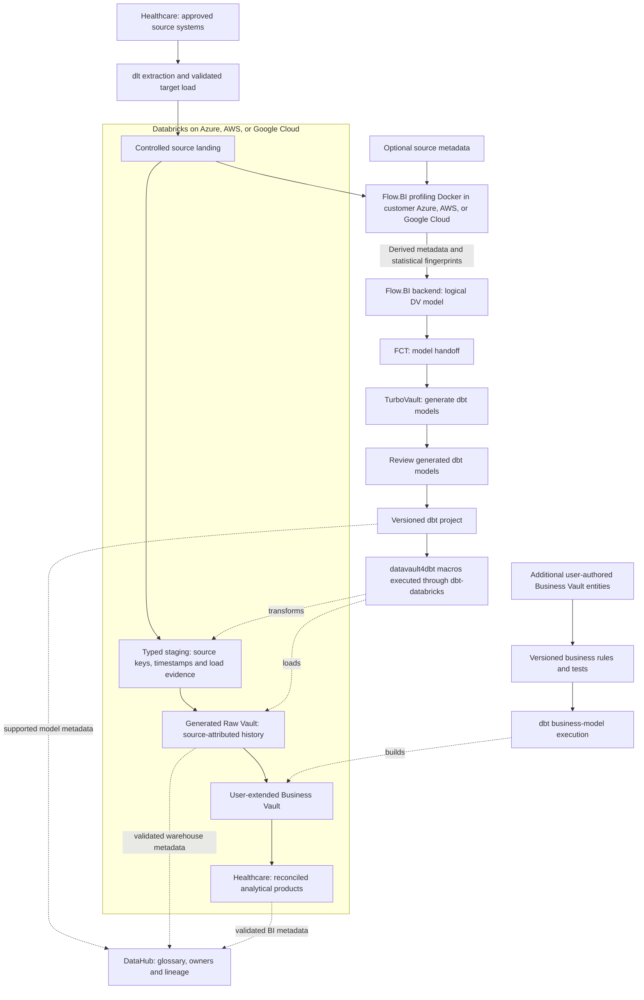

# Cloud Healthcare Databricks Data Platform Blueprint

**Create a governed longitudinal view across providers without losing clinical context, provenance, or purpose restrictions.**

Build a Databricks data warehouse for healthcare around patient reference, referral, and appointment. This blueprint connects dlt ingestion, Flow.BI modeling, Data Vault automation and DataHub governance to cross-provider referral completion, with a platform-specific flow diagram and operating plan.
Audience: provider-network leadership, clinical informatics, care coordination, privacy, research governance, and data teams. Updated: 5 November 2026.

[Industry platform selection guide](../cloud-healthcare-platform-selection-guide.md) · [Sovereign edition](../../sovereign/sovereign-healthcare-data-platform-blueprint.md) · [All blueprints](../../../../README.md)

## Tools behind the healthcare Databricks platform

[dlt](https://github.com/dlt-hub/dlt) is the open-source ingestion library used to extract approved referral, appointment, encounter, and organization feeds. The healthcare team owns connector code, load state, schedules, and a tested landing-to-target path.

[Flow.BI](https://flow.bi/) builds a logical Data Vault from profiled source datasets and their relationships for patient reference, referral, and appointment. Actual data is required; mostly optional source metadata improves modeling. Its customer-cloud Docker component profiles locally and sends derived metadata and statistical fingerprints to the backend.

[FCT](https://www.scalefree.com/consulting/turbovault/flowbi-connector/) (Flow.BI Connector for TurboVault4dbt) retrieves and translates the generated model into metadata for the generator. [TurboVault](https://www.scalefree.com/consulting/turbovault/) creates physical-model definitions as dbt project artifacts. Its generated models are reviewed before execution; request online TurboVault Studio access through Scalefree.

[datavault4dbt](https://github.com/ScalefreeCOM/datavault4dbt) provides the transformation templates for staging and historized Vault entities, while [dbt](https://github.com/dbt-labs/dbt) orchestrates the SQL model dependency graph through compilation, execution, and tests. Additional user-authored Business Vault entities implement **approved patient crosswalks and referral episodes** outside the regenerated paths.

[Databricks SQL and lakehouse tables](https://docs.databricks.com/aws/en/getting-started/architecture) is the database/compute target for healthcare: Databricks supplies the engineering and SQL compute; governed lakehouse tables hold source history, Vault entities, and derived products. This separates the query/runtime role from the underlying object storage. Deploy Databricks in the approved Azure, AWS, or Google Cloud environment near the source data and operational skills. That cloud supplies the surrounding storage, network, identity, and customer profiling runtime.

[DataHub](https://docs.datahub.com/docs/ui-ingestion) provides cross-stack discovery, business definitions, ownership, and lineage for patient reference, referral, and appointment; native platform permissions remain in force.

[Scalefree](https://www.scalefree.com/) helps organizations plan, implement, automate, and operate data and analytics solutions. The engagement connects Databricks implementation to the healthcare workflow, governed business rules, and team enablement.

## Databricks data and model flow

Source values for patient reference, referral, and appointment are required for profiling. The local Docker component keeps raw source records in the customer environment during profiling and needs approved outbound backend connectivity for derived metadata and fingerprints. Flow.BI output goes directly through FCT and TurboVault; the review occurs after generation and before macro execution. Catalog edges represent configured integrations with tested coverage, including explicit lineage where automatic discovery is incomplete.

## Implement healthcare on Databricks

This is the **Databricks implementation** of the healthcare workflow. Its purpose is **cross-provider referral completion**. Validate the selected target against the worked example and operational failure cases in this document. The platform comparison is available separately; this article carries the complete implementation, training, resources, and Next steps for this stack.

[Databricks](https://docs.databricks.com/aws/en/getting-started/architecture) contributes engineering and SQL execution over governed lakehouse tables. Use the approved incumbent cloud for storage, network and identity, then retain raw deliveries, typed source tables, the Raw Vault, and approved patient crosswalks and referral episodes with an owned writer/refresh contract. Unity Catalog governs the platform assets; DataHub provides the cross-stack business discovery and lineage layer in this cloud edition.

Evaluate ingestion/replay and SQL serving for healthcare together. Preserve the fact grain and corrections while comparing job/SQL/serverless choices supported by the chosen cloud and edition. Include platform usage, underlying infrastructure where separately billed, table maintenance, storage, network, retries, and retained environments. A streaming or AI feature needs a measurable product use case.

### Table ownership and event replay

Keep a durable source-delivery record, typed staging tables, generated Vault tables and user-authored Business Vault models. Register the production tables under the agreed Unity Catalog catalog/schema with one accountable writer per table. For patient reference, referral, and appointment, preserve source event/version identifiers, business-effective time and load time; a streaming checkpoint is processing state, not the historical business record. A replay needs an idempotence contract and explicit handling of corrections and deleted source records.

### SQL/dbt execution and physical layout

Use dbt-databricks against the selected SQL execution endpoint and pin its compatibility with datavault4dbt. Validate the materializations and history-load behavior on Delta tables before scaling. Partitioning, clustering and maintenance choices follow the healthcare access and update pattern; use query profiles and maintenance cost to choose them. Prevent notebooks or engineering jobs from writing concurrently to dbt-owned Vault targets. Bronze/silver/gold naming may describe processing stages, but each table still needs an explicit mapping to landing, Raw Vault, Business Vault or serving.

### Separate engineering demand from serving commitments

Allocate source preparation, history replay, dbt transformation and analytical serving to owned workloads. Benchmark a late-source correction while consumers query approved patient crosswalks and referral episodes; track both result correctness and contention. The budget includes platform usage and cloud compute/storage/network charges where applicable, idle or restart overhead, table maintenance and retained data. Unity Catalog supplies native asset governance; DataHub connects cross-stack business meaning and lineage without replacing platform authorization.

### Ingestion contract

**Primary ingestion: dlt (open-source library).** The healthcare team owns source connectors, extraction/load state, schedules, runtime and recovery. Preserve source identifiers, deleted-record evidence and schema changes in a controlled load contract. Use a supported destination or a validated intermediate file/database load path; source support does not establish target-write support. Include engineering effort, execution infrastructure and maintenance in the lifecycle cost.

### Platform acceptance and operating evidence

The release record contains job and SQL execution evidence, Delta table versions, dbt artifacts, and compute attribution. Join it to source delivery IDs, generator/package/adapter versions, model approval, calculation rule versions and publication cutoffs. Execute a duplicate, a late correction, partial-load recovery, regeneration without losing user-authored Business Vault entities, permission revocation and clean-environment restore using this industry's actual grain.

Reconstruct a referral cohort, apply a patient unmerge, and revoke one participant’s access while testing concurrent provider reporting. Use identical source scope, correction cases, service targets, and business definitions when comparing platforms.

Report cost per **accepted referral/encounter batch and governed network product refresh**, plus end-to-end freshness, concurrent-consumer response, reconciliation exceptions, and operator hours. Specifically measure duplicate provider extracts, identity-reprocessing work, permission administration, and separate research copies.

### Implementation documentation

Use the [Databricks platform documentation](https://docs.databricks.com/aws/en/getting-started/architecture), [dbt-databricks setup](https://docs.getdbt.com/docs/local/connect-data-platform/databricks-setup), and [datavault4dbt supported platforms and documentation](https://www.datavault4dbt.com/) to pin the implementation. Feature availability and adapter/materialization behavior are part of the pilot acceptance record. Select each additional feature against a concrete healthcare use case and incremental operating cost.

## Follow a referral across organizations

A healthcare network needs to understand whether a referral reached the receiving service, whether an appointment occurred, and whether the result returned to the originating clinician. The integration problem spans identity, coding, timestamps, and organizational authority. This blueprint focuses on cross-provider coordination and analytical reuse. The separate hospital blueprint focuses on operations inside a hospital.

The first product is referral-to-completed-encounter reporting across two participating providers. Start with structured referral, scheduling, encounter, and organization data. Clinical decision support, prescribing, and automated treatment recommendations require separate clinical validation and operational designs.

| Stage | Event and evidence | Decision supported |
| --- | --- | --- |
| Referral issued | Referral/order ID, reason code, originating organization, issue time | Establish the requested service and accountable provider. |
| Referral received | Receiving ID, triage status, acceptance time | Identify rejected, redirected, or unacknowledged requests. |
| Appointment arranged | Appointment status, rescheduling chain, service location | Measure access while retaining cancellations. |
| Encounter completed | Encounter ID, completion status, actual timing | Distinguish delivered care from a scheduled slot. |
| Result returned | Result/report metadata and delivery status | Identify coordination gaps under authorized access. |

## Identity and clinical meaning form the integration contract

Keep patient identifiers namespaced by issuer and organization. An enterprise patient index or approved matching service supplies governed cross-provider matches; do not join patients solely by name, date of birth, or a generated hash. Preserve match provenance, confidence/status, merges, and unmerges.

Separate patient, practitioner, organization, referral, appointment, encounter, observation, specimen, and result/report. Version terminology mappings and preserve original codes, units, clinical status, and correction status. A preliminary result and an amended final result represent different source states.

Use [HL7 FHIR](https://hl7.org/fhir/overview.html) interfaces where the actual systems support them, with an explicit FHIR version and implementation profile. FHIR resources are an exchange representation; flattening them into tables must preserve repeated values, references, provenance, and history needed by the use case. dlt requires validated resources/adapters and pagination/history behavior; it is not assumed to be a clinical interface engine.

## A referral metric with an explicit denominator

Suppose a cohort contains 100 accepted referrals. By the agreed cutoff, 65 have a completed qualifying encounter, 10 are cancelled, and 25 remain open. A defined completion proportion for that original accepted cohort is 65%. A denominator excluding cancellations would yield 65/90, or approximately 72.2%; publish neither without declaring the rule.

The fact grain is **referral × destination service × status-effective event**, with appointment and encounter links. Record transfers to another provider rather than counting a new referral automatically. Include cohort entry date, reporting cutoff, and the policy for withdrawn or duplicate referrals.

Users add Business Vault entities for approved patient crosswalks, service taxonomies, referral episodes, and elapsed-time measures. Flow.BI output proceeds through FCT and TurboVault; the review occurs after model generation and before datavault4dbt/dbt execution.

## Protect care relationships and secondary uses

Assign access by participating organization, clinical purpose, and approved data product. Separate direct-care, operational planning, and research permissions. Pseudonymization does not by itself authorize cross-provider sharing or make records anonymous. Protect small cohorts and rare-condition combinations in externally shared aggregates.

For EU settings, map [GDPR](https://eur-lex.europa.eu/eli/reg/2016/679/oj/eng) requirements and applicable health-sector law. For relevant US operations, assess [HIPAA covered-entity/business-associate status](https://www.hhs.gov/hipaa/for-professionals/covered-entities/index.html) and necessary arrangements. Do not assume these regimes apply identically to every participant.

Flow.BI's local Docker profiler must read authorized data within the selected Azure, AWS, or Google Cloud boundary. Classify its outbound derived metadata and statistical fingerprints before approving the backend connection. Patient or condition names in structural metadata can also be sensitive.

## Demonstrate coordination before scaling

Clinical informatics approves interpretation, participating providers approve sharing, identity stewards manage match exceptions, and privacy/research owners govern secondary use. Train analysts on encounter/referral definitions and operators on identity corrections and data-access auditing.

The pilot must account for every source referral, preserve rescheduling history, handle patient unmerge, distinguish cancelled from completed encounters, and reproduce cohort results at two cutoffs. Test revoked participant access and suppression of small exported groups. Acceptance includes referral/encounter reconciliation and source-to-report lineage reviewed by clinical owners.

Expand into longitudinal quality measures and research-ready products only after these foundations work. The complete technical, deployment, training, and reference guidance follows within this document.

## Operate and govern by data product

Assign each product a business owner, technical operator, purpose, grain, definitions, refresh target, classification, retention, and quality thresholds. Preserve source batch/offset IDs, code/package versions, calculation rules, cutoff, and exception status with published outputs. Keep operational-system decisions and regulated calculation engines within their validated authority boundaries.

Use institutional identity, scoped service principals, separate development/production, secret management, auditable privileged access, and approved network routes. Enforce restrictions through SQL, BI, export, and underlying storage. Test actual negative access and revocation behavior. A managed service or compliant provider does not establish application-level compliance.

Choose orchestration and alerts around the product's dependencies. A late source or unresolved material reconciliation break should affect publication status. Define retries and recovery of ingestion state, metadata/catalogs, data, credentials, and deployment artifacts. Demonstrate rollback and a clean-environment restore.

## Compare lifecycle cost and delivery value

The managed-cloud case is **shorter delivery time, reduced infrastructure administration, elastic execution, and useful platform integration**. The decision is an operating-model tradeoff. Keep privacy, contractual requirements, data-location constraints, and an exit plan even when sovereignty is not the main objective.

Use a three-year model with an explicit growth scenario:

`TCO = migration and implementation + platform/compute + storage and retained copies + ingestion/orchestration + network/egress + BI/security licenses + support + operating staff + recovery/testing + exit allowance`

Account for negotiated rates and existing commitments as incremental costs, without treating sunk licenses or staff effort as free. Measure normal, peak, backfill, and quiet-period workloads. Record costs per completed data-product refresh and per meaningful business unit, together with correctness and service quality. Compare low/base/high demand and sensitivity to refresh frequency, retention, concurrency, and source growth. Do not publish a cost-saving percentage without the corresponding workload and pricing assumptions.

For feature decisions, record the use case, production availability in the selected region/edition, integration limits, expected outcome, incremental cost, operating owner, and rollback. Prefer an ordinary SQL or scheduled pipeline when it meets the product goal more economically. New AI, streaming, or sharing capabilities should earn their place through a measured pilot.

## Delivery gates

1. Agree the product's grain, calculation, scope, cutoff, access, and reconciliation targets with its business owner.
2. Benchmark the recommended platform against the strongest alternative using the same sources and workload, including cold/warm runs and concurrent consumers.
3. Build the ingestion/model-generation path; review after TurboVault; run tested macros and add Business Vault rules.
4. Prove the industry's worked example and failure cases, historical reconstruction, permissions, restart, restore, and regeneration behavior.
5. Compare measured run cost and staff effort with the business case. Document limitations and choose the platform before committing to broad migration.

## From patient reference to a documented data product

[DataHub](https://docs.datahub.com/docs/ui-ingestion) is the metadata catalog for this healthcare stack. It joins asset discovery, business definitions, ownership, and lineage so teams can trace patient reference and understand the derived rules for approved patient crosswalks and referral episodes.

For this product, register **patient reference, referral, appointment, encounter, and provider** as governed concepts linked to real assets. Describe **approved patient crosswalks and referral episodes** with an owner, calculation/rule version, eligible population, cutoff, and known limitations. Publish only the metadata fields that the catalog users are authorized to see.

### Deployment and processing boundary

Use DataHub Core in a customer-managed environment as the reference open-source catalog, or choose DataHub Cloud under an explicit service agreement. Budget catalog infrastructure/search, upgrades, credentials, metadata collection, and stewardship; a managed catalog adds its subscription and provider dependencies. This catalog complements the database's native access controls and, where present, Unity Catalog or a table-format metastore.

### Connect execution evidence to meaning

Collect [dbt artifacts and target-warehouse metadata](https://docs.datahub.com/docs/generated/ingestion/sources/dbt) together so model nodes resolve to the actual tables/views. Select supported warehouse/BI sources and validate the Databricks route and its warehouse/BI lineage coverage. For Fivetran-led ingestion, assess the [DataHub Fivetran source](https://docs.datahub.com/docs/generated/ingestion/sources/fivetran) for connector metadata/lineage coverage. Use explicit API-emitted lineage for unrepresented steps rather than assuming the full source-to-report path is automatic.

dbt remains the execution/test layer; DataHub collects the supported metadata and quality results. Test which table/column lineage, test status, and deletion behavior are captured by the actual sources and artifact versions.

Catalog acceptance follows the healthcare pilot: trace an approved source field through a generated model and Business Vault extension to a published metric, then test a schema change, a stale scan, and a permission revocation. Mask sample values and sensitive SQL/descriptions where required. Track scan coverage and unresolved lineage gaps explicitly.

## Training and knowledge transfer

Make capability development a delivery workstream with practical acceptance criteria.

| Track | Training resource | Participants | Proposed project outcome |
| --- | --- | --- | --- |
| DV — Data Vault | [Data Vault Training & Certification](https://www.scalefree.com/data-vault-2-1-trainings/data-vault-training-certification/) and [Modeling Class](https://www.scalefree.com/data-vault-2-1-trainings/data-vault-2-1-modeling-class/) | Architects, modelers, engineering leads; selected stewards for shared concepts. | Understand generated Raw Vault structures and design additional Business Vault entities with the correct keys, grain, and history. |
| DWA — Data Warehouse Automation | [Scalefree dbt training: DataVault4dbt and TurboVault automation blocks](https://www.scalefree.com/training/dbt-training/) | Modelers, engineers, and release owners. | Operate the Flow.BI–FCT–TurboVault workflow, review generated models before datavault4dbt/dbt execution, and regenerate without overwriting user-authored Business Vault entities. |
| dbt | [Scalefree dbt Training](https://www.scalefree.com/training/dbt-training/) | Data engineers, analytics engineers, and operators. | Build and test models, use packages/macros, debug failures, and promote releases through controlled environments. |
| Flow.BI foundations | [Flow.BI Introduction](https://flow.bi/trainings/flow-bi-introduction/) | Business analysts, domain stewards, architects, project leads, and engineers. | Understand the interface, data sources, deployment targets, and first model-generation run. |
| Flow.BI configuration and operations | [Flow.BI In-Depth](https://flow.bi/trainings/flow-bi-in-depth/) | Engineers, architects, and platform operators. | Configure classification, permissions, API access, and integration settings for the organization environment. |
| Understanding generated models | [Generated Data Vault Models](https://flow.bi/trainings/generated-data-vault-2-0-models/) | Data modelers, engineers, and architects. | Interpret generated structures and their downstream physical implementation; apply this knowledge to the review after TurboVault and to Business Vault extensions. |
| Flow.BI metadata presentation | [Presenting Flow.BI Metadata — training catalog](https://flow.bi/trainings/) | Modelers, analysts, and metadata/catalog owners. | Use Flow.BI dashboards to present internal metadata to authorized users. |
| Catalog stewardship | [DataHub documentation](https://docs.datahub.com/docs/ui-ingestion) | Data owners, stewards, catalog operators, and engineers. | Document patient reference, approve definitions, trace model lineage, and operate metadata scans and access. |

**Terminology:** DWA means Data Warehouse Automation. The DWA training track uses Scalefree's published automation learning blocks. DVA refers exclusively to the Data Vault Alliance.

The Data Vault certification training covers Data Vault 2.1. Align the curriculum with the selected tool versions and implementation patterns. Its dbt offering is customizable; agree the agenda and prerequisites before booking.
Flow.BI In-Depth requires Flow.BI Introduction and general data-architecture knowledge. Generated Data Vault Models requires Flow.BI Introduction and Data Vault modeling knowledge. Use the [Flow.BI training catalog](https://flow.bi/trainings/) to select classes or a bundle and confirm current delivery details.

Recommended sequence:

1. Run DV foundations and modeling to understand the generated Raw Vault and design Business Vault extensions.
2. Complete Flow.BI Introduction before connecting the pilot sources; follow with In-Depth for the configuration and operations team and Generated Data Vault Models for modelers and engineers.
3. Run dbt fundamentals before building the first transformation pipeline.
4. Run DWA practical sessions when the first Flow.BI output is available for direct processing through FCT and TurboVault. Include metadata presentation training for the team publishing model documentation.
5. Complete an organization-led lab using synthetic datasets for the selected industry workflow: dlt ingestion, Flow.BI generation, direct FCT transfer, TurboVault generation, generated-model review, datavault4dbt/dbt execution, user-added Business Vault entities, and industry-specific reconciliation.
6. Require at least two internal operators to deploy, troubleshoot, restore, and explain the pipeline without external assistance.

Budget training, preparation time, labs, and follow-up coaching separately from software and hosting. Use the [current training catalog](https://www.scalefree.com/training/) for available formats and scheduling.

## Scalefree implementation resources

The following articles complement the product documentation and training. Read the Flow.BI/FCT integration overview first, then TurboVault generation, datavault4dbt staging and loading, and finally Business Vault extensions and deployment practices.

| Tool or topic | Scalefree blog resource | Application to this blueprint |
| --- | --- | --- |
| Flow.BI, FCT, TurboVault, and datavault4dbt | [Flow.BI: Generating the Raw Data Vault Using AI and dbt](https://www.scalefree.com/blog/modeling/flow-bi-generating-the-raw-data-vault-using-ai-and-dbt/) | Explains the logical-to-physical automation chain and connector, and the addition of business logic in the Business Vault. Pair it with the [FCT access page](https://www.scalefree.com/consulting/turbovault/flowbi-connector/) for onboarding. |
| TurboVault | [Speed Up Your Data Vault 2.0 Implementation with TurboVault4dbt](https://www.scalefree.com/blog/tools/speed-up-your-data-vault-2-0-implementation-with-turbovault4dbt/) | Introduces metadata-driven dbt model generation. Use it to understand the generation stage before the review phase. |
| datavault4dbt overview | [Kick-Start Your Data Vault 2.0 Implementation with datavault4dbt](https://www.scalefree.com/blog/tools/kick-start-your-data-vault-2-0-implementation-with-datavault4dbt/) | Introduces loading templates and the package's role within dbt. Useful background before the hands-on training. |
| datavault4dbt staging | [Exploring datavault4dbt — Vol. 1: The Staging Layer](https://www.scalefree.com/blog/tools/exploring-datavault4dbt-a-practical-series-on-the-dbt-package-for-data-vault-2-0-vol-1-the-staging-layer/) | Covers staging configuration, hashing, derived columns, and prejoins. Apply these concepts when connecting the dlt landing datasets to generated transformations. |
| datavault4dbt Raw Vault | [Exploring datavault4dbt — Vol. 2: Standard Entities in the Raw Vault](https://www.scalefree.com/blog/datenwerkzeuge/exploring-datavault4dbt-a-practical-series-on-the-dbt-package-for-data-vault-2-0-vol-2-standard-entities-in-the-raw-vault/) | Walks through hubs, links, and satellites. Use it to interpret the models produced by TurboVault and their macro parameters. |
| Business Vault extensions | [Designing the Business Vault: Key Strategies for Effective Data Organization](https://www.scalefree.com/blog/data-vault/designing-the-business-vault-key-strategies-for-effective-data-organization/) | Explains reusable business logic and additional entities such as computed satellites, links, PITs, and bridges. Relevant to user-defined organization extensions after Raw Vault generation. |
| dbt delivery and testing | [CI/CD: Practical Insights into Automating Data Vault 2.0 with dbt](https://www.scalefree.com/blog/data-vault/ci-cd-practical-insights-into-automating-data-vault-2-0-with-dbt/) | Uses datavault4dbt and GitHub Actions to illustrate testing and delivery automation. Adapt execution and runner placement to the organization's cloud boundary. |

Examples in older articles may use earlier package versions, metadata layouts, or specific cloud databases. Use the pinned tool versions and current documentation for implementation details. For ingestion and target-platform configuration, use the primary documentation already linked in the platform and ingestion guidance in this document alongside these architectural resources. Browse the [Scalefree blog](https://www.scalefree.com/blog/) for further articles.

## Flow.BI implementation resources

Use the [Flow.BI blog](https://flow.bi/blog/) for ongoing product architecture and implementation material. Relevant starting points:

| Resource | Why it matters to this blueprint |
| --- | --- |
| [How Flow.BI Protects Sensitive Enterprise Data](https://flow.bi/blog/how-flow-bi-protects-sensitive-enterprise-data/) | Explains required data profiling, the local Docker image, storage access, and the local/backend processing boundary. |
| [Seeing Every Step: Data Lineage Inside Flow.BI](https://flow.bi/blog/seeing-every-step-data-lineage-inside-flow-bi/) | Describes source-to-model traceability and graph views. Use this model lineage alongside dlt load evidence and dbt execution lineage. |
| [Turning Salesforce and Pardot Tables Into a Semantic Model](https://flow.bi/blog/turning-salesforce-and-pardot-tables-into-a-semantic-model/) | Illustrates concept recognition and declared versus inferred relationships using CRM data. Use it as background on model generation; organization-specific additions in this blueprint are implemented through Business Vault entities. |
| [Generative AI for Data Vault](https://flow.bi/ai-driven-business/) | Explains the progression from data profiling to a logical Data Vault model and downstream physical-model automation. |
| [Flow.BI Media Library](https://flow.bi/media/) | Includes local-processing, bring-your-own-bucket, modeling, and dbt integration sessions for team onboarding. |

## Databricks implementation questions for healthcare

### How should Databricks preserve healthcare history?

Keep a durable source record and one accountable writer for each governed Delta target. Model patient reference, referral, and appointment in the Vault before deriving approved patient crosswalks and referral episodes; test replay, correction handling and SQL serving together. Unity Catalog authorization and DataHub business lineage have separate roles.

### What should the healthcare Databricks pilot prove?

Use the worked example and difficult cases to validate **cross-provider referral completion**. Retain source-to-output reconciliation, duplicate and late-record results, access-denial evidence, restore behavior and the measured cost per accepted product. Confirm that regeneration preserves user-authored Business Vault rules and that DataHub lineage covers the actual route.

## Related blueprints

- [Sovereign healthcare data platform](../../sovereign/sovereign-healthcare-data-platform-blueprint.md)
- [Healthcare cloud platform selection](../cloud-healthcare-platform-selection-guide.md)
- [Healthcare on Snowflake](../snowflake/cloud-healthcare-snowflake-data-platform-blueprint.md)
- [Healthcare on Microsoft Fabric](../microsoft-fabric/cloud-healthcare-microsoft-fabric-data-platform-blueprint.md)
- [Healthcare on Google BigQuery](../google-bigquery/cloud-healthcare-google-bigquery-data-platform-blueprint.md)
- [Databricks technology architecture](../../../../cloud/databricks/databricks-data-platform-blueprint.md)
- [All industry and technology blueprints](../../../../README.md)

## Next steps

Bring the healthcare worked example, source inventory, Databricks deployment assumptions and measured cost targets to the first implementation session. Request a pilot covering ingestion, model generation, the review after TurboVault, dbt execution, DataHub lineage and one user-authored Business Vault extension.

Include DataHub metadata discovery, glossary ownership, lineage coverage, and catalog operating cost in the pilot scope.

Use the [dlt documentation](https://dlthub.com/docs/intro) to validate source extraction, state recovery and the selected landing-to-target load path.

Select the pilot described in this blueprint, name its business and technical owners, and bring representative source data, reporting definitions, workload volumes, and operating constraints to an architecture discussion.

| Step | Where to go | What to request or prepare |
| --- | --- | --- |
| Discuss the implementation | [Scalefree contact form](https://www.scalefree.com/about-scalefree/contact/) | Request a platform assessment, pilot workshop, implementation support, or tailored training. Include the blueprint title and the first data product. |
| Try automated modeling | [Flow.BI trial registration](https://flow.bi/sign-up-for-trial/) | Request a trial and local-processing Docker deployment instructions. Prepare authorized source data; available metadata improves the result. |
| Obtain the connector | [FCT access and download request](https://www.scalefree.com/consulting/turbovault/flowbi-connector/) | Request Flow.BI Connector for TurboVault4dbt access and verify the intended generator version. |
| Install the macro package | [datavault4dbt repository and releases](https://github.com/ScalefreeCOM/datavault4dbt) | Obtain the package, choose a supported target adapter, and pin a tested version. |
| Access the online generator | [Request TurboVault Studio signup through Scalefree](https://www.scalefree.com/about-scalefree/contact/) | Ask specifically for the new online TurboVault Studio and its Flow.BI/FCT integration route. |
| Obtain a downloadable generator | [TurboVault4dbt](https://github.com/ScalefreeCOM/turbovault4dbt) and [TurboVault Engine](https://github.com/ScalefreeCOM/turbovault-engine) | Select the edition that fits the integration and retain its version and configuration. |
| Receive implementation updates | [Scalefree newsletter registration](https://www.scalefree.com/) | Use the “Data Vault 2.GO / Build Better Data Platforms” newsletter form on the homepage. |

Complete the pilot's reconciliation, access, recovery, and cost checks before extending the source scope. Record the results and the decision to proceed in the project repository.

## License

Copyright © 2026 Scalefree International GmbH. The original text, tables, and diagrams in this blueprint are licensed under [CC BY-SA 4.0](https://creativecommons.org/licenses/by-sa/4.0/). Credit Scalefree, identify changes, and retain the applicable ShareAlike terms when distributing adaptations. See [LICENSE.md](../../../../LICENSE.md) for scope, attribution, and the governing legal code. Referenced software and third-party material retain their own licenses.
