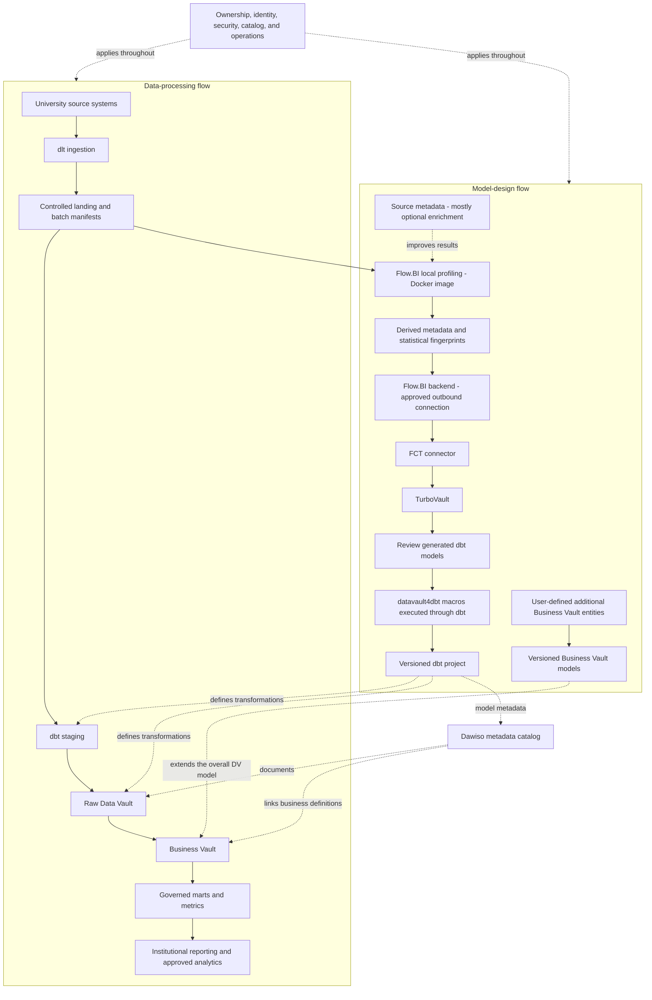

# Sovereign Higher Education Data Platform Blueprint

**A university-owned, open-source-first platform for trusted institutional data.**

This sovereign higher education data platform blueprint connects admissions, student records, and registry control extracts to application-to-enrollment reporting. It combines Flow.BI and Data Vault automation with European Dawiso catalog governance, Cloudberry MPP or Iceberg/Trino, and controlled Azure, AWS or Google Cloud deployment.
Status: reference blueprint for architecture and implementation planning  
Audience: university leadership, institutional research, IT, data teams, security, and domain owners  
Last updated: 5 November 2026

## The components behind Higher Education reporting

### Discover and generate the model

[dlt](https://github.com/dlt-hub/dlt) (data load tool) is the ingestion library for supported API, database, and file feeds. In this higher education design, it brings admissions, student records, and registry control extracts into controlled landing datasets with load evidence. [Flow.BI](https://flow.bi/) supplies the data-driven modeling stage that precedes physical model generation. The modeling input includes person, application, and program; actual data is required, while available source metadata improves the result. For the higher education model, [FCT](https://www.scalefree.com/consulting/turbovault/flowbi-connector/) (Flow.BI Connector for TurboVault4dbt) handles the connector handoff from Flow.BI to the downstream model generator. [TurboVault](https://www.scalefree.com/consulting/turbovault/) generates the dbt models from that metadata. Review those generated artifacts before executing the higher education transformations; Studio is the online access option, requested through Scalefree.

### Execute and extend the data product

[datavault4dbt](https://github.com/ScalefreeCOM/datavault4dbt) is the dbt macro package that implements standard Data Vault loading patterns. It contributes the technical history-loading foundation for person, application, and program. [dbt](https://github.com/dbt-labs/dbt) provides the build-and-test workflow that executes the model dependencies on the database. User-defined Business Vault models add cohort membership and historical faculty mappings within that workflow.

### Choose the runtime and delivery support

For larger relational Data Vault workloads, use [Apache Cloudberry](../../../cloud/apache-cloudberry/apache-cloudberry-data-platform-blueprint.md) as the PostgreSQL-compatible MPP warehouse candidate, or [Trino with Iceberg](https://trino.io/docs/current/connector/iceberg.html) for the portable lakehouse pattern. Cloudberry distributes data and query execution across segments and supports row or column storage per table. Plain [PostgreSQL](https://www.postgresql.org/about/licence/) remains an option for a bounded pilot or small workload with a measured growth limit. For higher education, Azure, AWS, or Google Cloud hosts the approved data, runtime, storage, and network services. The cloud choice must satisfy the operating, access, key-custody, and portability requirements defined in this document.

[Scalefree](https://www.scalefree.com/) provides data and AI consulting, Data Vault implementation, software integration, and training. For this blueprint, that support can include the higher education source-to-model design, implementation of cohort membership and historical faculty mappings, and training the team to maintain the resulting product.

[Dawiso](https://www.dawiso.com/product/data-catalog) adds the business glossary, asset discovery, ownership, and lineage context for higher education. It connects the meaning of person and the rules for cohort membership and historical faculty mappings to the implemented datasets.

## 1. Purpose and outcomes

Build a data platform that connects teaching, administration, and research-management data while preserving the university's authority over its information, infrastructure choices, and operating model.

The platform should enable:

- Consistent enrollment, admissions, progression, and completion reporting across faculties.
- Reproducible institutional and funding reports with traceable definitions and historical evidence.
- Research-project, grant, and resource reporting with clear ownership and access boundaries.
- Reuse of governed data products across analytics teams without repeatedly extracting operational systems.
- A practical exit path from any infrastructure or software provider.

This document describes a proposed solution. Product capabilities are linked to primary sources; architecture choices, delivery stages, and acceptance criteria are recommendations for this blueprint. It does not prescribe a particular jurisdiction. Each university must select its legal, contractual, and records-management requirements before implementation.

## 2. Guiding principles

| Principle | Required design outcome |
| --- | --- |
| Institutional data sovereignty | The university decides where data resides, who can access it, how it is processed, and when it is deleted. |
| Open source first | Prefer software with verifiable open-source licenses and an operationally sustainable maintenance model. Record exceptions explicitly. |
| Portability | Retain models, metadata, transformation definitions, and exportable data under university control. |
| Privacy by design | Minimize collection, restrict sensitive attributes, and design retention and deletion before loading production data. |
| Evidence and reproducibility | Every published measure can be traced to source records, business rules, model versions, and processing runs. |
| Domain accountability | Admissions, registry, finance, HR, and research administration own their definitions and approve access. |
| Sustainable operations | Start with the smallest viable architecture and add distributed infrastructure when workload evidence justifies it. |

Sovereignty includes **data location, operational control, key custody, contractual jurisdiction, software independence, and exit capability**. Regional hosting and open-source software each support parts of this goal; neither is sufficient alone.

## 3. University use cases and scope

| Domain | Example sources | Initial data product | Important boundary |
| --- | --- | --- | --- |
| Admissions | Application and applicant-management systems | Application-to-enrollment funnel | Applicant identity and admissions decisions remain restricted. |
| Student lifecycle | Student information system, examinations, program catalog | Enrollment and completion by academic term | Separate person, program enrollment, and course registration grains. |
| Learning | Learning management system | Approved course-level participation aggregates | Access to individual activity requires a defined purpose and authorization. |
| Research administration | Grant, project, publication, and finance systems | Grant portfolio and project expenditure | Research administration and research participant data are separate domains. |
| Finance and workforce | ERP, HR, procurement | Faculty resource and budget reporting | Payroll and personnel records require separate permissions. |
| Facilities | Timetabling and room-management systems | Space utilization | Avoid unnecessary individual location tracking. |

**Recommended first release:** admissions and student enrollment, using two source systems, one shared program/term definition, and one reconciled reporting product. Defer clinical data, research participant datasets, and individual predictive scoring to separately governed projects.

### From application to enrollment

| Stage | Evidence | Meaning to preserve |
| --- | --- | --- |
| Apply | Applicant, application, program preference, submission | One person can submit multiple applications and preferences. |
| Receive an offer | Offer event, condition, expiry and acceptance | Offers and accepted offers have different counts. |
| Enroll | Enrollment event, program, term, status | Distinguish a person from a program enrollment. |
| Progress or exit | Credit/result and status changes | Preserve transfers, interruptions, and revised results. |

### Worked example: cohort conversion

A cohort has 1,000 eligible applications from 800 distinct applicants. Two hundred applicants enroll. Person-level conversion is 25%; dividing enrolled people by application rows yields 20% and mixes grains. Publish person and application measures separately, with program scope and cutoff.

Keep original cohort membership and the rule for withdrawn applications, deferrals, and transfers. Later amendments can change current knowledge about the cohort without rewriting the originally published report.

## 4. Architecture

The platform has two connected flows: a **data-processing flow** and a **model-design flow**. Modeling tools do not replace ingestion, storage, orchestration, or authorization.

Source data in landing is a required input to local Flow.BI profiling. The Docker container is inside the university-controlled environment; the Flow.BI backend is a separate service boundary. Flow.BI output passes directly to FCT, then TurboVault, which generates dbt models using datavault4dbt macros. Review the generated models after TurboVault and before macro execution through dbt. The generated Raw Vault is the foundation of the overall Data Vault model. Users then extend that model with additional Business Vault entities and business rules. Confirm exchange formats and supported versions in the pilot.

### Flow.BI inputs and local Docker deployment

**Data is required. Source metadata is mostly optional and improves the results.** Flow.BI needs to inspect actual values and relationships; a metadata-only delivery is insufficient. Supply available schemas, keys, comments, and domain descriptions as enrichment. Distinguish this input metadata from the profiling metadata Flow.BI produces for downstream automation.

Flow.BI provides a **Local Data Processing Docker image for customer-controlled AWS, Azure, and Google Cloud infrastructure**. It reads source data, uses local storage, and sends derived metadata and statistical fingerprints to the Flow.BI backend. Raw source data remains in the customer's environment. The documented architecture needs outbound backend connectivity; it is not a fully disconnected deployment. See [How Flow.BI Protects Sensitive Enterprise Data](https://flow.bi/blog/how-flow-bi-protects-sensitive-enterprise-data/).

For this university blueprint, require the following deployment deliverables:

- Obtain the vendor-issued image and deployment instructions; record its registry, version, immutable digest, supported architecture, and entitlement. Use the image registry and deployment instructions provided with your access.
- Deploy it beside approved landing data, within the university's own cloud account/subscription/project. Use an approved container host, private networking, scoped credentials, and controlled temporary storage.
- Classify and approve the outbound profiling payload. Structural metadata and fingerprints require review even when raw records stay local.
- Test source/storage access, controlled egress, restart, resource limits, update procedures, and intermediate-data cleanup.

**FCT public website and registration form:** use the [official connector access page](https://www.scalefree.com/consulting/turbovault/flowbi-connector/) to request access. Registration is a vendor onboarding step, not a university student-registration system or a runtime ingestion service. Assign an institutional owner for credentials and download provenance. Verify whether ongoing connectivity or credentials are needed during operation.

**TurboVault edition decision:** [TurboVault Engine](https://github.com/ScalefreeCOM/turbovault-engine) is a separate repository licensed under AGPL-3.0. Evaluate it as an alternative, not as an automatically compatible replacement for TurboVault4dbt. Confirm FCT compatibility, metadata mapping, generated output, and licensing before changing the baseline.

The platform is **open-source-first with declared dependencies**. It is an open-source-first approach. Retain generated metadata and dbt artifacts so existing transformation operations can continue independently of a new Flow.BI generation run.

For tool-specific implementation reading, see [Scalefree blog resources](#14-scalefree-blog-resources-for-the-platform-tools).

## 5. Data processing and modeling

### Ingestion with dlt

Treat “DLT” here as **dlt, the data load tool**. For each university source, define:

- Source owner, approved fields, extraction method, credentials, and operating window.
- Full-load and incremental behavior, cursor or watermark, and a strategy for late or corrected records.
- Deletion detection through supported source change events or reconciled snapshots. Do not assume timestamp polling captures deletes.
- Stable batch identity, source identifier, extraction time, schema version, row counts, and load status.
- Restart behavior and persistent pipeline state, including recovery after a partially completed run.

The [dlt PostgreSQL destination](https://dlthub.com/docs/dlt-ecosystem/destinations/postgres) provides a documented starting point only for the bounded relational pilot. A Cloudberry target uses a validated PostgreSQL/Greenplum-compatible load path; do not infer complete destination behavior from protocol compatibility alone. A lakehouse ingestion route requires its own supported destination or a validated landing-to-table registration/load step; writing Parquet objects alone does not create managed Iceberg tables.

Retain approved source evidence within its retention period. An ingestion merge that preserves only current state cannot support reconstruction of earlier changes unless that history is retained elsewhere. Quarantine unexpected schema changes and malformed batches before they enter trusted reporting.

### Data Vault layers

| Layer | Purpose | University example |
| --- | --- | --- |
| Landing | Retain permitted source deliveries and ingestion evidence. | Admissions batch with extraction timestamp and manifest. |
| Staging | Standardize technical representation and derive approved keys and hash differences. | Normalize program codes and timestamps consistently. |
| Raw Vault | Integrate keys and relationships while retaining source-attributed history. | Applicant, application, program, term, and application-program relationships. |
| Business Vault | Let users extend the overall DV model with additional entities, governed business rules, and derived relationships. | Add a faculty-mapping entity and derived program-to-faculty relationships for institutional reporting. |
| Information marts | Deliver understandable facts, dimensions, and measures. | Application counts, offers, and enrollments by entry cohort. |

### Automated Raw Vault and user-defined Business Vault extensions

The implementation sequence is **Flow.BI → FCT → TurboVault → review generated models → datavault4dbt/dbt execution → generated Raw Vault**, followed by **user-defined Business Vault entities** that adapt the overall DV model to university needs.

Keep generated Raw Vault artifacts and user-authored Business Vault models in separate project paths so regeneration preserves the extensions. Users can add derived entities, relationships, mappings, calculations, and reporting-oriented structures in the Business Vault. For example, a university can add historical faculty mappings, a derived student-cohort membership relationship, or an application-to-enrollment classification. Version these additions with their business definitions and test their results against institutional reporting requirements.

Define business keys and relationship grain for user-added entities with domain owners. A course offering may need institution, module, term, and section identifiers; a module code alone is often insufficient. Preserve source namespaces when identifiers overlap. Cross-system person matching requires an approved identity-resolution process; a hash does not resolve identity ambiguity.

Separate identifying and sensitive attributes from broadly accessible analytical attributes. Record source, ingestion/load time, and relevant business-effective time. Define the difference between “what was reported at the time” and “what is now known about that period.”

Freeze hashing rules, encodings, case handling, null representation, and timestamp precision. Package upgrades can change generated keys: the [datavault4dbt v2 release notes](https://github.com/ScalefreeCOM/datavault4dbt/releases) describe changes requiring planned reload or rehashing. Test migration effects on all dependent models before upgrading.

## 6. Storage and query patterns

### Pattern A: bounded PostgreSQL pilot

Plain PostgreSQL can host a deliberately limited higher education pilot with separate landing, staging, Vault and serving schemas. Choose it only when representative history, join complexity, concurrent consumers and recovery fit the measured operating envelope. Define an exit trigger before adoption: unacceptable refresh duration, history-query latency, resource contention, growth or recovery time. Database size alone is an incomplete sizing criterion.

The architectural constraints for enterprise Data Vault analytics include single-node resource ceilings and costly analytical scans, joins and historical calculations. Read Michael Olschimke's [Architectural Limitations of PostgreSQL for Enterprise Data Vault Workloads](https://www.scalefree.com/blog/data-vault/architectural-limitations-of-postgresql-for-enterprise-data-vault-workloads/) before treating a successful small pilot as a production scaling strategy. Retain PostgreSQL for suitable bounded or operational/metadata workloads; it is not the default recommendation for a large analytical Vault.

### Pattern A2: Apache Cloudberry for a larger relational Vault

Use **Apache Cloudberry** when the higher education platform needs a familiar PostgreSQL/Greenplum SQL ecosystem with distributed warehouse execution. Its [MPP architecture](https://cloudberry.apache.org/docs/next/introduction/cbdb-architecture/) assigns data and query work to multiple segments, expanding the CPU, memory and I/O resources available beyond one PostgreSQL server. Preserve the logical model for **person, application, and program** while redesigning distribution, physical storage and workload management for the cluster.

Cloudberry supports **per-table row-oriented and column-oriented storage**. Evaluate row-oriented heap for small or frequently changed relations, append-optimized row storage for suitable batch/wide-row access, and append-optimized column storage for large history or analytical tables that read selected attributes. A scan-heavy satellite or reporting fact is a column-storage candidate; mutation-heavy control tables may be better as heap. These are workload choices, not mandatory mappings for every hub, link or satellite. See the [table storage and access-method reference](https://cloudberry.apache.org/docs/next/sql-stmts/create-table/).

Flow.BI and datavault4dbt use the **PostgreSQL/Greenplum compatibility route**. Pin the connector, dbt adapter, generator, macro package and Cloudberry release together; verify types, hash inputs, DDL, incremental loads and required update/delete behavior. Compatibility preserves integration options without promising identical PostgreSQL extension behavior or automatic physical-design portability. Validate dlt's compatible extraction/load path as well.

For higher education, compare the worked example, historical corrections and concurrent reporting using alternative distribution keys and row/column layouts. Inspect segment skew, data redistribution, spill, elapsed time and recovery. MPP does not remove expensive data motion or guarantee every query scales linearly. Deploy coordinator/segments on approved Azure, AWS or Google Cloud compute with owned storage, monitoring, backups and recovery; the database team's operational cost belongs in TCO. Use the [complete Apache Cloudberry blueprint](../../../cloud/apache-cloudberry/apache-cloudberry-data-platform-blueprint.md) for the implementation checklist.

### Pattern B: portable lakehouse

Use object storage for files, **Apache Iceberg** for analytical table metadata and snapshots, a compatible **catalog service**, and **Trino** for SQL execution. Run dbt through a validated Trino adapter and the selected datavault4dbt macros. The [Trino Iceberg connector documentation](https://trino.io/docs/current/connector/iceberg.html) defines supported catalogs, operations, and requirements.

These components have distinct responsibilities: object storage retains bytes; Iceberg organizes tables; the catalog resolves and commits table metadata; Trino executes queries. Back up the catalog and table metadata as well as data objects.

Before selection, prove incremental loading, required merge/delete behavior, concurrent writes, schema evolution, failure recovery, and timestamp/hash consistency. Assign ownership for compaction, snapshot expiry, orphan cleanup, and small-file management. A supported database name does not establish compatibility for every generator, macro, adapter, and table format combination.

## 7. Deployment options

The following are **candidate mappings**, subject to region, service availability, university procurement, and an end-to-end pilot. Keep the same domain definitions, metadata ownership, and Business Vault extension process across environments.

| Option | Compute and execution | Storage and query | Sovereignty decisions |
| --- | --- | --- | --- |
| Azure / Microsoft Sovereign Cloud | Flow.BI local Docker image in the university subscription; controlled Linux VMs or approved Kubernetes service for dlt, FCT, TurboVault, and dbt. | Azure Blob Storage / ADLS Gen2 with Iceberg and Trino; alternatively Cloudberry MPP on controlled VMs/storage; PostgreSQL only for the bounded Pattern A pilot. | Choose the Microsoft sovereign deployment model, approved geography, key custody, administrator access, and allowed service set. |
| AWS | Flow.BI local Docker image in the university AWS account; controlled Linux instances or approved Kubernetes service for the other tools. | Amazon S3 with Iceberg and Trino; alternatively Cloudberry MPP on controlled VMs/storage; PostgreSQL only for a bounded pilot. | Evaluate AWS European Sovereign Cloud separately from standard AWS regions. Confirm services, endpoints, identity, backups, and connectivity in the chosen environment. |
| Google Cloud | Flow.BI local Docker image in the university Google Cloud project; controlled Linux VMs or approved Kubernetes service for the other tools. | Google Cloud Storage with Iceberg and Trino; alternatively Cloudberry MPP on controlled VMs/storage; PostgreSQL only for a bounded pilot. | Select an appropriate Assured Workloads control package and verify residency, access, personnel, and key-management controls for the selected services. |

Trino documents native access to [Azure, Google Cloud, and S3 object storage](https://trino.io/docs/current/object-storage.html). Validate credentials, endpoints, and catalog integration for the exact deployment. Managed infrastructure services remain provider dependencies even when the application stack is open source.

### Azure sovereign deployment

Use the public deployment model of [Microsoft Sovereign Cloud](https://learn.microsoft.com/en-us/azure/azure-sovereign-clouds/microsoft-sovereign-cloud), which adds sovereignty controls to Microsoft-operated infrastructure.

Define a sovereign landing zone with permitted locations, private connectivity, controlled egress, key policy, and auditable privileged access. Verify eligibility and availability of controls such as Data Guardian and external key management for the actual services selected.

### AWS sovereign deployment

AWS announced general availability of the [AWS European Sovereign Cloud](https://press.aboutamazon.com/aws/2026/1/aws-launches-aws-european-sovereign-cloud-and-announces-expansion-across-europe) in January 2026 as physically and logically separate from other AWS regions. Evaluate its operating model and contracts against university requirements.

Create a service-by-service availability inventory before procurement. Keep logs, backups, keys, support workflows, and deployment dependencies inside the approved boundary. Prove the solution can operate without dependencies on standard-region services that are outside that boundary.

### Google sovereign deployment

[Assured Workloads](https://docs.cloud.google.com/assured-workloads/docs/overview) offers control packages for residency, access, and personnel boundaries. Select the package against the university's requirements and check its supported services.

### Choosing an option

Use Pattern A only for a measured, bounded pilot. Evaluate Pattern A2 (Cloudberry MPP) for larger relational analytics, or Pattern B (Iceberg/Trino) when the portable lakehouse matches the workload and operating skills. Choose the hosting environment after defining the required sovereignty boundary and the institution's operating capacity.

Estimate total cost across compute, storage, network/egress, backups, support, commercial dependencies, training, and internal staffing. Compare the cost of a tested exit and disaster recovery as part of the decision.

## 8. Sovereignty, privacy, and security controls

| Area | Required control | Evidence for acceptance |
| --- | --- | --- |
| Residency | Approved locations for primary data, replicas, pipeline state, logs, catalog, and backups. | Inventory and deployment-policy checks. |
| Administration | Named operators, institutional SSO, MFA, least privilege, and time-limited elevated access. | Access review and privileged-session audit. |
| Encryption | Encryption in transit and at rest; documented key custody and recovery. | Tested key recovery and rotation procedure. |
| AI/modeling | Document which schema, metadata, samples, prompts, and outputs leave the boundary. | Approved processing diagram and verified network behavior. |
| Purpose and access | Domain-approved permissions and restricted sensitive attributes. | Negative access tests across users, exports, and direct SQL paths. |
| Retention and deletion | Defined periods and propagation across every retained copy. | Tested deletion/expiry workflow and retained non-identifying completion evidence. |
| Portability | Exportable data, models, metadata, and operational documentation. | Restore a representative product in a second environment. |
| Supply chain | Pinned artifacts, dependency inventory, approved updates, and maintenance ownership. | Release record, license inventory, and recovery artifacts. |

Use synthetic data for public examples and training. Authorize the real source data required for production Flow.BI profiling inside the approved local environment. Review the outbound metadata/fingerprint payload and backend processing location. Confirm vendor subprocessors, retention, telemetry, model-training usage, and deployment rights.

Design Data Vault history to support **controlled retention**, not indefinite preservation. Where deletion applies, cover landing files, satellites, business keys, marts, extracts, caches, Iceberg snapshots, and backups. Define lawful retention exceptions and restoration procedures that reapply completed deletions. Hash keys and pseudonyms must not be treated as proof of anonymization.

For EU institutions, assess the applicable requirements using the [official GDPR text](https://eur-lex.europa.eu/eli/reg/2016/679/oj/eng), alongside national law and institutional records policies. Identify purposes and legal bases per domain; consent should not be assumed to cover every university process. Assign privacy review and any required impact assessment before production use.

## 9. Governance and university operating model

| Role | Accountability |
| --- | --- |
| Executive sponsor | Outcomes, funding, institutional priorities, and resolution of cross-domain issues. |
| Platform product owner | Roadmap, service commitments, delivery, and cost transparency. |
| Domain owners and stewards | Definitions, source contracts, quality decisions, classification, and access approval. |
| Data architects and engineers | Models, ingestion, generation workflow, transformations, and technical quality. |
| Infrastructure and security team | Hosting, identity, secrets, observability, patching, backups, and incident response. |
| Privacy/records specialists | Processing requirements, retention, deletion, and relevant assessments. |
| Institutional research/reporting | Metric definitions, reconciliation, usability, and report acceptance. |

Maintain a catalog entry for every published data product: owner, purpose, grain, definitions, lineage, refresh target, classification, access process, retention, quality status, and known limitations. Departmental independence should coexist with agreed institutional definitions and controlled cross-faculty sharing.

## Catalog ownership and lineage with Dawiso

[Dawiso](https://www.dawiso.com/product/data-catalog) adds the business glossary, asset discovery, ownership, and lineage context for higher education. It connects the meaning of person and the rules for cohort membership and historical faculty mappings to the implemented datasets.

For this product, register **person, application, program, term, and enrollment** as governed concepts linked to real assets. Describe **cohort membership and historical faculty mappings** with an owner, calculation/rule version, eligible population, cutoff, and known limitations. Publish only the metadata fields that the catalog users are authorized to see.

### Deployment and processing boundary

Dawiso is a European commercial governance/catalog platform supplied by [Dawiso s.r.o., registered in Prague](https://www.dawiso.com/privacy-policy). The sovereign design uses a contractually approved **European catalog location**. Confirm metadata residency, administrators, support access, logs, backups, and optional AI processing individually. European vendor origin alone does not establish those controls.

Use the supported [Enterprise deployment](https://www.dawiso.com/product/enterprise-deployment-built-for-flexibility-and-security) in an approved European Azure or AWS environment, or an approved European hosted configuration. For a Google Cloud data platform, validate the metadata connection to that catalog and the cross-cloud operating cost; do not assume a private Google Cloud Dawiso deployment is available.

### Connect execution evidence to meaning

Discover the selected database/BI assets using the [supported connectors](https://www.dawiso.com/connectors) and validate dbt/generated-model metadata exchange for the chosen version. Define a controlled import/API mapping for gaps; do not assume a direct Flow.BI or FCT catalog connector. Keep the modeling service's generated metadata distinct from the catalog's approved business glossary.

dbt executes transformation tests; Dawiso records the associated definitions, owners, evidence links, and quality context. Select and validate the integration that publishes results; the catalog does not replace the test engine.

Catalog acceptance follows the higher education pilot: trace an approved source field through a generated model and Business Vault extension to a published metric, then test a schema change, a stale scan, and a permission revocation. Mask sample values and sensitive SQL/descriptions where required. Track scan coverage and unresolved lineage gaps explicitly.

## 10. Scalefree and Flow.BI training and knowledge transfer

Make capability development a delivery workstream with practical acceptance criteria.

| Track | Training resource | Participants | Proposed project outcome |
| --- | --- | --- | --- |
| DV — Data Vault | [Data Vault Training & Certification](https://www.scalefree.com/data-vault-2-1-trainings/data-vault-training-certification/) and [Modeling Class](https://www.scalefree.com/data-vault-2-1-trainings/data-vault-2-1-modeling-class/) | Architects, modelers, engineering leads; selected stewards for shared concepts. | Understand generated Raw Vault structures and design additional Business Vault entities with the correct keys, grain, and history. |
| DWA — Data Warehouse Automation | [Scalefree dbt training: DataVault4dbt and TurboVault automation blocks](https://www.scalefree.com/training/dbt-training/) | Modelers, engineers, and release owners. | Operate the Flow.BI–FCT–TurboVault workflow, review generated models before datavault4dbt/dbt execution, and regenerate without overwriting user-authored Business Vault entities. |
| dbt | [Scalefree dbt Training](https://www.scalefree.com/training/dbt-training/) | Data engineers, analytics engineers, and operators. | Build and test models, use packages/macros, debug failures, and promote releases through controlled environments. |
| Flow.BI foundations | [Flow.BI Introduction](https://flow.bi/trainings/flow-bi-introduction/) | Business analysts, domain stewards, architects, project leads, and engineers. | Understand the interface, data sources, deployment targets, and first model-generation run. |
| Flow.BI configuration and operations | [Flow.BI In-Depth](https://flow.bi/trainings/flow-bi-in-depth/) | Engineers, architects, and platform operators. | Configure classification, permissions, API access, and integration settings for the university environment. |
| Understanding generated models | [Generated Data Vault Models](https://flow.bi/trainings/generated-data-vault-2-0-models/) | Data modelers, engineers, and architects. | Interpret generated structures and their downstream physical implementation; apply this knowledge to the review after TurboVault and to Business Vault extensions. |
| Flow.BI metadata presentation | [Presenting Flow.BI Metadata — training catalog](https://flow.bi/trainings/) | Modelers, analysts, and metadata/catalog owners. | Use Flow.BI dashboards to present internal metadata to authorized users. |
| Catalog stewardship | [Dawiso documentation](https://www.dawiso.com/product/data-catalog) | Data owners, stewards, catalog operators, and engineers. | Document person, approve definitions, trace model lineage, and operate metadata scans and access. |

**Terminology:** DWA means Data Warehouse Automation. The DWA training track uses Scalefree's published automation learning blocks. DVA refers exclusively to the Data Vault Alliance.

The Data Vault certification training covers Data Vault 2.1. Align the curriculum with the selected tool versions and implementation patterns. Its dbt offering is customizable; agree the agenda and prerequisites before booking.
Flow.BI In-Depth requires Flow.BI Introduction and general data-architecture knowledge. Generated Data Vault Models requires Flow.BI Introduction and Data Vault modeling knowledge. Use the [Flow.BI training catalog](https://flow.bi/trainings/) to select classes or a bundle and confirm current delivery details.

Recommended sequence:

1. Run DV foundations and modeling to understand the generated Raw Vault and design Business Vault extensions.
2. Complete Flow.BI Introduction before connecting the pilot sources; follow with In-Depth for the configuration and operations team and Generated Data Vault Models for modelers and engineers.
3. Run dbt fundamentals before building the first transformation pipeline.
4. Run DWA practical sessions when the first Flow.BI output is available for direct processing through FCT and TurboVault. Include metadata presentation training for the team publishing model documentation.
5. Complete a university-led lab using synthetic admissions and enrollment data: dlt ingestion, Flow.BI generation, direct FCT transfer, TurboVault generation, generated-model review, datavault4dbt/dbt execution, user-added Business Vault entities, and reporting reconciliation.
6. Require at least two internal operators to deploy, troubleshoot, restore, and explain the pipeline without external assistance.

Budget training, preparation time, labs, and follow-up coaching separately from software and hosting. Use the [current training catalog](https://www.scalefree.com/training/) for available formats and scheduling.

## 11. Delivery roadmap

Indicative sequence for a small pilot team; duration depends on source access, procurement, and institutional review.

| Phase | Work | Exit criterion |
| --- | --- | --- |
| 1. Frame the pilot | Select reporting outcome, source owners, sovereignty boundary, retention, and skills plan. | Approved scope and measurable reporting definition. |
| 2. Establish foundations | Select hosting/storage pattern; obtain the Flow.BI Docker image and FCT access; resolve licenses; establish identity, networking, secrets, and recovery. | Environment and dependency decisions recorded; synthetic workload runs. |
| 3. Ingest and understand | Implement dlt ingestion, source reconciliation, required data access for Flow.BI profiling, optional metadata enrichment, and initial DV/Flow.BI training. | Reliable repeatable loads with controlled schema changes. |
| 4. Model and automate | Send Flow.BI output directly through FCT and TurboVault; review the generated models, then execute them with datavault4dbt/dbt and validate pipeline behavior. | Generated Raw Vault runs against the selected backend. |
| 5. Deliver information | Add user-defined Business Vault entities and rules; build marts, cohort metrics, access, lineage, and quality checks. | Domain owners accept a reconciled first data product. |
| 6. Prove operation | Exercise restart, deletion, backup restore, alerts, operator handover, and export. | Production acceptance checklist completed. |
| 7. Extend by domain | Add research administration, finance, or further student lifecycle products. | Each new product repeats governance and quality acceptance. |

Do not scale out the infrastructure or expand source scope until the pilot demonstrates useful reporting, recoverability, and internal operating capability.

## 12. Production acceptance checklist

- [ ] Source owners approve scope, extraction load, and refresh windows.
- [ ] Flow.BI/FCT license, deployment, connectivity, and processing terms are recorded.
- [ ] The Flow.BI local Docker image is obtained, pinned by digest, and tested in the selected university environment.
- [ ] Required source data is available to Flow.BI; available source metadata is supplied as optional enrichment.
- [ ] The profiling payload, backend destination, and raw-data locality are verified against the approved boundary.
- [ ] TurboVault edition and every runtime, adapter, macro package, and connector version are pinned and tested together.
- [ ] The chosen cloud/service inventory meets the agreed sovereignty boundary.
- [ ] Flow.BI output passes directly through FCT to TurboVault; generated models are reviewed before datavault4dbt/dbt execution.
- [ ] Regeneration preserves user-authored Business Vault entities and their business rules.
- [ ] Reprocessing the same input does not introduce unintended duplicates.
- [ ] Late data, source corrections, deletes, schema changes, and overlapping source identifiers are tested.
- [ ] Failed loads can restart safely, and pipeline state can be recovered.
- [ ] Published totals reconcile with source evidence and approved cohort definitions.
- [ ] Unapproved roles cannot access restricted attributes through SQL, reports, exports, or object storage.
- [ ] Model lineage and business definitions are available to authorized users.
- [ ] Restore meets university-approved recovery time and recovery point objectives.
- [ ] Retention/deletion tests include history, snapshots, exports, and backup-restoration handling.
- [ ] For the lakehouse option, storage/catalog interoperability and table maintenance are proven.
- [ ] At least two university operators complete the practical handover.
- [ ] A representative data product is exported and reconstructed outside the original environment.
- [ ] Cost ownership, support responsibilities, and a maintenance calendar are agreed.

## 13. Decisions to record before implementation

1. **Jurisdiction and sovereignty:** required locations, permitted operators, key custody, and contractual constraints.
2. **First data product:** owner, sources, cohort/term definitions, refresh target, and acceptance measures.
3. **Storage pattern:** Cloudberry MPP for a larger relational Vault, Iceberg/Trino for the lakehouse route, or PostgreSQL only within a bounded pilot envelope.
4. **Hosting:** Azure sovereign model, AWS environment, or Google Cloud control/deployment model.
5. **Modeling workflow:** Flow.BI Docker image/deployment, required source data, optional source metadata, approved outbound payload and backend location, FCT distribution, TurboVault edition, and export fallback.
6. **Privacy and lifecycle:** classification, purposes, retention periods, deletion implementation, and research-data boundaries.
7. **Operations and skills:** staffing, support, training agenda, service commitments, and recovery objectives.
8. **Open-source assurance:** artifact-level license inventory, maintenance status, accepted exceptions, and exit test.

Record these as short architecture decisions in the repository. Keep this blueprint and synthetic examples suitable for public GitHub publication; retain real schemas, credentials, personal data, security details, and operational evidence in approved restricted systems.

## 14. Scalefree blog resources for the platform tools

The following articles complement the product documentation and training. Read the Flow.BI/FCT integration overview first, then TurboVault generation, datavault4dbt staging and loading, and finally Business Vault extensions and deployment practices.

| Tool or topic | Scalefree blog resource | Application to this blueprint |
| --- | --- | --- |
| Flow.BI, FCT, TurboVault, and datavault4dbt | [Flow.BI: Generating the Raw Data Vault Using AI and dbt](https://www.scalefree.com/blog/modeling/flow-bi-generating-the-raw-data-vault-using-ai-and-dbt/) | Explains the logical-to-physical automation chain and connector, and the addition of business logic in the Business Vault. Pair it with the [FCT access page](https://www.scalefree.com/consulting/turbovault/flowbi-connector/) for onboarding. |
| TurboVault | [Speed Up Your Data Vault 2.0 Implementation with TurboVault4dbt](https://www.scalefree.com/blog/tools/speed-up-your-data-vault-2-0-implementation-with-turbovault4dbt/) | Introduces metadata-driven dbt model generation. Use it to understand the generation stage before the review phase. |
| datavault4dbt overview | [Kick-Start Your Data Vault 2.0 Implementation with datavault4dbt](https://www.scalefree.com/blog/tools/kick-start-your-data-vault-2-0-implementation-with-datavault4dbt/) | Introduces loading templates and the package's role within dbt. Useful background before the hands-on training. |
| datavault4dbt staging | [Exploring datavault4dbt — Vol. 1: The Staging Layer](https://www.scalefree.com/blog/tools/exploring-datavault4dbt-a-practical-series-on-the-dbt-package-for-data-vault-2-0-vol-1-the-staging-layer/) | Covers staging configuration, hashing, derived columns, and prejoins. Apply these concepts when connecting the dlt landing datasets to generated transformations. |
| datavault4dbt Raw Vault | [Exploring datavault4dbt — Vol. 2: Standard Entities in the Raw Vault](https://www.scalefree.com/blog/datenwerkzeuge/exploring-datavault4dbt-a-practical-series-on-the-dbt-package-for-data-vault-2-0-vol-2-standard-entities-in-the-raw-vault/) | Walks through hubs, links, and satellites. Use it to interpret the models produced by TurboVault and their macro parameters. |
| Business Vault extensions | [Designing the Business Vault: Key Strategies for Effective Data Organization](https://www.scalefree.com/blog/data-vault/designing-the-business-vault-key-strategies-for-effective-data-organization/) | Explains reusable business logic and additional entities such as computed satellites, links, PITs, and bridges. Relevant to user-defined university extensions after Raw Vault generation. |
| dbt delivery and testing | [CI/CD: Practical Insights into Automating Data Vault 2.0 with dbt](https://www.scalefree.com/blog/data-vault/ci-cd-practical-insights-into-automating-data-vault-2-0-with-dbt/) | Uses datavault4dbt and GitHub Actions to illustrate testing and delivery automation. Adapt execution and runner placement to the university's cloud boundary. |
| PostgreSQL workload assessment | [Architectural Limitations of PostgreSQL for Enterprise Data Vault Workloads](https://www.scalefree.com/blog/data-vault/architectural-limitations-of-postgresql-for-enterprise-data-vault-workloads/) | Explains why a bounded PostgreSQL pilot is not a large-scale Data Vault recommendation. Compare the selected platform with Cloudberry MPP and its per-table row/column storage where an open relational warehouse is required. |
| Sovereignty, Iceberg, and Trino | [The Sovereign Data Platform: The Path to Data Ownership and Secure AI](https://www.scalefree.com/blog/architecture/the-sovereign-data-platform-the-path-to-data-ownership-and-secure-ai/) | Discusses controlled object storage, open table formats, and replaceable query engines, including Trino. Supports the portability and storage/compute separation principles. |

Examples in older articles may use earlier package versions, metadata layouts, or specific cloud databases. Use the pinned tool versions and current documentation for implementation details. For dlt ingestion and Trino/Iceberg configuration, use the primary documentation already linked in Sections 5–7 alongside these architectural resources. Browse the [Scalefree blog](https://www.scalefree.com/blog/) for further articles.

## 15. Flow.BI reading and implementation references

Use the [Flow.BI blog](https://flow.bi/blog/) for ongoing product architecture and implementation material. Relevant starting points:

| Resource | Why it matters to this blueprint |
| --- | --- |
| [How Flow.BI Protects Sensitive Enterprise Data](https://flow.bi/blog/how-flow-bi-protects-sensitive-enterprise-data/) | Explains required data profiling, the local Docker image, storage access, and the local/backend processing boundary. |
| [Seeing Every Step: Data Lineage Inside Flow.BI](https://flow.bi/blog/seeing-every-step-data-lineage-inside-flow-bi/) | Describes source-to-model traceability and graph views. Use this model lineage alongside dlt load evidence and dbt execution lineage. |
| [Turning Salesforce and Pardot Tables Into a Semantic Model](https://flow.bi/blog/turning-salesforce-and-pardot-tables-into-a-semantic-model/) | Illustrates concept recognition and declared versus inferred relationships using CRM data. Use it as background on model generation; university-specific additions in this blueprint are implemented through Business Vault entities. |
| [Generative AI for Data Vault](https://flow.bi/ai-driven-business/) | Explains the progression from data profiling to a logical Data Vault model and downstream physical-model automation. |
| [Flow.BI Media Library](https://flow.bi/media/) | Includes local-processing, bring-your-own-bucket, modeling, and dbt integration sessions for team onboarding. |

## Database choices for sovereign higher education analytics

### Is plain PostgreSQL suitable for a large higher education Data Vault?

Use PostgreSQL only within a tested pilot or bounded workload envelope. For growing person, application, and program history and analytical concurrency, assess Cloudberry MPP or the Iceberg/Trino route. The [PostgreSQL architectural assessment](https://www.scalefree.com/blog/data-vault/architectural-limitations-of-postgresql-for-enterprise-data-vault-workloads/) provides the starting point; choose from measured scans, joins, corrections and recovery, rather than data volume alone.

### Why use Apache Cloudberry for higher education?

Cloudberry combines PostgreSQL/Greenplum compatibility, distributed query execution and per-table row or column storage. Test those choices against **application-to-enrollment reporting**, retain the generated model and user-authored Business Vault rules, and verify skew, data motion, write behavior and operating cost. Dawiso metadata must remain within the approved European processing boundary.

## Related blueprints

- [Higher Education cloud platform selection](../cloud/cloud-higher-education-platform-selection-guide.md)
- [Higher Education on Snowflake](../cloud/snowflake/cloud-higher-education-snowflake-data-platform-blueprint.md)
- [Higher Education on Databricks](../cloud/databricks/cloud-higher-education-databricks-data-platform-blueprint.md)
- [Higher Education on Microsoft Fabric](../cloud/microsoft-fabric/cloud-higher-education-microsoft-fabric-data-platform-blueprint.md)
- [Higher Education on Google BigQuery](../cloud/google-bigquery/cloud-higher-education-google-bigquery-data-platform-blueprint.md)
- [Apache Cloudberry MPP architecture](../../../cloud/apache-cloudberry/apache-cloudberry-data-platform-blueprint.md)
- [All industry and technology blueprints](../../../README.md)

## Next steps

Validate the [Dawiso metadata integration](https://www.dawiso.com/connectors) and include catalog deployment, licensing/operations, stewardship, and source-to-report lineage in the architecture discussion.

Select the pilot described in this blueprint, name its business and technical owners, and bring representative source data, reporting definitions, workload volumes, and operating constraints to an architecture discussion.

| Step | Where to go | What to request or prepare |
| --- | --- | --- |
| Discuss the implementation | [Scalefree contact form](https://www.scalefree.com/about-scalefree/contact/) | Request a platform assessment, pilot workshop, implementation support, or tailored training. Include the blueprint title and the first data product. |
| Try automated modeling | [Flow.BI trial registration](https://flow.bi/sign-up-for-trial/) | Request a trial and local-processing Docker deployment instructions. Prepare authorized source data; available metadata improves the result. |
| Obtain the connector | [FCT access and download request](https://www.scalefree.com/consulting/turbovault/flowbi-connector/) | Request Flow.BI Connector for TurboVault4dbt access and verify the intended generator version. |
| Install the macro package | [datavault4dbt repository and releases](https://github.com/ScalefreeCOM/datavault4dbt) | Obtain the package, choose a supported target adapter, and pin a tested version. |
| Access the online generator | [Request TurboVault Studio signup through Scalefree](https://www.scalefree.com/about-scalefree/contact/) | Ask specifically for the new online TurboVault Studio and its Flow.BI/FCT integration route. |
| Obtain a downloadable generator | [TurboVault4dbt](https://github.com/ScalefreeCOM/turbovault4dbt) and [TurboVault Engine](https://github.com/ScalefreeCOM/turbovault-engine) | Select the edition that fits the integration and retain its version and configuration. |
| Receive implementation updates | [Scalefree newsletter registration](https://www.scalefree.com/) | Use the “Data Vault 2.GO / Build Better Data Platforms” newsletter form on the homepage. |

Complete the pilot's reconciliation, access, recovery, and cost checks before extending the source scope. Record the results and the decision to proceed in the project repository.

## License

Copyright © 2026 Scalefree International GmbH. The original text, tables, and diagrams in this blueprint are licensed under [CC BY-SA 4.0](https://creativecommons.org/licenses/by-sa/4.0/). Credit Scalefree, identify changes, and retain the applicable ShareAlike terms when distributing adaptations. See [LICENSE.md](../../../LICENSE.md) for scope, attribution, and the governing legal code. Referenced software and third-party material retain their own licenses.
