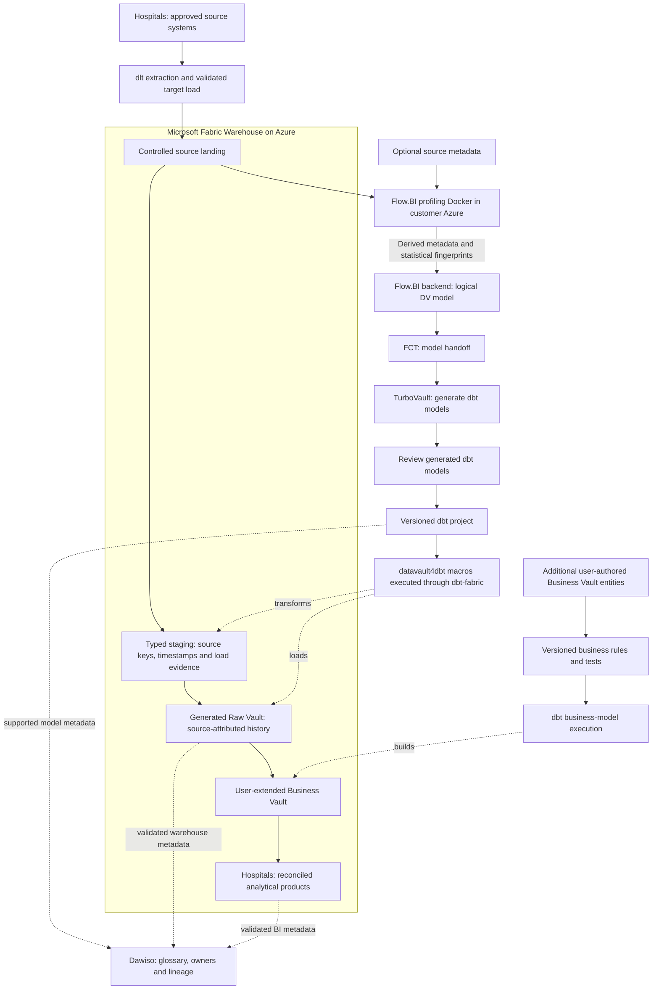

# Cloud Hospitals Microsoft Fabric Data Platform Blueprint

**Connect hospital activity, capacity, clinical events, and finance to explain patient flow and operational performance.**

Build a Microsoft Fabric data warehouse for hospitals around encounter, ward stay, and bed. This blueprint connects dlt ingestion, Flow.BI modeling, Data Vault automation and Dawiso governance to staffed-bed utilization and patient flow, with a platform-specific flow diagram and operating plan.
Audience: hospital leadership, nursing operations, clinical informatics, theatre management, revenue cycle, privacy, and data teams. Updated: 5 November 2026.

[Industry platform selection guide](../cloud-hospitals-platform-selection-guide.md) · [Sovereign edition](../../sovereign/sovereign-hospitals-data-platform-blueprint.md) · [All blueprints](../../../../README.md)

## From encounter, ward stay, and bed to a Microsoft Fabric data product

[dlt](https://github.com/dlt-hub/dlt) is the open-source ingestion library used to extract approved admission/transfer/discharge, bed-management, and capacity data. The hospitals team owns connector code, load state, schedules, and a tested landing-to-target path.

[Flow.BI](https://flow.bi/) derives hubs, links, satellites, and their relationships from the data it profiles for encounter, ward stay, and bed. Actual data is required; mostly optional source metadata improves modeling. Its customer-cloud Docker component profiles locally and sends derived metadata and statistical fingerprints to the backend.

[FCT](https://www.scalefree.com/consulting/turbovault/flowbi-connector/) (Flow.BI Connector for TurboVault4dbt) passes the generated logical model from Flow.BI into the TurboVault metadata workflow. [TurboVault](https://www.scalefree.com/consulting/turbovault/) generates model artifacts so the implementation follows the supplied metadata. Its generated models are reviewed before execution; request online TurboVault Studio access through Scalefree.

[datavault4dbt](https://github.com/ScalefreeCOM/datavault4dbt) supplies the reusable staging, hub, link, and satellite macros invoked by the models, while [dbt](https://github.com/dbt-labs/dbt) runs the versioned SQL transformation project and its quality tests against the selected engine. Additional user-authored Business Vault entities implement **ward-stay intervals and staffed-capacity denominators** outside the regenerated paths.

[Microsoft Fabric Warehouse](https://learn.microsoft.com/en-sg/fabric/fundamentals/decision-guide-lakehouse-warehouse) is the database/compute target for hospitals: Microsoft Fabric is the managed analytics platform; its Warehouse is the SQL target for staging, Vault models, and marts in this design. Power BI supplies the reporting/semantic delivery path. Azure is the cloud ecosystem for the Fabric deployment and the customer-controlled source/profiling environment; tenant identity, networking, storage, capacity, and execution need explicit owners.

[Dawiso](https://www.dawiso.com/product/data-catalog) is the commercial catalog for encounter, ward stay, and bed, connecting business definitions, owners, discovered assets, and lineage evidence. Its deployment and metadata processing need a separate operating agreement.

[Scalefree](https://www.scalefree.com/) supports the data-platform lifecycle through architecture, engineering, governance, and skills development. The engagement connects Microsoft Fabric implementation to the hospitals workflow, governed business rules, and team enablement.

## Microsoft Fabric data and model flow

Source values for encounter, ward stay, and bed are required for profiling. The local Docker component keeps raw source records in the customer environment during profiling and needs approved outbound backend connectivity for derived metadata and fingerprints. Flow.BI output goes directly through FCT and TurboVault; the review occurs after generation and before macro execution. Catalog edges represent configured integrations with tested coverage, including explicit lineage where automatic discovery is incomplete.

## Implement hospitals on Microsoft Fabric

This is the **Microsoft Fabric implementation** of the hospitals workflow. Its purpose is **staffed-bed utilization and patient flow**. Validate the selected target against the worked example and operational failure cases in this document. The platform comparison is available separately; this article carries the complete implementation, training, resources, and Next steps for this stack.

[Microsoft Fabric](https://learn.microsoft.com/en-sg/fabric/fundamentals/decision-guide-lakehouse-warehouse) combines managed analytical services and Power BI delivery. For hospitals, use Warehouse as the tested SQL/dbt target when that is the selected route, and keep Lakehouse/file/Spark processing an explicit option with separate adapter/write tests. Azure supplies the surrounding customer identity, source-access and profiling environment.

Define ward-stay intervals and staffed-capacity denominators once in the agreed transformation/semantic layer and test the handoff to reports. Measure capacity contention during a real hospitals refresh and consumer burst. Include capacity, storage, applicable BI/user licensing, ingestion, and administration. Validate the dlt-to-landing and landing-to-Warehouse path before treating source ingestion as production-ready.

### Warehouse, Lakehouse and semantic ownership

Use **Fabric Warehouse** as the SQL/dbt transformation target in this article. Place approved file/API extracts in controlled landing and load typed Warehouse staging through a tested route. A Lakehouse may retain files or support separately owned Spark preparation, but its SQL endpoint is not treated as an interchangeable writable Warehouse. Own the source-to-staging load independently from dbt. Define encounter, ward stay, and bed at the documented business grain before creating report relationships or measures.

### Azure identity and tested dbt execution

Use Microsoft Entra identities, scoped workspace/item permissions and secrets managed under the customer Azure policy. Connect dbt-fabric to the Warehouse endpoint, pin adapter/package versions and test the generated staging, hubs, links and satellites. The hospitals worked example must retain decimal precision, timestamp meaning, source deletion evidence and late-history behavior. Run the Flow.BI Docker component in customer-controlled Azure compute; Fabric capacity does not itself supply that customer container host.

### Capacity and Power BI delivery

Build ward-stay intervals and staffed-capacity denominators in the agreed Business Vault or semantic responsibility layer and test reconciliation across the Warehouse-to-Power BI boundary. Evaluate Direct Lake, import or another supported consumption mode for the actual target and access pattern; the report mode must preserve permissions, freshness and calculation meaning. Schedule ingestion, dbt and BI refresh with dependency evidence. Benchmark a correction/backfill during peak reporting, capture capacity contention, and include capacity, retained storage, BI/user entitlements, ingestion and operator effort.

### Ingestion contract

**Primary ingestion: dlt (open-source library).** The hospitals team owns source connectors, extraction/load state, schedules, runtime and recovery. Preserve source identifiers, deleted-record evidence and schema changes in a controlled load contract. Use a supported destination or a validated intermediate file/database load path; source support does not establish target-write support. Include engineering effort, execution infrastructure and maintenance in the lifecycle cost. For Fabric, validate dlt extraction to controlled Azure landing followed by a supported Warehouse load. Do not infer full Warehouse or Lakehouse compatibility from a SQL protocol, file format or a differently named destination. Fivetran is an optional commercial acquisition service only through a separately validated landing/load design; direct Fivetran-to-Fabric Warehouse loading is not assumed.

### Platform acceptance and operating evidence

The release record contains Warehouse query/load evidence, capacity observations, dbt artifacts, and semantic-model reconciliation. Join it to source delivery IDs, generator/package/adapter versions, model approval, calculation rule versions and publication cutoffs. Execute a duplicate, a late correction, partial-load recovery, regeneration without losing user-authored Business Vault entities, permission revocation and clean-environment restore using this industry's actual grain.

Run morning operational dashboards while reconstructing bed intervals after a late discharge and a staffed-capacity correction. Use identical source scope, correction cases, service targets, and business definitions when comparing platforms.

Report cost per **validated ward-day product and operational reporting refresh**, plus end-to-end freshness, concurrent-consumer response, reconciliation exceptions, and operator hours. Specifically measure refresh frequency, morning dashboard concurrency, repeated interval joins, and semantic-model duplication.

### Implementation documentation

Use the [Microsoft Fabric platform documentation](https://learn.microsoft.com/en-us/fabric/data-warehouse/tutorial-setup-dbt), [dbt-fabric setup](https://docs.getdbt.com/docs/local/connect-data-platform/fabric-setup), and [datavault4dbt supported platforms and documentation](https://www.datavault4dbt.com/) to pin the implementation. Feature availability and adapter/materialization behavior are part of the pilot acceptance record. Select each additional feature against a concrete hospitals use case and incremental operating cost.

## Follow a patient through the hospital

Hospital operations involve admission, transfers, procedures, diagnostics, and discharge, often recorded in different systems. The platform must preserve event order and corrections while reconciling patient encounters with physical capacity. It supports planning and retrospective analysis; bedside systems, device control, prescribing, and emergency decisions remain within validated clinical workflows.

Start with staffed-bed utilization and inpatient flow for one hospital and selected wards. Include admission/discharge/transfer events, bed-management history, staffing-capacity declarations, and encounter master data. The broader healthcare blueprint addresses cross-provider identity and referrals; this blueprint concentrates on in-hospital operations.

| Operational step | Primary evidence | Question answered |
| --- | --- | --- |
| Admission | Encounter registration and actual arrival | When did the patient enter the measured inpatient scope? |
| Bed assignment and transfer | Assignment intervals, ward changes, correction events | Which ward and bed were occupied, and when? |
| Procedure or diagnostic work | Theatre case, laboratory, radiology, encounter links | Which service events contributed to flow? |
| Discharge readiness and departure | Readiness status, discharge order, actual departure | Separate clinically ready, administratively discharged, and physically departed states. |
| Billing and close | Coding, charge capture, payer and ledger controls | Reconcile activity to billable and recorded financial events. |

## Build encounter and location history before dashboards

Use a governed patient-identity crosswalk and preserve merge/unmerge events. Distinguish patient, encounter, episode, ward, physical bed, staffed capacity interval, procedure, order, specimen, and claim/invoice. A transferred patient can create multiple ward stays inside one encounter.

Raw Vault entities preserve original admission/transfer/discharge events and amendments. Add Business Vault entities for ward-stay intervals, encounter episodes, staffed-capacity intervals, operational calendars, and exclusions. Flow.BI output reaches FCT and TurboVault directly; review generated models after TurboVault and before macro execution.

Use existing clinical interface infrastructure and documented [FHIR](https://hl7.org/fhir/overview.html) resources where supported. Pin interface versions and validate resource history, repeated fields, and reference resolution. Do not treat a database extract as a substitute for agreed clinical event semantics.

## Worked example: staffed capacity and occupancy

A ward declares 20 staffed beds for a 24-hour day: 480 staffed bed-hours. If validated occupancy intervals total 360 hours, an illustrative occupancy measure is 75%. Physical installed capacity may be larger; it is a different denominator.

Define how leave, temporary closure, boarding, observation, and overlapping assignments affect the metric. If a bed is closed for part of a day, use its effective capacity interval. Compute durations from instants consistently and explain local-day aggregation across daylight-saving changes.

The analytical grain is **encounter × ward-stay interval**, joined to **ward × staffed-capacity interval** through controlled interval logic. Retain interval-building rule versions and report cutoff. Test both overlap and gaps rather than filling them silently.

## Keep clinical, workforce, and financial permissions distinct

Patient-level flow data requires authorized operational access. Clinical content, staff rosters, sensitive specialties, and billing identifiers need their own field and purpose restrictions. Treat demographic matching, hospital discharge status, and clinical death records with explicit source precedence and escalation.

Map relevant [GDPR](https://eur-lex.europa.eu/eli/reg/2016/679/oj/eng) and local health-record requirements. For US entities in scope, evaluate [HIPAA roles and business-associate arrangements](https://www.hhs.gov/hipaa/for-professionals/covered-entities/index.html). Pseudonymized analytics still needs governance. Protect small specialty/diagnosis aggregates in exports.

Run Flow.BI's local Docker component within the hospital-controlled Azure, AWS, or Google Cloud environment. Approve the outbound fingerprint/metadata payload and source access without introducing workload or availability problems for clinical systems.

## Pilot with nursing operations and clinical informatics

Nursing operations approves capacity semantics, informatics validates clinical events, ward managers resolve assignment exceptions, and finance defines activity-to-revenue boundaries. Training should include an admission correction, a ward transfer, a staffed-bed closure, and a patient unmerge.

Release criteria include reconciliation of encounters to the source system, sampled agreement of reconstructed stays with bed-management evidence, verified denominator changes, source-to-metric lineage, and explicit handling of late discharge events. A patient transfer must neither double-count bed occupancy nor lose the encounter.

Extend later to theatre utilization, diagnostic turnaround, discharge delays, and revenue-cycle products. Define separate denominators and clinical ownership for each. Complete technology, deployment, training, and reference guidance follows.

## Operate and govern by data product

Assign each product a business owner, technical operator, purpose, grain, definitions, refresh target, classification, retention, and quality thresholds. Preserve source batch/offset IDs, code/package versions, calculation rules, cutoff, and exception status with published outputs. Keep operational-system decisions and regulated calculation engines within their validated authority boundaries.

Use institutional identity, scoped service principals, separate development/production, secret management, auditable privileged access, and approved network routes. Enforce restrictions through SQL, BI, export, and underlying storage. Test actual negative access and revocation behavior. A managed service or compliant provider does not establish application-level compliance.

Choose orchestration and alerts around the product's dependencies. A late source or unresolved material reconciliation break should affect publication status. Define retries and recovery of ingestion state, metadata/catalogs, data, credentials, and deployment artifacts. Demonstrate rollback and a clean-environment restore.

## Compare lifecycle cost and delivery value

The managed-cloud case is **shorter delivery time, reduced infrastructure administration, elastic execution, and useful platform integration**. The decision is an operating-model tradeoff. Keep privacy, contractual requirements, data-location constraints, and an exit plan even when sovereignty is not the main objective.

Use a three-year model with an explicit growth scenario:

`TCO = migration and implementation + platform/compute + storage and retained copies + ingestion/orchestration + network/egress + BI/security licenses + support + operating staff + recovery/testing + exit allowance`

Account for negotiated rates and existing commitments as incremental costs, without treating sunk licenses or staff effort as free. Measure normal, peak, backfill, and quiet-period workloads. Record costs per completed data-product refresh and per meaningful business unit, together with correctness and service quality. Compare low/base/high demand and sensitivity to refresh frequency, retention, concurrency, and source growth. Do not publish a cost-saving percentage without the corresponding workload and pricing assumptions.

For feature decisions, record the use case, production availability in the selected region/edition, integration limits, expected outcome, incremental cost, operating owner, and rollback. Prefer an ordinary SQL or scheduled pipeline when it meets the product goal more economically. New AI, streaming, or sharing capabilities should earn their place through a measured pilot.

## Delivery gates

1. Agree the product's grain, calculation, scope, cutoff, access, and reconciliation targets with its business owner.
2. Benchmark the recommended platform against the strongest alternative using the same sources and workload, including cold/warm runs and concurrent consumers.
3. Build the ingestion/model-generation path; review after TurboVault; run tested macros and add Business Vault rules.
4. Prove the industry's worked example and failure cases, historical reconstruction, permissions, restart, restore, and regeneration behavior.
5. Compare measured run cost and staff effort with the business case. Document limitations and choose the platform before committing to broad migration.

## Dawiso governance for hospitals

[Dawiso](https://www.dawiso.com/product/data-catalog) adds the business glossary, asset discovery, ownership, and lineage context for hospitals. It connects the meaning of encounter and the rules for ward-stay intervals and staffed-capacity denominators to the implemented datasets.

For this product, register **encounter, ward stay, bed, capacity interval, and procedure** as governed concepts linked to real assets. Describe **ward-stay intervals and staffed-capacity denominators** with an owner, calculation/rule version, eligible population, cutoff, and known limitations. Publish only the metadata fields that the catalog users are authorized to see.

### Deployment and processing boundary

Use [Dawiso's deployment and integration options](https://www.dawiso.com/product/enterprise-deployment-built-for-flexibility-and-security) to select the supported catalog location and network path. Record the edition, contributor/viewer licensing, metadata scanning scope, and operating owner. Validate discovery of Microsoft Fabric assets and dbt lineage using the supported connectors or an explicit metadata mapping.

### Connect execution evidence to meaning

Discover the selected database/BI assets using the [supported connectors](https://www.dawiso.com/connectors) and validate dbt/generated-model metadata exchange for the chosen version. Define a controlled import/API mapping for gaps; do not assume a direct Flow.BI or FCT catalog connector. Keep the modeling service's generated metadata distinct from the catalog's approved business glossary.

dbt executes transformation tests; Dawiso records the associated definitions, owners, evidence links, and quality context. Select and validate the integration that publishes results; the catalog does not replace the test engine.

Catalog acceptance follows the hospitals pilot: trace an approved source field through a generated model and Business Vault extension to a published metric, then test a schema change, a stale scan, and a permission revocation. Mask sample values and sensitive SQL/descriptions where required. Track scan coverage and unresolved lineage gaps explicitly.

## Training and knowledge transfer

Make capability development a delivery workstream with practical acceptance criteria.

| Track | Training resource | Participants | Proposed project outcome |
| --- | --- | --- | --- |
| DV — Data Vault | [Data Vault Training & Certification](https://www.scalefree.com/data-vault-2-1-trainings/data-vault-training-certification/) and [Modeling Class](https://www.scalefree.com/data-vault-2-1-trainings/data-vault-2-1-modeling-class/) | Architects, modelers, engineering leads; selected stewards for shared concepts. | Understand generated Raw Vault structures and design additional Business Vault entities with the correct keys, grain, and history. |
| DWA — Data Warehouse Automation | [Scalefree dbt training: DataVault4dbt and TurboVault automation blocks](https://www.scalefree.com/training/dbt-training/) | Modelers, engineers, and release owners. | Operate the Flow.BI–FCT–TurboVault workflow, review generated models before datavault4dbt/dbt execution, and regenerate without overwriting user-authored Business Vault entities. |
| dbt | [Scalefree dbt Training](https://www.scalefree.com/training/dbt-training/) | Data engineers, analytics engineers, and operators. | Build and test models, use packages/macros, debug failures, and promote releases through controlled environments. |
| Flow.BI foundations | [Flow.BI Introduction](https://flow.bi/trainings/flow-bi-introduction/) | Business analysts, domain stewards, architects, project leads, and engineers. | Understand the interface, data sources, deployment targets, and first model-generation run. |
| Flow.BI configuration and operations | [Flow.BI In-Depth](https://flow.bi/trainings/flow-bi-in-depth/) | Engineers, architects, and platform operators. | Configure classification, permissions, API access, and integration settings for the organization environment. |
| Understanding generated models | [Generated Data Vault Models](https://flow.bi/trainings/generated-data-vault-2-0-models/) | Data modelers, engineers, and architects. | Interpret generated structures and their downstream physical implementation; apply this knowledge to the review after TurboVault and to Business Vault extensions. |
| Flow.BI metadata presentation | [Presenting Flow.BI Metadata — training catalog](https://flow.bi/trainings/) | Modelers, analysts, and metadata/catalog owners. | Use Flow.BI dashboards to present internal metadata to authorized users. |
| Catalog stewardship | [Dawiso documentation](https://www.dawiso.com/product/data-catalog) | Data owners, stewards, catalog operators, and engineers. | Document encounter, approve definitions, trace model lineage, and operate metadata scans and access. |

**Terminology:** DWA means Data Warehouse Automation. The DWA training track uses Scalefree's published automation learning blocks. DVA refers exclusively to the Data Vault Alliance.

The Data Vault certification training covers Data Vault 2.1. Align the curriculum with the selected tool versions and implementation patterns. Its dbt offering is customizable; agree the agenda and prerequisites before booking.
Flow.BI In-Depth requires Flow.BI Introduction and general data-architecture knowledge. Generated Data Vault Models requires Flow.BI Introduction and Data Vault modeling knowledge. Use the [Flow.BI training catalog](https://flow.bi/trainings/) to select classes or a bundle and confirm current delivery details.

Recommended sequence:

1. Run DV foundations and modeling to understand the generated Raw Vault and design Business Vault extensions.
2. Complete Flow.BI Introduction before connecting the pilot sources; follow with In-Depth for the configuration and operations team and Generated Data Vault Models for modelers and engineers.
3. Run dbt fundamentals before building the first transformation pipeline.
4. Run DWA practical sessions when the first Flow.BI output is available for direct processing through FCT and TurboVault. Include metadata presentation training for the team publishing model documentation.
5. Complete an organization-led lab using synthetic datasets for the selected industry workflow: dlt ingestion, Flow.BI generation, direct FCT transfer, TurboVault generation, generated-model review, datavault4dbt/dbt execution, user-added Business Vault entities, and industry-specific reconciliation.
6. Require at least two internal operators to deploy, troubleshoot, restore, and explain the pipeline without external assistance.

Budget training, preparation time, labs, and follow-up coaching separately from software and hosting. Use the [current training catalog](https://www.scalefree.com/training/) for available formats and scheduling.

## Scalefree implementation resources

The following articles complement the product documentation and training. Read the Flow.BI/FCT integration overview first, then TurboVault generation, datavault4dbt staging and loading, and finally Business Vault extensions and deployment practices.

| Tool or topic | Scalefree blog resource | Application to this blueprint |
| --- | --- | --- |
| Flow.BI, FCT, TurboVault, and datavault4dbt | [Flow.BI: Generating the Raw Data Vault Using AI and dbt](https://www.scalefree.com/blog/modeling/flow-bi-generating-the-raw-data-vault-using-ai-and-dbt/) | Explains the logical-to-physical automation chain and connector, and the addition of business logic in the Business Vault. Pair it with the [FCT access page](https://www.scalefree.com/consulting/turbovault/flowbi-connector/) for onboarding. |
| TurboVault | [Speed Up Your Data Vault 2.0 Implementation with TurboVault4dbt](https://www.scalefree.com/blog/tools/speed-up-your-data-vault-2-0-implementation-with-turbovault4dbt/) | Introduces metadata-driven dbt model generation. Use it to understand the generation stage before the review phase. |
| datavault4dbt overview | [Kick-Start Your Data Vault 2.0 Implementation with datavault4dbt](https://www.scalefree.com/blog/tools/kick-start-your-data-vault-2-0-implementation-with-datavault4dbt/) | Introduces loading templates and the package's role within dbt. Useful background before the hands-on training. |
| datavault4dbt staging | [Exploring datavault4dbt — Vol. 1: The Staging Layer](https://www.scalefree.com/blog/tools/exploring-datavault4dbt-a-practical-series-on-the-dbt-package-for-data-vault-2-0-vol-1-the-staging-layer/) | Covers staging configuration, hashing, derived columns, and prejoins. Apply these concepts when connecting the dlt landing datasets to generated transformations. |
| datavault4dbt Raw Vault | [Exploring datavault4dbt — Vol. 2: Standard Entities in the Raw Vault](https://www.scalefree.com/blog/datenwerkzeuge/exploring-datavault4dbt-a-practical-series-on-the-dbt-package-for-data-vault-2-0-vol-2-standard-entities-in-the-raw-vault/) | Walks through hubs, links, and satellites. Use it to interpret the models produced by TurboVault and their macro parameters. |
| Business Vault extensions | [Designing the Business Vault: Key Strategies for Effective Data Organization](https://www.scalefree.com/blog/data-vault/designing-the-business-vault-key-strategies-for-effective-data-organization/) | Explains reusable business logic and additional entities such as computed satellites, links, PITs, and bridges. Relevant to user-defined organization extensions after Raw Vault generation. |
| dbt delivery and testing | [CI/CD: Practical Insights into Automating Data Vault 2.0 with dbt](https://www.scalefree.com/blog/data-vault/ci-cd-practical-insights-into-automating-data-vault-2-0-with-dbt/) | Uses datavault4dbt and GitHub Actions to illustrate testing and delivery automation. Adapt execution and runner placement to the organization's cloud boundary. |

Examples in older articles may use earlier package versions, metadata layouts, or specific cloud databases. Use the pinned tool versions and current documentation for implementation details. For ingestion and target-platform configuration, use the primary documentation already linked in the platform and ingestion guidance in this document alongside these architectural resources. Browse the [Scalefree blog](https://www.scalefree.com/blog/) for further articles.

## Flow.BI implementation resources

Use the [Flow.BI blog](https://flow.bi/blog/) for ongoing product architecture and implementation material. Relevant starting points:

| Resource | Why it matters to this blueprint |
| --- | --- |
| [How Flow.BI Protects Sensitive Enterprise Data](https://flow.bi/blog/how-flow-bi-protects-sensitive-enterprise-data/) | Explains required data profiling, the local Docker image, storage access, and the local/backend processing boundary. |
| [Seeing Every Step: Data Lineage Inside Flow.BI](https://flow.bi/blog/seeing-every-step-data-lineage-inside-flow-bi/) | Describes source-to-model traceability and graph views. Use this model lineage alongside dlt load evidence and dbt execution lineage. |
| [Turning Salesforce and Pardot Tables Into a Semantic Model](https://flow.bi/blog/turning-salesforce-and-pardot-tables-into-a-semantic-model/) | Illustrates concept recognition and declared versus inferred relationships using CRM data. Use it as background on model generation; organization-specific additions in this blueprint are implemented through Business Vault entities. |
| [Generative AI for Data Vault](https://flow.bi/ai-driven-business/) | Explains the progression from data profiling to a logical Data Vault model and downstream physical-model automation. |
| [Flow.BI Media Library](https://flow.bi/media/) | Includes local-processing, bring-your-own-bucket, modeling, and dbt integration sessions for team onboarding. |

## Microsoft Fabric implementation questions for hospitals

### How should Microsoft Fabric preserve hospitals history?

Use Fabric Warehouse as the dbt SQL target with a validated source-to-Warehouse load. Preserve the grain of encounter, ward stay, and bed, then reconcile ward-stay intervals and staffed-capacity denominators through the Power BI delivery boundary. Test capacity contention and the chosen consumption mode using the real refresh cycle.

### What should the hospitals Microsoft Fabric pilot prove?

Use the worked example and difficult cases to validate **staffed-bed utilization and patient flow**. Retain source-to-output reconciliation, duplicate and late-record results, access-denial evidence, restore behavior and the measured cost per accepted product. Confirm that regeneration preserves user-authored Business Vault rules and that Dawiso lineage covers the actual route.

## Related blueprints

- [Sovereign hospitals data platform](../../sovereign/sovereign-hospitals-data-platform-blueprint.md)
- [Hospitals cloud platform selection](../cloud-hospitals-platform-selection-guide.md)
- [Hospitals on Snowflake](../snowflake/cloud-hospitals-snowflake-data-platform-blueprint.md)
- [Hospitals on Databricks](../databricks/cloud-hospitals-databricks-data-platform-blueprint.md)
- [Hospitals on Google BigQuery](../google-bigquery/cloud-hospitals-google-bigquery-data-platform-blueprint.md)
- [Microsoft Fabric technology architecture](../../../../cloud/microsoft-fabric/microsoft-fabric-data-platform-blueprint.md)
- [All industry and technology blueprints](../../../../README.md)

## Next steps

Bring the hospitals worked example, source inventory, Microsoft Fabric deployment assumptions and measured cost targets to the first implementation session. Request a pilot covering ingestion, model generation, the review after TurboVault, dbt execution, Dawiso lineage and one user-authored Business Vault extension.

Include Dawiso metadata discovery, glossary ownership, lineage coverage, and catalog operating cost in the pilot scope.

Select the pilot described in this blueprint, name its business and technical owners, and bring representative source data, reporting definitions, workload volumes, and operating constraints to an architecture discussion.

| Step | Where to go | What to request or prepare |
| --- | --- | --- |
| Discuss the implementation | [Scalefree contact form](https://www.scalefree.com/about-scalefree/contact/) | Request a platform assessment, pilot workshop, implementation support, or tailored training. Include the blueprint title and the first data product. |
| Try automated modeling | [Flow.BI trial registration](https://flow.bi/sign-up-for-trial/) | Request a trial and local-processing Docker deployment instructions. Prepare authorized source data; available metadata improves the result. |
| Obtain the connector | [FCT access and download request](https://www.scalefree.com/consulting/turbovault/flowbi-connector/) | Request Flow.BI Connector for TurboVault4dbt access and verify the intended generator version. |
| Install the macro package | [datavault4dbt repository and releases](https://github.com/ScalefreeCOM/datavault4dbt) | Obtain the package, choose a supported target adapter, and pin a tested version. |
| Access the online generator | [Request TurboVault Studio signup through Scalefree](https://www.scalefree.com/about-scalefree/contact/) | Ask specifically for the new online TurboVault Studio and its Flow.BI/FCT integration route. |
| Obtain a downloadable generator | [TurboVault4dbt](https://github.com/ScalefreeCOM/turbovault4dbt) and [TurboVault Engine](https://github.com/ScalefreeCOM/turbovault-engine) | Select the edition that fits the integration and retain its version and configuration. |
| Receive implementation updates | [Scalefree newsletter registration](https://www.scalefree.com/) | Use the “Data Vault 2.GO / Build Better Data Platforms” newsletter form on the homepage. |

Complete the pilot's reconciliation, access, recovery, and cost checks before extending the source scope. Record the results and the decision to proceed in the project repository.

## License

Copyright © 2026 Scalefree International GmbH. The original text, tables, and diagrams in this blueprint are licensed under [CC BY-SA 4.0](https://creativecommons.org/licenses/by-sa/4.0/). Credit Scalefree, identify changes, and retain the applicable ShareAlike terms when distributing adaptations. See [LICENSE.md](../../../../LICENSE.md) for scope, attribution, and the governing legal code. Referenced software and third-party material retain their own licenses.
