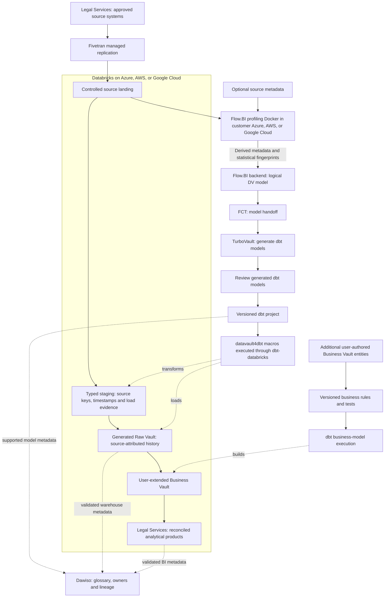

# Cloud Legal Services Databricks Data Platform Blueprint

**Connect matters, people, work, billing, and knowledge while preserving confidentiality, ethical walls, and privilege-sensitive boundaries.**

This legal services data platform blueprint implements Data Vault on Databricks using Fivetran, Flow.BI, dbt and Dawiso. Follow the source workflow for matter financial reporting under ethical walls, then validate history, business rules, deployment and cost against the worked example.
Audience: managing partners, practice operations, conflicts teams, finance, knowledge management, records, and data teams. Updated: 5 November 2026.

[Industry platform selection guide](../cloud-legal-services-platform-selection-guide.md) · [Sovereign edition](../../sovereign/sovereign-legal-services-data-platform-blueprint.md) · [All blueprints](../../../../README.md)

## Build the legal services pipeline with Databricks

1. [Fivetran](https://fivetran.com/docs/getting-started) provides commercial managed replication for supported legal services sources. Land practice-management, time, billing, and approved ledger extracts in a destination-owned replica, retain sync/deletion evidence, and keep dbt-owned Vault tables separate.

2. [Flow.BI](https://flow.bi/) analyzes source values and relationships to generate the logical Data Vault structure for client, matter, and engagement. Actual data is required; mostly optional source metadata improves modeling. Its customer-cloud Docker component profiles locally and sends derived metadata and statistical fingerprints to the backend.

3. [FCT](https://www.scalefree.com/consulting/turbovault/flowbi-connector/) (Flow.BI Connector for TurboVault4dbt) connects the modeling service to the generator by retrieving and transforming Flow.BI output. [TurboVault](https://www.scalefree.com/consulting/turbovault/) translates Data Vault metadata into the dbt model layer. Its generated models are reviewed before execution; request online TurboVault Studio access through Scalefree.

4. [datavault4dbt](https://github.com/ScalefreeCOM/datavault4dbt) supplies reusable loading logic for staging and the required Vault entity types, while [dbt](https://github.com/dbt-labs/dbt) compiles model SQL, resolves dependencies, runs transformations, and executes tests on the target. Additional user-authored Business Vault entities implement **effective fee rules and billing/collection measures** outside the regenerated paths.

5. [Databricks SQL and lakehouse tables](https://docs.databricks.com/aws/en/getting-started/architecture) is the database/compute target for legal services: Databricks supplies the engineering and SQL compute; governed lakehouse tables hold source history, Vault entities, and derived products. This separates the query/runtime role from the underlying object storage. Deploy Databricks in the approved Azure, AWS, or Google Cloud environment near the source data and operational skills. That cloud supplies the surrounding storage, network, identity, and customer profiling runtime.

6. [Dawiso](https://www.dawiso.com/product/data-catalog) is the commercial catalog for client, matter, and engagement, connecting business definitions, owners, discovered assets, and lineage evidence. Its deployment and metadata processing need a separate operating agreement.

7. [Scalefree](https://www.scalefree.com/) combines data-platform advisory, implementation delivery, automation tooling, and team training. The engagement connects Databricks implementation to the legal services workflow, governed business rules, and team enablement.

## Databricks data and model flow

Source values for client, matter, and engagement are required for profiling. The local Docker component keeps raw source records in the customer environment during profiling and needs approved outbound backend connectivity for derived metadata and fingerprints. Flow.BI output goes directly through FCT and TurboVault; the review occurs after generation and before macro execution. Catalog edges represent configured integrations with tested coverage, including explicit lineage where automatic discovery is incomplete.

## A matter is the governing access boundary

A firm needs to understand work performed, recoverable value, billing progress, and client commitments without exposing one engagement to an unauthorized team. A global client hierarchy is useful for management, but it must not bypass matter-specific restrictions.

Start with work-in-progress and billing realization for one practice, using practice-management, time recording, billing, and approved ledger extracts. Document search, discovery processing, and generative legal research need their own content permissions and quality controls.

| Workflow | Evidence | Analytical use |
| --- | --- | --- |
| Accept an engagement | Client, matter, conflict clearance, engagement terms | Establish authorized scope and billing arrangements. |
| Staff and perform work | Matter role, time entry, task, fee-earner rate | Work and value by permitted team. |
| Review work in progress | Amendments, write-downs, approvals | Explain changes between recorded and recoverable work. |
| Bill and collect | Invoice lines, credit notes, receipts, allocation | Separate billing realization from cash collection. |
| Close and retain | Closure event, hold, retention authority | Limit continued access and preserve required evidence. |

## Model client relationships without flattening restrictions

Separate person, organization, client relationship, matter, engagement version, matter role, time entry, rate, invoice line, receipt allocation, and document reference. Preserve effective dates for fee arrangements, staffing, ethical walls, and rate changes.

The Raw Vault stores original time, billing, and amendment records. Users add Business Vault entities for rate selection, realization measures, partner/practice hierarchies, and approved allocation. Flow.BI output moves directly to FCT and TurboVault; review generated models before datavault4dbt/dbt execution.

A document reference is not authorization to extract its contents. Keep privileged documents, legal advice, witness material, and client identity behind the relevant matter permissions. Metadata such as matter names and counterparties can itself be sensitive and must be considered in Flow.BI's outbound metadata/fingerprint approval.

## Worked example: realization and collection answer different questions

Suppose recorded standard-value work is EUR 10,000 and approved billed fees are EUR 8,000. A defined billing realization is 80%. If EUR 6,000 has been collected, collection against those billed fees is 75%. Calling either measure simply “realization” hides the denominator.

Use **time entry × version** for work evidence, **invoice line × matter × currency** for billed value, and **receipt × invoice allocation** for collection. Keep taxes, disbursements, fixed fees, contingency fees, credit notes, and FX treatment explicit. A fixed-fee matter needs an approved allocation method rather than a guessed hourly conversion.

## Ethical walls must reach the data platform

Enforce matter access in query engines, semantic models, extracts, and caches. Test join paths that could reveal restricted counterparties through a client-wide report. Role removal or a new ethical wall must affect previously accessible analytical products within the agreed process.

Map the professional rules, engagement terms, privacy law, and privilege considerations for the jurisdictions involved. [ABA Formal Opinion 477R](https://www.americanbar.org/books/ecd/chapter/348777154/) is a US reference on protecting client communications; it is not a substitute for applicable local professional requirements. Azure, AWS, or Google Cloud deployment requires review of client contracts, operator access, retention, and vendor processing terms.

## Pilot with finance and the conflicts function

Practice management owns engagement meaning, finance owns value and ledger controls, the conflicts function owns wall definitions, and records staff owns retention/holds. Train modelers with a fee change, a credited invoice, a transferred matter, and an ethical-wall change.

Acceptance requires reconciliation to time and billing sources, reproducible rate selection, correct receipt allocations, and negative access tests on matter-level joins and exports. Demonstrate an access revocation and a legal hold. Do not publish a partner leaderboard before allocation and denominator rules are agreed.

Extend to capacity planning and approved knowledge products after financial and access controls work. Full technology, cloud, training, and reference guidance follows.

## Databricks deployment and physical design

This is the **Databricks implementation** of the legal services workflow. Its purpose is **matter financial reporting under ethical walls**. Validate the selected target against the worked example and operational failure cases in this document. The platform comparison is available separately; this article carries the complete implementation, training, resources, and Next steps for this stack.

[Databricks](https://docs.databricks.com/aws/en/getting-started/architecture) contributes engineering and SQL execution over governed lakehouse tables. Use the approved incumbent cloud for storage, network and identity, then retain raw deliveries, typed source tables, the Raw Vault, and effective fee rules and billing/collection measures with an owned writer/refresh contract. Unity Catalog governs the platform assets; Dawiso provides the cross-stack business discovery and lineage layer in this cloud edition.

Evaluate ingestion/replay and SQL serving for legal services together. Preserve the fact grain and corrections while comparing job/SQL/serverless choices supported by the chosen cloud and edition. Include platform usage, underlying infrastructure where separately billed, table maintenance, storage, network, retries, and retained environments. A streaming or AI feature needs a measurable product use case.

### Table ownership and event replay

Keep a durable source-delivery record, typed staging tables, generated Vault tables and user-authored Business Vault models. Register the production tables under the agreed Unity Catalog catalog/schema with one accountable writer per table. For client, matter, and engagement, preserve source event/version identifiers, business-effective time and load time; a streaming checkpoint is processing state, not the historical business record. A replay needs an idempotence contract and explicit handling of corrections and deleted source records.

### SQL/dbt execution and physical layout

Use dbt-databricks against the selected SQL execution endpoint and pin its compatibility with datavault4dbt. Validate the materializations and history-load behavior on Delta tables before scaling. Partitioning, clustering and maintenance choices follow the legal services access and update pattern; use query profiles and maintenance cost to choose them. Prevent notebooks or engineering jobs from writing concurrently to dbt-owned Vault targets. Bronze/silver/gold naming may describe processing stages, but each table still needs an explicit mapping to landing, Raw Vault, Business Vault or serving.

### Separate engineering demand from serving commitments

Allocate source preparation, history replay, dbt transformation and analytical serving to owned workloads. Benchmark a late-source correction while consumers query effective fee rules and billing/collection measures; track both result correctness and contention. The budget includes platform usage and cloud compute/storage/network charges where applicable, idle or restart overhead, table maintenance and retained data. Unity Catalog supplies native asset governance; Dawiso connects cross-stack business meaning and lineage without replacing platform authorization.

### Ingestion contract

**Primary ingestion: Fivetran (commercial managed service).** Verify supported legal services sources and the documented Databricks destination, historical load/CDC scope, deleted-record behavior, schema changes, sync recovery and processing location. Keep its destination replica separate from dbt-owned models. Price the actual connector usage and destination load compute, including the plan-specific treatment of re-syncs; source-specific APIs or industrial/clinical gateways may still be needed. Use the [destination documentation](https://fivetran.com/docs/destinations) and [pricing definitions](https://fivetran.com/docs/core-concepts/usage-based-pricing).

### Platform acceptance and operating evidence

The release record contains job and SQL execution evidence, Delta table versions, dbt artifacts, and compute attribution. Join it to source delivery IDs, generator/package/adapter versions, model approval, calculation rule versions and publication cutoffs. Execute a duplicate, a late correction, partial-load recovery, regeneration without losing user-authored Business Vault entities, permission revocation and clean-environment restore using this industry's actual grain.

Reconcile time and invoice measures, change an ethical wall, and verify direct SQL and exported data obey the new access boundary. Use identical source scope, correction cases, service targets, and business definitions when comparing platforms.

Report cost per **reconciled matter reporting cycle and authorized dashboard refresh**, plus end-to-end freshness, concurrent-consumer response, reconciliation exceptions, and operator hours. Specifically measure permission administration, parallel restricted copies, report concurrency, document-engineering scope, and idle capacity.

### Implementation documentation

Use the [Databricks platform documentation](https://docs.databricks.com/aws/en/getting-started/architecture), [dbt-databricks setup](https://docs.getdbt.com/docs/local/connect-data-platform/databricks-setup), and [datavault4dbt supported platforms and documentation](https://www.datavault4dbt.com/) to pin the implementation. Feature availability and adapter/materialization behavior are part of the pilot acceptance record. Select each additional feature against a concrete legal services use case and incremental operating cost.

## Operate and govern by data product

Assign each product a business owner, technical operator, purpose, grain, definitions, refresh target, classification, retention, and quality thresholds. Preserve source batch/offset IDs, code/package versions, calculation rules, cutoff, and exception status with published outputs. Keep operational-system decisions and regulated calculation engines within their validated authority boundaries.

Use institutional identity, scoped service principals, separate development/production, secret management, auditable privileged access, and approved network routes. Enforce restrictions through SQL, BI, export, and underlying storage. Test actual negative access and revocation behavior. A managed service or compliant provider does not establish application-level compliance.

Choose orchestration and alerts around the product's dependencies. A late source or unresolved material reconciliation break should affect publication status. Define retries and recovery of ingestion state, metadata/catalogs, data, credentials, and deployment artifacts. Demonstrate rollback and a clean-environment restore.

## Compare lifecycle cost and delivery value

The managed-cloud case is **shorter delivery time, reduced infrastructure administration, elastic execution, and useful platform integration**. The decision is an operating-model tradeoff. Keep privacy, contractual requirements, data-location constraints, and an exit plan even when sovereignty is not the main objective.

Use a three-year model with an explicit growth scenario:

`TCO = migration and implementation + platform/compute + storage and retained copies + ingestion/orchestration + network/egress + BI/security licenses + support + operating staff + recovery/testing + exit allowance`

Account for negotiated rates and existing commitments as incremental costs, without treating sunk licenses or staff effort as free. Measure normal, peak, backfill, and quiet-period workloads. Record costs per completed data-product refresh and per meaningful business unit, together with correctness and service quality. Compare low/base/high demand and sensitivity to refresh frequency, retention, concurrency, and source growth. Do not publish a cost-saving percentage without the corresponding workload and pricing assumptions.

For feature decisions, record the use case, production availability in the selected region/edition, integration limits, expected outcome, incremental cost, operating owner, and rollback. Prefer an ordinary SQL or scheduled pipeline when it meets the product goal more economically. New AI, streaming, or sharing capabilities should earn their place through a measured pilot.

## Delivery gates

1. Agree the product's grain, calculation, scope, cutoff, access, and reconciliation targets with its business owner.
2. Benchmark the recommended platform against the strongest alternative using the same sources and workload, including cold/warm runs and concurrent consumers.
3. Build the ingestion/model-generation path; review after TurboVault; run tested macros and add Business Vault rules.
4. Prove the industry's worked example and failure cases, historical reconstruction, permissions, restart, restore, and regeneration behavior.
5. Compare measured run cost and staff effort with the business case. Document limitations and choose the platform before committing to broad migration.

## Metadata stewardship in the legal services stack

[Dawiso](https://www.dawiso.com/product/data-catalog) adds the business glossary, asset discovery, ownership, and lineage context for legal services. It connects the meaning of client and the rules for effective fee rules and billing/collection measures to the implemented datasets.

Use [Dawiso's deployment and integration options](https://www.dawiso.com/product/enterprise-deployment-built-for-flexibility-and-security) to select the supported catalog location and network path. Record the edition, contributor/viewer licensing, metadata scanning scope, and operating owner. Validate discovery of Databricks assets and dbt lineage using the supported connectors or an explicit metadata mapping.

| Catalog responsibility | Implementation in this blueprint |
| --- | --- |
| Business meaning | For this product, register **client, matter, engagement, time entry, and invoice line** as governed concepts linked to real assets. Describe **effective fee rules and billing/collection measures** with an owner, calculation/rule version, eligible population, cutoff, and known limitations. Publish only the metadata fields that the catalog users are authorized to see. |
| Metadata ingestion | Discover the selected database/BI assets using the [supported connectors](https://www.dawiso.com/connectors) and validate dbt/generated-model metadata exchange for the chosen version. Define a controlled import/API mapping for gaps; do not assume a direct Flow.BI or FCT catalog connector. Keep the modeling service's generated metadata distinct from the catalog's approved business glossary. |
| Quality and lineage evidence | dbt executes transformation tests; Dawiso records the associated definitions, owners, evidence links, and quality context. Select and validate the integration that publishes results; the catalog does not replace the test engine. |
| Release evidence | Catalog acceptance follows the legal services pilot: trace an approved source field through a generated model and Business Vault extension to a published metric, then test a schema change, a stale scan, and a permission revocation. Mask sample values and sensitive SQL/descriptions where required. Track scan coverage and unresolved lineage gaps explicitly. |

## Training and knowledge transfer

Make capability development a delivery workstream with practical acceptance criteria.

| Track | Training resource | Participants | Proposed project outcome |
| --- | --- | --- | --- |
| DV — Data Vault | [Data Vault Training & Certification](https://www.scalefree.com/data-vault-2-1-trainings/data-vault-training-certification/) and [Modeling Class](https://www.scalefree.com/data-vault-2-1-trainings/data-vault-2-1-modeling-class/) | Architects, modelers, engineering leads; selected stewards for shared concepts. | Understand generated Raw Vault structures and design additional Business Vault entities with the correct keys, grain, and history. |
| DWA — Data Warehouse Automation | [Scalefree dbt training: DataVault4dbt and TurboVault automation blocks](https://www.scalefree.com/training/dbt-training/) | Modelers, engineers, and release owners. | Operate the Flow.BI–FCT–TurboVault workflow, review generated models before datavault4dbt/dbt execution, and regenerate without overwriting user-authored Business Vault entities. |
| dbt | [Scalefree dbt Training](https://www.scalefree.com/training/dbt-training/) | Data engineers, analytics engineers, and operators. | Build and test models, use packages/macros, debug failures, and promote releases through controlled environments. |
| Flow.BI foundations | [Flow.BI Introduction](https://flow.bi/trainings/flow-bi-introduction/) | Business analysts, domain stewards, architects, project leads, and engineers. | Understand the interface, data sources, deployment targets, and first model-generation run. |
| Flow.BI configuration and operations | [Flow.BI In-Depth](https://flow.bi/trainings/flow-bi-in-depth/) | Engineers, architects, and platform operators. | Configure classification, permissions, API access, and integration settings for the organization environment. |
| Understanding generated models | [Generated Data Vault Models](https://flow.bi/trainings/generated-data-vault-2-0-models/) | Data modelers, engineers, and architects. | Interpret generated structures and their downstream physical implementation; apply this knowledge to the review after TurboVault and to Business Vault extensions. |
| Flow.BI metadata presentation | [Presenting Flow.BI Metadata — training catalog](https://flow.bi/trainings/) | Modelers, analysts, and metadata/catalog owners. | Use Flow.BI dashboards to present internal metadata to authorized users. |
| Catalog stewardship | [Dawiso documentation](https://www.dawiso.com/product/data-catalog) | Data owners, stewards, catalog operators, and engineers. | Document client, approve definitions, trace model lineage, and operate metadata scans and access. |

**Terminology:** DWA means Data Warehouse Automation. The DWA training track uses Scalefree's published automation learning blocks. DVA refers exclusively to the Data Vault Alliance.

The Data Vault certification training covers Data Vault 2.1. Align the curriculum with the selected tool versions and implementation patterns. Its dbt offering is customizable; agree the agenda and prerequisites before booking.
Flow.BI In-Depth requires Flow.BI Introduction and general data-architecture knowledge. Generated Data Vault Models requires Flow.BI Introduction and Data Vault modeling knowledge. Use the [Flow.BI training catalog](https://flow.bi/trainings/) to select classes or a bundle and confirm current delivery details.

Recommended sequence:

1. Run DV foundations and modeling to understand the generated Raw Vault and design Business Vault extensions.
2. Complete Flow.BI Introduction before connecting the pilot sources; follow with In-Depth for the configuration and operations team and Generated Data Vault Models for modelers and engineers.
3. Run dbt fundamentals before building the first transformation pipeline.
4. Run DWA practical sessions when the first Flow.BI output is available for direct processing through FCT and TurboVault. Include metadata presentation training for the team publishing model documentation.
5. Complete an organization-led lab using synthetic datasets for the selected industry workflow: Fivetran ingestion, Flow.BI generation, direct FCT transfer, TurboVault generation, generated-model review, datavault4dbt/dbt execution, user-added Business Vault entities, and industry-specific reconciliation.
6. Require at least two internal operators to deploy, troubleshoot, restore, and explain the pipeline without external assistance.

Budget training, preparation time, labs, and follow-up coaching separately from software and hosting. Use the [current training catalog](https://www.scalefree.com/training/) for available formats and scheduling.

## Scalefree implementation resources

The following articles complement the product documentation and training. Read the Flow.BI/FCT integration overview first, then TurboVault generation, datavault4dbt staging and loading, and finally Business Vault extensions and deployment practices.

| Tool or topic | Scalefree blog resource | Application to this blueprint |
| --- | --- | --- |
| Flow.BI, FCT, TurboVault, and datavault4dbt | [Flow.BI: Generating the Raw Data Vault Using AI and dbt](https://www.scalefree.com/blog/modeling/flow-bi-generating-the-raw-data-vault-using-ai-and-dbt/) | Explains the logical-to-physical automation chain and connector, and the addition of business logic in the Business Vault. Pair it with the [FCT access page](https://www.scalefree.com/consulting/turbovault/flowbi-connector/) for onboarding. |
| TurboVault | [Speed Up Your Data Vault 2.0 Implementation with TurboVault4dbt](https://www.scalefree.com/blog/tools/speed-up-your-data-vault-2-0-implementation-with-turbovault4dbt/) | Introduces metadata-driven dbt model generation. Use it to understand the generation stage before the review phase. |
| datavault4dbt overview | [Kick-Start Your Data Vault 2.0 Implementation with datavault4dbt](https://www.scalefree.com/blog/tools/kick-start-your-data-vault-2-0-implementation-with-datavault4dbt/) | Introduces loading templates and the package's role within dbt. Useful background before the hands-on training. |
| datavault4dbt staging | [Exploring datavault4dbt — Vol. 1: The Staging Layer](https://www.scalefree.com/blog/tools/exploring-datavault4dbt-a-practical-series-on-the-dbt-package-for-data-vault-2-0-vol-1-the-staging-layer/) | Covers staging configuration, hashing, derived columns, and prejoins. Apply these concepts when connecting the Fivetran landing datasets to generated transformations. |
| datavault4dbt Raw Vault | [Exploring datavault4dbt — Vol. 2: Standard Entities in the Raw Vault](https://www.scalefree.com/blog/datenwerkzeuge/exploring-datavault4dbt-a-practical-series-on-the-dbt-package-for-data-vault-2-0-vol-2-standard-entities-in-the-raw-vault/) | Walks through hubs, links, and satellites. Use it to interpret the models produced by TurboVault and their macro parameters. |
| Business Vault extensions | [Designing the Business Vault: Key Strategies for Effective Data Organization](https://www.scalefree.com/blog/data-vault/designing-the-business-vault-key-strategies-for-effective-data-organization/) | Explains reusable business logic and additional entities such as computed satellites, links, PITs, and bridges. Relevant to user-defined organization extensions after Raw Vault generation. |
| dbt delivery and testing | [CI/CD: Practical Insights into Automating Data Vault 2.0 with dbt](https://www.scalefree.com/blog/data-vault/ci-cd-practical-insights-into-automating-data-vault-2-0-with-dbt/) | Uses datavault4dbt and GitHub Actions to illustrate testing and delivery automation. Adapt execution and runner placement to the organization's cloud boundary. |

Examples in older articles may use earlier package versions, metadata layouts, or specific cloud databases. Use the pinned tool versions and current documentation for implementation details. For ingestion and target-platform configuration, use the primary documentation already linked in the platform and ingestion guidance in this document alongside these architectural resources. Browse the [Scalefree blog](https://www.scalefree.com/blog/) for further articles.

## Flow.BI implementation resources

Use the [Flow.BI blog](https://flow.bi/blog/) for ongoing product architecture and implementation material. Relevant starting points:

| Resource | Why it matters to this blueprint |
| --- | --- |
| [How Flow.BI Protects Sensitive Enterprise Data](https://flow.bi/blog/how-flow-bi-protects-sensitive-enterprise-data/) | Explains required data profiling, the local Docker image, storage access, and the local/backend processing boundary. |
| [Seeing Every Step: Data Lineage Inside Flow.BI](https://flow.bi/blog/seeing-every-step-data-lineage-inside-flow-bi/) | Describes source-to-model traceability and graph views. Use this model lineage alongside Fivetran load evidence and dbt execution lineage. |
| [Turning Salesforce and Pardot Tables Into a Semantic Model](https://flow.bi/blog/turning-salesforce-and-pardot-tables-into-a-semantic-model/) | Illustrates concept recognition and declared versus inferred relationships using CRM data. Use it as background on model generation; organization-specific additions in this blueprint are implemented through Business Vault entities. |
| [Generative AI for Data Vault](https://flow.bi/ai-driven-business/) | Explains the progression from data profiling to a logical Data Vault model and downstream physical-model automation. |
| [Flow.BI Media Library](https://flow.bi/media/) | Includes local-processing, bring-your-own-bucket, modeling, and dbt integration sessions for team onboarding. |

## Questions about legal services analytics on Databricks

### How should Databricks preserve legal services history?

Keep a durable source record and one accountable writer for each governed Delta target. Model client, matter, and engagement in the Vault before deriving effective fee rules and billing/collection measures; test replay, correction handling and SQL serving together. Unity Catalog authorization and Dawiso business lineage have separate roles.

### What should the legal services Databricks pilot prove?

Use the worked example and difficult cases to validate **matter financial reporting under ethical walls**. Retain source-to-output reconciliation, duplicate and late-record results, access-denial evidence, restore behavior and the measured cost per accepted product. Confirm that regeneration preserves user-authored Business Vault rules and that Dawiso lineage covers the actual route.

## Related blueprints

- [Sovereign legal services data platform](../../sovereign/sovereign-legal-services-data-platform-blueprint.md)
- [Legal Services cloud platform selection](../cloud-legal-services-platform-selection-guide.md)
- [Legal Services on Snowflake](../snowflake/cloud-legal-services-snowflake-data-platform-blueprint.md)
- [Legal Services on Microsoft Fabric](../microsoft-fabric/cloud-legal-services-microsoft-fabric-data-platform-blueprint.md)
- [Legal Services on Google BigQuery](../google-bigquery/cloud-legal-services-google-bigquery-data-platform-blueprint.md)
- [Databricks technology architecture](../../../../cloud/databricks/databricks-data-platform-blueprint.md)
- [All industry and technology blueprints](../../../../README.md)

## Next steps

Bring the legal services worked example, source inventory, Databricks deployment assumptions and measured cost targets to the first implementation session. Request a pilot covering ingestion, model generation, the review after TurboVault, dbt execution, Dawiso lineage and one user-authored Business Vault extension.

Include Dawiso metadata discovery, glossary ownership, lineage coverage, and catalog operating cost in the pilot scope.

Select the pilot described in this blueprint, name its business and technical owners, and bring representative source data, reporting definitions, workload volumes, and operating constraints to an architecture discussion.

| Step | Where to go | What to request or prepare |
| --- | --- | --- |
| Discuss the implementation | [Scalefree contact form](https://www.scalefree.com/about-scalefree/contact/) | Request a platform assessment, pilot workshop, implementation support, or tailored training. Include the blueprint title and the first data product. |
| Try automated modeling | [Flow.BI trial registration](https://flow.bi/sign-up-for-trial/) | Request a trial and local-processing Docker deployment instructions. Prepare authorized source data; available metadata improves the result. |
| Obtain the connector | [FCT access and download request](https://www.scalefree.com/consulting/turbovault/flowbi-connector/) | Request Flow.BI Connector for TurboVault4dbt access and verify the intended generator version. |
| Install the macro package | [datavault4dbt repository and releases](https://github.com/ScalefreeCOM/datavault4dbt) | Obtain the package, choose a supported target adapter, and pin a tested version. |
| Access the online generator | [Request TurboVault Studio signup through Scalefree](https://www.scalefree.com/about-scalefree/contact/) | Ask specifically for the new online TurboVault Studio and its Flow.BI/FCT integration route. |
| Obtain a downloadable generator | [TurboVault4dbt](https://github.com/ScalefreeCOM/turbovault4dbt) and [TurboVault Engine](https://github.com/ScalefreeCOM/turbovault-engine) | Select the edition that fits the integration and retain its version and configuration. |
| Receive implementation updates | [Scalefree newsletter registration](https://www.scalefree.com/) | Use the “Data Vault 2.GO / Build Better Data Platforms” newsletter form on the homepage. |

Complete the pilot's reconciliation, access, recovery, and cost checks before extending the source scope. Record the results and the decision to proceed in the project repository.

## License

Copyright © 2026 Scalefree International GmbH. The original text, tables, and diagrams in this blueprint are licensed under [CC BY-SA 4.0](https://creativecommons.org/licenses/by-sa/4.0/). Credit Scalefree, identify changes, and retain the applicable ShareAlike terms when distributing adaptations. See [LICENSE.md](../../../../LICENSE.md) for scope, attribution, and the governing legal code. Referenced software and third-party material retain their own licenses.
