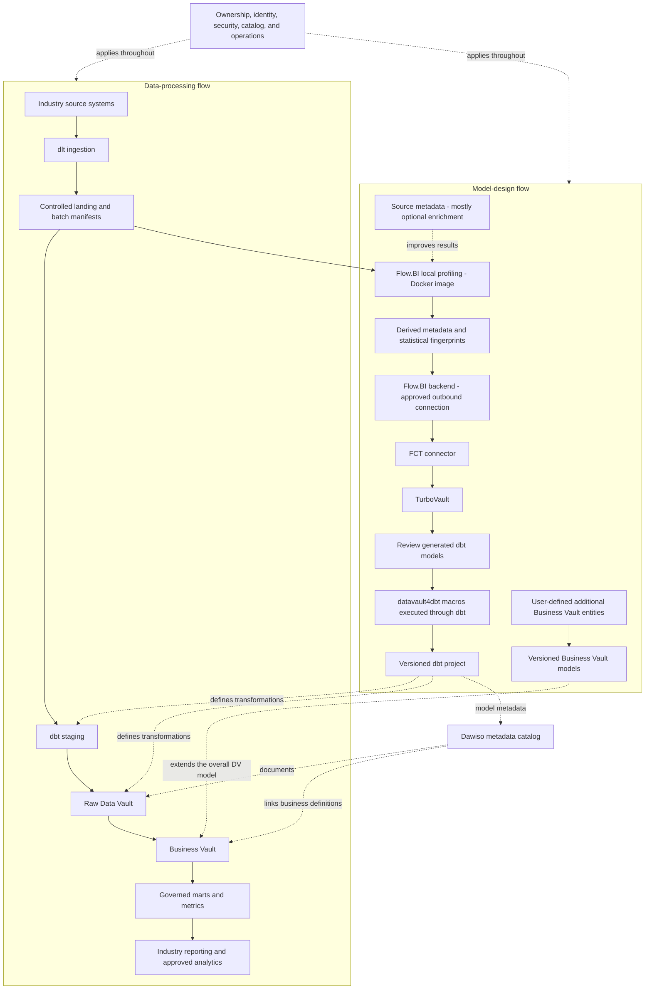

# Sovereign Manufacturing Data Platform Blueprint

**Connect product definition, shop-floor execution, quality, maintenance, and cost through traceable production genealogy.**

This sovereign manufacturing data platform blueprint connects ERP, MES, material movement, and quality evidence to traceable production and quality reporting. It combines Flow.BI and Data Vault automation with European Dawiso catalog governance, Cloudberry MPP or Iceberg/Trino, and controlled Azure, AWS or Google Cloud deployment.
Audience: plant leadership, production engineering, quality, supply chain, maintenance, finance, IT/OT, and data teams. Updated: 5 November 2026.

## From order to a governed Manufacturing data product

| Stack component | Role in this blueprint |
| --- | --- |
| Ingestion | [dlt](https://github.com/dlt-hub/dlt) (data load tool) is the ingestion library for supported API, database, and file feeds. In this manufacturing design, it brings ERP, MES, and material movement into controlled landing datasets with load evidence. |
| Data modeling | [Flow.BI](https://flow.bi/) analyzes source values and relationships to generate the logical Data Vault structure. The modeling input includes order, operation, and serial unit; actual data is required, while available source metadata improves the result. |
| Model handoff | For the manufacturing model, [FCT](https://www.scalefree.com/consulting/turbovault/flowbi-connector/) (Flow.BI Connector for TurboVault4dbt) connects the modeling service to the generator by retrieving and transforming Flow.BI output. |
| Project generation | [TurboVault](https://www.scalefree.com/consulting/turbovault/) translates Data Vault metadata into the dbt model layer. Review those generated artifacts before executing the manufacturing transformations; Studio is the online access option, requested through Scalefree. |
| Loading macros | [datavault4dbt](https://github.com/ScalefreeCOM/datavault4dbt) supplies reusable loading logic for staging and the required Vault entity types. It contributes the technical history-loading foundation for order, operation, and serial unit. |
| Transformation runtime | [dbt](https://github.com/dbt-labs/dbt) compiles model SQL, resolves dependencies, runs transformations, and executes tests on the target. User-defined Business Vault models add as-built genealogy and first-pass quality measures within that workflow. |
| Database | For larger relational Data Vault workloads, use [Apache Cloudberry](../../../cloud/apache-cloudberry/apache-cloudberry-data-platform-blueprint.md) as the PostgreSQL-compatible MPP warehouse candidate, or [Trino with Iceberg](https://trino.io/docs/current/connector/iceberg.html) for the portable lakehouse pattern. Cloudberry distributes data and query execution across segments and supports row or column storage per table. Plain [PostgreSQL](https://www.postgresql.org/about/licence/) remains an option for a bounded pilot or small workload with a measured growth limit. |
| Cloud platform | For manufacturing, Azure, AWS, or Google Cloud hosts the approved data, runtime, storage, and network services. The cloud choice must satisfy the operating, access, key-custody, and portability requirements defined in this document. |
| Scalefree | [Scalefree](https://www.scalefree.com/) combines data-platform advisory, implementation delivery, automation tooling, and team training. For this blueprint, that support can include the manufacturing source-to-model design, implementation of as-built genealogy and first-pass quality measures, and training the team to maintain the resulting product. |

[Dawiso](https://www.dawiso.com/product/data-catalog) adds the business glossary, asset discovery, ownership, and lineage context for manufacturing. It connects the meaning of order and the rules for as-built genealogy and first-pass quality measures to the implemented datasets.

## Follow material through transformation

Manufacturers need to know which input lots entered which operations, which settings and specification versions applied, and which finished units reached customers. Production counts alone cannot answer a recall or quality-escape question.

Start with lot genealogy and first-pass yield for one line and product family. Include ERP production orders, manufacturing execution events, quality results, and material issues/receipts. Product engineering, plant historians, and maintenance systems can join through controlled interfaces as scope grows.

| Stage | Source evidence | Integration consequence |
| --- | --- | --- |
| Release the order | Order, BOM and routing revisions | Freeze the intended product/process definition. |
| Issue materials | Lot, quantity, unit, order and operation | Establish actual consumed material, including substitutes. |
| Execute operations | Equipment, execution IDs, start/end, output | Separate planned operations from actual runs. |
| Inspect or rework | Test result, specification, disposition, rework path | Preserve first attempt and later outcomes. |
| Ship or recall | Finished serial/lot, delivery and recipient | Trace forward to deliveries and backward to inputs. |

## Genealogy is a graph with quantities

Model product, product revision, BOM/routing revision, order, operation execution, material lot, serial unit, equipment, inspection, specification, and shipment. Capture consumption and production edges at the actual transformation grain. Splits, merges, substitutions, and rework make a simple parent-child column insufficient.

Original execution and quality events stay in the Raw Vault. Users add Business Vault entities for allocation across batch splits, as-built genealogy, first-pass classification, and approved cost attribution. Flow.BI output passes through FCT and TurboVault; review generated models before datavault4dbt/dbt runs the macros.

Use documented industrial interfaces, including [OPC UA](https://reference.opcfoundation.org/specs/OPC-10000-1/full) where supported. Validate namespace, units, quality, and event semantics per source. dlt ingests approved historian/API/database outputs; protocol acquisition and buffering require a compatible gateway. Protect plant networks using a design informed by [NIST OT security guidance](https://csrc.nist.gov/pubs/sp/800/82/r3/final).

## Worked example: first-pass yield and rework

A run processes 100 unique units. Ninety pass the first qualifying inspection, five pass after rework, and five are scrapped. Under a unit-based definition, first-pass yield is 90%; final good yield is 95%. Counting inspection rows would inflate the denominator because reworked units generate additional records.

Record **serial unit × operation execution × inspection attempt**, along with specification revision and disposition. For bulk production, use an approved quantity-based denominator and compatible units instead of borrowing the serial-unit formula.

For genealogy, if an input lot is split across two production batches, retain both consumption edges and their quantities. A recall query must return the reachable output lots and shipment references without duplicating totals merely because multiple paths reach the same unit.

## Keep intellectual property and release authority controlled

BOMs, recipes, process windows, supplier terms, export-controlled designs, and employee-linked performance data need different access policies. The analytical platform reports quality status; designated quality systems and authorized staff control product release.

Choose Azure, AWS, or Google Cloud hosting after agreeing engineering-data geography, supplier-sharing boundaries, keys, and operators. Run the Flow.BI Docker profiler in the customer environment and classify any outbound derived metadata/fingerprints. A column name can reveal a recipe or protected process.

## Pilot evidence and plant handover

Production engineering approves execution grain; quality approves pass/rework definitions; materials teams approve units and lot identity; OT owns acquisition boundaries. Train modelers using a lot split, a substitute material, a repeated inspection, and a cancelled order.

Acceptance requires a backward and forward trace for selected finished units, reconciliation of issues/receipts to ERP within documented tolerances, stable first-pass counts under replay, and correct treatment of late quality corrections. Verify regeneration preserves Business Vault rules and that analytical accounts cannot command production equipment.

Next products can cover downtime, OEE, predictive-maintenance inputs, and order profitability. Each needs its own denominator, planned-time calendar, and validated calculation; do not derive a universal OEE measure from incomplete event logs. Full technology, cloud, training, and implementation resources follow.

## Metadata stewardship in the manufacturing stack

[Dawiso](https://www.dawiso.com/product/data-catalog) adds the business glossary, asset discovery, ownership, and lineage context for manufacturing. It connects the meaning of order and the rules for as-built genealogy and first-pass quality measures to the implemented datasets.

1. **Establish the catalog boundary.** Dawiso is a European commercial governance/catalog platform supplied by [Dawiso s.r.o., registered in Prague](https://www.dawiso.com/privacy-policy). The sovereign design uses a contractually approved **European catalog location**. Confirm metadata residency, administrators, support access, logs, backups, and optional AI processing individually. European vendor origin alone does not establish those controls.

Use the supported [Enterprise deployment](https://www.dawiso.com/product/enterprise-deployment-built-for-flexibility-and-security) in an approved European Azure or AWS environment, or an approved European hosted configuration. For a Google Cloud data platform, validate the metadata connection to that catalog and the cross-cloud operating cost; do not assume a private Google Cloud Dawiso deployment is available.

2. **Document the business product.** For this product, register **order, operation, serial unit, material lot, and inspection** as governed concepts linked to real assets. Describe **as-built genealogy and first-pass quality measures** with an owner, calculation/rule version, eligible population, cutoff, and known limitations. Publish only the metadata fields that the catalog users are authorized to see.

3. **Collect and verify lineage.** Discover the selected database/BI assets using the [supported connectors](https://www.dawiso.com/connectors) and validate dbt/generated-model metadata exchange for the chosen version. Define a controlled import/API mapping for gaps; do not assume a direct Flow.BI or FCT catalog connector. Keep the modeling service's generated metadata distinct from the catalog's approved business glossary. dbt executes transformation tests; Dawiso records the associated definitions, owners, evidence links, and quality context. Select and validate the integration that publishes results; the catalog does not replace the test engine.

4. **Exercise the pilot controls.** Catalog acceptance follows the manufacturing pilot: trace an approved source field through a generated model and Business Vault extension to a published metric, then test a schema change, a stale scan, and a permission revocation. Mask sample values and sensitive SQL/descriptions where required. Track scan coverage and unresolved lineage gaps explicitly.

## Technology, cloud deployment, and enablement

### Architecture and tool responsibilities

The platform has two connected flows: a **data-processing flow** and a **model-design flow**. Modeling tools do not replace ingestion, storage, orchestration, or authorization.

Source data in landing is a required input to local Flow.BI profiling. The Docker container is inside the organization-controlled environment; the Flow.BI backend is a separate service boundary. Flow.BI output passes directly to FCT, then TurboVault, which generates dbt models using datavault4dbt macros. Review the generated models after TurboVault and before macro execution through dbt. The generated Raw Vault is the foundation of the overall Data Vault model. Users then extend that model with additional Business Vault entities and business rules. Confirm exchange formats and supported versions in the pilot.

#### Flow.BI inputs and local Docker deployment

**Data is required. Source metadata is mostly optional and improves the results.** Flow.BI needs to inspect actual values and relationships; a metadata-only delivery is insufficient. Supply available schemas, keys, comments, and domain descriptions as enrichment. Distinguish this input metadata from the profiling metadata Flow.BI produces for downstream automation.

Flow.BI provides a **Local Data Processing Docker image for customer-controlled AWS, Azure, and Google Cloud infrastructure**. It reads source data, uses local storage, and sends derived metadata and statistical fingerprints to the Flow.BI backend. Raw source data remains in the customer's environment. The documented architecture needs outbound backend connectivity; it is not a fully disconnected deployment. See [How Flow.BI Protects Sensitive Enterprise Data](https://flow.bi/blog/how-flow-bi-protects-sensitive-enterprise-data/).

For this organization blueprint, require the following deployment deliverables:

- Obtain the vendor-issued image and deployment instructions; record its registry, version, immutable digest, supported architecture, and entitlement. Use the image registry and deployment instructions provided with your access.
- Deploy it beside approved landing data, within the organization's own cloud account/subscription/project. Use an approved container host, private networking, scoped credentials, and controlled temporary storage.
- Classify and approve the outbound profiling payload. Structural metadata and fingerprints require review even when raw records stay local.
- Test source/storage access, controlled egress, restart, resource limits, update procedures, and intermediate-data cleanup.

**FCT public website and registration form:** use the [official connector access page](https://www.scalefree.com/consulting/turbovault/flowbi-connector/) to request access. Registration is a vendor onboarding step for the connector. Assign a designated owner for credentials and download provenance. Verify whether ongoing connectivity or credentials are needed during operation.

**TurboVault edition decision:** [TurboVault Engine](https://github.com/ScalefreeCOM/turbovault-engine) is a separate repository licensed under AGPL-3.0. Evaluate it as an alternative, not as an automatically compatible replacement for TurboVault4dbt. Confirm FCT compatibility, metadata mapping, generated output, and licensing before changing the baseline.

The platform is **open-source-first with declared dependencies**. Retain generated metadata and dbt artifacts so existing transformation operations can continue independently of a new Flow.BI generation run.

For tool-specific implementation reading, see the resources below.

### Shared ingestion requirements

#### Ingestion with dlt

Treat “DLT” here as **dlt, the data load tool**. For each organization source, define:

- Source owner, approved fields, extraction method, credentials, and operating window.
- Full-load and incremental behavior, cursor or watermark, and a strategy for late or corrected records.
- Deletion detection through supported source change events or reconciled snapshots. Do not assume timestamp polling captures deletes.
- Stable batch identity, source identifier, extraction time, schema version, row counts, and load status.
- Restart behavior and persistent pipeline state, including recovery after a partially completed run.

The [dlt PostgreSQL destination](https://dlthub.com/docs/dlt-ecosystem/destinations/postgres) provides a documented starting point only for the bounded relational pilot. A Cloudberry target uses a validated PostgreSQL/Greenplum-compatible load path; do not infer complete destination behavior from protocol compatibility alone. A lakehouse ingestion route requires its own supported destination or a validated landing-to-table registration/load step; writing Parquet objects alone does not create managed Iceberg tables.

Retain approved source evidence within its retention period. An ingestion merge that preserves only current state cannot support reconstruction of earlier changes unless that history is retained elsewhere. Quarantine unexpected schema changes and malformed batches before they enter trusted reporting.

### Storage and query patterns

#### Pattern A: bounded PostgreSQL pilot

Plain PostgreSQL can host a deliberately limited manufacturing pilot with separate landing, staging, Vault and serving schemas. Choose it only when representative history, join complexity, concurrent consumers and recovery fit the measured operating envelope. Define an exit trigger before adoption: unacceptable refresh duration, history-query latency, resource contention, growth or recovery time. Database size alone is an incomplete sizing criterion.

The architectural constraints for enterprise Data Vault analytics include single-node resource ceilings and costly analytical scans, joins and historical calculations. Read Michael Olschimke's [Architectural Limitations of PostgreSQL for Enterprise Data Vault Workloads](https://www.scalefree.com/blog/data-vault/architectural-limitations-of-postgresql-for-enterprise-data-vault-workloads/) before treating a successful small pilot as a production scaling strategy. Retain PostgreSQL for suitable bounded or operational/metadata workloads; it is not the default recommendation for a large analytical Vault.

#### Pattern A2: Apache Cloudberry for a larger relational Vault

Use **Apache Cloudberry** when the manufacturing platform needs a familiar PostgreSQL/Greenplum SQL ecosystem with distributed warehouse execution. Its [MPP architecture](https://cloudberry.apache.org/docs/next/introduction/cbdb-architecture/) assigns data and query work to multiple segments, expanding the CPU, memory and I/O resources available beyond one PostgreSQL server. Preserve the logical model for **order, operation, and serial unit** while redesigning distribution, physical storage and workload management for the cluster.

Cloudberry supports **per-table row-oriented and column-oriented storage**. Evaluate row-oriented heap for small or frequently changed relations, append-optimized row storage for suitable batch/wide-row access, and append-optimized column storage for large history or analytical tables that read selected attributes. A scan-heavy satellite or reporting fact is a column-storage candidate; mutation-heavy control tables may be better as heap. These are workload choices, not mandatory mappings for every hub, link or satellite. See the [table storage and access-method reference](https://cloudberry.apache.org/docs/next/sql-stmts/create-table/).

Flow.BI and datavault4dbt use the **PostgreSQL/Greenplum compatibility route**. Pin the connector, dbt adapter, generator, macro package and Cloudberry release together; verify types, hash inputs, DDL, incremental loads and required update/delete behavior. Compatibility preserves integration options without promising identical PostgreSQL extension behavior or automatic physical-design portability. Validate dlt's compatible extraction/load path as well.

For manufacturing, compare the worked example, historical corrections and concurrent reporting using alternative distribution keys and row/column layouts. Inspect segment skew, data redistribution, spill, elapsed time and recovery. MPP does not remove expensive data motion or guarantee every query scales linearly. Deploy coordinator/segments on approved Azure, AWS or Google Cloud compute with owned storage, monitoring, backups and recovery; the database team's operational cost belongs in TCO. Use the [complete Apache Cloudberry blueprint](../../../cloud/apache-cloudberry/apache-cloudberry-data-platform-blueprint.md) for the implementation checklist.

#### Pattern B: portable lakehouse

Use object storage for files, **Apache Iceberg** for analytical table metadata and snapshots, a compatible **catalog service**, and **Trino** for SQL execution. Run dbt through a validated Trino adapter and the selected datavault4dbt macros. The [Trino Iceberg connector documentation](https://trino.io/docs/current/connector/iceberg.html) defines supported catalogs, operations, and requirements.

These components have distinct responsibilities: object storage retains bytes; Iceberg organizes tables; the catalog resolves and commits table metadata; Trino executes queries. Back up the catalog and table metadata as well as data objects.

Before selection, prove incremental loading, required merge/delete behavior, concurrent writes, schema evolution, failure recovery, and timestamp/hash consistency. Assign ownership for compaction, snapshot expiry, orphan cleanup, and small-file management. A supported database name does not establish compatibility for every generator, macro, adapter, and table format combination.

### Cloud deployment options

The following are **candidate mappings**, subject to region, service availability, organization procurement, and an end-to-end pilot. Keep the same domain definitions, metadata ownership, and Business Vault extension process across environments.

| Option | Compute and execution | Storage and query | Sovereignty decisions |
| --- | --- | --- | --- |
| Azure / Microsoft Sovereign Cloud | Flow.BI local Docker image in the organization subscription; controlled Linux VMs or approved Kubernetes service for dlt, FCT, TurboVault, and dbt. | Azure Blob Storage / ADLS Gen2 with Iceberg and Trino; alternatively Cloudberry MPP on controlled VMs/storage; PostgreSQL only for the bounded Pattern A pilot. | Choose the Microsoft sovereign deployment model, approved geography, key custody, administrator access, and allowed service set. |
| AWS | Flow.BI local Docker image in the organization AWS account; controlled Linux instances or approved Kubernetes service for the other tools. | Amazon S3 with Iceberg and Trino; alternatively Cloudberry MPP on controlled VMs/storage; PostgreSQL only for a bounded pilot. | Evaluate AWS European Sovereign Cloud separately from standard AWS regions. Confirm services, endpoints, identity, backups, and connectivity in the chosen environment. |
| Google Cloud | Flow.BI local Docker image in the organization Google Cloud project; controlled Linux VMs or approved Kubernetes service for the other tools. | Google Cloud Storage with Iceberg and Trino; alternatively Cloudberry MPP on controlled VMs/storage; PostgreSQL only for a bounded pilot. | Select an appropriate Assured Workloads control package and verify residency, access, personnel, and key-management controls for the selected services. |

Trino documents native access to [Azure, Google Cloud, and S3 object storage](https://trino.io/docs/current/object-storage.html). Validate credentials, endpoints, and catalog integration for the exact deployment. Managed infrastructure services remain provider dependencies even when the application stack is open source.

#### Azure sovereign deployment

Use the public deployment model of [Microsoft Sovereign Cloud](https://learn.microsoft.com/en-us/azure/azure-sovereign-clouds/microsoft-sovereign-cloud), which adds sovereignty controls to Microsoft-operated infrastructure.

Define a sovereign landing zone with permitted locations, private connectivity, controlled egress, key policy, and auditable privileged access. Verify eligibility and availability of controls such as Data Guardian and external key management for the actual services selected.

#### AWS sovereign deployment

AWS announced general availability of the [AWS European Sovereign Cloud](https://press.aboutamazon.com/aws/2026/1/aws-launches-aws-european-sovereign-cloud-and-announces-expansion-across-europe) in January 2026 as physically and logically separate from other AWS regions. Evaluate its operating model and contracts against organization requirements.

Create a service-by-service availability inventory before procurement. Keep logs, backups, keys, support workflows, and deployment dependencies inside the approved boundary. Prove the solution can operate without dependencies on standard-region services that are outside that boundary.

#### Google sovereign deployment

[Assured Workloads](https://docs.cloud.google.com/assured-workloads/docs/overview) offers control packages for residency, access, and personnel boundaries. Select the package against the organization's requirements and check its supported services.

#### Choosing an option

Use Pattern A only for a measured, bounded pilot. Evaluate Pattern A2 (Cloudberry MPP) for larger relational analytics, or Pattern B (Iceberg/Trino) when the portable lakehouse matches the workload and operating skills. Choose the hosting environment after defining the required sovereignty boundary and the organization's operating capacity.

Estimate total cost across compute, storage, network/egress, backups, support, commercial dependencies, training, and internal staffing. Compare the cost of a tested exit and disaster recovery as part of the decision.

### Training and knowledge transfer

Make capability development a delivery workstream with practical acceptance criteria.

| Track | Training resource | Participants | Proposed project outcome |
| --- | --- | --- | --- |
| DV — Data Vault | [Data Vault Training & Certification](https://www.scalefree.com/data-vault-2-1-trainings/data-vault-training-certification/) and [Modeling Class](https://www.scalefree.com/data-vault-2-1-trainings/data-vault-2-1-modeling-class/) | Architects, modelers, engineering leads; selected stewards for shared concepts. | Understand generated Raw Vault structures and design additional Business Vault entities with the correct keys, grain, and history. |
| DWA — Data Warehouse Automation | [Scalefree dbt training: DataVault4dbt and TurboVault automation blocks](https://www.scalefree.com/training/dbt-training/) | Modelers, engineers, and release owners. | Operate the Flow.BI–FCT–TurboVault workflow, review generated models before datavault4dbt/dbt execution, and regenerate without overwriting user-authored Business Vault entities. |
| dbt | [Scalefree dbt Training](https://www.scalefree.com/training/dbt-training/) | Data engineers, analytics engineers, and operators. | Build and test models, use packages/macros, debug failures, and promote releases through controlled environments. |
| Flow.BI foundations | [Flow.BI Introduction](https://flow.bi/trainings/flow-bi-introduction/) | Business analysts, domain stewards, architects, project leads, and engineers. | Understand the interface, data sources, deployment targets, and first model-generation run. |
| Flow.BI configuration and operations | [Flow.BI In-Depth](https://flow.bi/trainings/flow-bi-in-depth/) | Engineers, architects, and platform operators. | Configure classification, permissions, API access, and integration settings for the organization environment. |
| Understanding generated models | [Generated Data Vault Models](https://flow.bi/trainings/generated-data-vault-2-0-models/) | Data modelers, engineers, and architects. | Interpret generated structures and their downstream physical implementation; apply this knowledge to the review after TurboVault and to Business Vault extensions. |
| Flow.BI metadata presentation | [Presenting Flow.BI Metadata — training catalog](https://flow.bi/trainings/) | Modelers, analysts, and metadata/catalog owners. | Use Flow.BI dashboards to present internal metadata to authorized users. |
| Catalog stewardship | [Dawiso documentation](https://www.dawiso.com/product/data-catalog) | Data owners, stewards, catalog operators, and engineers. | Document order, approve definitions, trace model lineage, and operate metadata scans and access. |

**Terminology:** DWA means Data Warehouse Automation. The DWA training track uses Scalefree's published automation learning blocks. DVA refers exclusively to the Data Vault Alliance.

The Data Vault certification training covers Data Vault 2.1. Align the curriculum with the selected tool versions and implementation patterns. Its dbt offering is customizable; agree the agenda and prerequisites before booking.
Flow.BI In-Depth requires Flow.BI Introduction and general data-architecture knowledge. Generated Data Vault Models requires Flow.BI Introduction and Data Vault modeling knowledge. Use the [Flow.BI training catalog](https://flow.bi/trainings/) to select classes or a bundle and confirm current delivery details.

Recommended sequence:

1. Run DV foundations and modeling to understand the generated Raw Vault and design Business Vault extensions.
2. Complete Flow.BI Introduction before connecting the pilot sources; follow with In-Depth for the configuration and operations team and Generated Data Vault Models for modelers and engineers.
3. Run dbt fundamentals before building the first transformation pipeline.
4. Run DWA practical sessions when the first Flow.BI output is available for direct processing through FCT and TurboVault. Include metadata presentation training for the team publishing model documentation.
5. Complete an organization-led lab using synthetic datasets for the selected industry workflow: dlt ingestion, Flow.BI generation, direct FCT transfer, TurboVault generation, generated-model review, datavault4dbt/dbt execution, user-added Business Vault entities, and industry-specific reconciliation.
6. Require at least two internal operators to deploy, troubleshoot, restore, and explain the pipeline without external assistance.

Budget training, preparation time, labs, and follow-up coaching separately from software and hosting. Use the [current training catalog](https://www.scalefree.com/training/) for available formats and scheduling.

### Scalefree implementation resources

The following articles complement the product documentation and training. Read the Flow.BI/FCT integration overview first, then TurboVault generation, datavault4dbt staging and loading, and finally Business Vault extensions and deployment practices.

| Tool or topic | Scalefree blog resource | Application to this blueprint |
| --- | --- | --- |
| Flow.BI, FCT, TurboVault, and datavault4dbt | [Flow.BI: Generating the Raw Data Vault Using AI and dbt](https://www.scalefree.com/blog/modeling/flow-bi-generating-the-raw-data-vault-using-ai-and-dbt/) | Explains the logical-to-physical automation chain and connector, and the addition of business logic in the Business Vault. Pair it with the [FCT access page](https://www.scalefree.com/consulting/turbovault/flowbi-connector/) for onboarding. |
| TurboVault | [Speed Up Your Data Vault 2.0 Implementation with TurboVault4dbt](https://www.scalefree.com/blog/tools/speed-up-your-data-vault-2-0-implementation-with-turbovault4dbt/) | Introduces metadata-driven dbt model generation. Use it to understand the generation stage before the review phase. |
| datavault4dbt overview | [Kick-Start Your Data Vault 2.0 Implementation with datavault4dbt](https://www.scalefree.com/blog/tools/kick-start-your-data-vault-2-0-implementation-with-datavault4dbt/) | Introduces loading templates and the package's role within dbt. Useful background before the hands-on training. |
| datavault4dbt staging | [Exploring datavault4dbt — Vol. 1: The Staging Layer](https://www.scalefree.com/blog/tools/exploring-datavault4dbt-a-practical-series-on-the-dbt-package-for-data-vault-2-0-vol-1-the-staging-layer/) | Covers staging configuration, hashing, derived columns, and prejoins. Apply these concepts when connecting the dlt landing datasets to generated transformations. |
| datavault4dbt Raw Vault | [Exploring datavault4dbt — Vol. 2: Standard Entities in the Raw Vault](https://www.scalefree.com/blog/datenwerkzeuge/exploring-datavault4dbt-a-practical-series-on-the-dbt-package-for-data-vault-2-0-vol-2-standard-entities-in-the-raw-vault/) | Walks through hubs, links, and satellites. Use it to interpret the models produced by TurboVault and their macro parameters. |
| Business Vault extensions | [Designing the Business Vault: Key Strategies for Effective Data Organization](https://www.scalefree.com/blog/data-vault/designing-the-business-vault-key-strategies-for-effective-data-organization/) | Explains reusable business logic and additional entities such as computed satellites, links, PITs, and bridges. Relevant to user-defined organization extensions after Raw Vault generation. |
| dbt delivery and testing | [CI/CD: Practical Insights into Automating Data Vault 2.0 with dbt](https://www.scalefree.com/blog/data-vault/ci-cd-practical-insights-into-automating-data-vault-2-0-with-dbt/) | Uses datavault4dbt and GitHub Actions to illustrate testing and delivery automation. Adapt execution and runner placement to the organization's cloud boundary. |
| PostgreSQL workload assessment | [Architectural Limitations of PostgreSQL for Enterprise Data Vault Workloads](https://www.scalefree.com/blog/data-vault/architectural-limitations-of-postgresql-for-enterprise-data-vault-workloads/) | Explains why a bounded PostgreSQL pilot is not a large-scale Data Vault recommendation. Compare the selected platform with Cloudberry MPP and its per-table row/column storage where an open relational warehouse is required. |
| Sovereignty, Iceberg, and Trino | [The Sovereign Data Platform: The Path to Data Ownership and Secure AI](https://www.scalefree.com/blog/architecture/the-sovereign-data-platform-the-path-to-data-ownership-and-secure-ai/) | Discusses controlled object storage, open table formats, and replaceable query engines, including Trino. Supports the portability and storage/compute separation principles. |

Examples in older articles may use earlier package versions, metadata layouts, or specific cloud databases. Use the pinned tool versions and current documentation for implementation details. For dlt ingestion and Trino/Iceberg configuration, use the primary documentation already linked in the ingestion, storage, and cloud deployment guidance above alongside these architectural resources. Browse the [Scalefree blog](https://www.scalefree.com/blog/) for further articles.

### Flow.BI implementation resources

Use the [Flow.BI blog](https://flow.bi/blog/) for ongoing product architecture and implementation material. Relevant starting points:

| Resource | Why it matters to this blueprint |
| --- | --- |
| [How Flow.BI Protects Sensitive Enterprise Data](https://flow.bi/blog/how-flow-bi-protects-sensitive-enterprise-data/) | Explains required data profiling, the local Docker image, storage access, and the local/backend processing boundary. |
| [Seeing Every Step: Data Lineage Inside Flow.BI](https://flow.bi/blog/seeing-every-step-data-lineage-inside-flow-bi/) | Describes source-to-model traceability and graph views. Use this model lineage alongside dlt load evidence and dbt execution lineage. |
| [Turning Salesforce and Pardot Tables Into a Semantic Model](https://flow.bi/blog/turning-salesforce-and-pardot-tables-into-a-semantic-model/) | Illustrates concept recognition and declared versus inferred relationships using CRM data. Use it as background on model generation; organization-specific additions in this blueprint are implemented through Business Vault entities. |
| [Generative AI for Data Vault](https://flow.bi/ai-driven-business/) | Explains the progression from data profiling to a logical Data Vault model and downstream physical-model automation. |
| [Flow.BI Media Library](https://flow.bi/media/) | Includes local-processing, bring-your-own-bucket, modeling, and dbt integration sessions for team onboarding. |

## Database choices for sovereign manufacturing analytics

### Is plain PostgreSQL suitable for a large manufacturing Data Vault?

Use PostgreSQL only within a tested pilot or bounded workload envelope. For growing order, operation, and serial unit history and analytical concurrency, assess Cloudberry MPP or the Iceberg/Trino route. The [PostgreSQL architectural assessment](https://www.scalefree.com/blog/data-vault/architectural-limitations-of-postgresql-for-enterprise-data-vault-workloads/) provides the starting point; choose from measured scans, joins, corrections and recovery, rather than data volume alone.

### Why use Apache Cloudberry for manufacturing?

Cloudberry combines PostgreSQL/Greenplum compatibility, distributed query execution and per-table row or column storage. Test those choices against **traceable production and quality reporting**, retain the generated model and user-authored Business Vault rules, and verify skew, data motion, write behavior and operating cost. Dawiso metadata must remain within the approved European processing boundary.

## Related blueprints

- [Manufacturing cloud platform selection](../cloud/cloud-manufacturing-platform-selection-guide.md)
- [Manufacturing on Snowflake](../cloud/snowflake/cloud-manufacturing-snowflake-data-platform-blueprint.md)
- [Manufacturing on Databricks](../cloud/databricks/cloud-manufacturing-databricks-data-platform-blueprint.md)
- [Manufacturing on Microsoft Fabric](../cloud/microsoft-fabric/cloud-manufacturing-microsoft-fabric-data-platform-blueprint.md)
- [Manufacturing on Google BigQuery](../cloud/google-bigquery/cloud-manufacturing-google-bigquery-data-platform-blueprint.md)
- [Apache Cloudberry MPP architecture](../../../cloud/apache-cloudberry/apache-cloudberry-data-platform-blueprint.md)
- [All industry and technology blueprints](../../../README.md)

## Next steps

Validate the [Dawiso metadata integration](https://www.dawiso.com/connectors) and include catalog deployment, licensing/operations, stewardship, and source-to-report lineage in the architecture discussion.

Select the pilot described in this blueprint, name its business and technical owners, and bring representative source data, reporting definitions, workload volumes, and operating constraints to an architecture discussion.

| Step | Where to go | What to request or prepare |
| --- | --- | --- |
| Discuss the implementation | [Scalefree contact form](https://www.scalefree.com/about-scalefree/contact/) | Request a platform assessment, pilot workshop, implementation support, or tailored training. Include the blueprint title and the first data product. |
| Try automated modeling | [Flow.BI trial registration](https://flow.bi/sign-up-for-trial/) | Request a trial and local-processing Docker deployment instructions. Prepare authorized source data; available metadata improves the result. |
| Obtain the connector | [FCT access and download request](https://www.scalefree.com/consulting/turbovault/flowbi-connector/) | Request Flow.BI Connector for TurboVault4dbt access and verify the intended generator version. |
| Install the macro package | [datavault4dbt repository and releases](https://github.com/ScalefreeCOM/datavault4dbt) | Obtain the package, choose a supported target adapter, and pin a tested version. |
| Access the online generator | [Request TurboVault Studio signup through Scalefree](https://www.scalefree.com/about-scalefree/contact/) | Ask specifically for the new online TurboVault Studio and its Flow.BI/FCT integration route. |
| Obtain a downloadable generator | [TurboVault4dbt](https://github.com/ScalefreeCOM/turbovault4dbt) and [TurboVault Engine](https://github.com/ScalefreeCOM/turbovault-engine) | Select the edition that fits the integration and retain its version and configuration. |
| Receive implementation updates | [Scalefree newsletter registration](https://www.scalefree.com/) | Use the “Data Vault 2.GO / Build Better Data Platforms” newsletter form on the homepage. |

Complete the pilot's reconciliation, access, recovery, and cost checks before extending the source scope. Record the results and the decision to proceed in the project repository.

## License

Copyright © 2026 Scalefree International GmbH. The original text, tables, and diagrams in this blueprint are licensed under [CC BY-SA 4.0](https://creativecommons.org/licenses/by-sa/4.0/). Credit Scalefree, identify changes, and retain the applicable ShareAlike terms when distributing adaptations. See [LICENSE.md](../../../LICENSE.md) for scope, attribution, and the governing legal code. Referenced software and third-party material retain their own licenses.
