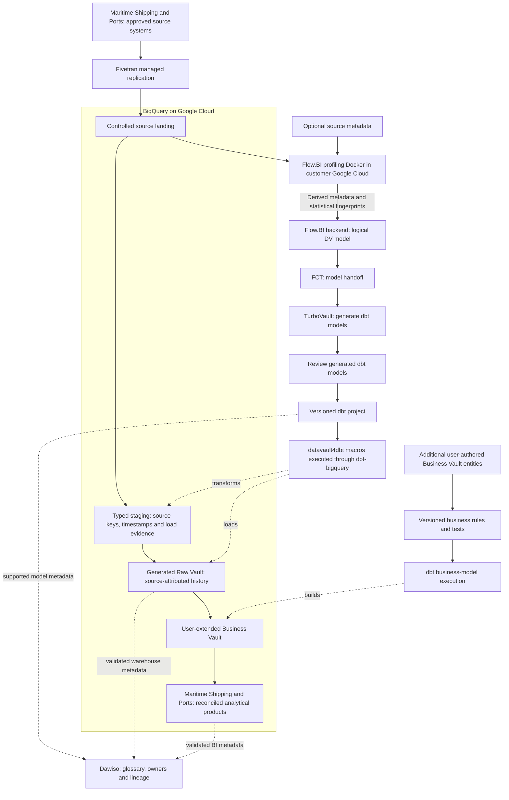

# Cloud Maritime Shipping and Ports Google BigQuery Data Platform Blueprint

**Connect voyage, port call, berth, cargo handling, customs-facing references, and terminal dwell evidence.**

Build a Google BigQuery data warehouse for maritime shipping and ports around vessel, voyage, and port call. This blueprint connects Fivetran ingestion, Flow.BI modeling, Data Vault automation and Dawiso governance to Connect voyage, port call, berth, cargo handling, customs-facing references, and terminal dwell evidence, with a platform-specific flow diagram and operating plan.
Audience: sector operations, domain specialists, finance/commercial teams, security, governance, and data engineering. Updated: 5 November 2026.

[Industry platform selection guide](../cloud-maritime-shipping-and-ports-platform-selection-guide.md) · [Sovereign edition](../../sovereign/sovereign-maritime-shipping-and-ports-data-platform-blueprint.md) · [All blueprints](../../../../README.md)

## Tools behind the maritime shipping and ports Google BigQuery platform

| Stack responsibility | Contribution to this industry product |
| --- | --- |
| Ingestion | [Fivetran](https://fivetran.com/docs/getting-started) provides commercial managed replication for supported maritime shipping and ports sources. Land port community/terminal systems, vessel schedules, carrier bookings, handling events, gate records, and invoicing in a destination-owned replica, retain sync/deletion evidence, and keep dbt-owned Vault tables separate. |
| Data-driven modeling | [Flow.BI](https://flow.bi/) uses data profiling and AI-assisted modeling to define an integrated Data Vault for vessel, voyage, and port call. Actual data is required; mostly optional source metadata improves modeling. Its customer-cloud Docker component profiles locally and sends derived metadata and statistical fingerprints to the backend. |
| Model handoff and generation | [FCT](https://www.scalefree.com/consulting/turbovault/flowbi-connector/) (Flow.BI Connector for TurboVault4dbt) is the connector that maps Flow.BI output into metadata TurboVault can consume. [TurboVault](https://www.scalefree.com/consulting/turbovault/) builds the metadata-driven dbt project artifacts for the target implementation. Its generated models are reviewed before execution; request online TurboVault Studio access through Scalefree. |
| Loading and business rules | [datavault4dbt](https://github.com/ScalefreeCOM/datavault4dbt) provides standardized macro definitions for the Vault structures and load behavior, while [dbt](https://github.com/dbt-labs/dbt) executes model SQL through the selected adapter and records the transformation/test run. Additional user-authored Business Vault entities implement **port-call identity, milestone precedence, demurrage/detention references, and service-charge controls** outside the regenerated paths. |
| Database and cloud | [Google BigQuery](https://cloud.google.com/bigquery/pricing) is the database/compute target for maritime shipping and ports: BigQuery is the managed analytical warehouse and SQL execution engine for the typed source data, Vault, and reporting products. Google Cloud provides the project/IAM, storage, network, and execution environment around BigQuery. The customer-managed Flow.BI Docker component runs within that environment. |
| Catalog stewardship | [Dawiso](https://www.dawiso.com/product/data-catalog) is the commercial catalog for vessel, voyage, and port call, connecting business definitions, owners, discovered assets, and lineage evidence. Its deployment and metadata processing need a separate operating agreement. |
| Delivery and training | [Scalefree](https://www.scalefree.com/) supports platform design and delivery with Data Vault expertise, software tooling, and practical training. The engagement connects Google BigQuery implementation to the maritime shipping and ports workflow, governed business rules, and team enablement. |

## Google BigQuery data and model flow

Source values for vessel, voyage, and port call are required for profiling. The local Docker component keeps raw source records in the customer environment during profiling and needs approved outbound backend connectivity for derived metadata and fingerprints. Flow.BI output goes directly through FCT and TurboVault; the review occurs after generation and before macro execution. Catalog edges represent configured integrations with tested coverage, including explicit lineage where automatic discovery is incomplete.

## Maritime Shipping and Ports: operational workflow and source evidence

The first data product addresses this decision: **connect voyage, port call, berth, cargo handling, customs-facing references, and terminal dwell evidence.** Start with one bounded business unit, contract/product family, site, or reporting period and name the owner of the resulting decision. The pilot draws from port community/terminal systems, vessel schedules, carrier bookings, handling events, gate records, and invoicing.

| Workflow stage | Evidence and interpretation to retain |
| --- | --- |
| Nominate a call | preserve schedule and declarations |
| Assign berth | retain planned and actual intervals |
| Handle cargo | track discharge/load and custody |
| Depart and settle | reconcile handled units, services and charges |

Preserve the planned or promised position as well as actual execution. Maintain source-event time, business-effective time, arrival/load time, correction references, and the cutoff used for reporting. A late or missing delivery remains a visible data-quality state; it should not silently become zero activity.

## Data Vault entities and fact grain for maritime shipping and ports

The business vocabulary includes **vessel, voyage, port call, berth interval, consignment, container, handling event, declaration reference, and port charge**. The proposed fact grain is **port call × container/handling unit × handling event, with berth intervals separately modeled**. Keep identifiers namespaced by the issuing system and organization. Distinguish source facts from estimates, allocations, approved business rules, and publication snapshots.

Flow.BI profiles required actual data; mostly optional source metadata improves results. Its output passes directly through **FCT → TurboVault → generated-model review → datavault4dbt/dbt execution**. The generated Raw Vault preserves source-attributed history. Users add Business Vault entities for **port-call identity, milestone precedence, demurrage/detention references, and service-charge controls**. These user-authored extensions remain outside regenerated model paths.

Use the vocabulary to validate source semantics and define user-authored extensions. Review the generated implementation after TurboVault. Record the relevant package, adapter, generator, source-schema, rule, and runtime versions together.

## Worked maritime shipping and ports example: calculation and reporting scope

A container is discharged at 08:00 Monday and exits the gate at 08:00 Thursday: terminal dwell is 72 hours under that definition. Customs release after 48 hours is a different milestone; subtracting it changes the measure to post-release dwell, not total dwell.

Keep the calculation's numerator, denominator, unit/currency, eligible population, business calendar, cutoff, exclusions, and rule version with the published product. Original evidence and corrected knowledge should support both reconstruction of the earlier report and a separately identified restatement.

## Corrections, exceptions, and access in maritime shipping and ports

Exercise **vessel substitutions, transshipment, duplicate scans, corrected arrival times, and cargo split across calls**. Build explicit associations for revisions and reversals so an event replay does not become a second business event. Measure reconciliation breaks at the fact grain before joining to descriptive or many-to-many relationships.

Protect **cargo contents, security-sensitive vessel/port data, crew manifests, commercial rates, and customs information**. Establish purpose-specific permissions across direct SQL, BI, exports, and storage. Test revoked access and partner/client boundaries using the same routes consumers use. Retain source documents or large artifacts in an appropriate controlled repository and integrate authorized references and provenance.

[IMO Maritime Single Window resources](https://www.imo.org/en/ourwork/facilitation/pages/maritimesinglewindow-default.aspx) is a relevant reference for the design. Review relevant maritime data exchanges and declaration interfaces. Keep operational cargo/voyage records and regulatory submission evidence distinct.

### Managed-cloud value and operating fit

Choose managed execution for measured delivery and operating benefits: faster product delivery, appropriate workload elasticity, reduced infrastructure administration, and useful integration. Retain the domain's confidentiality, safety, contractual, and records requirements. Platform features do not replace accountable business definitions or source reconciliation.

## Pilot ownership, acceptance, and rollout

Ownership is explicit: **terminal operations owns handling; port operations owns berth events; finance owns charge interpretation**. Engineers own connector behavior, pipeline state, generated-model releases and recovery. Governance owners approve processing purpose, field scope, external disclosure, and retention. The report/data-product owner decides how unresolved exceptions affect publication.

For acceptance, **trace a container through transshipment, reconcile handled-unit counts, and reproduce corrected dwell intervals**. Also demonstrate restart after a partial load, reproducible historical output, negative access tests, clean-environment recovery, and regeneration without losing Business Vault entities. Document thresholds and tolerances before assessing results rather than selecting them after a discrepancy appears.

Train business analysts on the worked example and denominator/grain choices. Train modelers using the sector's difficult cases, and require at least two internal operators to explain ingestion, review, execution, corrections, and restore. Extend one source or domain at a time after the pilot evidence and operating cost are accepted.

## Implement maritime shipping and ports on Google BigQuery

This is the **Google BigQuery implementation** of the maritime shipping and ports workflow. Its purpose is **Connect voyage, port call, berth, cargo handling, customs-facing references, and terminal dwell evidence**. Validate the selected target against the worked example and operational failure cases in this document. The platform comparison is available separately; this article carries the complete implementation, training, resources, and Next steps for this stack.

[BigQuery](https://cloud.google.com/bigquery/pricing) is the managed warehouse and SQL engine for a Google Cloud implementation. Use governed projects/datasets, supported ingestion, a tested BigQuery adapter, and explicit partition/cluster choices for vessel, voyage, port call, berth interval, consignment, container, handling event, declaration reference, and port charge. Customer-controlled Google Cloud services also host source landing and the Flow.BI profiling component.

Benchmark connect voyage, port call, berth, cargo handling, customs-facing references, and terminal dwell evidence with representative data and historical corrections. Compare on-demand analysis with capacity-based execution under the same refresh and concurrency targets. Measure scanned data/capacity, storage, load/streaming features actually used, transfer, BI, and operator time. Predicate pruning and repeat-query behavior must be demonstrated with this industry's facts.

### Projects, datasets and bounded history scans

Use separate project/dataset boundaries for environments and appropriate ownership separation for source landing, Vault models and serving. Keep load time and business-effective time distinct for vessel, voyage, and port call. Choose a useful date partition for each large append/history table and test clustering against repeated business-key joins; a partition key must support both routine access and the documented late-correction window. Retain original delivery references so reprocessing is auditable.

### Incremental correctness with dbt-bigquery

Connect dbt-bigquery using a nonhuman identity with the required dataset and job permissions, and pin the datavault4dbt package. Test key/hash type stability, timestamp normalization, numeric precision and deletion semantics. Incremental predicates must not exclude old partitions affected by a correction. Execute the maritime shipping and ports worked example both incrementally and as a bounded reconstruction, compare the outputs, and retain the affected-partition/job evidence. Partition pruning is demonstrated from job observations rather than inferred from the schema.

### Serving economics and Google Cloud operations

Publish port-call identity, milestone precedence, demurrage/detention references, and service-charge controls through governed views or serving tables with owned freshness and access contracts. The Flow.BI profiling container runs in the customer Google Cloud project with scoped access to the approved source data. Compare on-demand analysis with capacity-based execution under the same refresh and concurrency target; attribute scanned bytes or slot usage to products. Include storage, load/streaming methods actually used, cross-location transfer, BI and operations. Separate source/profiling, BigQuery and catalog processing locations explicitly.

### Ingestion contract

**Primary ingestion: Fivetran (commercial managed service).** Verify supported maritime shipping and ports sources and the documented Google BigQuery destination, historical load/CDC scope, deleted-record behavior, schema changes, sync recovery and processing location. Keep its destination replica separate from dbt-owned models. Price the actual connector usage and destination load compute, including the plan-specific treatment of re-syncs; source-specific APIs or industrial/clinical gateways may still be needed. Use the [destination documentation](https://fivetran.com/docs/destinations) and [pricing definitions](https://fivetran.com/docs/core-concepts/usage-based-pricing).

### Platform acceptance and operating evidence

The release record contains BigQuery job evidence, bytes or slot usage, dbt artifacts, and corrected-partition reconciliation. Join it to source delivery IDs, generator/package/adapter versions, model approval, calculation rule versions and publication cutoffs. Execute a duplicate, a late correction, partial-load recovery, regeneration without losing user-authored Business Vault entities, permission revocation and clean-environment restore using this industry's actual grain.

Measure **event bursts at vessel calls, geospatial processing, partner replay, and long cargo-history retention**. Attribute normal refreshes, backfills, peak consumer demand, retries, retained history and staff effort separately. Report both cost per accepted source batch/data-product refresh and the meaningful business unit established in the worked example. A lower cost is useful only if correctness and the declared service target are maintained.

Use the difficult cases and acceptance exercise above as the platform benchmark. Compare cold and warm runs, record cache effects, and include the cost of a historical reconstruction. New streaming, AI, sharing, or semantic features enter the design only through a named use case, a supported regional/edition configuration, a measured benefit, and an incremental operating cost.

### Implementation documentation

Use the [Google BigQuery platform documentation](https://cloud.google.com/bigquery/pricing), [dbt-bigquery setup](https://docs.getdbt.com/docs/local/connect-data-platform/bigquery-setup), and [datavault4dbt supported platforms and documentation](https://www.datavault4dbt.com/) to pin the implementation. Feature availability and adapter/materialization behavior are part of the pilot acceptance record. Select each additional feature against a concrete maritime shipping and ports use case and incremental operating cost.

## Operate and govern by data product

Assign each product a business owner, technical operator, purpose, grain, definitions, refresh target, classification, retention, and quality thresholds. Preserve source batch/offset IDs, code/package versions, calculation rules, cutoff, and exception status with published outputs. Keep operational-system decisions and regulated calculation engines within their validated authority boundaries.

Use institutional identity, scoped service principals, separate development/production, secret management, auditable privileged access, and approved network routes. Enforce restrictions through SQL, BI, export, and underlying storage. Test actual negative access and revocation behavior. A managed service or compliant provider does not establish application-level compliance.

Choose orchestration and alerts around the product's dependencies. A late source or unresolved material reconciliation break should affect publication status. Define retries and recovery of ingestion state, metadata/catalogs, data, credentials, and deployment artifacts. Demonstrate rollback and a clean-environment restore.

## Compare lifecycle cost and delivery value

The managed-cloud case is **shorter delivery time, reduced infrastructure administration, elastic execution, and useful platform integration**. The decision is an operating-model tradeoff. Keep privacy, contractual requirements, data-location constraints, and an exit plan even when sovereignty is not the main objective.

Use a three-year model with an explicit growth scenario:

`TCO = migration and implementation + platform/compute + storage and retained copies + ingestion/orchestration + network/egress + BI/security licenses + support + operating staff + recovery/testing + exit allowance`

Account for negotiated rates and existing commitments as incremental costs, without treating sunk licenses or staff effort as free. Measure normal, peak, backfill, and quiet-period workloads. Record costs per completed data-product refresh and per meaningful business unit, together with correctness and service quality. Compare low/base/high demand and sensitivity to refresh frequency, retention, concurrency, and source growth. Do not publish a cost-saving percentage without the corresponding workload and pricing assumptions.

For feature decisions, record the use case, production availability in the selected region/edition, integration limits, expected outcome, incremental cost, operating owner, and rollback. Prefer an ordinary SQL or scheduled pipeline when it meets the product goal more economically. New AI, streaming, or sharing capabilities should earn their place through a measured pilot.

## Delivery gates

1. Agree the product's grain, calculation, scope, cutoff, access, and reconciliation targets with its business owner.
2. Benchmark the recommended platform against the strongest alternative using the same sources and workload, including cold/warm runs and concurrent consumers.
3. Build the ingestion/model-generation path; review after TurboVault; run tested macros and add Business Vault rules.
4. Prove the industry's worked example and failure cases, historical reconstruction, permissions, restart, restore, and regeneration behavior.
5. Compare measured run cost and staff effort with the business case. Document limitations and choose the platform before committing to broad migration.

## Catalog ownership and lineage with Dawiso

[Dawiso](https://www.dawiso.com/product/data-catalog) adds the business glossary, asset discovery, ownership, and lineage context for maritime shipping and ports. It connects the meaning of vessel and the rules for port-call identity, milestone precedence, demurrage/detention references, and service-charge controls to the implemented datasets.

For this product, register **vessel, voyage, port call, berth interval, consignment, container, handling event, declaration reference, and port charge** as governed concepts linked to real assets. Describe **port-call identity, milestone precedence, demurrage/detention references, and service-charge controls** with an owner, calculation/rule version, eligible population, cutoff, and known limitations. Publish only the metadata fields that the catalog users are authorized to see.

### Deployment and processing boundary

Use [Dawiso's deployment and integration options](https://www.dawiso.com/product/enterprise-deployment-built-for-flexibility-and-security) to select the supported catalog location and network path. Record the edition, contributor/viewer licensing, metadata scanning scope, and operating owner. Validate discovery of Google BigQuery assets and dbt lineage using the supported connectors or an explicit metadata mapping.

### Connect execution evidence to meaning

Discover the selected database/BI assets using the [supported connectors](https://www.dawiso.com/connectors) and validate dbt/generated-model metadata exchange for the chosen version. Define a controlled import/API mapping for gaps; do not assume a direct Flow.BI or FCT catalog connector. Keep the modeling service's generated metadata distinct from the catalog's approved business glossary.

dbt executes transformation tests; Dawiso records the associated definitions, owners, evidence links, and quality context. Select and validate the integration that publishes results; the catalog does not replace the test engine.

Catalog acceptance follows the maritime shipping and ports pilot: trace an approved source field through a generated model and Business Vault extension to a published metric, then test a schema change, a stale scan, and a permission revocation. Mask sample values and sensitive SQL/descriptions where required. Track scan coverage and unresolved lineage gaps explicitly.

## Training and knowledge transfer

Make capability development a delivery workstream with practical acceptance criteria.

| Track | Training resource | Participants | Proposed project outcome |
| --- | --- | --- | --- |
| DV — Data Vault | [Data Vault Training & Certification](https://www.scalefree.com/data-vault-2-1-trainings/data-vault-training-certification/) and [Modeling Class](https://www.scalefree.com/data-vault-2-1-trainings/data-vault-2-1-modeling-class/) | Architects, modelers, engineering leads; selected stewards for shared concepts. | Understand generated Raw Vault structures and design additional Business Vault entities with the correct keys, grain, and history. |
| DWA — Data Warehouse Automation | [Scalefree dbt training: DataVault4dbt and TurboVault automation blocks](https://www.scalefree.com/training/dbt-training/) | Modelers, engineers, and release owners. | Operate the Flow.BI–FCT–TurboVault workflow, review generated models before datavault4dbt/dbt execution, and regenerate without overwriting user-authored Business Vault entities. |
| dbt | [Scalefree dbt Training](https://www.scalefree.com/training/dbt-training/) | Data engineers, analytics engineers, and operators. | Build and test models, use packages/macros, debug failures, and promote releases through controlled environments. |
| Flow.BI foundations | [Flow.BI Introduction](https://flow.bi/trainings/flow-bi-introduction/) | Business analysts, domain stewards, architects, project leads, and engineers. | Understand the interface, data sources, deployment targets, and first model-generation run. |
| Flow.BI configuration and operations | [Flow.BI In-Depth](https://flow.bi/trainings/flow-bi-in-depth/) | Engineers, architects, and platform operators. | Configure classification, permissions, API access, and integration settings for the organization environment. |
| Understanding generated models | [Generated Data Vault Models](https://flow.bi/trainings/generated-data-vault-2-0-models/) | Data modelers, engineers, and architects. | Interpret generated structures and their downstream physical implementation; apply this knowledge to the review after TurboVault and to Business Vault extensions. |
| Flow.BI metadata presentation | [Presenting Flow.BI Metadata — training catalog](https://flow.bi/trainings/) | Modelers, analysts, and metadata/catalog owners. | Use Flow.BI dashboards to present internal metadata to authorized users. |
| Catalog stewardship | [Dawiso documentation](https://www.dawiso.com/product/data-catalog) | Data owners, stewards, catalog operators, and engineers. | Document vessel, approve definitions, trace model lineage, and operate metadata scans and access. |

**Terminology:** DWA means Data Warehouse Automation. The DWA training track uses Scalefree's published automation learning blocks. DVA refers exclusively to the Data Vault Alliance.

The Data Vault certification training covers Data Vault 2.1. Align the curriculum with the selected tool versions and implementation patterns. Its dbt offering is customizable; agree the agenda and prerequisites before booking.
Flow.BI In-Depth requires Flow.BI Introduction and general data-architecture knowledge. Generated Data Vault Models requires Flow.BI Introduction and Data Vault modeling knowledge. Use the [Flow.BI training catalog](https://flow.bi/trainings/) to select classes or a bundle and confirm current delivery details.

Recommended sequence:

1. Run DV foundations and modeling to understand the generated Raw Vault and design Business Vault extensions.
2. Complete Flow.BI Introduction before connecting the pilot sources; follow with In-Depth for the configuration and operations team and Generated Data Vault Models for modelers and engineers.
3. Run dbt fundamentals before building the first transformation pipeline.
4. Run DWA practical sessions when the first Flow.BI output is available for direct processing through FCT and TurboVault. Include metadata presentation training for the team publishing model documentation.
5. Complete an organization-led lab using synthetic datasets for the selected industry workflow: Fivetran ingestion, Flow.BI generation, direct FCT transfer, TurboVault generation, generated-model review, datavault4dbt/dbt execution, user-added Business Vault entities, and industry-specific reconciliation.
6. Require at least two internal operators to deploy, troubleshoot, restore, and explain the pipeline without external assistance.

Budget training, preparation time, labs, and follow-up coaching separately from software and hosting. Use the [current training catalog](https://www.scalefree.com/training/) for available formats and scheduling.

## Scalefree implementation resources

The following articles complement the product documentation and training. Read the Flow.BI/FCT integration overview first, then TurboVault generation, datavault4dbt staging and loading, and finally Business Vault extensions and deployment practices.

| Tool or topic | Scalefree blog resource | Application to this blueprint |
| --- | --- | --- |
| Flow.BI, FCT, TurboVault, and datavault4dbt | [Flow.BI: Generating the Raw Data Vault Using AI and dbt](https://www.scalefree.com/blog/modeling/flow-bi-generating-the-raw-data-vault-using-ai-and-dbt/) | Explains the logical-to-physical automation chain and connector, and the addition of business logic in the Business Vault. Pair it with the [FCT access page](https://www.scalefree.com/consulting/turbovault/flowbi-connector/) for onboarding. |
| TurboVault | [Speed Up Your Data Vault 2.0 Implementation with TurboVault4dbt](https://www.scalefree.com/blog/tools/speed-up-your-data-vault-2-0-implementation-with-turbovault4dbt/) | Introduces metadata-driven dbt model generation. Use it to understand the generation stage before the review phase. |
| datavault4dbt overview | [Kick-Start Your Data Vault 2.0 Implementation with datavault4dbt](https://www.scalefree.com/blog/tools/kick-start-your-data-vault-2-0-implementation-with-datavault4dbt/) | Introduces loading templates and the package's role within dbt. Useful background before the hands-on training. |
| datavault4dbt staging | [Exploring datavault4dbt — Vol. 1: The Staging Layer](https://www.scalefree.com/blog/tools/exploring-datavault4dbt-a-practical-series-on-the-dbt-package-for-data-vault-2-0-vol-1-the-staging-layer/) | Covers staging configuration, hashing, derived columns, and prejoins. Apply these concepts when connecting the Fivetran landing datasets to generated transformations. |
| datavault4dbt Raw Vault | [Exploring datavault4dbt — Vol. 2: Standard Entities in the Raw Vault](https://www.scalefree.com/blog/datenwerkzeuge/exploring-datavault4dbt-a-practical-series-on-the-dbt-package-for-data-vault-2-0-vol-2-standard-entities-in-the-raw-vault/) | Walks through hubs, links, and satellites. Use it to interpret the models produced by TurboVault and their macro parameters. |
| Business Vault extensions | [Designing the Business Vault: Key Strategies for Effective Data Organization](https://www.scalefree.com/blog/data-vault/designing-the-business-vault-key-strategies-for-effective-data-organization/) | Explains reusable business logic and additional entities such as computed satellites, links, PITs, and bridges. Relevant to user-defined organization extensions after Raw Vault generation. |
| dbt delivery and testing | [CI/CD: Practical Insights into Automating Data Vault 2.0 with dbt](https://www.scalefree.com/blog/data-vault/ci-cd-practical-insights-into-automating-data-vault-2-0-with-dbt/) | Uses datavault4dbt and GitHub Actions to illustrate testing and delivery automation. Adapt execution and runner placement to the organization's cloud boundary. |

Examples in older articles may use earlier package versions, metadata layouts, or specific cloud databases. Use the pinned tool versions and current documentation for implementation details. For ingestion and target-platform configuration, use the primary documentation already linked in the platform and ingestion guidance in this document alongside these architectural resources. Browse the [Scalefree blog](https://www.scalefree.com/blog/) for further articles.

## Flow.BI implementation resources

Use the [Flow.BI blog](https://flow.bi/blog/) for ongoing product architecture and implementation material. Relevant starting points:

| Resource | Why it matters to this blueprint |
| --- | --- |
| [How Flow.BI Protects Sensitive Enterprise Data](https://flow.bi/blog/how-flow-bi-protects-sensitive-enterprise-data/) | Explains required data profiling, the local Docker image, storage access, and the local/backend processing boundary. |
| [Seeing Every Step: Data Lineage Inside Flow.BI](https://flow.bi/blog/seeing-every-step-data-lineage-inside-flow-bi/) | Describes source-to-model traceability and graph views. Use this model lineage alongside Fivetran load evidence and dbt execution lineage. |
| [Turning Salesforce and Pardot Tables Into a Semantic Model](https://flow.bi/blog/turning-salesforce-and-pardot-tables-into-a-semantic-model/) | Illustrates concept recognition and declared versus inferred relationships using CRM data. Use it as background on model generation; organization-specific additions in this blueprint are implemented through Business Vault entities. |
| [Generative AI for Data Vault](https://flow.bi/ai-driven-business/) | Explains the progression from data profiling to a logical Data Vault model and downstream physical-model automation. |
| [Flow.BI Media Library](https://flow.bi/media/) | Includes local-processing, bring-your-own-bucket, modeling, and dbt integration sessions for team onboarding. |

## Google BigQuery implementation questions for maritime shipping and ports

### How should Google BigQuery preserve maritime shipping and ports history?

Use governed datasets and partition/cluster choices that match vessel, voyage, and port call history and corrections. Build port-call identity, milestone precedence, demurrage/detention references, and service-charge controls with the tested dbt-bigquery stack, and compare incremental results with a bounded rebuild. Measure actual bytes or slot usage and late-correction scans.

### What should the maritime shipping and ports Google BigQuery pilot prove?

Use the worked example and difficult cases to validate **Connect voyage, port call, berth, cargo handling, customs-facing references, and terminal dwell evidence**. Retain source-to-output reconciliation, duplicate and late-record results, access-denial evidence, restore behavior and the measured cost per accepted product. Confirm that regeneration preserves user-authored Business Vault rules and that Dawiso lineage covers the actual route.

## Related blueprints

- [Sovereign maritime shipping and ports data platform](../../sovereign/sovereign-maritime-shipping-and-ports-data-platform-blueprint.md)
- [Maritime Shipping and Ports cloud platform selection](../cloud-maritime-shipping-and-ports-platform-selection-guide.md)
- [Maritime Shipping and Ports on Snowflake](../snowflake/cloud-maritime-shipping-and-ports-snowflake-data-platform-blueprint.md)
- [Maritime Shipping and Ports on Databricks](../databricks/cloud-maritime-shipping-and-ports-databricks-data-platform-blueprint.md)
- [Maritime Shipping and Ports on Microsoft Fabric](../microsoft-fabric/cloud-maritime-shipping-and-ports-microsoft-fabric-data-platform-blueprint.md)
- [Google BigQuery technology architecture](../../../../cloud/google-bigquery/google-bigquery-data-platform-blueprint.md)
- [All industry and technology blueprints](../../../../README.md)

## Next steps

Bring the maritime shipping and ports worked example, source inventory, Google BigQuery deployment assumptions and measured cost targets to the first implementation session. Request a pilot covering ingestion, model generation, the review after TurboVault, dbt execution, Dawiso lineage and one user-authored Business Vault extension.

Include Dawiso metadata discovery, glossary ownership, lineage coverage, and catalog operating cost in the pilot scope.

Select the pilot described in this blueprint, name its business and technical owners, and bring representative source data, reporting definitions, workload volumes, and operating constraints to an architecture discussion.

| Step | Where to go | What to request or prepare |
| --- | --- | --- |
| Discuss the implementation | [Scalefree contact form](https://www.scalefree.com/about-scalefree/contact/) | Request a platform assessment, pilot workshop, implementation support, or tailored training. Include the blueprint title and the first data product. |
| Try automated modeling | [Flow.BI trial registration](https://flow.bi/sign-up-for-trial/) | Request a trial and local-processing Docker deployment instructions. Prepare authorized source data; available metadata improves the result. |
| Obtain the connector | [FCT access and download request](https://www.scalefree.com/consulting/turbovault/flowbi-connector/) | Request Flow.BI Connector for TurboVault4dbt access and verify the intended generator version. |
| Install the macro package | [datavault4dbt repository and releases](https://github.com/ScalefreeCOM/datavault4dbt) | Obtain the package, choose a supported target adapter, and pin a tested version. |
| Access the online generator | [Request TurboVault Studio signup through Scalefree](https://www.scalefree.com/about-scalefree/contact/) | Ask specifically for the new online TurboVault Studio and its Flow.BI/FCT integration route. |
| Obtain a downloadable generator | [TurboVault4dbt](https://github.com/ScalefreeCOM/turbovault4dbt) and [TurboVault Engine](https://github.com/ScalefreeCOM/turbovault-engine) | Select the edition that fits the integration and retain its version and configuration. |
| Receive implementation updates | [Scalefree newsletter registration](https://www.scalefree.com/) | Use the “Data Vault 2.GO / Build Better Data Platforms” newsletter form on the homepage. |

Complete the pilot's reconciliation, access, recovery, and cost checks before extending the source scope. Record the results and the decision to proceed in the project repository.

## License

Copyright © 2026 Scalefree International GmbH. The original text, tables, and diagrams in this blueprint are licensed under [CC BY-SA 4.0](https://creativecommons.org/licenses/by-sa/4.0/). Credit Scalefree, identify changes, and retain the applicable ShareAlike terms when distributing adaptations. See [LICENSE.md](../../../../LICENSE.md) for scope, attribution, and the governing legal code. Referenced software and third-party material retain their own licenses.
