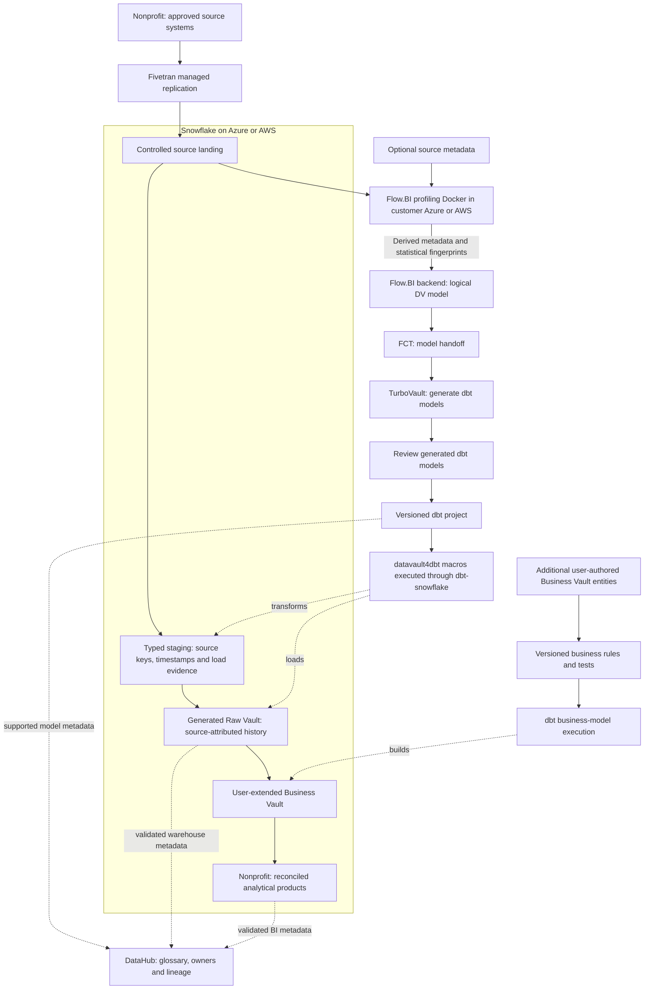

# Cloud Nonprofit Snowflake Data Platform Blueprint

**Connect funding restrictions, program delivery, expenditure, and outcomes while protecting donors and beneficiaries.**

For nonprofit teams adopting Snowflake, this Data Vault architecture turns grant, accounting, program delivery, and authorized participant records into governed analytical products. It covers grant-to-service reporting, Fivetran ingestion, Flow.BI automation, dbt execution and DataHub lineage, including correction and cost checks.
Audience: nonprofit leadership, program managers, fundraising, finance, safeguarding, monitoring/evaluation, and data teams. Updated: 5 November 2026.

[Industry platform selection guide](../cloud-nonprofit-platform-selection-guide.md) · [Sovereign edition](../../sovereign/sovereign-nonprofit-data-platform-blueprint.md) · [All blueprints](../../../../README.md)

## Tools behind the nonprofit Snowflake platform

[Snowflake](https://docs.snowflake.com/en/user-guide/cost-understanding-overall) is the database/compute target for nonprofit: Snowflake is the managed SQL warehouse for storing integrated history and executing transformation/reporting workloads. Workload sizing and compute attribution remain architectural decisions. Choose Azure or AWS for the deployment described here according to data location and integration needs; the chosen cloud also supplies customer-side landing, profiling, and surrounding services.

[Fivetran](https://fivetran.com/docs/getting-started) provides commercial managed replication for supported nonprofit sources. Land grant, accounting, program delivery, and authorized participant records in a destination-owned replica, retain sync/deletion evidence, and keep dbt-owned Vault tables separate. [Flow.BI](https://flow.bi/) analyzes source values and relationships to generate the logical Data Vault structure for grant, restriction, and expenditure. Actual data is required; mostly optional source metadata improves modeling. Its customer-cloud Docker component profiles locally and sends derived metadata and statistical fingerprints to the backend.

[FCT](https://www.scalefree.com/consulting/turbovault/flowbi-connector/) (Flow.BI Connector for TurboVault4dbt) connects the modeling service to the generator by retrieving and transforming Flow.BI output. [TurboVault](https://www.scalefree.com/consulting/turbovault/) translates Data Vault metadata into the dbt model layer. Its generated models are reviewed before execution; request online TurboVault Studio access through Scalefree. [datavault4dbt](https://github.com/ScalefreeCOM/datavault4dbt) supplies reusable loading logic for staging and the required Vault entity types, while [dbt](https://github.com/dbt-labs/dbt) compiles model SQL, resolves dependencies, runs transformations, and executes tests on the target. Additional user-authored Business Vault entities implement **restricted-fund allocation and indicator cohorts** outside the regenerated paths.

[DataHub](https://docs.datahub.com/docs/ui-ingestion) provides cross-stack discovery, business definitions, ownership, and lineage for grant, restriction, and expenditure; native platform permissions remain in force.

[Scalefree](https://www.scalefree.com/) combines data-platform advisory, implementation delivery, automation tooling, and team training. The engagement connects Snowflake implementation to the nonprofit workflow, governed business rules, and team enablement.

## Snowflake data and model flow

Source values for grant, restriction, and expenditure are required for profiling. The local Docker component keeps raw source records in the customer environment during profiling and needs approved outbound backend connectivity for derived metadata and fingerprints. Flow.BI output goes directly through FCT and TurboVault; the review occurs after generation and before macro execution. Catalog edges represent configured integrations with tested coverage, including explicit lineage where automatic discovery is incomplete.

## Follow restricted funding into program delivery

A nonprofit needs to explain which funds were committed, received, allocated, spent, and associated with delivered services. A donor CRM and an accounting ledger describe different stages of that chain. Their totals should not be joined as though every pledge were cash and every activity were an outcome.

Start with a restricted-grant budget-to-actual and delivery product for one program and funding period. Integrate grant agreements, accounting transactions, program activity records, and an authorized participant register. Keep fundraising campaign attribution distinct from grant restrictions.

| Stage | Required evidence | Question |
| --- | --- | --- |
| Agree funding | Grant version, restrictions, budget, dates | What can the organization spend, and when? |
| Receive funds | Donation/receipt, currency, accounting reference | What cash has actually arrived? |
| Allocate and spend | Cost center, program allocation, eligible expenditure | Which funding source supports which activity? |
| Deliver services | Session, attendance, eligibility and provider | What was delivered and to whom under authorized access? |
| Report results | Indicator definition, observation, reporting version | Which outputs and outcomes are evidenced? |

## Model obligations and evidence separately

Core entities include donor/funder, grant, restriction, program, project, budget version, expenditure, allocation, service activity, participant, partner, and indicator. Donors can be people or organizations; beneficiaries may have multiple service episodes. Do not merge the two identity domains merely because a contact appears in both.

The Raw Vault preserves receipts, agreements, expenses, and delivery events. Users add Business Vault entities for eligibility rules, restricted-fund allocations, currency conversion, indicator cohorts, and approved de-duplication. The implementation sequence uses Flow.BI, FCT, TurboVault, post-generation review, and datavault4dbt/dbt, followed by these program-specific extensions.

## Worked example: grant utilization is not impact

A grant has EUR 100,000 approved eligible budget. By the cutoff, EUR 40,000 is posted as eligible expenditure and EUR 15,000 is committed but not yet spent. A defined actual-expenditure utilization is 40%; actual plus commitments is 55%. Publish both with distinct labels and exclude double counting when commitments become actual transactions.

If 80 people attended 120 sessions, report 80 distinct participants and 120 service attendances only if those figures follow the agreed identity and event definitions. Attendance does not establish an outcome such as sustained employment or improved health; outcome indicators require their own evidence and observation window.

Financial facts use **expenditure line × funding allocation × currency**, with allocation totals constrained to the line amount. Service facts use **activity/session × participant × participation event**. Record indicator definitions, denominator, method, and missing-data policy.

## Safeguarding and responsible transparency

Restrict beneficiary identities, precise locations, safeguarding cases, and sensitive needs separately from donor and aggregate program data. Volunteer access should expire with the role. Partners receive minimum approved fields; public donor reports should not expose vulnerable individuals through small groups or linked attributes.

For development/humanitarian reporting, assess [IATI activity and financial data](https://reference.iatistandard.org/en/using-data/types-of-data/) as a publication mapping. Its relevance depends on funder requirements and organizational commitments. Publication requires an explicit disclosure review; internal record completeness does not imply safe open publication.

Map privacy, grant terms, charitable reporting, retention, and local law to each operating country. Maintain correction and withdrawal procedures while retaining financial evidence where required. Classify Flow.BI's outbound metadata/fingerprints as well as the source records.

## Prove the grant-to-service chain

Finance owns eligible expenditure and fund balances; program management owns activities; monitoring/evaluation owns indicator methods; safeguarding owns access boundaries. Train analysts to distinguish commitment, receipt, allocation, expenditure, output, and outcome.

Acceptance requires reconciling expenses to accounting, verifying restriction allocations, reproducing an indicator at a historical cutoff, and checking that a participant receiving multiple services is counted correctly. Test funder-report suppression and removal of a volunteer's access. Unallocated costs and missing participant observations remain explicit exceptions.

Expand to multi-country grants, partner delivery, and fundraising effectiveness when the pilot is reconciled. The complete technology, cloud, training, and resource guidance follows.

## Engineering decisions for the nonprofit Snowflake product

This is the **Snowflake implementation** of the nonprofit workflow. Its purpose is **grant-to-service reporting**. Validate the selected target against the worked example and operational failure cases in this document. The platform comparison is available separately; this article carries the complete implementation, training, resources, and Next steps for this stack.

[Snowflake](https://docs.snowflake.com/en/user-guide/cost-understanding-overall) provides the managed SQL warehouse for nonprofit. Land approved source deliveries, build staging and the Raw Vault with the tested Snowflake adapter, and implement restricted-fund allocation and indicator cohorts as owned Business Vault models. Align the Azure or AWS account/region with the source estate, consumers, and operating skills.

Use distinct load, transformation, and reporting compute where the nonprofit service windows need isolation. The evaluation must reconstruct historical grant evidence and run concurrent consumers while applying a correction. Price compute, storage/retained copies, managed/serverless features used, transfer, and recovery; an AWS-to-Azure change is a migration decision with its own cost.

### Physical model and workload boundaries

Use separate landing, staging, Raw Vault, Business Vault, and serving schemas with explicit writer roles. A Fivetran-managed replica is an ingestion boundary; generated dbt models own the Vault. For grant, restriction, and expenditure, preserve the source key namespace and business-effective timestamp alongside the load timestamp. Size transformation and reporting virtual warehouses independently where contention or charge attribution justifies it. Avoid adding clustering to every table: inspect the actual history lookup, join and correction profiles first.

### Historical rebuilds and release validation

Run the nonprofit worked example through the pinned dbt-snowflake adapter and datavault4dbt package. Prove stable key/hash inputs, decimal/currency precision, timestamp interpretation, duplicate handling and satellite change detection. A late correction must update the appropriate historical interpretation without silently rewriting the previously published report. Exercise isolated development/release datasets and a restoration route; retention or cloning features have configured scope and cost and do not replace the recovery test.

### SQL serving, sharing and cost attribution

Publish restricted-fund allocation and indicator cohorts through owned Business Vault models and approved serving contracts. Apply access policy to SQL, BI, extracts and any sharing route, and verify revoked access from the consumer identity. Measure loading, transformations and the close/reporting burst separately. Record query/warehouse evidence for each accepted batch; include idle compute, retries, retained data and edition-dependent features in the cost model. A feature such as additional acceleration or sharing requires a measured nonprofit benefit and an approved release configuration.

### Ingestion contract

**Primary ingestion: Fivetran (commercial managed service).** Verify supported nonprofit sources and the documented Snowflake destination, historical load/CDC scope, deleted-record behavior, schema changes, sync recovery and processing location. Keep its destination replica separate from dbt-owned models. Price the actual connector usage and destination load compute, including the plan-specific treatment of re-syncs; source-specific APIs or industrial/clinical gateways may still be needed. Use the [destination documentation](https://fivetran.com/docs/destinations) and [pricing definitions](https://fivetran.com/docs/core-concepts/usage-based-pricing).

### Platform acceptance and operating evidence

The release record contains Snowflake query history, dbt artifacts, reconciliation results, and warehouse usage. Join it to source delivery IDs, generator/package/adapter versions, model approval, calculation rule versions and publication cutoffs. Execute a duplicate, a late correction, partial-load recovery, regeneration without losing user-authored Business Vault entities, permission revocation and clean-environment restore using this industry's actual grain.

Reconcile one restricted grant and its eligible expenses, reproduce an indicator cohort, and test beneficiary-data export restrictions. Use identical source scope, correction cases, service targets, and business definitions when comparing platforms.

Report cost per **reconciled grant report and program-indicator refresh**, plus end-to-end freshness, concurrent-consumer response, reconciliation exceptions, and operator hours. Specifically measure quiet months, donor reporting bursts, volunteer operating effort, beneficiary copies, and unbounded exploratory scans.

### Implementation documentation

Use the [Snowflake platform documentation](https://docs.snowflake.com/en/user-guide/cost-understanding-overall), [dbt-snowflake setup](https://docs.getdbt.com/docs/local/connect-data-platform/snowflake-setup), and [datavault4dbt supported platforms and documentation](https://www.datavault4dbt.com/) to pin the implementation. Feature availability and adapter/materialization behavior are part of the pilot acceptance record. Select each additional feature against a concrete nonprofit use case and incremental operating cost.

## Operate and govern by data product

Assign each product a business owner, technical operator, purpose, grain, definitions, refresh target, classification, retention, and quality thresholds. Preserve source batch/offset IDs, code/package versions, calculation rules, cutoff, and exception status with published outputs. Keep operational-system decisions and regulated calculation engines within their validated authority boundaries.

Use institutional identity, scoped service principals, separate development/production, secret management, auditable privileged access, and approved network routes. Enforce restrictions through SQL, BI, export, and underlying storage. Test actual negative access and revocation behavior. A managed service or compliant provider does not establish application-level compliance.

Choose orchestration and alerts around the product's dependencies. A late source or unresolved material reconciliation break should affect publication status. Define retries and recovery of ingestion state, metadata/catalogs, data, credentials, and deployment artifacts. Demonstrate rollback and a clean-environment restore.

## Compare lifecycle cost and delivery value

The managed-cloud case is **shorter delivery time, reduced infrastructure administration, elastic execution, and useful platform integration**. The decision is an operating-model tradeoff. Keep privacy, contractual requirements, data-location constraints, and an exit plan even when sovereignty is not the main objective.

Use a three-year model with an explicit growth scenario:

`TCO = migration and implementation + platform/compute + storage and retained copies + ingestion/orchestration + network/egress + BI/security licenses + support + operating staff + recovery/testing + exit allowance`

Account for negotiated rates and existing commitments as incremental costs, without treating sunk licenses or staff effort as free. Measure normal, peak, backfill, and quiet-period workloads. Record costs per completed data-product refresh and per meaningful business unit, together with correctness and service quality. Compare low/base/high demand and sensitivity to refresh frequency, retention, concurrency, and source growth. Do not publish a cost-saving percentage without the corresponding workload and pricing assumptions.

For feature decisions, record the use case, production availability in the selected region/edition, integration limits, expected outcome, incremental cost, operating owner, and rollback. Prefer an ordinary SQL or scheduled pipeline when it meets the product goal more economically. New AI, streaming, or sharing capabilities should earn their place through a measured pilot.

## Delivery gates

1. Agree the product's grain, calculation, scope, cutoff, access, and reconciliation targets with its business owner.
2. Benchmark the recommended platform against the strongest alternative using the same sources and workload, including cold/warm runs and concurrent consumers.
3. Build the ingestion/model-generation path; review after TurboVault; run tested macros and add Business Vault rules.
4. Prove the industry's worked example and failure cases, historical reconstruction, permissions, restart, restore, and regeneration behavior.
5. Compare measured run cost and staff effort with the business case. Document limitations and choose the platform before committing to broad migration.

## Metadata stewardship in the nonprofit stack

[DataHub](https://docs.datahub.com/docs/ui-ingestion) is the metadata catalog for this nonprofit stack. It joins asset discovery, business definitions, ownership, and lineage so teams can trace grant and understand the derived rules for restricted-fund allocation and indicator cohorts.

1. **Establish the catalog boundary.** Use DataHub Core in a customer-managed environment as the reference open-source catalog, or choose DataHub Cloud under an explicit service agreement. Budget catalog infrastructure/search, upgrades, credentials, metadata collection, and stewardship; a managed catalog adds its subscription and provider dependencies. This catalog complements the database's native access controls and, where present, Unity Catalog or a table-format metastore.

2. **Document the business product.** For this product, register **grant, restriction, expenditure, allocation, and service activity** as governed concepts linked to real assets. Describe **restricted-fund allocation and indicator cohorts** with an owner, calculation/rule version, eligible population, cutoff, and known limitations. Publish only the metadata fields that the catalog users are authorized to see.

3. **Collect and verify lineage.** Collect [dbt artifacts and target-warehouse metadata](https://docs.datahub.com/docs/generated/ingestion/sources/dbt) together so model nodes resolve to the actual tables/views. Select supported warehouse/BI sources and validate the Snowflake route and its warehouse/BI lineage coverage. For Fivetran-led ingestion, assess the [DataHub Fivetran source](https://docs.datahub.com/docs/generated/ingestion/sources/fivetran) for connector metadata/lineage coverage. Use explicit API-emitted lineage for unrepresented steps rather than assuming the full source-to-report path is automatic. dbt remains the execution/test layer; DataHub collects the supported metadata and quality results. Test which table/column lineage, test status, and deletion behavior are captured by the actual sources and artifact versions.

4. **Exercise the pilot controls.** Catalog acceptance follows the nonprofit pilot: trace an approved source field through a generated model and Business Vault extension to a published metric, then test a schema change, a stale scan, and a permission revocation. Mask sample values and sensitive SQL/descriptions where required. Track scan coverage and unresolved lineage gaps explicitly.

## Training and knowledge transfer

Make capability development a delivery workstream with practical acceptance criteria.

| Track | Training resource | Participants | Proposed project outcome |
| --- | --- | --- | --- |
| DV — Data Vault | [Data Vault Training & Certification](https://www.scalefree.com/data-vault-2-1-trainings/data-vault-training-certification/) and [Modeling Class](https://www.scalefree.com/data-vault-2-1-trainings/data-vault-2-1-modeling-class/) | Architects, modelers, engineering leads; selected stewards for shared concepts. | Understand generated Raw Vault structures and design additional Business Vault entities with the correct keys, grain, and history. |
| DWA — Data Warehouse Automation | [Scalefree dbt training: DataVault4dbt and TurboVault automation blocks](https://www.scalefree.com/training/dbt-training/) | Modelers, engineers, and release owners. | Operate the Flow.BI–FCT–TurboVault workflow, review generated models before datavault4dbt/dbt execution, and regenerate without overwriting user-authored Business Vault entities. |
| dbt | [Scalefree dbt Training](https://www.scalefree.com/training/dbt-training/) | Data engineers, analytics engineers, and operators. | Build and test models, use packages/macros, debug failures, and promote releases through controlled environments. |
| Flow.BI foundations | [Flow.BI Introduction](https://flow.bi/trainings/flow-bi-introduction/) | Business analysts, domain stewards, architects, project leads, and engineers. | Understand the interface, data sources, deployment targets, and first model-generation run. |
| Flow.BI configuration and operations | [Flow.BI In-Depth](https://flow.bi/trainings/flow-bi-in-depth/) | Engineers, architects, and platform operators. | Configure classification, permissions, API access, and integration settings for the organization environment. |
| Understanding generated models | [Generated Data Vault Models](https://flow.bi/trainings/generated-data-vault-2-0-models/) | Data modelers, engineers, and architects. | Interpret generated structures and their downstream physical implementation; apply this knowledge to the review after TurboVault and to Business Vault extensions. |
| Flow.BI metadata presentation | [Presenting Flow.BI Metadata — training catalog](https://flow.bi/trainings/) | Modelers, analysts, and metadata/catalog owners. | Use Flow.BI dashboards to present internal metadata to authorized users. |
| Catalog stewardship | [DataHub documentation](https://docs.datahub.com/docs/ui-ingestion) | Data owners, stewards, catalog operators, and engineers. | Document grant, approve definitions, trace model lineage, and operate metadata scans and access. |

**Terminology:** DWA means Data Warehouse Automation. The DWA training track uses Scalefree's published automation learning blocks. DVA refers exclusively to the Data Vault Alliance.

The Data Vault certification training covers Data Vault 2.1. Align the curriculum with the selected tool versions and implementation patterns. Its dbt offering is customizable; agree the agenda and prerequisites before booking.
Flow.BI In-Depth requires Flow.BI Introduction and general data-architecture knowledge. Generated Data Vault Models requires Flow.BI Introduction and Data Vault modeling knowledge. Use the [Flow.BI training catalog](https://flow.bi/trainings/) to select classes or a bundle and confirm current delivery details.

Recommended sequence:

1. Run DV foundations and modeling to understand the generated Raw Vault and design Business Vault extensions.
2. Complete Flow.BI Introduction before connecting the pilot sources; follow with In-Depth for the configuration and operations team and Generated Data Vault Models for modelers and engineers.
3. Run dbt fundamentals before building the first transformation pipeline.
4. Run DWA practical sessions when the first Flow.BI output is available for direct processing through FCT and TurboVault. Include metadata presentation training for the team publishing model documentation.
5. Complete an organization-led lab using synthetic datasets for the selected industry workflow: Fivetran ingestion, Flow.BI generation, direct FCT transfer, TurboVault generation, generated-model review, datavault4dbt/dbt execution, user-added Business Vault entities, and industry-specific reconciliation.
6. Require at least two internal operators to deploy, troubleshoot, restore, and explain the pipeline without external assistance.

Budget training, preparation time, labs, and follow-up coaching separately from software and hosting. Use the [current training catalog](https://www.scalefree.com/training/) for available formats and scheduling.

## Scalefree implementation resources

The following articles complement the product documentation and training. Read the Flow.BI/FCT integration overview first, then TurboVault generation, datavault4dbt staging and loading, and finally Business Vault extensions and deployment practices.

| Tool or topic | Scalefree blog resource | Application to this blueprint |
| --- | --- | --- |
| Flow.BI, FCT, TurboVault, and datavault4dbt | [Flow.BI: Generating the Raw Data Vault Using AI and dbt](https://www.scalefree.com/blog/modeling/flow-bi-generating-the-raw-data-vault-using-ai-and-dbt/) | Explains the logical-to-physical automation chain and connector, and the addition of business logic in the Business Vault. Pair it with the [FCT access page](https://www.scalefree.com/consulting/turbovault/flowbi-connector/) for onboarding. |
| TurboVault | [Speed Up Your Data Vault 2.0 Implementation with TurboVault4dbt](https://www.scalefree.com/blog/tools/speed-up-your-data-vault-2-0-implementation-with-turbovault4dbt/) | Introduces metadata-driven dbt model generation. Use it to understand the generation stage before the review phase. |
| datavault4dbt overview | [Kick-Start Your Data Vault 2.0 Implementation with datavault4dbt](https://www.scalefree.com/blog/tools/kick-start-your-data-vault-2-0-implementation-with-datavault4dbt/) | Introduces loading templates and the package's role within dbt. Useful background before the hands-on training. |
| datavault4dbt staging | [Exploring datavault4dbt — Vol. 1: The Staging Layer](https://www.scalefree.com/blog/tools/exploring-datavault4dbt-a-practical-series-on-the-dbt-package-for-data-vault-2-0-vol-1-the-staging-layer/) | Covers staging configuration, hashing, derived columns, and prejoins. Apply these concepts when connecting the Fivetran landing datasets to generated transformations. |
| datavault4dbt Raw Vault | [Exploring datavault4dbt — Vol. 2: Standard Entities in the Raw Vault](https://www.scalefree.com/blog/datenwerkzeuge/exploring-datavault4dbt-a-practical-series-on-the-dbt-package-for-data-vault-2-0-vol-2-standard-entities-in-the-raw-vault/) | Walks through hubs, links, and satellites. Use it to interpret the models produced by TurboVault and their macro parameters. |
| Business Vault extensions | [Designing the Business Vault: Key Strategies for Effective Data Organization](https://www.scalefree.com/blog/data-vault/designing-the-business-vault-key-strategies-for-effective-data-organization/) | Explains reusable business logic and additional entities such as computed satellites, links, PITs, and bridges. Relevant to user-defined organization extensions after Raw Vault generation. |
| dbt delivery and testing | [CI/CD: Practical Insights into Automating Data Vault 2.0 with dbt](https://www.scalefree.com/blog/data-vault/ci-cd-practical-insights-into-automating-data-vault-2-0-with-dbt/) | Uses datavault4dbt and GitHub Actions to illustrate testing and delivery automation. Adapt execution and runner placement to the organization's cloud boundary. |

Examples in older articles may use earlier package versions, metadata layouts, or specific cloud databases. Use the pinned tool versions and current documentation for implementation details. For ingestion and target-platform configuration, use the primary documentation already linked in the platform and ingestion guidance in this document alongside these architectural resources. Browse the [Scalefree blog](https://www.scalefree.com/blog/) for further articles.

## Flow.BI implementation resources

Use the [Flow.BI blog](https://flow.bi/blog/) for ongoing product architecture and implementation material. Relevant starting points:

| Resource | Why it matters to this blueprint |
| --- | --- |
| [How Flow.BI Protects Sensitive Enterprise Data](https://flow.bi/blog/how-flow-bi-protects-sensitive-enterprise-data/) | Explains required data profiling, the local Docker image, storage access, and the local/backend processing boundary. |
| [Seeing Every Step: Data Lineage Inside Flow.BI](https://flow.bi/blog/seeing-every-step-data-lineage-inside-flow-bi/) | Describes source-to-model traceability and graph views. Use this model lineage alongside Fivetran load evidence and dbt execution lineage. |
| [Turning Salesforce and Pardot Tables Into a Semantic Model](https://flow.bi/blog/turning-salesforce-and-pardot-tables-into-a-semantic-model/) | Illustrates concept recognition and declared versus inferred relationships using CRM data. Use it as background on model generation; organization-specific additions in this blueprint are implemented through Business Vault entities. |
| [Generative AI for Data Vault](https://flow.bi/ai-driven-business/) | Explains the progression from data profiling to a logical Data Vault model and downstream physical-model automation. |
| [Flow.BI Media Library](https://flow.bi/media/) | Includes local-processing, bring-your-own-bucket, modeling, and dbt integration sessions for team onboarding. |

## Planning a nonprofit Snowflake data warehouse

### How should Snowflake preserve nonprofit history?

Separate source landing, dbt transformations and reporting workloads. For grant, restriction, and expenditure, preserve source keys and effective/load times before building restricted-fund allocation and indicator cohorts. Test historical corrections under concurrent SQL demand and attribute virtual-warehouse usage to the accepted product.

### What should the nonprofit Snowflake pilot prove?

Use the worked example and difficult cases to validate **grant-to-service reporting**. Retain source-to-output reconciliation, duplicate and late-record results, access-denial evidence, restore behavior and the measured cost per accepted product. Confirm that regeneration preserves user-authored Business Vault rules and that DataHub lineage covers the actual route.

## Related blueprints

- [Sovereign nonprofit data platform](../../sovereign/sovereign-nonprofit-data-platform-blueprint.md)
- [Nonprofit cloud platform selection](../cloud-nonprofit-platform-selection-guide.md)
- [Nonprofit on Databricks](../databricks/cloud-nonprofit-databricks-data-platform-blueprint.md)
- [Nonprofit on Microsoft Fabric](../microsoft-fabric/cloud-nonprofit-microsoft-fabric-data-platform-blueprint.md)
- [Nonprofit on Google BigQuery](../google-bigquery/cloud-nonprofit-google-bigquery-data-platform-blueprint.md)
- [Snowflake technology architecture](../../../../cloud/snowflake/snowflake-data-platform-blueprint.md)
- [All industry and technology blueprints](../../../../README.md)

## Next steps

Bring the nonprofit worked example, source inventory, Snowflake deployment assumptions and measured cost targets to the first implementation session. Request a pilot covering ingestion, model generation, the review after TurboVault, dbt execution, DataHub lineage and one user-authored Business Vault extension.

Include DataHub metadata discovery, glossary ownership, lineage coverage, and catalog operating cost in the pilot scope.

Use the [Fivetran getting-started and connector documentation](https://fivetran.com/docs/getting-started) to validate the proposed managed ingestion route before selecting a commercial plan.

Select the pilot described in this blueprint, name its business and technical owners, and bring representative source data, reporting definitions, workload volumes, and operating constraints to an architecture discussion.

| Step | Where to go | What to request or prepare |
| --- | --- | --- |
| Discuss the implementation | [Scalefree contact form](https://www.scalefree.com/about-scalefree/contact/) | Request a platform assessment, pilot workshop, implementation support, or tailored training. Include the blueprint title and the first data product. |
| Try automated modeling | [Flow.BI trial registration](https://flow.bi/sign-up-for-trial/) | Request a trial and local-processing Docker deployment instructions. Prepare authorized source data; available metadata improves the result. |
| Obtain the connector | [FCT access and download request](https://www.scalefree.com/consulting/turbovault/flowbi-connector/) | Request Flow.BI Connector for TurboVault4dbt access and verify the intended generator version. |
| Install the macro package | [datavault4dbt repository and releases](https://github.com/ScalefreeCOM/datavault4dbt) | Obtain the package, choose a supported target adapter, and pin a tested version. |
| Access the online generator | [Request TurboVault Studio signup through Scalefree](https://www.scalefree.com/about-scalefree/contact/) | Ask specifically for the new online TurboVault Studio and its Flow.BI/FCT integration route. |
| Obtain a downloadable generator | [TurboVault4dbt](https://github.com/ScalefreeCOM/turbovault4dbt) and [TurboVault Engine](https://github.com/ScalefreeCOM/turbovault-engine) | Select the edition that fits the integration and retain its version and configuration. |
| Receive implementation updates | [Scalefree newsletter registration](https://www.scalefree.com/) | Use the “Data Vault 2.GO / Build Better Data Platforms” newsletter form on the homepage. |

Complete the pilot's reconciliation, access, recovery, and cost checks before extending the source scope. Record the results and the decision to proceed in the project repository.

## License

Copyright © 2026 Scalefree International GmbH. The original text, tables, and diagrams in this blueprint are licensed under [CC BY-SA 4.0](https://creativecommons.org/licenses/by-sa/4.0/). Credit Scalefree, identify changes, and retain the applicable ShareAlike terms when distributing adaptations. See [LICENSE.md](../../../../LICENSE.md) for scope, attribution, and the governing legal code. Referenced software and third-party material retain their own licenses.
