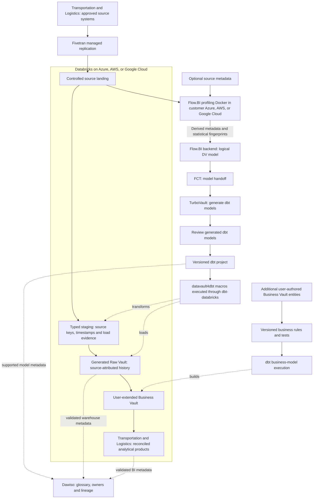

# Cloud Transportation and Logistics Databricks Data Platform Blueprint

**Connect consignments, legs, handling units, custody events, capacity, and cost across carriers and partners.**

Build a Databricks data warehouse for transportation and logistics around consignment, handling unit, and transport leg. This blueprint connects Fivetran ingestion, Flow.BI modeling, Data Vault automation and Dawiso governance to delivery-performance and exception reporting, with a platform-specific flow diagram and operating plan.
Audience: transport planning, carrier operations, warehouse management, customer service, finance, safety, and data teams. Updated: 5 November 2026.

[Industry platform selection guide](../cloud-transportation-and-logistics-platform-selection-guide.md) · [Sovereign edition](../../sovereign/sovereign-transportation-and-logistics-data-platform-blueprint.md) · [All blueprints](../../../../README.md)

## Databricks stack for transportation and logistics

1. [Fivetran](https://fivetran.com/docs/getting-started) provides commercial managed replication for supported transportation and logistics sources. Land transport orders, warehouse scans, carrier events, and delivery evidence in a destination-owned replica, retain sync/deletion evidence, and keep dbt-owned Vault tables separate.

2. [Flow.BI](https://flow.bi/) uses data profiling and AI-assisted modeling to define an integrated Data Vault for consignment, handling unit, and transport leg. Actual data is required; mostly optional source metadata improves modeling. Its customer-cloud Docker component profiles locally and sends derived metadata and statistical fingerprints to the backend.

3. [FCT](https://www.scalefree.com/consulting/turbovault/flowbi-connector/) (Flow.BI Connector for TurboVault4dbt) is the connector that maps Flow.BI output into metadata TurboVault can consume. [TurboVault](https://www.scalefree.com/consulting/turbovault/) builds the metadata-driven dbt project artifacts for the target implementation. Its generated models are reviewed before execution; request online TurboVault Studio access through Scalefree.

4. [datavault4dbt](https://github.com/ScalefreeCOM/datavault4dbt) provides standardized macro definitions for the Vault structures and load behavior, while [dbt](https://github.com/dbt-labs/dbt) executes model SQL through the selected adapter and records the transformation/test run. Additional user-authored Business Vault entities implement **canonical milestones and charge allocations** outside the regenerated paths.

5. [Databricks SQL and lakehouse tables](https://docs.databricks.com/aws/en/getting-started/architecture) is the database/compute target for transportation and logistics: Databricks supplies the engineering and SQL compute; governed lakehouse tables hold source history, Vault entities, and derived products. This separates the query/runtime role from the underlying object storage. Deploy Databricks in the approved Azure, AWS, or Google Cloud environment near the source data and operational skills. That cloud supplies the surrounding storage, network, identity, and customer profiling runtime.

6. [Dawiso](https://www.dawiso.com/product/data-catalog) is the commercial catalog for consignment, handling unit, and transport leg, connecting business definitions, owners, discovered assets, and lineage evidence. Its deployment and metadata processing need a separate operating agreement.

7. [Scalefree](https://www.scalefree.com/) supports platform design and delivery with Data Vault expertise, software tooling, and practical training. The engagement connects Databricks implementation to the transportation and logistics workflow, governed business rules, and team enablement.

## Databricks data and model flow

Source values for consignment, handling unit, and transport leg are required for profiling. The local Docker component keeps raw source records in the customer environment during profiling and needs approved outbound backend connectivity for derived metadata and fingerprints. Flow.BI output goes directly through FCT and TurboVault; the review occurs after generation and before macro execution. Catalog edges represent configured integrations with tested coverage, including explicit lineage where automatic discovery is incomplete.

## Trace the shipment, not just its latest status

A customer shipment can be split across vehicles, consolidated with other consignments, transferred between carriers, and delivered in parts. A latest-status dashboard hides those relationships and can misstate both on-time delivery and cost.

Start with delivery performance and exception visibility for one lane or distribution network. Integrate transport-management orders, warehouse scans, carrier events, proof of delivery, and approved cost/settlement data.

| Workflow | Event evidence | Integration task |
| --- | --- | --- |
| Accept and plan | Order, promised service, planned legs | Preserve the customer promise and its version. |
| Pick and dispatch | Handling unit, shipment association, departure | Connect warehouse evidence to transport execution. |
| Move and hand over | Carrier leg, custody scan, location, timestamp | Track responsibility and event provenance. |
| Deliver or fail | Delivery quantity, proof, failed attempt | Distinguish partial, attempted, and complete delivery. |
| Invoice and resolve | Accessorial charge, claim, carrier invoice | Allocate costs and service failures at the right grain. |

## A shipment has multiple valid identities

Separate customer order, consignment, shipment, handling unit, package/item, transport leg, vehicle, carrier, location, custody event, and delivery attempt. Keep partner identifiers namespaced. Record planned and actual events separately and preserve corrected milestones.

[GS1 EPCIS](https://support.gs1.org/support/solutions/articles/43000755325-what-is-electronic-product-code-information-services-epcis-) provides a reference for visibility events. [UN/CEFACT transport standards](https://unece.org/trade/uncefact/mainstandards) can guide cross-partner semantic mappings. Adoption depends on actual partner contracts and interface versions, not merely a standard name in the architecture.

Raw Vault entities preserve scans and partner events. Business Vault additions establish canonical milestones, promise versions, exception categories, and cost allocations. Flow.BI output reaches FCT and TurboVault directly; generated-model review precedes datavault4dbt/dbt execution.

## Worked example: complete delivery differs from first arrival

A consignment contains ten handling units. Nine arrive before the promised cutoff and one arrives the next day. Under an all-units-complete definition, the consignment is late even though 90% of units were on time. Report unit-level service and consignment-level complete delivery separately.

Use **consignment × handling unit × milestone event**, linked to transport legs and promise version. Repeated scans should not multiply delivered quantities. An approved later promise change must not silently rewrite the originally committed service measure.

Record timezones and source-event time versus receipt time. Partner feeds may arrive out of order or emit inconsistent “delivered” states. Apply an owned status-resolution rule and retain the original messages for investigation.

## Location and partner data need boundaries

Driver identity, vehicle tracks, consignee addresses, high-value cargo routes, and commercial rates should have purpose-specific access. Telemetry collection needs appropriate gateways and permissions; Fivetran consumes supported outputs rather than acting as a vehicle-control system.

Allocate shared transport costs with a defined basis such as weight, pallet space, distance, or contracted charge. Preserve original units, allocation numerator/denominator, and rule version. Avoid treating an allocation as a direct measured cost.

## Pilot against real exceptions

Transport operations owns milestones, warehouse teams own scan semantics, customer service owns promises, and finance owns charge allocation. Train the team using split shipments, duplicate scans, carrier handover, failed delivery, and reattempts.

Acceptance requires reconciling handling-unit counts to dispatch and proof-of-delivery evidence, tracing custody across one partner, retaining original promise performance, and reproducing an invoice allocation. Test out-of-order events and a corrected delivery. Missing milestones must be visible.

Extend to capacity utilization, cold-chain exceptions, emissions estimates, and claims only with explicit methods and source evidence. The full technology, cloud, training, and resources follow within this document.

## Databricks deployment and physical design

This is the **Databricks implementation** of the transportation and logistics workflow. Its purpose is **delivery-performance and exception reporting**. Validate the selected target against the worked example and operational failure cases in this document. The platform comparison is available separately; this article carries the complete implementation, training, resources, and Next steps for this stack.

[Databricks](https://docs.databricks.com/aws/en/getting-started/architecture) contributes engineering and SQL execution over governed lakehouse tables. Use the approved incumbent cloud for storage, network and identity, then retain raw deliveries, typed source tables, the Raw Vault, and canonical milestones and charge allocations with an owned writer/refresh contract. Unity Catalog governs the platform assets; Dawiso provides the cross-stack business discovery and lineage layer in this cloud edition.

Evaluate ingestion/replay and SQL serving for transportation and logistics together. Preserve the fact grain and corrections while comparing job/SQL/serverless choices supported by the chosen cloud and edition. Include platform usage, underlying infrastructure where separately billed, table maintenance, storage, network, retries, and retained environments. A streaming or AI feature needs a measurable product use case.

### Table ownership and event replay

Keep a durable source-delivery record, typed staging tables, generated Vault tables and user-authored Business Vault models. Register the production tables under the agreed Unity Catalog catalog/schema with one accountable writer per table. For consignment, handling unit, and transport leg, preserve source event/version identifiers, business-effective time and load time; a streaming checkpoint is processing state, not the historical business record. A replay needs an idempotence contract and explicit handling of corrections and deleted source records.

### SQL/dbt execution and physical layout

Use dbt-databricks against the selected SQL execution endpoint and pin its compatibility with datavault4dbt. Validate the materializations and history-load behavior on Delta tables before scaling. Partitioning, clustering and maintenance choices follow the transportation and logistics access and update pattern; use query profiles and maintenance cost to choose them. Prevent notebooks or engineering jobs from writing concurrently to dbt-owned Vault targets. Bronze/silver/gold naming may describe processing stages, but each table still needs an explicit mapping to landing, Raw Vault, Business Vault or serving.

### Separate engineering demand from serving commitments

Allocate source preparation, history replay, dbt transformation and analytical serving to owned workloads. Benchmark a late-source correction while consumers query canonical milestones and charge allocations; track both result correctness and contention. The budget includes platform usage and cloud compute/storage/network charges where applicable, idle or restart overhead, table maintenance and retained data. Unity Catalog supplies native asset governance; Dawiso connects cross-stack business meaning and lineage without replacing platform authorization.

### Ingestion contract

**Primary ingestion: Fivetran (commercial managed service).** Verify supported transportation and logistics sources and the documented Databricks destination, historical load/CDC scope, deleted-record behavior, schema changes, sync recovery and processing location. Keep its destination replica separate from dbt-owned models. Price the actual connector usage and destination load compute, including the plan-specific treatment of re-syncs; source-specific APIs or industrial/clinical gateways may still be needed. Use the [destination documentation](https://fivetran.com/docs/destinations) and [pricing definitions](https://fivetran.com/docs/core-concepts/usage-based-pricing).

### Platform acceptance and operating evidence

The release record contains job and SQL execution evidence, Delta table versions, dbt artifacts, and compute attribution. Join it to source delivery IDs, generator/package/adapter versions, model approval, calculation rule versions and publication cutoffs. Execute a duplicate, a late correction, partial-load recovery, regeneration without losing user-authored Business Vault entities, permission revocation and clean-environment restore using this industry's actual grain.

Replay duplicate/out-of-order handovers, a split shipment, and a corrected delivery without inflating delivered units. Use identical source scope, correction cases, service targets, and business definitions when comparing platforms.

Report cost per **million custody events and reconciled shipment product refresh**, plus end-to-end freshness, concurrent-consumer response, reconciliation exceptions, and operator hours. Specifically measure continuous pipelines, partner retries, replay windows, file layout maintenance, and fleet-data transfer.

### Implementation documentation

Use the [Databricks platform documentation](https://docs.databricks.com/aws/en/getting-started/architecture), [dbt-databricks setup](https://docs.getdbt.com/docs/local/connect-data-platform/databricks-setup), and [datavault4dbt supported platforms and documentation](https://www.datavault4dbt.com/) to pin the implementation. Feature availability and adapter/materialization behavior are part of the pilot acceptance record. Select each additional feature against a concrete transportation and logistics use case and incremental operating cost.

## Operate and govern by data product

Assign each product a business owner, technical operator, purpose, grain, definitions, refresh target, classification, retention, and quality thresholds. Preserve source batch/offset IDs, code/package versions, calculation rules, cutoff, and exception status with published outputs. Keep operational-system decisions and regulated calculation engines within their validated authority boundaries.

Use institutional identity, scoped service principals, separate development/production, secret management, auditable privileged access, and approved network routes. Enforce restrictions through SQL, BI, export, and underlying storage. Test actual negative access and revocation behavior. A managed service or compliant provider does not establish application-level compliance.

Choose orchestration and alerts around the product's dependencies. A late source or unresolved material reconciliation break should affect publication status. Define retries and recovery of ingestion state, metadata/catalogs, data, credentials, and deployment artifacts. Demonstrate rollback and a clean-environment restore.

## Compare lifecycle cost and delivery value

The managed-cloud case is **shorter delivery time, reduced infrastructure administration, elastic execution, and useful platform integration**. The decision is an operating-model tradeoff. Keep privacy, contractual requirements, data-location constraints, and an exit plan even when sovereignty is not the main objective.

Use a three-year model with an explicit growth scenario:

`TCO = migration and implementation + platform/compute + storage and retained copies + ingestion/orchestration + network/egress + BI/security licenses + support + operating staff + recovery/testing + exit allowance`

Account for negotiated rates and existing commitments as incremental costs, without treating sunk licenses or staff effort as free. Measure normal, peak, backfill, and quiet-period workloads. Record costs per completed data-product refresh and per meaningful business unit, together with correctness and service quality. Compare low/base/high demand and sensitivity to refresh frequency, retention, concurrency, and source growth. Do not publish a cost-saving percentage without the corresponding workload and pricing assumptions.

For feature decisions, record the use case, production availability in the selected region/edition, integration limits, expected outcome, incremental cost, operating owner, and rollback. Prefer an ordinary SQL or scheduled pipeline when it meets the product goal more economically. New AI, streaming, or sharing capabilities should earn their place through a measured pilot.

## Delivery gates

1. Agree the product's grain, calculation, scope, cutoff, access, and reconciliation targets with its business owner.
2. Benchmark the recommended platform against the strongest alternative using the same sources and workload, including cold/warm runs and concurrent consumers.
3. Build the ingestion/model-generation path; review after TurboVault; run tested macros and add Business Vault rules.
4. Prove the industry's worked example and failure cases, historical reconstruction, permissions, restart, restore, and regeneration behavior.
5. Compare measured run cost and staff effort with the business case. Document limitations and choose the platform before committing to broad migration.

## Catalog ownership and lineage with Dawiso

[Dawiso](https://www.dawiso.com/product/data-catalog) adds the business glossary, asset discovery, ownership, and lineage context for transportation and logistics. It connects the meaning of consignment and the rules for canonical milestones and charge allocations to the implemented datasets.

Use [Dawiso's deployment and integration options](https://www.dawiso.com/product/enterprise-deployment-built-for-flexibility-and-security) to select the supported catalog location and network path. Record the edition, contributor/viewer licensing, metadata scanning scope, and operating owner. Validate discovery of Databricks assets and dbt lineage using the supported connectors or an explicit metadata mapping.

| Catalog responsibility | Implementation in this blueprint |
| --- | --- |
| Business meaning | For this product, register **consignment, handling unit, transport leg, milestone, and delivery** as governed concepts linked to real assets. Describe **canonical milestones and charge allocations** with an owner, calculation/rule version, eligible population, cutoff, and known limitations. Publish only the metadata fields that the catalog users are authorized to see. |
| Metadata ingestion | Discover the selected database/BI assets using the [supported connectors](https://www.dawiso.com/connectors) and validate dbt/generated-model metadata exchange for the chosen version. Define a controlled import/API mapping for gaps; do not assume a direct Flow.BI or FCT catalog connector. Keep the modeling service's generated metadata distinct from the catalog's approved business glossary. |
| Quality and lineage evidence | dbt executes transformation tests; Dawiso records the associated definitions, owners, evidence links, and quality context. Select and validate the integration that publishes results; the catalog does not replace the test engine. |
| Release evidence | Catalog acceptance follows the transportation and logistics pilot: trace an approved source field through a generated model and Business Vault extension to a published metric, then test a schema change, a stale scan, and a permission revocation. Mask sample values and sensitive SQL/descriptions where required. Track scan coverage and unresolved lineage gaps explicitly. |

## Training and knowledge transfer

Make capability development a delivery workstream with practical acceptance criteria.

| Track | Training resource | Participants | Proposed project outcome |
| --- | --- | --- | --- |
| DV — Data Vault | [Data Vault Training & Certification](https://www.scalefree.com/data-vault-2-1-trainings/data-vault-training-certification/) and [Modeling Class](https://www.scalefree.com/data-vault-2-1-trainings/data-vault-2-1-modeling-class/) | Architects, modelers, engineering leads; selected stewards for shared concepts. | Understand generated Raw Vault structures and design additional Business Vault entities with the correct keys, grain, and history. |
| DWA — Data Warehouse Automation | [Scalefree dbt training: DataVault4dbt and TurboVault automation blocks](https://www.scalefree.com/training/dbt-training/) | Modelers, engineers, and release owners. | Operate the Flow.BI–FCT–TurboVault workflow, review generated models before datavault4dbt/dbt execution, and regenerate without overwriting user-authored Business Vault entities. |
| dbt | [Scalefree dbt Training](https://www.scalefree.com/training/dbt-training/) | Data engineers, analytics engineers, and operators. | Build and test models, use packages/macros, debug failures, and promote releases through controlled environments. |
| Flow.BI foundations | [Flow.BI Introduction](https://flow.bi/trainings/flow-bi-introduction/) | Business analysts, domain stewards, architects, project leads, and engineers. | Understand the interface, data sources, deployment targets, and first model-generation run. |
| Flow.BI configuration and operations | [Flow.BI In-Depth](https://flow.bi/trainings/flow-bi-in-depth/) | Engineers, architects, and platform operators. | Configure classification, permissions, API access, and integration settings for the organization environment. |
| Understanding generated models | [Generated Data Vault Models](https://flow.bi/trainings/generated-data-vault-2-0-models/) | Data modelers, engineers, and architects. | Interpret generated structures and their downstream physical implementation; apply this knowledge to the review after TurboVault and to Business Vault extensions. |
| Flow.BI metadata presentation | [Presenting Flow.BI Metadata — training catalog](https://flow.bi/trainings/) | Modelers, analysts, and metadata/catalog owners. | Use Flow.BI dashboards to present internal metadata to authorized users. |
| Catalog stewardship | [Dawiso documentation](https://www.dawiso.com/product/data-catalog) | Data owners, stewards, catalog operators, and engineers. | Document consignment, approve definitions, trace model lineage, and operate metadata scans and access. |

**Terminology:** DWA means Data Warehouse Automation. The DWA training track uses Scalefree's published automation learning blocks. DVA refers exclusively to the Data Vault Alliance.

The Data Vault certification training covers Data Vault 2.1. Align the curriculum with the selected tool versions and implementation patterns. Its dbt offering is customizable; agree the agenda and prerequisites before booking.
Flow.BI In-Depth requires Flow.BI Introduction and general data-architecture knowledge. Generated Data Vault Models requires Flow.BI Introduction and Data Vault modeling knowledge. Use the [Flow.BI training catalog](https://flow.bi/trainings/) to select classes or a bundle and confirm current delivery details.

Recommended sequence:

1. Run DV foundations and modeling to understand the generated Raw Vault and design Business Vault extensions.
2. Complete Flow.BI Introduction before connecting the pilot sources; follow with In-Depth for the configuration and operations team and Generated Data Vault Models for modelers and engineers.
3. Run dbt fundamentals before building the first transformation pipeline.
4. Run DWA practical sessions when the first Flow.BI output is available for direct processing through FCT and TurboVault. Include metadata presentation training for the team publishing model documentation.
5. Complete an organization-led lab using synthetic datasets for the selected industry workflow: Fivetran ingestion, Flow.BI generation, direct FCT transfer, TurboVault generation, generated-model review, datavault4dbt/dbt execution, user-added Business Vault entities, and industry-specific reconciliation.
6. Require at least two internal operators to deploy, troubleshoot, restore, and explain the pipeline without external assistance.

Budget training, preparation time, labs, and follow-up coaching separately from software and hosting. Use the [current training catalog](https://www.scalefree.com/training/) for available formats and scheduling.

## Scalefree implementation resources

The following articles complement the product documentation and training. Read the Flow.BI/FCT integration overview first, then TurboVault generation, datavault4dbt staging and loading, and finally Business Vault extensions and deployment practices.

| Tool or topic | Scalefree blog resource | Application to this blueprint |
| --- | --- | --- |
| Flow.BI, FCT, TurboVault, and datavault4dbt | [Flow.BI: Generating the Raw Data Vault Using AI and dbt](https://www.scalefree.com/blog/modeling/flow-bi-generating-the-raw-data-vault-using-ai-and-dbt/) | Explains the logical-to-physical automation chain and connector, and the addition of business logic in the Business Vault. Pair it with the [FCT access page](https://www.scalefree.com/consulting/turbovault/flowbi-connector/) for onboarding. |
| TurboVault | [Speed Up Your Data Vault 2.0 Implementation with TurboVault4dbt](https://www.scalefree.com/blog/tools/speed-up-your-data-vault-2-0-implementation-with-turbovault4dbt/) | Introduces metadata-driven dbt model generation. Use it to understand the generation stage before the review phase. |
| datavault4dbt overview | [Kick-Start Your Data Vault 2.0 Implementation with datavault4dbt](https://www.scalefree.com/blog/tools/kick-start-your-data-vault-2-0-implementation-with-datavault4dbt/) | Introduces loading templates and the package's role within dbt. Useful background before the hands-on training. |
| datavault4dbt staging | [Exploring datavault4dbt — Vol. 1: The Staging Layer](https://www.scalefree.com/blog/tools/exploring-datavault4dbt-a-practical-series-on-the-dbt-package-for-data-vault-2-0-vol-1-the-staging-layer/) | Covers staging configuration, hashing, derived columns, and prejoins. Apply these concepts when connecting the Fivetran landing datasets to generated transformations. |
| datavault4dbt Raw Vault | [Exploring datavault4dbt — Vol. 2: Standard Entities in the Raw Vault](https://www.scalefree.com/blog/datenwerkzeuge/exploring-datavault4dbt-a-practical-series-on-the-dbt-package-for-data-vault-2-0-vol-2-standard-entities-in-the-raw-vault/) | Walks through hubs, links, and satellites. Use it to interpret the models produced by TurboVault and their macro parameters. |
| Business Vault extensions | [Designing the Business Vault: Key Strategies for Effective Data Organization](https://www.scalefree.com/blog/data-vault/designing-the-business-vault-key-strategies-for-effective-data-organization/) | Explains reusable business logic and additional entities such as computed satellites, links, PITs, and bridges. Relevant to user-defined organization extensions after Raw Vault generation. |
| dbt delivery and testing | [CI/CD: Practical Insights into Automating Data Vault 2.0 with dbt](https://www.scalefree.com/blog/data-vault/ci-cd-practical-insights-into-automating-data-vault-2-0-with-dbt/) | Uses datavault4dbt and GitHub Actions to illustrate testing and delivery automation. Adapt execution and runner placement to the organization's cloud boundary. |

Examples in older articles may use earlier package versions, metadata layouts, or specific cloud databases. Use the pinned tool versions and current documentation for implementation details. For ingestion and target-platform configuration, use the primary documentation already linked in the platform and ingestion guidance in this document alongside these architectural resources. Browse the [Scalefree blog](https://www.scalefree.com/blog/) for further articles.

## Flow.BI implementation resources

Use the [Flow.BI blog](https://flow.bi/blog/) for ongoing product architecture and implementation material. Relevant starting points:

| Resource | Why it matters to this blueprint |
| --- | --- |
| [How Flow.BI Protects Sensitive Enterprise Data](https://flow.bi/blog/how-flow-bi-protects-sensitive-enterprise-data/) | Explains required data profiling, the local Docker image, storage access, and the local/backend processing boundary. |
| [Seeing Every Step: Data Lineage Inside Flow.BI](https://flow.bi/blog/seeing-every-step-data-lineage-inside-flow-bi/) | Describes source-to-model traceability and graph views. Use this model lineage alongside Fivetran load evidence and dbt execution lineage. |
| [Turning Salesforce and Pardot Tables Into a Semantic Model](https://flow.bi/blog/turning-salesforce-and-pardot-tables-into-a-semantic-model/) | Illustrates concept recognition and declared versus inferred relationships using CRM data. Use it as background on model generation; organization-specific additions in this blueprint are implemented through Business Vault entities. |
| [Generative AI for Data Vault](https://flow.bi/ai-driven-business/) | Explains the progression from data profiling to a logical Data Vault model and downstream physical-model automation. |
| [Flow.BI Media Library](https://flow.bi/media/) | Includes local-processing, bring-your-own-bucket, modeling, and dbt integration sessions for team onboarding. |

## Databricks implementation questions for transportation and logistics

### How should Databricks preserve transportation and logistics history?

Keep a durable source record and one accountable writer for each governed Delta target. Model consignment, handling unit, and transport leg in the Vault before deriving canonical milestones and charge allocations; test replay, correction handling and SQL serving together. Unity Catalog authorization and Dawiso business lineage have separate roles.

### What should the transportation and logistics Databricks pilot prove?

Use the worked example and difficult cases to validate **delivery-performance and exception reporting**. Retain source-to-output reconciliation, duplicate and late-record results, access-denial evidence, restore behavior and the measured cost per accepted product. Confirm that regeneration preserves user-authored Business Vault rules and that Dawiso lineage covers the actual route.

## Related blueprints

- [Sovereign transportation and logistics data platform](../../sovereign/sovereign-transportation-and-logistics-data-platform-blueprint.md)
- [Transportation and Logistics cloud platform selection](../cloud-transportation-and-logistics-platform-selection-guide.md)
- [Transportation and Logistics on Snowflake](../snowflake/cloud-transportation-and-logistics-snowflake-data-platform-blueprint.md)
- [Transportation and Logistics on Microsoft Fabric](../microsoft-fabric/cloud-transportation-and-logistics-microsoft-fabric-data-platform-blueprint.md)
- [Transportation and Logistics on Google BigQuery](../google-bigquery/cloud-transportation-and-logistics-google-bigquery-data-platform-blueprint.md)
- [Databricks technology architecture](../../../../cloud/databricks/databricks-data-platform-blueprint.md)
- [All industry and technology blueprints](../../../../README.md)

## Next steps

Bring the transportation and logistics worked example, source inventory, Databricks deployment assumptions and measured cost targets to the first implementation session. Request a pilot covering ingestion, model generation, the review after TurboVault, dbt execution, Dawiso lineage and one user-authored Business Vault extension.

Include Dawiso metadata discovery, glossary ownership, lineage coverage, and catalog operating cost in the pilot scope.

Use the [Fivetran getting-started and connector documentation](https://fivetran.com/docs/getting-started) to validate the proposed managed ingestion route before selecting a commercial plan.

Select the pilot described in this blueprint, name its business and technical owners, and bring representative source data, reporting definitions, workload volumes, and operating constraints to an architecture discussion.

| Step | Where to go | What to request or prepare |
| --- | --- | --- |
| Discuss the implementation | [Scalefree contact form](https://www.scalefree.com/about-scalefree/contact/) | Request a platform assessment, pilot workshop, implementation support, or tailored training. Include the blueprint title and the first data product. |
| Try automated modeling | [Flow.BI trial registration](https://flow.bi/sign-up-for-trial/) | Request a trial and local-processing Docker deployment instructions. Prepare authorized source data; available metadata improves the result. |
| Obtain the connector | [FCT access and download request](https://www.scalefree.com/consulting/turbovault/flowbi-connector/) | Request Flow.BI Connector for TurboVault4dbt access and verify the intended generator version. |
| Install the macro package | [datavault4dbt repository and releases](https://github.com/ScalefreeCOM/datavault4dbt) | Obtain the package, choose a supported target adapter, and pin a tested version. |
| Access the online generator | [Request TurboVault Studio signup through Scalefree](https://www.scalefree.com/about-scalefree/contact/) | Ask specifically for the new online TurboVault Studio and its Flow.BI/FCT integration route. |
| Obtain a downloadable generator | [TurboVault4dbt](https://github.com/ScalefreeCOM/turbovault4dbt) and [TurboVault Engine](https://github.com/ScalefreeCOM/turbovault-engine) | Select the edition that fits the integration and retain its version and configuration. |
| Receive implementation updates | [Scalefree newsletter registration](https://www.scalefree.com/) | Use the “Data Vault 2.GO / Build Better Data Platforms” newsletter form on the homepage. |

Complete the pilot's reconciliation, access, recovery, and cost checks before extending the source scope. Record the results and the decision to proceed in the project repository.

## License

Copyright © 2026 Scalefree International GmbH. The original text, tables, and diagrams in this blueprint are licensed under [CC BY-SA 4.0](https://creativecommons.org/licenses/by-sa/4.0/). Credit Scalefree, identify changes, and retain the applicable ShareAlike terms when distributing adaptations. See [LICENSE.md](../../../../LICENSE.md) for scope, attribution, and the governing legal code. Referenced software and third-party material retain their own licenses.
