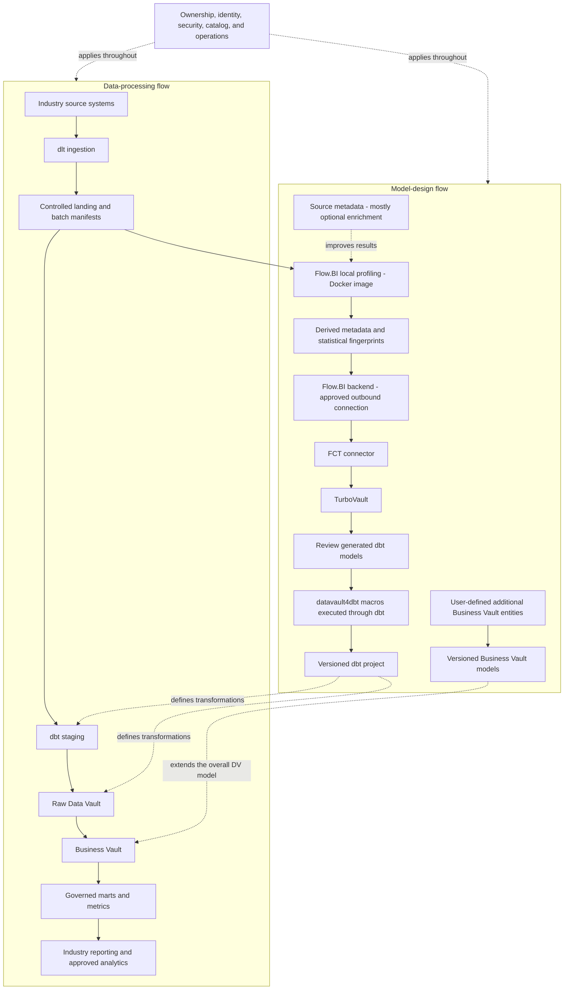

# Sovereign Asset Management Data Platform Blueprint

**Explain how portfolio positions, trades, prices, and cash produce an approved valuation and investor report.**

Audience: sector operations, domain specialists, finance/commercial teams, security, governance, and data engineering. Updated: 5 November 2026.

## Technology roles in Asset Management analytics

1. [dlt](https://github.com/dlt-hub/dlt) (data load tool) is the ingestion library for supported API, database, and file feeds. In this asset management design, it brings portfolio accounting, order management, and custodian files into controlled landing datasets with load evidence. [Flow.BI](https://flow.bi/) derives hubs, links, satellites, and their relationships from the data it profiles. The modeling input includes fund, portfolio, and mandate; actual data is required, while available source metadata improves the result.

2. For the asset management model, [FCT](https://www.scalefree.com/consulting/turbovault/flowbi-connector/) (Flow.BI Connector for TurboVault4dbt) passes the generated logical model from Flow.BI into the TurboVault metadata workflow. [TurboVault](https://www.scalefree.com/consulting/turbovault/) generates model artifacts so the implementation follows the supplied metadata. Review those generated artifacts before executing the asset management transformations; Studio is the online access option, requested through Scalefree.

3. [datavault4dbt](https://github.com/ScalefreeCOM/datavault4dbt) supplies the reusable staging, hub, link, and satellite macros invoked by the models. It contributes the technical history-loading foundation for fund, portfolio, and mandate. [dbt](https://github.com/dbt-labs/dbt) runs the versioned SQL transformation project and its quality tests against the selected engine. User-defined Business Vault models add price-source precedence and corporate-action adjustments within that workflow.

4. The reference database paths are [PostgreSQL](https://www.postgresql.org/about/licence/) for a bounded relational pilot and [Trino with Iceberg](https://trino.io/docs/current/connector/iceberg.html) for the larger lakehouse pattern. PostgreSQL stores and executes relational models; Trino queries and transforms Iceberg tables held in object storage through a catalog. For asset management, Azure, AWS, or Google Cloud hosts the approved data, runtime, storage, and network services. The cloud choice must satisfy the operating, access, key-custody, and portability requirements defined in this document.

[Scalefree](https://www.scalefree.com/) supports the data-platform lifecycle through architecture, engineering, governance, and skills development. For this blueprint, that support can include the asset management source-to-model design, implementation of price-source precedence and corporate-action adjustments, and training the team to maintain the resulting product.

## Asset Management: operational workflow and source evidence

The first data product addresses this decision: **explain how portfolio positions, trades, prices, and cash produce an approved valuation and investor report.** Start with one bounded business unit, contract/product family, site, or reporting period and name the owner of the resulting decision. The pilot draws from portfolio accounting, order management, custodian files, security master, pricing feeds, and fund accounting.

| Workflow stage | Evidence and interpretation to retain |
| --- | --- |
| Agree the mandate | preserve portfolio restrictions and benchmark version |
| Execute trades | retain order, fill, allocation, and settlement references |
| Value the book | bind positions to price and FX observations |
| Close and report | reconcile custodian positions, cash, and fund valuations |

Preserve the planned or promised position as well as actual execution. Maintain source-event time, business-effective time, arrival/load time, correction references, and the cutoff used for reporting. A late or missing delivery remains a visible data-quality state; it should not silently become zero activity.

## Data Vault entities and fact grain for asset management

The business vocabulary includes **fund, portfolio, mandate, security, trade, fill, allocation, position, price observation, custodian, and valuation run**. The proposed fact grain is **portfolio × security × valuation instant × position type, with separately versioned trade allocations**. Keep identifiers namespaced by the issuing system and organization. Distinguish source facts from estimates, allocations, approved business rules, and publication snapshots.

Flow.BI profiles required actual data; mostly optional source metadata improves results. Its output passes directly through **FCT → TurboVault → generated-model review → datavault4dbt/dbt execution**. The generated Raw Vault preserves source-attributed history. Users add Business Vault entities for **price-source precedence, corporate-action adjustments, portfolio classifications, and valuation-to-custody reconciliation**. These user-authored extensions remain outside regenerated model paths.

Use the vocabulary to validate source semantics and define user-authored extensions. Review the generated implementation after TurboVault. Record the relevant package, adapter, generator, source-schema, rule, and runtime versions together.

## Worked asset management example: calculation and reporting scope

A position of 1,000 units priced at EUR 12 is EUR 12,000. A corrected price of EUR 11.80 changes value by EUR 200; it does not change units. Preserve original and corrected valuation runs. Returns need their own cash-flow and fee methodology, so a value change alone is not performance.

Keep the calculation's numerator, denominator, unit/currency, eligible population, business calendar, cutoff, exclusions, and rule version with the published product. Original evidence and corrected knowledge should support both reconstruction of the earlier report and a separately identified restatement.

## Corrections, exceptions, and access in asset management

Exercise **late trades, stock splits, stale prices, cancelled fills, and settlement-date versus trade-date positions**. Build explicit associations for revisions and reversals so an event replay does not become a second business event. Measure reconciliation breaks at the fact grain before joining to descriptive or many-to-many relationships.

Protect **client mandates, investor identities, trading strategy, licensed market data, and employee dealing information**. Establish purpose-specific permissions across direct SQL, BI, exports, and storage. Test revoked access and partner/client boundaries using the same routes consumers use. Retain source documents or large artifacts in an appropriate controlled repository and integrate authorized references and provenance.

[ISO 20022 reference material](https://www.iso20022.org/about-iso-20022) is a relevant reference for the design. Use the financial message/business dictionary as a mapping reference where the actual source feeds use it; retain source-specific lifecycle meaning and version.

### Processing control and portability

Run profiling and data processing within the approved customer Azure, AWS, or Google Cloud environment. Define geography, administration, key custody, source rights, temporary-data retention, and the approved Flow.BI backend payload. Preserve exportable records, model metadata, business rules, and recovery instructions so another environment can reconstruct the pilot.

The sovereignty decision concerns the operating and contractual boundary as well as software choice. Document managed-service dependencies and verify which controls apply to each selected service.

## Pilot ownership, acceptance, and rollout

Ownership is explicit: **investment operations owns positions; valuation control owns price selection; finance owns fund reconciliation**. Engineers own connector behavior, pipeline state, generated-model releases and recovery. Governance owners approve processing purpose, field scope, external disclosure, and retention. The report/data-product owner decides how unresolved exceptions affect publication.

For acceptance, **recreate two valuation runs, reconcile a custodian break, and apply a corporate action without doubling holdings**. Also demonstrate restart after a partial load, reproducible historical output, negative access tests, clean-environment recovery, and regeneration without losing Business Vault entities. Document thresholds and tolerances before assessing results rather than selecting them after a discrepancy appears.

Train business analysts on the worked example and denominator/grain choices. Train modelers using the sector's difficult cases, and require at least two internal operators to explain ingestion, review, execution, corrections, and restore. Extend one source or domain at a time after the pilot evidence and operating cost are accepted.

## Technology, cloud deployment, and enablement

### Architecture and tool responsibilities

The platform has two connected flows: a **data-processing flow** and a **model-design flow**. Modeling tools do not replace ingestion, storage, orchestration, or authorization.

Source data in landing is a required input to local Flow.BI profiling. The Docker container is inside the organization-controlled environment; the Flow.BI backend is a separate service boundary. Flow.BI output passes directly to FCT, then TurboVault, which generates dbt models using datavault4dbt macros. Review the generated models after TurboVault and before macro execution through dbt. The generated Raw Vault is the foundation of the overall Data Vault model. Users then extend that model with additional Business Vault entities and business rules. Confirm exchange formats and supported versions in the pilot.

#### Flow.BI inputs and local Docker deployment

**Data is required. Source metadata is mostly optional and improves the results.** Flow.BI needs to inspect actual values and relationships; a metadata-only delivery is insufficient. Supply available schemas, keys, comments, and domain descriptions as enrichment. Distinguish this input metadata from the profiling metadata Flow.BI produces for downstream automation.

Flow.BI provides a **Local Data Processing Docker image for customer-controlled AWS, Azure, and Google Cloud infrastructure**. It reads source data, uses local storage, and sends derived metadata and statistical fingerprints to the Flow.BI backend. Raw source data remains in the customer's environment. The documented architecture needs outbound backend connectivity; it is not a fully disconnected deployment. See [How Flow.BI Protects Sensitive Enterprise Data](https://flow.bi/blog/how-flow-bi-protects-sensitive-enterprise-data/).

For this organization blueprint, require the following deployment deliverables:

- Obtain the vendor-issued image and deployment instructions; record its registry, version, immutable digest, supported architecture, and entitlement. Use the image registry and deployment instructions provided with your access.
- Deploy it beside approved landing data, within the organization's own cloud account/subscription/project. Use an approved container host, private networking, scoped credentials, and controlled temporary storage.
- Classify and approve the outbound profiling payload. Structural metadata and fingerprints require review even when raw records stay local.
- Test source/storage access, controlled egress, restart, resource limits, update procedures, and intermediate-data cleanup.

**FCT public website and registration form:** use the [official connector access page](https://www.scalefree.com/consulting/turbovault/flowbi-connector/) to request access. Registration is a vendor onboarding step for the connector. Assign a designated owner for credentials and download provenance. Verify whether ongoing connectivity or credentials are needed during operation.

**TurboVault edition decision:** [TurboVault Engine](https://github.com/ScalefreeCOM/turbovault-engine) is a separate repository licensed under AGPL-3.0. Evaluate it as an alternative, not as an automatically compatible replacement for TurboVault4dbt. Confirm FCT compatibility, metadata mapping, generated output, and licensing before changing the baseline.

The platform is **open-source-first with declared dependencies**. Retain generated metadata and dbt artifacts so existing transformation operations can continue independently of a new Flow.BI generation run.

For tool-specific implementation reading, see the resources below.

### Shared ingestion requirements

#### Ingestion with dlt

Treat “DLT” here as **dlt, the data load tool**. For each organization source, define:

- Source owner, approved fields, extraction method, credentials, and operating window.
- Full-load and incremental behavior, cursor or watermark, and a strategy for late or corrected records.
- Deletion detection through supported source change events or reconciled snapshots. Do not assume timestamp polling captures deletes.
- Stable batch identity, source identifier, extraction time, schema version, row counts, and load status.
- Restart behavior and persistent pipeline state, including recovery after a partially completed run.

The [dlt PostgreSQL destination](https://dlthub.com/docs/dlt-ecosystem/destinations/postgres) provides a documented starting point for a relational pilot. A lakehouse ingestion route requires its own supported destination or a validated landing-to-table registration/load step; writing Parquet objects alone does not create managed Iceberg tables.

Retain approved source evidence within its retention period. An ingestion merge that preserves only current state cannot support reconstruction of earlier changes unless that history is retained elsewhere. Quarantine unexpected schema changes and malformed batches before they enter trusted reporting.

### Storage and query patterns

#### Pattern A: relational pilot

Use [PostgreSQL](https://www.postgresql.org/about/licence/) for landing, staging, vault, and marts, with separate schemas and permissions. Run dlt and dbt on controlled Linux hosts or containers. Use organization-approved backup storage. This is the proposed starting point when volumes and concurrency fit a relational database.

Advantages are fewer infrastructure components and a simpler recovery model. Validate load performance, indexes, storage growth, and reporting isolation with representative workloads. PostgreSQL is available under the open-source PostgreSQL License.

#### Pattern B: portable lakehouse

Use object storage for files, **Apache Iceberg** for analytical table metadata and snapshots, a compatible **catalog service**, and **Trino** for SQL execution. Run dbt through a validated Trino adapter and the selected datavault4dbt macros. The [Trino Iceberg connector documentation](https://trino.io/docs/current/connector/iceberg.html) defines supported catalogs, operations, and requirements.

These components have distinct responsibilities: object storage retains bytes; Iceberg organizes tables; the catalog resolves and commits table metadata; Trino executes queries. Back up the catalog and table metadata as well as data objects.

Before selection, prove incremental loading, required merge/delete behavior, concurrent writes, schema evolution, failure recovery, and timestamp/hash consistency. Assign ownership for compaction, snapshot expiry, orphan cleanup, and small-file management. A supported database name does not establish compatibility for every generator, macro, adapter, and table format combination.

### Cloud deployment options

The following are **candidate mappings**, subject to region, service availability, organization procurement, and an end-to-end pilot. Keep the same domain definitions, metadata ownership, and Business Vault extension process across environments.

| Option | Compute and execution | Storage and query | Sovereignty decisions |
| --- | --- | --- | --- |
| Azure / Microsoft Sovereign Cloud | Flow.BI local Docker image in the organization subscription; controlled Linux VMs or approved Kubernetes service for dlt, FCT, TurboVault, and dbt. | Azure Blob Storage / ADLS Gen2 with Iceberg and Trino; alternatively PostgreSQL for Pattern A. | Choose the Microsoft sovereign deployment model, approved geography, key custody, administrator access, and allowed service set. |
| AWS | Flow.BI local Docker image in the organization AWS account; controlled Linux instances or approved Kubernetes service for the other tools. | Amazon S3 with Iceberg and Trino; alternatively PostgreSQL. | Evaluate AWS European Sovereign Cloud separately from standard AWS regions. Confirm services, endpoints, identity, backups, and connectivity in the chosen environment. |
| Google Cloud | Flow.BI local Docker image in the organization Google Cloud project; controlled Linux VMs or approved Kubernetes service for the other tools. | Google Cloud Storage with Iceberg and Trino; alternatively PostgreSQL. | Select an appropriate Assured Workloads control package and verify residency, access, personnel, and key-management controls for the selected services. |

Trino documents native access to [Azure, Google Cloud, and S3 object storage](https://trino.io/docs/current/object-storage.html). Validate credentials, endpoints, and catalog integration for the exact deployment. Managed infrastructure services remain provider dependencies even when the application stack is open source.

#### Azure sovereign deployment

Use the public deployment model of [Microsoft Sovereign Cloud](https://learn.microsoft.com/en-us/azure/azure-sovereign-clouds/microsoft-sovereign-cloud), which adds sovereignty controls to Microsoft-operated infrastructure.

Define a sovereign landing zone with permitted locations, private connectivity, controlled egress, key policy, and auditable privileged access. Verify eligibility and availability of controls such as Data Guardian and external key management for the actual services selected.

#### AWS sovereign deployment

AWS announced general availability of the [AWS European Sovereign Cloud](https://press.aboutamazon.com/aws/2026/1/aws-launches-aws-european-sovereign-cloud-and-announces-expansion-across-europe) in January 2026 as physically and logically separate from other AWS regions. Evaluate its operating model and contracts against organization requirements.

Create a service-by-service availability inventory before procurement. Keep logs, backups, keys, support workflows, and deployment dependencies inside the approved boundary. Prove the solution can operate without dependencies on standard-region services that are outside that boundary.

#### Google sovereign deployment

[Assured Workloads](https://docs.cloud.google.com/assured-workloads/docs/overview) offers control packages for residency, access, and personnel boundaries. Select the package against the organization's requirements and check its supported services.

#### Choosing an option

Prefer Pattern A for a modest first workload. Choose Pattern B when measured scale, mixed workloads, or open table storage justify the additional components. Choose the hosting environment after defining the required sovereignty boundary and the organization's operating capacity.

Estimate total cost across compute, storage, network/egress, backups, support, commercial dependencies, training, and internal staffing. Compare the cost of a tested exit and disaster recovery as part of the decision.

### Training and knowledge transfer

Make capability development a delivery workstream with practical acceptance criteria.

| Track | Training resource | Participants | Proposed project outcome |
| --- | --- | --- | --- |
| DV — Data Vault | [Data Vault Training & Certification](https://www.scalefree.com/data-vault-2-1-trainings/data-vault-training-certification/) and [Modeling Class](https://www.scalefree.com/data-vault-2-1-trainings/data-vault-2-1-modeling-class/) | Architects, modelers, engineering leads; selected stewards for shared concepts. | Understand generated Raw Vault structures and design additional Business Vault entities with the correct keys, grain, and history. |
| DWA — Data Warehouse Automation | [Scalefree dbt training: DataVault4dbt and TurboVault automation blocks](https://www.scalefree.com/training/dbt-training/) | Modelers, engineers, and release owners. | Operate the Flow.BI–FCT–TurboVault workflow, review generated models before datavault4dbt/dbt execution, and regenerate without overwriting user-authored Business Vault entities. |
| dbt | [Scalefree dbt Training](https://www.scalefree.com/training/dbt-training/) | Data engineers, analytics engineers, and operators. | Build and test models, use packages/macros, debug failures, and promote releases through controlled environments. |
| Flow.BI foundations | [Flow.BI Introduction](https://flow.bi/trainings/flow-bi-introduction/) | Business analysts, domain stewards, architects, project leads, and engineers. | Understand the interface, data sources, deployment targets, and first model-generation run. |
| Flow.BI configuration and operations | [Flow.BI In-Depth](https://flow.bi/trainings/flow-bi-in-depth/) | Engineers, architects, and platform operators. | Configure classification, permissions, API access, and integration settings for the organization environment. |
| Understanding generated models | [Generated Data Vault Models](https://flow.bi/trainings/generated-data-vault-2-0-models/) | Data modelers, engineers, and architects. | Interpret generated structures and their downstream physical implementation; apply this knowledge to the review after TurboVault and to Business Vault extensions. |
| Flow.BI metadata presentation | [Presenting Flow.BI Metadata — training catalog](https://flow.bi/trainings/) | Modelers, analysts, and metadata/catalog owners. | Use Flow.BI dashboards to present internal metadata to authorized users. |

**Terminology:** DWA means Data Warehouse Automation. The DWA training track uses Scalefree's published automation learning blocks. DVA refers exclusively to the Data Vault Alliance.

The Data Vault certification training covers Data Vault 2.1. Align the curriculum with the selected tool versions and implementation patterns. Its dbt offering is customizable; agree the agenda and prerequisites before booking.
Flow.BI In-Depth requires Flow.BI Introduction and general data-architecture knowledge. Generated Data Vault Models requires Flow.BI Introduction and Data Vault modeling knowledge. Use the [Flow.BI training catalog](https://flow.bi/trainings/) to select classes or a bundle and confirm current delivery details.

Recommended sequence:

1. Run DV foundations and modeling to understand the generated Raw Vault and design Business Vault extensions.
2. Complete Flow.BI Introduction before connecting the pilot sources; follow with In-Depth for the configuration and operations team and Generated Data Vault Models for modelers and engineers.
3. Run dbt fundamentals before building the first transformation pipeline.
4. Run DWA practical sessions when the first Flow.BI output is available for direct processing through FCT and TurboVault. Include metadata presentation training for the team publishing model documentation.
5. Complete an organization-led lab using synthetic datasets for the selected industry workflow: dlt ingestion, Flow.BI generation, direct FCT transfer, TurboVault generation, generated-model review, datavault4dbt/dbt execution, user-added Business Vault entities, and industry-specific reconciliation.
6. Require at least two internal operators to deploy, troubleshoot, restore, and explain the pipeline without external assistance.

Budget training, preparation time, labs, and follow-up coaching separately from software and hosting. Use the [current training catalog](https://www.scalefree.com/training/) for available formats and scheduling.

### Scalefree implementation resources

The following articles complement the product documentation and training. Read the Flow.BI/FCT integration overview first, then TurboVault generation, datavault4dbt staging and loading, and finally Business Vault extensions and deployment practices.

| Tool or topic | Scalefree blog resource | Application to this blueprint |
| --- | --- | --- |
| Flow.BI, FCT, TurboVault, and datavault4dbt | [Flow.BI: Generating the Raw Data Vault Using AI and dbt](https://www.scalefree.com/blog/modeling/flow-bi-generating-the-raw-data-vault-using-ai-and-dbt/) | Explains the logical-to-physical automation chain and connector, and the addition of business logic in the Business Vault. Pair it with the [FCT access page](https://www.scalefree.com/consulting/turbovault/flowbi-connector/) for onboarding. |
| TurboVault | [Speed Up Your Data Vault 2.0 Implementation with TurboVault4dbt](https://www.scalefree.com/blog/tools/speed-up-your-data-vault-2-0-implementation-with-turbovault4dbt/) | Introduces metadata-driven dbt model generation. Use it to understand the generation stage before the review phase. |
| datavault4dbt overview | [Kick-Start Your Data Vault 2.0 Implementation with datavault4dbt](https://www.scalefree.com/blog/tools/kick-start-your-data-vault-2-0-implementation-with-datavault4dbt/) | Introduces loading templates and the package's role within dbt. Useful background before the hands-on training. |
| datavault4dbt staging | [Exploring datavault4dbt — Vol. 1: The Staging Layer](https://www.scalefree.com/blog/tools/exploring-datavault4dbt-a-practical-series-on-the-dbt-package-for-data-vault-2-0-vol-1-the-staging-layer/) | Covers staging configuration, hashing, derived columns, and prejoins. Apply these concepts when connecting the dlt landing datasets to generated transformations. |
| datavault4dbt Raw Vault | [Exploring datavault4dbt — Vol. 2: Standard Entities in the Raw Vault](https://www.scalefree.com/blog/datenwerkzeuge/exploring-datavault4dbt-a-practical-series-on-the-dbt-package-for-data-vault-2-0-vol-2-standard-entities-in-the-raw-vault/) | Walks through hubs, links, and satellites. Use it to interpret the models produced by TurboVault and their macro parameters. |
| Business Vault extensions | [Designing the Business Vault: Key Strategies for Effective Data Organization](https://www.scalefree.com/blog/data-vault/designing-the-business-vault-key-strategies-for-effective-data-organization/) | Explains reusable business logic and additional entities such as computed satellites, links, PITs, and bridges. Relevant to user-defined organization extensions after Raw Vault generation. |
| dbt delivery and testing | [CI/CD: Practical Insights into Automating Data Vault 2.0 with dbt](https://www.scalefree.com/blog/data-vault/ci-cd-practical-insights-into-automating-data-vault-2-0-with-dbt/) | Uses datavault4dbt and GitHub Actions to illustrate testing and delivery automation. Adapt execution and runner placement to the organization's cloud boundary. |
| PostgreSQL workload assessment | [Architectural Limitations of PostgreSQL for Enterprise Data Vault Workloads](https://www.scalefree.com/blog/data-vault/architectural-limitations-of-postgresql-for-enterprise-data-vault-workloads/) | Discusses analytical scaling and join-heavy workload considerations. Use it to frame representative benchmarks when deciding between the relational pilot and lakehouse patterns. |
| Sovereignty, Iceberg, and Trino | [The Sovereign Data Platform: The Path to Data Ownership and Secure AI](https://www.scalefree.com/blog/architecture/the-sovereign-data-platform-the-path-to-data-ownership-and-secure-ai/) | Discusses controlled object storage, open table formats, and replaceable query engines, including Trino. Supports the portability and storage/compute separation principles. |

Examples in older articles may use earlier package versions, metadata layouts, or specific cloud databases. Use the pinned tool versions and current documentation for implementation details. For dlt ingestion and Trino/Iceberg configuration, use the primary documentation already linked in the ingestion, storage, and cloud deployment guidance above alongside these architectural resources. Browse the [Scalefree blog](https://www.scalefree.com/blog/) for further articles.

### Flow.BI implementation resources

Use the [Flow.BI blog](https://flow.bi/blog/) for ongoing product architecture and implementation material. Relevant starting points:

| Resource | Why it matters to this blueprint |
| --- | --- |
| [How Flow.BI Protects Sensitive Enterprise Data](https://flow.bi/blog/how-flow-bi-protects-sensitive-enterprise-data/) | Explains required data profiling, the local Docker image, storage access, and the local/backend processing boundary. |
| [Seeing Every Step: Data Lineage Inside Flow.BI](https://flow.bi/blog/seeing-every-step-data-lineage-inside-flow-bi/) | Describes source-to-model traceability and graph views. Use this model lineage alongside dlt load evidence and dbt execution lineage. |
| [Turning Salesforce and Pardot Tables Into a Semantic Model](https://flow.bi/blog/turning-salesforce-and-pardot-tables-into-a-semantic-model/) | Illustrates concept recognition and declared versus inferred relationships using CRM data. Use it as background on model generation; organization-specific additions in this blueprint are implemented through Business Vault entities. |
| [Generative AI for Data Vault](https://flow.bi/ai-driven-business/) | Explains the progression from data profiling to a logical Data Vault model and downstream physical-model automation. |
| [Flow.BI Media Library](https://flow.bi/media/) | Includes local-processing, bring-your-own-bucket, modeling, and dbt integration sessions for team onboarding. |

## Next steps

Select the pilot described in this blueprint, name its business and technical owners, and bring representative source data, reporting definitions, workload volumes, and operating constraints to an architecture discussion.

| Step | Where to go | What to request or prepare |
| --- | --- | --- |
| Discuss the implementation | [Scalefree contact form](https://www.scalefree.com/about-scalefree/contact/) | Request a platform assessment, pilot workshop, implementation support, or tailored training. Include the blueprint title and the first data product. |
| Try automated modeling | [Flow.BI trial registration](https://flow.bi/sign-up-for-trial/) | Request a trial and local-processing Docker deployment instructions. Prepare authorized source data; available metadata improves the result. |
| Obtain the connector | [FCT access and download request](https://www.scalefree.com/consulting/turbovault/flowbi-connector/) | Request Flow.BI Connector for TurboVault4dbt access and verify the intended generator version. |
| Install the macro package | [datavault4dbt repository and releases](https://github.com/ScalefreeCOM/datavault4dbt) | Obtain the package, choose a supported target adapter, and pin a tested version. |
| Access the online generator | [Request TurboVault Studio signup through Scalefree](https://www.scalefree.com/about-scalefree/contact/) | Ask specifically for the new online TurboVault Studio and its Flow.BI/FCT integration route. |
| Obtain a downloadable generator | [TurboVault4dbt](https://github.com/ScalefreeCOM/turbovault4dbt) and [TurboVault Engine](https://github.com/ScalefreeCOM/turbovault-engine) | Select the edition that fits the integration and retain its version and configuration. |
| Receive implementation updates | [Scalefree newsletter registration](https://www.scalefree.com/) | Use the “Data Vault 2.GO / Build Better Data Platforms” newsletter form on the homepage. |

Complete the pilot's reconciliation, access, recovery, and cost checks before extending the source scope. Record the results and the decision to proceed in the project repository.

## License

Copyright © 2026 Scalefree International GmbH. The original text, tables, and diagrams in this blueprint are licensed under [CC BY-SA 4.0](https://creativecommons.org/licenses/by-sa/4.0/). Credit Scalefree, identify changes, and retain the applicable ShareAlike terms when distributing adaptations. See [LICENSE.md](LICENSE.md) for scope, attribution, and the governing legal code. Referenced software and third-party material retain their own licenses.
